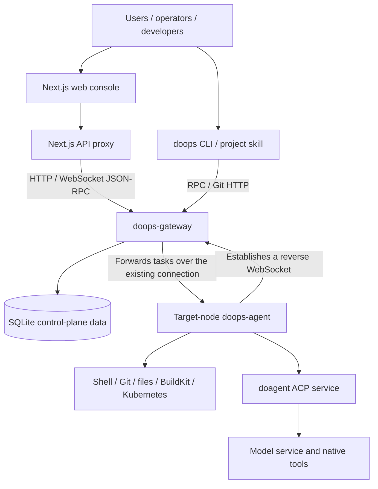

<p align="right"><a href="README.md">中文</a> | <b>English</b> | <a href="README.ru.md">Русский</a></p>

# DoOps

**An AI-assisted operations console, a unified gateway, and an agent execution channel for server and Kubernetes environments.**

DoOps connects the web console, the command-line tool, target-node agents, and AI operations capabilities: users reach authorized targets through a unified gateway, and the target agent runs commands, synchronizes code, handles files, or calls doagent for tasks that need analysis and multi-step collaboration.

The project follows a **gateway-first** architecture. Target agents establish reverse connections on their own, and day-to-day operations are authenticated, authorized, routed, and audited through the gateway, so a separate SSH session is not required for every operations task. Scenarios such as first-time bootstrap and gateway host maintenance may still use SSH.

**Core contributors: 孙勇 (Sun Yong), 高家祺 (Gao Jiaqi), 宋晨宇 (Song Chenyu).** See [Contributors](#contributors) for the exact attribution order.

[Project repository](https://github.com/symansun/doops) · [Issue tracker](https://github.com/symansun/doops/issues) · [Contribution guide](CONTRIBUTING.md) · [Security policy](SECURITY.md) · [License](LICENSE)

> **Before you start**: DoOps is operations software with real remote execution capability, not a strongly isolated sandbox for untrusted tasks. Before connecting it to production, configure TLS, least privilege, credential protection, backups, and deployment verification. Demo data on the pages does not represent results from a real environment; for current implementation boundaries, see [Known limitations](#limitations).

## Table of contents

- [Project scope and use cases](#overview)
- [Key capabilities](#features)
- [Architecture and responsibility boundaries](#architecture)
- [Technology stack and prerequisites](#requirements)
- [Quick start: web console](#web-quickstart)
- [Quick start: CLI and project skill](#cli-quickstart)
- [Self-hosted gateway and agent](#self-host)
- [Common operations](#usage)
- [Workload delivery and agent upgrade](#delivery)
- [Configuration, permissions, and security](#security)
- [Repository layout and documentation](#repository)
- [Development, build, and test](#development)
- [FAQ and known limitations](#limitations)
- [Contributing](#contributing)
- [Contributors](#contributors)
- [License](#license)

<a id="overview"></a>
## Project scope and use cases

DoOps focuses on the operations process from "connecting to a target" to "running a task and checking the result", not just a chat window.

It fits:

- **Multi-node day-to-day operations**: view online targets in one place, locate machines by `cluster/instance`, run checks, and collect node information.
- **Development and delivery collaboration**: synchronize code into a named session workspace, run builds or diagnostics, then pull the artifacts back.
- **AI-assisted troubleshooting**: hand questions that need exploration to doagent on the target node, and review execution events and results.
- **Kubernetes environment delivery**: drive releases through explicit `ask --apply` tasks, managed credentials, Helm assets, and execution evidence.
- **Team operations management**: manage users, tokens, target authorization, active operations, and audit records.
- **Controlled inspection and problem analysis**: run checks through `ask`, DoSql, DoWeb, and read-only Kubernetes entry points, and keep audit evidence.
- **Teaching and lab environments**: learn in a controlled environment how the gateway, agent, permissions, workspaces, and declarative deployment work together.

DoOps does not replace Kubernetes itself, and it is not a complete monitoring time-series database, ITSM platform, or vector knowledge base. AI planning, context, multi-agent collaboration, and tool calling are mainly handled by the external **doagent** engine; this repository provides the operations entry point, the control plane, and execution access.

<a id="features"></a>
## Key capabilities

| Capability | Description | Usage boundary |
| --- | --- | --- |
| Web console | Login, target selection, command and AI task interface, node information, audit, and administration entry points | Built on Next.js; some file, knowledge base, and model configuration pages still need contract alignment with the backend |
| Unified gateway | Agent registration, target routing, user authentication, scoped authorization, queueing, and concurrency control | SQLite stores control-plane state; public access requires a TLS reverse proxy |
| Agent reverse connection | Target nodes connect out to the gateway and identify execution targets by `cluster/instance` | Registration only declares cluster/instance and needs no registration token; user tokens are not used for agent registration |
| Deterministic command execution | `exec` runs commands and returns output; background tasks, logs, and status queries are supported | Not a persistent PTY; commands have the system privileges of the agent process |
| Snapshot and workspace synchronization | `push/pull` use COS snapshots by default; `--storage gateway` synchronizes the current workspace over Git HTTP | Pull and clean can overwrite or delete data; not a permanent backup mechanism |
| Small text file operations | `read/write` inside a named session | Use workspace-relative paths; use `push/pull` for large files and binaries |
| AI operations tasks | `ask` reaches doagent over ACP HTTP and SSE | Requires a reachable doagent service, model configuration, and the corresponding target permission |
| Natural-language workload delivery | `ask --apply` reads the image, chart, credentials, and acceptance criteria specified by the task, and executes through structured Helm tools | Workload delivery does not use environment registries, template-driven releases, or unreviewed YAML workflows |
| Credential resource management | Versioned credentials, authorization, bundles, and runtime materialization | Enabling encrypted storage requires a stable gateway key; it does not mean all logs are automatically redacted |
| Operations workbench | Integrates DoSql, DoWeb, Kubernetes observation, and controlled change entry points | Actual capability depends on the target agent, credential bindings, and the acceptance results of the corresponding skill |
| Agent upgrade entry point | Provides permission-checked upgrade notifications and lifecycle coordination | Kubernetes and Docker paths differ; do not assume Docker mode replaces the container automatically |

<a id="architecture"></a>
## Architecture and responsibility boundaries



### What each component is responsible for

- **Web console**: provides the browser entry point and reaches the gateway through a server-side proxy. Browser task results are received as an NDJSON stream; it is not a front end with static pages only.
- **doops CLI**: manages local target configuration, login credentials, sessions, commands, file synchronization, and delivery entry points.
- **doops-gateway**: provides the unified control plane for users and maintains target agent connections, authorization, and run records.
- **doops-agent**: runs in the managed environment and provides the actual command, workspace, and AI execution channel.
- **doagent**: provides the AI execution engine; it is a different component from `doops-agent`.
- **Operations skills**: describe the domain knowledge, execution constraints, and result contracts a task needs, and should not be equated with capabilities that have completed end-to-end acceptance.

### Three key concepts

| Concept | Meaning | Example |
| --- | --- | --- |
| Gateway | The unified gateway that users access | `https://gateway.example.com` |
| Target | A target node on the gateway, identified by cluster and instance together | `demo/node-1` |
| Session | The logical session and workspace used by one task or workflow | `inspect-001` |

A target answers "where to execute"; a session distinguishes "which run". The workspace lives under `/root/ws/<session>` by default, and **logical workspace isolation is not a system-level security sandbox**.

### Ports and protocols

| Component | Default port or path | Notes |
| --- | --- | --- |
| Next.js console | `3000` | Main interface at `/console` |
| Gateway | `42222` | Serves HTTP and WebSocket; TLS is usually terminated by a reverse proxy |
| User RPC | `/v1/rpc` | Authenticated with a user token, and a target must be specified |
| Agent registration | `/v1/agent/connect` | Entry point for an agent to connect out to the gateway |
| Git workspace synchronization | `/v1/git/<cluster>/<instance>/<session>.git` | The gateway authenticates and then forwards in reverse to the agent |
| Agent health endpoints | `/health/live`, `/health/ready`; `/ws` is retired | Should not be used as a standard public operations entry point |
| doagent ACP | `9000` | Internal AI execution service; avoid exposing it directly to the public internet |
| BuildKit | `/run/buildkit/buildkitd.sock` | Uses a Unix socket by default |

If the gateway and the agent run in the same host network, avoid default port conflicts.

<a id="requirements"></a>
## Technology stack and prerequisites

| Area | Technology or recommended version in this repository |
| --- | --- |
| Web | Next.js 16, React 19, TypeScript 6, Tailwind CSS 4 |
| Front-end toolchain | **Node.js 24 and pnpm 11.7.0**, consistent with CI |
| Backend and CLI | Go; the `go.mod` of all three modules declares **Go 1.24.0** |
| Control-plane storage | SQLite |
| Communication and synchronization | HTTP, WebSocket, JSON-RPC, Git HTTP |
| AI execution | doagent ACP HTTP and SSE |
| Container and cluster tooling | BuildKit, kubectl, Helm, configured per deployment scenario |

Prepare dependencies according to how you will use DoOps:

- **Just exploring the interface**: Node.js and pnpm are enough; demo mode does not need a backend.
- **Connecting to an existing environment**: you need the gateway address, a user token, a registered agent, and target authorization.
- **Installing a prebuilt CLI**: Linux/macOS amd64 and arm64 are supported; Bash, `shasum`, and common Unix tools are required. Code synchronization also needs Git.
- **Building from source**: you need Go, Node.js, pnpm, and Git.
- **Full agent container**: you also need reachable images, a gateway URL plus cluster/instance configuration, and model configuration; operating Kubernetes requires valid cluster credentials.

> The CLI ships artifacts for several client platforms, but that does not mean the agent image is also published for multiple architectures. The current agent image release process is based on `linux/amd64`.

<a id="web-quickstart"></a>
## Quick start: web console

### 1. Get the code and install dependencies

```bash
git clone https://github.com/symansun/doops.git
cd doops

corepack enable
corepack prepare pnpm@11.7.0 --activate
pnpm install --frozen-lockfile
```

If your Node.js distribution does not provide Corepack, install Corepack first, or install the matching pnpm version with your package manager.

### 2. Start the development server

```bash
pnpm dev
```

Visit:

- Home page: `http://localhost:3000/`
- Console: `http://localhost:3000/console`
- Simulated demo: `http://localhost:3000/console?demo=1`

**Demo mode uses local mock data, does not connect to real nodes, and cannot prove that a deployment or permission check succeeded.**

### 3. Connect to a real environment

In the console, enter the gateway address and sign in with an existing account password or user token. After selecting an online, authorized target, start operating.

Keep these distinctions in mind:

- Opening the web page does not create a gateway administrator automatically.
- Opening the web page does not install or register a target agent automatically.
- A reachable page does not mean the model, cluster permissions, or delivery capability are configured.
- The gateway address must be reachable from the **Next.js server process**. When the web app runs in a container, `localhost` points to that container itself.

The gateway address is entered in the interface and used by the server-side proxy; the current repository does not provide a root `.env.example`.

### 4. Build the web image

Run from the repository root:

```bash
docker build -f Dockerfile.web -t doops-console:local .

docker run --rm --name doops-console \
  -p 127.0.0.1:3000:3000 \
  doops-console:local
```

`Dockerfile.web` uses the Next.js standalone output and finally runs `node server.js`. The image contains **only the web console**; it does not include a full gateway, target agent, or model service. In production, place it behind a protected HTTPS entry point.

<a id="cli-quickstart"></a>
## Quick start: CLI and project skill

The following examples assume the administrator has provided the gateway URL and a login credential; target routes are discovered on the first login.

### 1. Installation

Run from the DoOps repository root; the business project directory given by `--project` must already exist:

```bash
# Recommended: provide only the gateway URL; the first login discovers targets
bash scripts/install.sh --version <release-tag> --project /absolute/path/to/existing-project \
  --target-gateway https://gateway.example.com
export PATH="$HOME/.local/bin:$PATH"
```

Main install locations:

| Item | Path |
| --- | --- |
| CLI | `~/.local/bin/doops` |
| Project skill | `<project>/.agent/skills/doops/SKILL.md` |
| Companion documentation | `<project>/.agent/skills/doops/docs/` |
| Default target configuration | `~/.agent/skills/doops/config.json` |
| Login cache | `~/.agent/skills/doops/auth.json` |

Public tag releases are built and published automatically by GitHub Actions ([release workflow](.github/workflows/release.yml));
installation uses GitHub Releases assets only:

```bash
bash scripts/install.sh --version <release-tag> --project /absolute/path/to/existing-project
```

The default source is `https://github.com/symansun/doops/releases/download`; `DOOPS_RELEASE_ASSET_BASE` accepts only
https (loopback addresses are for tests) and only serves to point the same sha256, `release=... commit=...` identity,
and CLI contract checks at a mirror.

Installation updates the DoOps skill and companion documentation in the target project. Back up those files first if you have modified them yourself. CLI configuration and caches contain sensitive information; file permission protection is not encrypted storage, so do not commit them to Git.

### 2. First login and target discovery

The following is a placeholder example; replace it with the information provided by your administrator:

```bash
# With no local route, use --gateway for the first login; password login or token stdin both work
doops login --gateway https://gateway.example.com
printf '%s' "$TOKEN" | doops login --gateway https://gateway.example.com --token-stdin

doops list
```

- The first login calls `GET /v1/targets` and writes the online targets visible to this account back to local routes; existing route names, aliases and descriptions are preserved.
- Operators do not need to know an Agent's `cluster/instance` in advance.
- Pre-create a route with `doops add --name <name> --gateway <url> --cluster <cluster> --instance <instance>` only when you must pin a route before login (or use a released CLI that does not support `--gateway`), then run `doops login --gateway <url>` (`--target <name>` still works as an alias).
- `doops add` stores routing only and never stores a target token; login state lives in the local auth cache.
- Do not leave real credentials in public logs, scripts or shared terminal history; password login uses interactive input or `--token-stdin`.

### 3. Check the connection

```bash
# A local route does not mean the target is online
doops list

# Targets actually online and visible in the gateway
doops targets --target <discovered-target>
doops -session diagnose targets --target <discovered-target> --admission

# Run a simple check on the specified target
doops -session inspect-001 exec --target <discovered-target> --cmd 'hostname'
```

To sign in again for an existing route, just run the command below; the password is read only as hidden terminal input (or imported with `--token-stdin`), and the CLI has no `--password` flag:

```bash
doops login --gateway <name|url> --username alice
```

<a id="self-host"></a>
## Self-hosted gateway and agent

Deploy in the order **control-plane initialization → agent registration → CLI/web connection → capability acceptance**, rather than exposing several ports first.

### 1. Build local binaries from source

Run from the repository root:

```bash
mkdir -p backend/bin

(cd backend/gateway && go build -o ../bin/doops-gateway .)
(cd backend/agent && go build -o ../bin/doops-agent ./cmd/agent)

bash backend/scripts/build-cli.sh
```

This compiles the gateway with the local Go toolchain. The repository's `build-gateway.sh` cross-compiles Linux/amd64 by default; macOS developers should not treat its default artifact as a local executable.

### 2. Initialize gateway identity and authorization

The commands below run on a trusted gateway host, and all of them must point to the **same persistent database**. The example creates an initial administrator; there is no default administrator password:

```bash
mkdir -p "$HOME/.local/share/doops-gateway"
DB="$HOME/.local/share/doops-gateway/gateway.db"

backend/bin/doops-gateway user create \
  -db "$DB" -name bootstrap-admin

backend/bin/doops-gateway grant \
  -db "$DB" -user bootstrap-admin \
  -admin

backend/bin/doops-gateway token create \
  -db "$DB" -user bootstrap-admin \
  -name initial-console -expires 24h
```

The user token is printed once; save it privately right away. The global `admin` in the example is only for the first trusted initialization — **do not use it as the default permission for ordinary users**. Agent reverse registration only declares `cluster/instance`; the gateway issues no registration credential for ordinary agents, and the current gateway CLI does not provide a general `agent-token create` command either.

Start the gateway:

```bash
backend/bin/doops-gateway serve -db "$DB" -port 42222
```

Note: the gateway listens on all network interfaces of the port, does not provide a separate `-listen` parameter, and does not configure TLS directly. Control access with firewalls, security groups, and a reverse proxy; do not expose the raw HTTP port to the public internet without protection.

When enabling features such as the encrypted credential store and private registry passwords, inject and persist `DOOPS_GATEWAY_SECRET_KEY` securely for the service. Do not rotate it randomly on every start; losing or changing the key affects decryption of existing ciphertext.

### 3. Register a target agent

Controlled local integration can use a bare binary. For example, when the gateway is on local port `42222`, give the agent a different port:

```bash
mkdir -p "$HOME/.local/share/doops-agent/workspaces"

DOOPS_ALLOW_INSECURE_GATEWAY=1 \
DOOPS_WORKSPACE_ROOT="$HOME/.local/share/doops-agent/workspaces" \
backend/bin/doops-agent \
  -listen 127.0.0.1 \
  -port 42223 \
  -gateway-url http://127.0.0.1:42222 \
  -cluster demo \
  -instance node-1
```

This is only an integration example for registration and the basic execution path; it does not install doagent, models, BuildKit, or Kubernetes tooling automatically. For real server registration, replace the address with a reachable HTTPS gateway and set the agent listen scope according to the target network.

Agent registration uses cluster and instance. An Agent that is already online stays connected across an upgrade. After that target connects once with an issued enrollment token, later registrations for it must present that token. Never use a user token or business credential as the registration credential. The Edge public tunnel (`-edge`, off by default and not in production) uses a separate `-edge-enroll-token`; see the [Edge tunnel design](backend/docs/design/DOOPS_EDGE_TUNNEL.md).

### 4. Full agent container and Kubernetes deployment

The current agent image separates a base layer from an application layer: the base layer provides runtime tools, and the application layer provides `doops-agent`, skills, documentation, and the entrypoint script. The build context is `backend/`.

A full deployment requires at least:

1. Accessible, trusted base and application images pinned to a version or digest.
2. The gateway URL, plus the cluster and instance bound to that target.
3. A `modelProvider` credential that has been created, verified, and promoted in the gateway; after the agent connects, the gateway materializes it to `/root/.agent/settings.json`.
4. The required volume mounts and persistence; a Kubernetes environment needs a valid `/root/.kube/config`.
5. Reviewed RBAC, network policy, node selection, image pull credentials, and resource configuration.

Recommended reading:

- [Natural-language workload delivery](backend/docs/NATURAL_LANGUAGE_DEPLOYMENT.md)
- [Build and deployment SOP](backend/docs/BUILD_DEPLOY_SOP.md)
- [Cluster installation guide](backend/docs/CLUSTER_INSTALL_GUIDE.md)
- [Agent Helm chart](backend/deploy/helm/doops-agent/)
- [Runtime version baseline](backend/runtime-versions.env)

The Helm chart's key defaults are empty and must be completed for the actual environment; installing it as-is does not give you a usable production agent. Namespace, address, permission, and certificate settings in historical manifests should also be reviewed item by item.

> The repository currently has no Docker Compose orchestration file. Do not treat `docker compose up -d` as an existing one-command full-stack startup, and do not assume the full agent image can be pulled without authentication in every environment.

<a id="usage"></a>
## Common operations

The examples below use the configured target `demo-node`. Specify the session explicitly for remote tasks, and use different names for different tasks.

### View nodes and run commands

```bash
doops -session inspect-001 info --target demo-node

doops -session inspect-001 exec \
  --target demo-node \
  --cmd 'hostname && uname -a && df -h'
```

`exec` is for known, explicit commands. Do not assume that the shell's current directory is automatically the session workspace; `cd` to the expected directory explicitly when needed.

### AI-assisted troubleshooting

```bash
doops -session diagnose-001 ask \
  --target demo-node \
  --msg '只读检查当前 Kubernetes 节点和异常 Pod，列出证据、可能原因与后续建议，不执行修复。'
```

Use it after valid model configuration and appropriate cluster permissions are in place. The prompt above asks for a read-only check of the current Kubernetes nodes and abnormal Pods, listing evidence, possible causes, and follow-up suggestions without performing repairs. "Read-only" in the prompt is a task requirement and does not replace system permission control; important operations still require reviewing results and real execution evidence.

Read-only database queries use `doops -session <s> sql --target <t> --mode query --request '<request>'`; change plans/applies plus `--credential` and `--verify` are covered in the [usage guide](backend/docs/DOOPS_USAGE_GUIDE.md).

### Synchronize code and pull results back

```bash
doops -session build-001 push --target demo-node --src .

doops -session build-001 exec \
  --target demo-node \
  --cmd 'ls -la /root/ws/build-001'

doops -session build-001 pull --storage gateway \
  --target demo-node \
  --dest ./doops-build-output
```

The example above uses the default container workspace; if `DOOPS_WORKSPACE_ROOT` is set, adjust the paths in the shell accordingly.

- Default COS push/pull store and download uploaded snapshots; the example explicitly uses `pull --storage gateway` to retrieve the current remote workspace. COS snapshots preserve Git executable bits; old snapshots without this metadata require a new push from the original source. See the [usage guide](backend/docs/DOOPS_USAGE_GUIDE.md#push) for protocol requirements.
- Push takes `.gitignore` and `.doopsignore` into account; make sure required deployment files are not excluded.
- Choose a dedicated output directory for pulled results; synchronizing into an existing target repository can overwrite local modifications, so do not point it at important uncommitted work.

### Small text read and write

```bash
doops -session build-001 write \
  --target demo-node \
  --path notes/status.txt \
  --content 'ready for review'

doops -session build-001 read \
  --target demo-node \
  --path notes/status.txt
```

`--path` is a **workspace-relative path** within that session; do not write it as `/root/ws/...`, and do not use `..` to escape the workspace. The default read limit is 1 MiB and the write limit is 16 MiB; use `push/pull` for binaries and large files.

### Long-running tasks

```bash
doops -session build-001 exec \
  --bg \
  --target demo-node \
  --cmd 'cd /root/ws/build-001 && bash ./scripts/build.sh'
```

Here `scripts/build.sh` is a build script provided by the business project itself, not a file this repository promises to contain. Long-running tasks use the native `--bg` mechanism; do not use plain `exec` with `&`, `nohup`, or similar tricks to escape lifecycle management. Registering a background task today is not the same as a durable task-orchestration guarantee across agent restarts.

### Cleanup and logout

```bash
# Deletes the specified remote workspace and its repositories; check --workspace and back up artifacts first
doops -session build-001 clean --target demo-node --workspace build-001

# Deletes the local login cache
doops logout --target demo-node
```

`clean` must specify target, session, and workspace together; what is actually deleted is determined by `--workspace`. `logout` only deletes the local login cache; it does not revoke the server-side token and does not delete the token stored in the target configuration.

More commands are in the [usage guide](backend/docs/DOOPS_USAGE_GUIDE.md). If paths or parameters in historical documentation conflict with the current code, follow the current examples in this README, the current CLI help, and the source code.

<a id="delivery"></a>
## Workload delivery and agent upgrade

DoOps converges ordinary business workload delivery onto `ask --apply`, and leaves agent self-upgrade to a separate controller or an external release script. Both paths require an explicit target, change scope, image facts, reason, and machine-checkable acceptance criteria; a model answer, a page hint, or a single health code cannot by itself prove that a delivery is complete.

### Ordinary business workload delivery

```bash
doops -session release-check ask \
  --target control-node \
  --apply \
  --credential <resource-name> \
  --msg '在 target control-node 发布服务 api；使用任务指定的 Chart、namespace 和已核验镜像 digest；原因：修复课堂权限；验收：Deployment、Pod、Service、Endpoint 与 /health 均通过。'
```

A delivery task must state the target, service scope, chart or repository assets, image version or its verifiable source, reason, and acceptance criteria. The prompt above asks the target agent to publish service `api` on target `control-node` using the chart, namespace, and verified image digest specified by the task, for the reason "fix classroom permissions", with acceptance that the Deployment, Pod, Service, Endpoints, and `/health` all pass. `--credential` carries only a managed credential resource name and never passes ciphertext in arguments, prompts, logs, or workspaces. The target agent performs the delivery through the structured `mcp_doops_helm upgrade-install` tool and returns dry-run, actual change, and final resource state evidence.

Ordinary delivery does not use environment registries, template-driven releases, or prompt-derived deployment scope, and does not require running `push` first or reading the operator machine's kubeconfig. For the detailed contract, see [Natural-language workload delivery](backend/docs/NATURAL_LANGUAGE_DEPLOYMENT.md) and [Credential resources](backend/docs/CREDENTIAL_RESOURCES.md).

### Standard Helm agent upgrade

Helm agents that already have a self-upgrade controller use `doops upgrade`; the upgrade Job runs inside the target cluster, and the agent process does not replace itself directly:

```bash
doops -session agent-upgrade upgrade \
  --target <configured-target> \
  --image <repository>@sha256:<verified-ci-digest>

# Previews parameters only; it does not prove that the controller, mounts, or permissions work
doops -session agent-upgrade upgrade \
  --target <configured-target> \
  --image <repository>@sha256:<verified-ci-digest> \
  --dry-run
```

`doops upgrade` only handles image replacement or rollback for a standard Helm agent; it does not modify business workloads, the proxy allowlist, or other Helm configuration. Before and after the upgrade, verify the CLI and agent release commit, Pod Ready, gateway reconnection, and the actual image digest.

### First-time installation and non-standard agents

Choose the entry point by runtime form; they do not downgrade to each other automatically:

| Scenario | Entry point | Key prerequisites |
| --- | --- | --- |
| Empty Ubuntu/Debian server | `backend/scripts/bootstrap-host-agent.sh` | root, an explicit release version, a unique cluster/instance; the script installs Docker/Compose and verifies the gateway tunnel |
| First K8s installation or an explicit Helm configuration change | `backend/scripts/release-managed-agent.sh` | External controller kubeconfig, Helm, kubectl, and complete values |
| Old Helm agent or a broken command channel | `backend/scripts/release-managed-agent.sh` | Complete dry-run, backup, and takeover acceptance first |
| Existing standalone Docker agent | `backend/scripts/release-host-agent.sh` | External DockerHost control, explicit SSH port, immutable image, and host key verification |
| Gateway control plane | `backend/scripts/deploy-gateway.sh --no-build` | Uses a verified CI Release Asset; does not publish itself through an agent target |

See the [build and deployment SOP](backend/docs/BUILD_DEPLOY_SOP.md) and the [cluster installation guide](backend/docs/CLUSTER_INSTALL_GUIDE.md) for detailed backup, rollback, image provenance, and acceptance steps.

<a id="security"></a>
## Configuration, permissions, and security

### Common configuration

| Configuration or parameter | Purpose | Notes |
| --- | --- | --- |
| `DOOPS_CONFIG` | Overrides the default CLI configuration file path | Not the gateway configuration for the web console |
| `-gateway-url`, `-cluster`, `-instance` | Agent registration location and identity | Pass them explicitly for a bare binary; do not assume that same-named environment variables in Helm take effect automatically |
| `DOOPS_AGENT_ENROLL_TOKEN` | Optional Agent enrollment token | Prefer the environment variable (Helm: `gateway.enrollmentTokenSecret`) over the `-enroll-token` flag. It becomes required only after this target has connected with it; see the [Gateway tunnel](backend/docs/DOOPS_GATEWAY_TUNNEL.md) for migration and recovery; do not use a user token |
| `DOOPS_CONSOLE_ORIGIN` | Optional public origin of the web console, e.g. `https://doops.example.com` | Console mutating requests require a same-origin `Origin`. By default it is derived from `Host`/`X-Forwarded-Host` and `X-Forwarded-Proto`; set it when the reverse proxy does not pass those headers |
| `-edge`, `-edge-enroll-token` | Edge public tunnel switch and its enrollment credential | Off by default and not in production; this is separate from the agent enrollment token, see the [Edge tunnel design](backend/docs/design/DOOPS_EDGE_TUNNEL.md) |
| `DOOPS_WORKSPACE_ROOT` | Root directory for agent session workspaces | Defaults to `/root/ws`; adjust related script paths after changing it |
| `DOOPS_GATEWAY_SECRET_KEY` | Key material for gateway credential encryption | Inject securely, persist, and back it up when credential features are enabled |
| `DO_AGENT_PORT`, `DO_AGENT_URL` | Agent internal ACP service address | Default port `9000`, address `http://127.0.0.1:9000`; keep them consistent when customizing |
| `DOOPS_ALLOWED_WS_ORIGINS` | WebSocket Origin restrictions | Set it together with the real deployment domain |
| `DOOPS_ALLOW_INSECURE_GATEWAY` | Development exception that allows non-loopback HTTP/WS | Not a production default |

### Permission and credential principles

1. **Distinguish user tokens from the agent registration identity**: the former operates the gateway; an ordinary agent registers in reverse with only its `cluster/instance` and needs no token. They are not interchangeable passwords.
2. **Make the authorization scope and actions explicit**: do not use `admin`, wildcards, or grants without actions as a template for ordinary users.
3. **Review default authorization on the management side**: different creation entry points may behave differently; do not assume that every new user naturally satisfies least privilege.
4. **Limit high-privilege capabilities**: `exec`, cluster credentials, host directories, and runtime sockets can all have a wide impact.
5. **Do not treat directory isolation as security isolation**: the current Helm chart includes privileged container settings and must be deployed for trusted operators in a controlled environment.
6. **Limit the web proxy's network egress**: Next.js makes server-side requests based on the gateway address in the request, so a public deployment needs additional ingress control, target scoping, or egress constraints.
7. **Protect audit and model data**: commands, prompts, results, and configuration can contain sensitive information; redact before sharing, and do not send production secrets to untrusted model endpoints.
8. **Back up state**: persist the gateway database and encryption keys; export important artifacts promptly, and note that agent workspaces are subject to automatic cleanup.

For security issues, contact the maintainers privately as described in [SECURITY.md](SECURITY.md); do not attach real credentials, production addresses, or exploitable vulnerability details to public issues.

<a id="repository"></a>
## Repository layout and documentation

```text
doops/
├── app/                         # Next.js pages and API proxy
├── components/                  # Console and administration UI components
├── lib/                         # Clients, protocol types, and front-end helpers
├── scripts/install.sh           # Root install entry point, forwarded to backend scripts
├── backend/
│   ├── agent/                   # Agent, control-plane implementation, ACP access, and dispatch
│   │   ├── cmd/agent/           # doops-agent entry point
│   │   ├── internal/server/     # Gateway/agent core service implementation
│   │   └── skills/              # Agent-side operations skills
│   ├── gateway/                 # Standalone doops-gateway build entry point
│   ├── cli/                       # Go CLI source and build entry point
│   ├── deploy/                  # Helm, environment, and deployment workflow configuration
│   ├── scripts/                 # Install, build, and maintenance scripts
│   ├── docs/                    # Protocol, usage, and deployment documentation
│   ├── test/                    # Python contract and deployment checks
│   ├── Dockerfile              # Agent application image
│   ├── Dockerfile.base.light   # Agent lightweight base image
│   └── runtime-versions.env    # Runtime versions and image digests for validation
├── docs/                        # Internal design records (product docs live in backend/docs)
├── Dockerfile.web              # Next.js production image
├── .github/workflows/ci.yml    # GitHub CI
├── .github/workflows/release.yml # GitHub tag release: build, verify, publish, re-verify
├── CONTRIBUTING.md
└── SECURITY.md
```

| Document | Purpose |
| --- | --- |
| [Documentation index](backend/docs/README.md) | Entry point, status, and authority for all product docs |
| [CLI usage guide](backend/docs/DOOPS_USAGE_GUIDE.md) | Command selection, sessions, synchronization, and task management |
| [API integration guide](backend/docs/DOOPS_API_GUIDE.md) | Login, targets, RPC, progress streaming, and audit |
| [Gateway tunnel and execution lifecycle](backend/docs/DOOPS_GATEWAY_TUNNEL.md) | Agent reverse connection, execution lifecycle, and concurrency boundaries |
| [Skill integration guide](backend/docs/SKILL_INTEGRATION_GUIDE.md) | Integrating project skills |
| [Model standards](backend/docs/MODEL_STANDARDS.md) | Model configuration and usage standards |
| [Build and deployment SOP](backend/docs/BUILD_DEPLOY_SOP.md) | Build, image, and deployment process |
| [Cluster installation guide](backend/docs/CLUSTER_INSTALL_GUIDE.md) | Cluster onboarding reference |
| [Natural-language workload delivery](backend/docs/NATURAL_LANGUAGE_DEPLOYMENT.md) | Delivery responsibility boundaries and acceptance principles |

Some historical backend documents use `backend/` as the current directory, so `scripts/...` in their examples cannot necessarily be run directly from the repository root. The web application is at the repository root; run examples from the working directory each document states.

<a id="development"></a>
## Development, build, and test

Run the same checks as GitHub CI from the repository root:

```bash
(cd backend/agent && go test ./...)
(cd backend/gateway && go test ./...)
(cd backend/cli && go test ./...)

pnpm exec tsc --noEmit
pnpm build
```

The repository root has no Go module, so do not merge the three Go checks into a single `go test ./...` run at the root. For the front end you can also run `pnpm test:gateway-policy` and `pnpm test:console`; `pnpm build` is the production build.

GitHub CI also includes Python contract checks. After preparing Python 3, pytest, PyYAML, Helm, and the related test dependencies, run:

```bash
python3 -m pytest backend/test -q
```

Some Python checks execute the CLI or tools rather than only scanning text; when they fail, check the environment prerequisites and the specific assertions.

When a maintainer needs to rebuild all CLI artifacts:

```bash
bash backend/scripts/build-cli.sh --all
```

Also check before committing:

- Paths and parameters in documentation match the current code.
- Protocol changes in the front end, gateway, agent, and CLI have corresponding tests.
- `.next/`, `node_modules/`, test caches, runtime databases, and local workspaces are not committed.
- Tokens, API keys, kubeconfigs, private keys, registry passwords, and internal environment information are not committed.
- Release-related changes have checkable verification results, not just a description of the generation process.

<a id="limitations"></a>
## FAQ and known limitations

### The page opens, so why can't I see any nodes?

The web page does not deploy target agents automatically. Check the gateway address, user permissions, and whether the agent registered with a matching cluster/instance. `doops list` only shows local configuration; for online status, check `doops targets`.

### Why does `exec` work but `ask` not?

Deterministic execution and AI execution have different dependencies. Check whether doagent ACP is available, whether a `modelProvider` credential is bound and promoted on the target, and whether the model service is reachable. Model settings are materialized only after the agent connects to the gateway; a bare binary does not carry model credentials automatically either.

### Why does file read/write report an unsafe path?

The current backend file tools require a path relative to the session. Use `notes/status.txt`, not `/root/ws/<session>/notes/status.txt`. Some historical examples and front-end modules still use the old path convention and need to be aligned.

### Does a 200 from the health check mean every capability is healthy?

No. `/health/live` only shows that the agent HTTP process is alive; `/health/ready` shows that reverse registration with the gateway is confirmed. Neither can replace model calls, image builds, cluster permissions, and real deployment acceptance.

### Are all pages and all delivery formats supported now?

The source is still being completed, and these boundaries matter:

- File, knowledge base, model configuration, and related AI pages still have adaptation work for backend path and parameter contracts; "the page exists" should not be taken as the whole chain being available.
- The knowledge base interface mainly manages Markdown files; it is not an implemented vector search or RAG service.
- Credential preflight and execution for workload delivery follow `ask --apply`, `NATURAL_LANGUAGE_DEPLOYMENT.md`, and `CREDENTIAL_RESOURCES.md`; do not substitute a retired release entry point for this flow.
- The Docker branch of agent upgrade is not the same as completing container replacement automatically; the actual replacement needs an external management mechanism.
- Workspaces may be cleaned up automatically, and background tasks do not provide an unconditional persistence guarantee across restarts.
- The current agent image, Helm defaults, and historical environment manifests do not amount to a promise of "one-command deployment on every platform".

Mock cases and displayed metrics on the pages should not be interpreted as independently verified performance, efficiency, or cost benefits. Whether DoOps suits production needs acceptance in your own network, permissions, runtime, and workflows.

<a id="contributing"></a>
## Contributing

Issues, pull requests, documentation improvements, and usage feedback are all welcome.

- [Report a bug](https://github.com/symansun/doops/issues/new?template=bug_report.yml): provide reproduction steps, the version or commit, expected and actual behavior, and redacted logs.
- [Suggest a feature](https://github.com/symansun/doops/issues/new?template=feature_request.yml): describe the use case, current limitations, and the outcome you want.
- Run the relevant checks before submitting a PR; protocol or permission changes should come with tests and documentation.
- For revisions to deployment documentation, state the working directory, required configuration, permission boundaries, and whether they were actually verified.
- Do not include real credentials or production-sensitive information in issues, PRs, screenshots, or examples.

See [CONTRIBUTING.md](CONTRIBUTING.md) and the [PR template](.github/pull_request_template.md) for details.

<a id="contributors"></a>
## Contributors

The core contributors of this project are attributed in the following order:

| Order | Contributor | Attribution |
| --- | --- | --- |
| 1 | **孙勇 (Sun Yong)** | First contributor |
| 2 | **高家祺 (Gao Jiaqi)** | Second contributor |
| 3 | **宋晨宇 (Song Chenyu)** | Third contributor |

Thanks to everyone who contributes to the project through code, design, tests, documentation, and usage feedback.

<a id="license"></a>
## License

This project is released under the [MIT License](LICENSE). When you modify, redistribute, or integrate it commercially, keep the license text and copyright notice.

Third-party dependencies and runtime components remain subject to their own licenses; refer to the license files shipped with each component.
