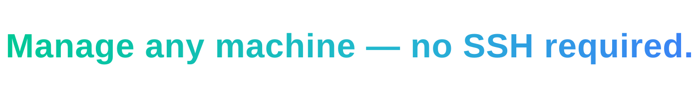
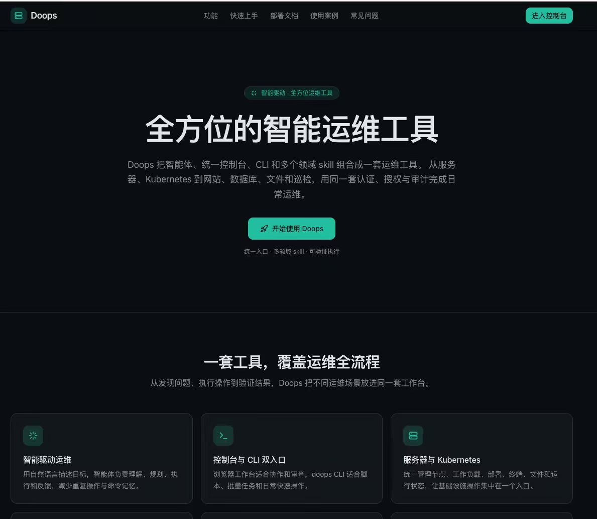
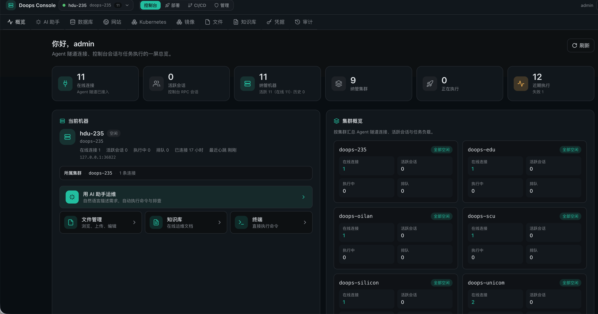
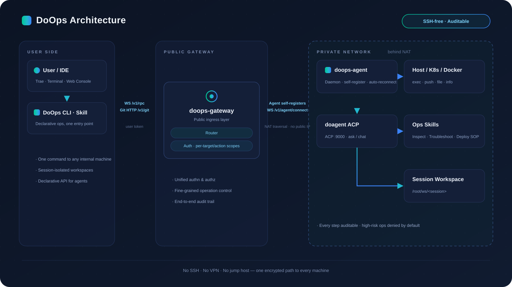

<p align="right"><a href="README.md">中文</a> | <b>English</b> | <a href="README.ru.md">Русский</a></p>

# DoOps

<p align="center">
  
</p>

> Original DoOps code is available under the [MIT License](LICENSE). Third-party components retain their own licenses; see [Third-party components](THIRD_PARTY_NOTICES.md).

**Core contributors: 孙勇 (Sun Yong), 高家祺 (Gao Jiaqi), 宋晨宇 (Song Chenyu).** See [Contributors](#contributors) for the attribution order.

**Still managing SSH ports, jump hosts, key distribution, NAT, and private-network isolation?** `doops` provides one entry point:

- **Reach private-network machines with one command**: the agent establishes an outbound, persistent connection to the public gateway; no public IP, VPN, jump host, or bastion is required on the target.
- **Reduce SSH administration**: daily operations share the gateway connection instead of separate SSH users, ports, passwords, and key inventories.
- **Built for agents and automation**: the CLI, console, and domain skills use the same auditable execution path for troubleshooting, inspection, deployment, and file synchronization.
- **Central authentication and authorization**: grants apply to the exact `cluster/instance`, with execution auditing and agent command guardrails.

## UI Preview





DoOps combines agents, a console, a CLI, and domain skills for servers, Kubernetes, websites, databases, files, and inspections under the same authentication, authorization, and audit model.

## Repository Layout

| Path | Description |
| --- | --- |
| `app/`, `components/`, `lib/` | Next.js console, API proxies, and gateway session adapters |
| `backend/agent/` | Shared agent/gateway runtime and DoSql/DoWeb skills |
| `backend/gateway/` | Gateway Go module entry point |
| `backend/cli/` | DoOps CLI Go module |
| `backend/skills/` | Operator skill installed into user projects |
| `backend/docs/` | API, permissions, installation, deployment, and operations guides |
| `backend/scripts/`, `backend/test/` | Build/release scripts and contract checks |
| `backend/deploy/helm/` | Agent Helm chart, without live environment inventories |
| `docs/` | Public guides, architecture diagrams, and maintenance policy |
| `vendor/agent-ui/` | Locally included UI dependency with its original license |

The complete web console and backend are maintained here. The former root directories `agent/`, `gateway/`, and `skills/doops-cli/` have moved to the paths above. GitHub [symansun/doops](https://github.com/symansun/doops) is the sole public home for source, Issues, Pull Requests, Actions, and Releases. Releases are built from reviewed commits on `main`; local uncommitted work is excluded.

## Architecture

<p align="center">
  
</p>

Clients authenticate through the gateway, which authorizes exact targets and audits operations. Agents register with the gateway and perform controlled command, file, database, website, and Kubernetes operations. The gateway implementation lives in [`backend/agent/internal/server/`](backend/agent/internal/server/README.md); the console accesses the same control plane through this repository's API adapters.

- [Backend usage and architecture](backend/README.md)
- [API and protocol](backend/docs/DOOPS_API_GUIDE.md)
- [Installation guide](backend/docs/CLUSTER_INSTALL_GUIDE.md)
- [Agent UI integration](docs/agent-ui-integration.md)
- [Managed credential lifecycle](backend/docs/CREDENTIAL_RESOURCES.md)
- [Release and rollback](backend/docs/BUILD_DEPLOY_SOP.md)

## Database and Website Operations

DoSql and DoWeb share gateway login, exact target grants, and auditing. Database requests use `query`, `plan`, or `discover`; mutations require explicit `apply`:

```bash
doops -session db-check sql --target <target> --mode query --request 'Count rows in orders'
doops -session db-plan sql --target <target> --mode plan --request 'Plan an external_id column for orders'
doops -session db-discover sql --target <target> --mode discover --request 'List database workloads'
doops -session db-change sql --target <target> --mode apply --file change.sql --verify 'SELECT external_id FROM orders WHERE 1 = 0'
```

Credentials are resolved from managed resources bound to the target. Keep passwords, tokens, and credential-bearing connection strings out of commands, prompts, logs, and documentation. See the [usage guide](backend/docs/DOOPS_USAGE_GUIDE.md) and [credential resources](backend/docs/CREDENTIAL_RESOURCES.md).

## Development and Verification

```bash
git clone https://github.com/symansun/doops.git
cd doops
(cd backend/agent && go test ./...)
(cd backend/gateway && go test ./...)
(cd backend/cli && go test ./...)
python3 -m pytest backend/test -q
corepack pnpm@11.7.0 install --frozen-lockfile
corepack pnpm@11.7.0 test:gateway-policy
corepack pnpm@11.7.0 test:console
corepack pnpm@11.7.0 exec tsc --noEmit
corepack pnpm@11.7.0 build
```

Use `corepack pnpm@11.7.0 dev` for console development. Production deployments must set `DOOPS_CONSOLE_ALLOWED_GATEWAYS` to the actual gateway origins; demo mode is available only in development. Browser acceptance covers login, authorized targets, errors, empty states, and desktop/mobile layouts.

## Installation and Releases

Versioned CLI/gateway binaries are distributed through [GitHub Releases](https://github.com/symansun/doops/releases). Select an explicitly published tag; the installer downloads `doops-<os>-<arch>` and `checksums.txt`, verifies the checksum and CLI release/commit/contract identity, and obtains the skill and documentation from the same GitHub commit archive. No locally fetched release commit is required.

```bash
curl --fail --location --output /tmp/doops-install.sh \
  https://raw.githubusercontent.com/symansun/doops/main/scripts/install.sh
bash /tmp/doops-install.sh --version <release-tag> --project /absolute/path/to/project
```

Replace `<release-tag>` with the published version you selected. No clone is required.
From a clone, `bash scripts/install.sh` accepts the same arguments. To upgrade the CLI
and skill, rerun this command with the next published tag. For Agent upgrades, follow
the [installation and upgrade guide](backend/docs/CLUSTER_INSTALL_GUIDE.md).

The supported CLI path is `~/.local/bin/doops`. Before replacing the installation, the installer rejects missing release sources, failed checksums, and invalid configuration. It does not mix in unpublished workspace files.

Container release repositories are `ghcr.io/symansun/doops-agent`, `ghcr.io/symansun/doops-web`, and `ghcr.io/symansun/doops-base-light`. Deployment requires the selected image's verified digest. The agent image excludes the gateway binary; runtime inputs are recorded in [`backend/runtime-versions.env`](backend/runtime-versions.env).

The release workflow creates a draft, uploads and reads back all required assets, and only then makes the release public. Use the selected release's asset list and Actions run as its publication and verification record. Service deployment has separate verification for the authorized target.

Remote operations select a target and carry a session. After installation or upgrade, use an authorized account to verify:

```bash
doops -session acceptance login --target <target>
doops -session acceptance targets --target <target>
doops -session acceptance exec --target <target> --cmd 'hostname'
```

Deployments, database writes, and upgrades follow their respective authorization, verification, and rollback guides.

## Agent Command Guardrails

Before agent `exec`, the [dispatcher](backend/agent/internal/dispatcher/dispatcher.go) normalizes whitespace and letter case, then evaluates ten named built-in rules. A match refuses execution and records `blocked=1` and the rule ID in `.doops-audit-log`:

| Rule ID | Command pattern |
| --- | --- |
| `disk.rm_root` | Recursive deletion of root/system directories |
| `disk.dd_device` | `dd` writes to block devices |
| `disk.mkfs` | Filesystem formatting |
| `disk.partition` | Partitioning and disk wiping tools |
| `sys.shutdown` | Shutdown and reboot |
| `sys.fork_bomb` | Fork bombs |
| `perm.chmod_root` | Recursive permission changes on root |
| `fs.overwrite_key_files` | Overwriting critical `/etc` files |
| `net.pipe_shell` | Downloading scripts directly into an interpreter |
| `proc.kill_all` | Killing all processes |

Agent environment variables control these rules: `DOOPS_BLOCK_EXTRA` appends semicolon-separated regexes, `DOOPS_BLOCK_DISABLE` disables comma-separated rule IDs, and `DOOPS_BLOCK_OFF=1` disables guardrails for emergencies. Regex guardrails cannot cover every encoded or indirect command; target authorization and operating discipline still apply.

## Contributors

Core contributors, in attribution order:

1. 孙勇 (Sun Yong)
2. 高家祺 (Gao Jiaqi)
3. 宋晨宇 (Song Chenyu)

Contributions through Issues and Pull Requests are welcome.

## License

Original DoOps code uses the [MIT License](LICENSE). The included `@agent-cloud/agent-ui` component retains its [Business Source License 1.1](vendor/agent-ui/LICENSE), authorship, and use restrictions. See [Third-party components](THIRD_PARTY_NOTICES.md) for the dependency notices and local adjustments.
