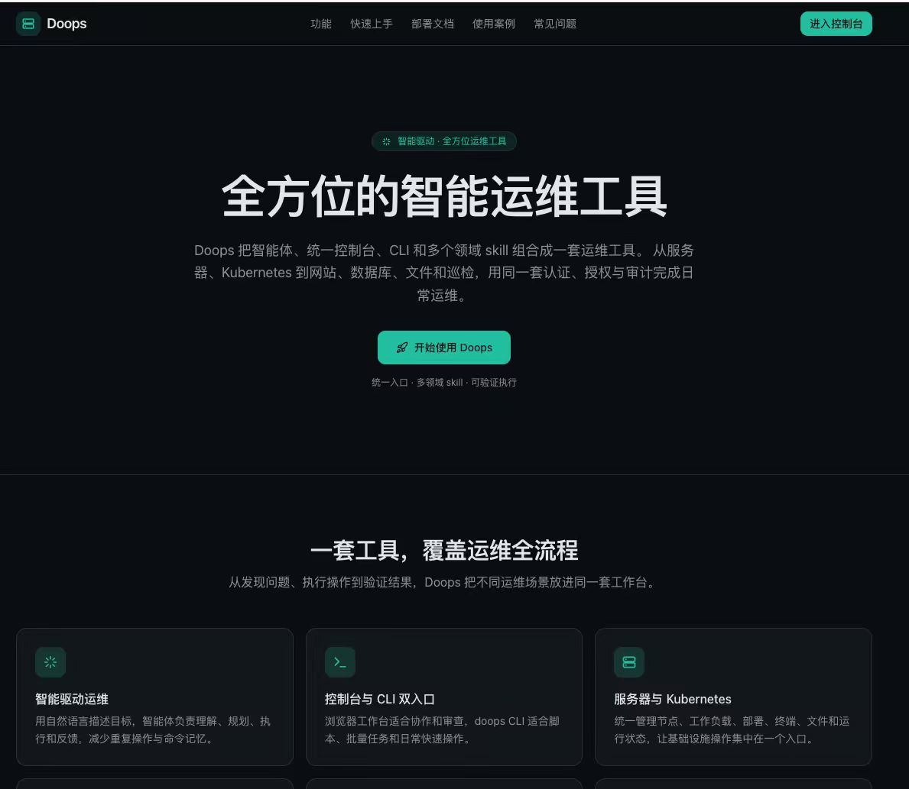
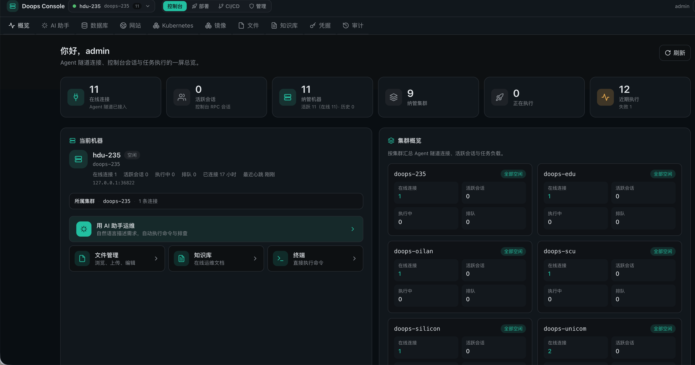
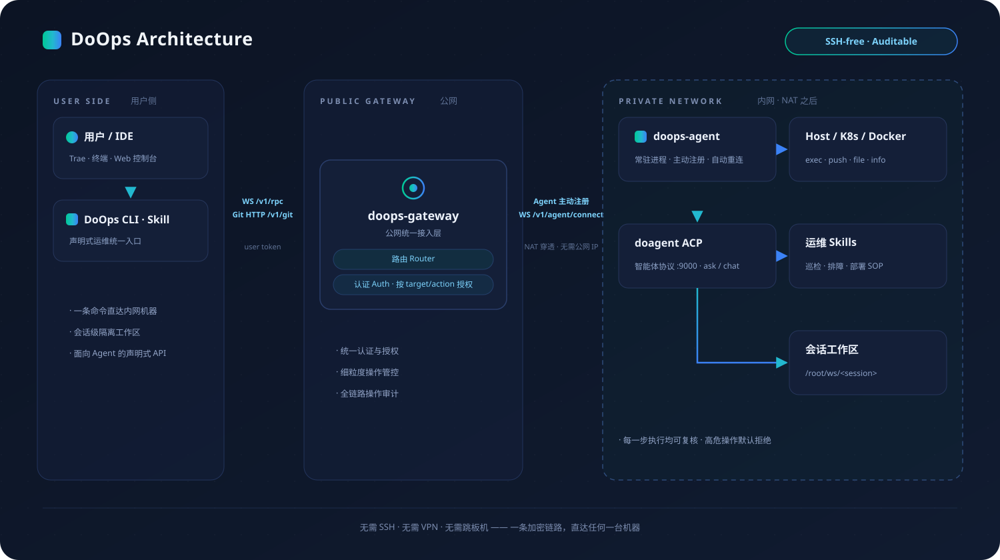

# DoOps

<p align="center">
  
</p>

> 本项目以 [MIT License](LICENSE) 开源。

**核心贡献者：孙勇、高家祺、宋晨宇。** 具体署名顺序见[贡献者](#contributors)。

**还在为 SSH 端口、跳板机、密钥分发、NAT 和内网隔离买单？** `doops` 把这些统统拿掉：

- **一条命令直达内网机器**：agent 主动向公网 gateway 建立长连接，无需公网 IP、VPN、跳板机或堡垒机
- **零 SSH 资产负担**：不用再维护 SSH 用户、端口、密码和密钥清单，断网重连、内网隔离都不再是障碍
- **为 Agent 和自动化而生**：CLI、控制台与多领域 skill 共用同一条可审计执行链路，AI 可以安全地排障、巡检、部署，而不是靠人肉复制粘贴
- **安全默认收口**：统一认证、按 target/action 授权、全链路审计，高危操作默认拒绝

排障、巡检、部署、文件同步——所有远程操作收进同一个入口，每一步都有记录，每一次执行都可复核。

## 界面预览





DoOps 统一入口：把智能体、控制台、CLI 和多领域 skill 组合成一套运维工具，覆盖服务器、Kubernetes、网站、数据库、文件与巡检等场景，并用同一套认证、授权与审计完成日常运维。

## 目录结构

| 路径 | 说明 |
| :--- | :--- |
| `agent/` | 边缘执行端 `doops-agent` 源码（Go） |
| `gateway/` | 公网控制面 `doops-gateway` 源码（Go） |
| `skills/` | doops CLI 源码、预构建二进制与运维 skill |
| `scripts/` | 安装、构建与发布脚本 |
| `docs/` | 协议、API、部署与运维文档 |
| `test/` | 测试与验收用例 |
| `Dockerfile*` | 基础镜像与轻更新镜像构建入口 |

本仓库不包含、也不发布 `do-agent` 二进制；运行 `doops ask` 需要你自行提供包含 `do-agent` 的镜像（见下文“基础镜像”）。

## 架构图

<p align="center">
  
</p>

系统里有两条正交维度：

- 连接模式：CLI/skill 连接 gateway，内网 agent 主动注册 gateway
- 执行模式：快路径 `exec/read/write/push/pull/info/check/clean`，慢路径 `ask` / 后续 `chat`

组件分工：

- 客户端：`doops` CLI + doops skill
- 公网控制面：`gateway/` 构建 `doops-gateway`，负责 RBAC、审计、排队和内网 agent 路由
- 边缘执行端：`agent/` 构建 `doops-agent`，负责目标机器上的 exec、push/pull、文件和 AI 任务
- 运行安全边界：`doops-agent` 默认只启动 `doops-agent`、`do-agent`、`buildkitd`；默认不启动 SSH，不启动 WebIDE
- 连接方式：CLI/skill 访问 gateway `42222`，gateway 通过已建立的 agent WebSocket 进入内网 agent
- 鉴权方式：用户连接 gateway 使用 gateway user token；agent 注册 gateway 不需要 token，只需要 `gateway-url`、`cluster` 和 `instance`
- 代码同步：gateway 使用 Git HTTP；gateway 只通过已建立的 agent WebSocket 反向隧道透传 Git 请求，不再使用 tar 分块上传作为 `push/pull` 路径
- 镜像构建：统一使用 `buildctl + buildkitd`

## Target 命名约定

`cluster/instance` 是 gateway 的路由键，名称由你自己的部署定义。示例：

- `prod / master-1`
- `staging / worker-1`
- `edge / gpu-node-1`

同一 `cluster/instance` 在任一时刻只应有一个 agent 在线；重复注册会替换旧连接。

## 协议与端点

- CLI 到 gateway 使用 `WS /v1/rpc?cluster=<cluster>&instance=<instance>`
- 内网 agent 到 gateway 使用 `WS /v1/agent/connect?cluster=<cluster>&instance=<instance>`
- 代码同步使用 `Git HTTP /v1/git/<cluster>/<instance>/<session>.git`
- 健康检查使用 `GET /health`
- OpenAI 兼容模型服务地址通过 `API_BASE_URL` 配置（默认示例为 `https://llm.example.com/v1`）

## 基础镜像与构建

agent 镜像分两层：

| 镜像 | Dockerfile | 内容 | 变化频率 |
| :--- | :--- | :--- | :--- |
| 基础镜像 | `Dockerfile.base` / `Dockerfile.base.light` | sandbox、do-agent、BuildKit、系统工具 | 低 |
| 轻更新镜像 | `Dockerfile` / `agent/Dockerfile` | `doops-agent`、skills、docs、entrypoint | 高 |

构建前必须准备：

- `DO_AGENT_IMAGE`：包含 `/usr/local/bin/do-agent` 的镜像。本仓库不附带 `do-agent`，请自行提供。
- `DOOPS_AGENT_BASE_IMAGE`：基础镜像 tag，默认 `doops-base:latest`。

```bash
# 1. 构建基础镜像（推荐 base-light，纯净 agent 运行时）
docker build -f Dockerfile.base.light \
  --build-arg DO_AGENT_IMAGE=<your-doagent-image> \
  -t doops-base:latest .

# 2. 构建轻更新镜像
docker build \
  --build-arg DOOPS_AGENT_BASE_IMAGE=doops-base:latest \
  -t <your-registry>/doops:dev .
```

日常升级只需替换轻更新镜像；只有 sandbox、do-agent、BuildKit 或系统包变化时才重建基础镜像。

## Gateway 代码入口

`doops-gateway` 是一等组件，源码入口在仓库一级目录：

```bash
bash scripts/build-gateway.sh
./bin/doops-gateway serve -db /var/lib/doops-gateway/gateway.db -port 42222
```

兼容入口 `agent/cmd/gateway` 仍保留，但只作为旧构建路径 wrapper；新文档和新部署应使用 `gateway/`。

面向外部系统的 API 使用指南见 [docs/DOOPS_API_GUIDE.md](docs/DOOPS_API_GUIDE.md)，包括登录、目标查询、WebSocket JSON-RPC、自然语言部署、进度流和审计查询。

## 运行验证

部署后按下面顺序验证链路：

```bash
doops list
doops targets --target <gateway-target>
doops -session smoke exec --target <gateway-target> --cmd 'hostname'
doops -session smoke push --target <gateway-target> --src <small-dir>
doops -session smoke ask --target <gateway-target> --msg '<read-only task>'
```

`targets` 能看到 `cluster/instance` 在线，才说明 agent 已注册 gateway；`ask` 失败时先检查 `doagent-config` 里的 `settings.json` 是否配置了有效 API Key 与 `API_BASE_URL`。

## 固定路径

- CLI：`~/.local/bin/doops`
- Skill 源码权威位置：`skills/SKILL.md`
- Skill 安装目标：`<project>/.agent/skills/doops/SKILL.md`
- CLI 唯一默认配置：`~/.agent/skills/doops/config.json`
- CLI token 缓存：`~/.agent/skills/doops/auth.json`
- 预构建 CLI：`skills/doops-cli/bin/doops-<os>-<arch>`
- Agent local token：服务端 `/root/.doops/agent-token`，只用于遗留直连或本机 `/ws` 保护，不用于 gateway 注册

`~/.config/doops/config.json`、`~/.doops/auth.json` 和项目 `.doops/` 是旧路径或运行痕迹，不能作为当前配置依据。`DOOPS_CONFIG=/path/to/config.json` 只用于测试和应急显式覆盖。

## 安装模型先看这里

DoOps 有两件事容易混淆，文档里必须先分开看：

1. **agent 部署形态**：`doops-agent` 在目标机器上怎么跑起来。
2. **连接模式**：CLI/skill 怎么连到这个 agent。

### Agent 部署形态

| 形态 | 怎么识别 | 适用场景 | 是否容器化 |
| :--- | :--- | :--- | :--- |
| K8s/DaemonSet | `kubectl get pod -A -l app=doops-agent` 能看到 Pod | K8s/K3s 集群节点，推荐标准安装 | 是 |
| Docker/nerdctl 容器 | `docker ps` 或 `nerdctl ps` 里有名为 `doops-agent` 的容器 | 单机或没有 DaemonSet 的节点，推荐标准安装 | 是 |
| 裸二进制/systemd | `ps -ef | grep doops-agent` 显示 `/usr/local/bin/doops-agent -port ...`，但没有 Pod/容器 | 临时自举、旧节点兼容 | 否 |

例如某台机器上看到：

```text
/usr/local/bin/doops-agent -port 42222 ...
```

同时 `kubectl get pod -A -l app=doops-agent` 没有 Pod，`docker ps` 也没有 `doops-agent` 容器，就说明它是 **裸二进制直装**，不是 K8s/K3s 镜像安装。裸二进制不会自动获得容器镜像里的 doagent、BuildKit、skills 和自恢复能力；生产环境建议升级成 K8s/DaemonSet 或容器模式。

### Gateway 连接

标准 target 只配置 gateway：

| CLI/skill 连哪里 | 目标 agent 要怎么运行 |
| :--- | :--- |
| `ws(s)://<gateway>/v1/rpc` | 内网 agent 主动 `-gateway-url ... -cluster ... -instance ...` 连公网 gateway |

是否“可以操作某节点”取决于该 agent 是否已经主动注册到 gateway。`doops targets --target <gateway-target>` 能看到对应 `cluster/instance` 在线，后续 `exec/ask/push/pull` 才能成功。如果某节点只是本地二进制直装且没有 `-gateway-url`，它不会自动出现在 gateway 里。

## 客户端安装与连接

### 1. 安装 CLI 和 skill

doops skill 的权威源码在本仓库 `skills/SKILL.md`。不要在用户项目里手写或反向维护 skill；安装脚本只负责把仓库里的 `skills/SKILL.md` 拷贝到业务项目的 `.agent/skills/doops/SKILL.md`。

```bash
git clone https://github.com/symansun/doops.git
cd doops
bash scripts/install.sh --project /absolute/path/to/your/project
```

这一步会完成：

1. 把对应平台的预构建 CLI 从本仓库的 `skills/doops-cli/bin/doops-<os>-<arch>` 拷贝到 `~/.local/bin/doops`
2. 把本仓库的 `skills/SKILL.md` 安装到 `/absolute/path/to/your/project/.agent/skills/doops/SKILL.md`

如果 `~/.local/bin` 还不在 `PATH`：

```bash
export PATH="$HOME/.local/bin:$PATH"
```

也可以安装时直接写入 gateway 目标配置。

```bash
bash scripts/install.sh \
  --project /absolute/path/to/your/project \
  --target-name prod \
  --target-gateway https://gateway.example.com \
  --target-cluster prod \
  --target-instance master-1 \
  --target-aliases p \
  --target-token '<GATEWAY_USER_TOKEN>' \
  --use 'prod via gateway'
```

Skill 会随安装同步到项目目录。标准 target 的配置必须有 `gateway`/`cluster`/`instance`，`token` 是 gateway user token。

- target 支持短名和别名，例如主名 `prod`，别名 `p`。后续 `doops -session smoke exec --target p --cmd hostname` 会解析到同一个 `prod/master-1`。

## Gateway 用户维护

用户、密码、token、授权和审计都由 gateway 统一维护，不保存在业务项目里。

产品层只暴露 `doops` 作为日常入口。发账号、发 token、grant 权限、审计查询、审计清理属于管理员能力，应收敛到 `doops admin ...` 管理入口；业务项目和 skill 不应引导用户直接调用 gateway 内部维护命令。

授权模型：

- 普通 user token 默认拥有所有 target 操作能力；旧库中只授予 `targets:list` 的 scope 也按全功能 target access 兼容，避免“能看到但不能操作”。需要隔离时，再显式收窄 `cluster/instance/action`。
- 全局管理员需要显式授予 `admin` 权限。
- 审计记录按 `user_id`、`token_id`、`cluster`、`instance`、`action`、`session`、`status` 可追溯。

故障判断：

- `401 Unauthorized`：token 无效或过期，认证失败
- `403 Forbidden`：token 有效，但该用户被显式收窄后缺少当前 `cluster/instance/action` 权限，或缺少 gateway 管理员 `admin` 权限

### 2. 通过 gateway 添加内网集群目标

gateway 由管理员维护用户、user token 和授权。agent 注册 gateway 不需要预签发 token；业务侧配置只消费管理员发放的 user token，不直接维护 gateway 数据库。

gateway 支持用户名密码登录，先换取 user token 再用 token 操作：

```bash
doops login --target prod-master --gateway https://gateway.example.com --username alice
```

内网 agent 主动连接公网 gateway：

```bash
doops-agent \
  -gateway-url https://gateway.example.com \
  -cluster prod \
  -instance master-1 \
```

客户端配置 gateway target：

```bash
doops add \
  --name prod-master \
  --gateway https://gateway.example.com \
  --cluster prod \
  --instance master-1 \
  --aliases prod,master \
  --token '<USER_TOKEN>' \
  --use 'prod cluster via gateway'
```

doops 支持 `http` / `https` gateway；`http` 会自动转换为 WebSocket 隧道使用的 `ws`。
公网生产环境建议使用 `https` / `wss`，但 CLI 和 agent 不会因为 gateway 是 HTTP 而拒绝连接。

验证：

```bash
doops targets --target prod-master
doops -session smoke exec --target prod-master --cmd 'hostname'
```

### 3. 验证连接

```bash
doops list
doops targets --target prod-master
doops -session smoke exec --target prod-master --cmd 'hostname'
doops -session smoke ask --target prod-master --msg '用一句话说明当前机器状态'
```

## 服务端安装 Agent

如果 `doops-agent` 已经在目标机器上运行并注册到 gateway，只需要给客户端配置 gateway target 和 gateway user token，不需要 SSH。

SSH 只用于首次把 agent 装到机器上，或者 agent 完全不可用时做自恢复；它不是日常连接方式。

### 安装前先判断当前形态

```bash
kubectl get pod -A -l app=doops-agent -o wide 2>/dev/null || true
docker ps --format '{{.Names}} {{.Image}} {{.Ports}}' 2>/dev/null | grep doops-agent || true
nerdctl ps --format '{{.Names}} {{.Image}} {{.Ports}}' 2>/dev/null | grep doops-agent || true
ps -ef | grep '[d]oops-agent' || true
ss -lntp | grep ':42222' || true
```

判断规则：

- 有 Pod：按 K8s/DaemonSet 管理。
- 有名为 `doops-agent` 的容器：按容器模式管理。
- 只有 `/usr/local/bin/doops-agent -port ...` 进程：这是裸二进制直装，不是容器化安装。
- 只有端口监听但 WebSocket EOF：通常是旧 agent、启动参数不匹配，或被错误进程占用了 42222。

### 方式 A：K8s/DaemonSet 标准安装

适合当前仓库默认的 K3s/containerd 布局。

```bash
kubectl create namespace doops-system --dry-run=client -o yaml | kubectl apply -f -
kubectl -n doops-system create secret generic registry-credentials \
  --from-literal=username="$REGISTRY_USER" \
  --from-literal=password="$REGISTRY_PASS" \
  --dry-run=client -o yaml | kubectl apply -f -
kubectl -n doops-system apply -f agent/agent-config.yaml
kubectl -n doops-system apply -f agent/agent.yaml
```

### 方式 B：Docker/nerdctl 容器标准安装

适合没有 DaemonSet、但可以在宿主机跑容器的节点。容器名必须使用标准名 `doops-agent`。

```bash
docker run -d --name doops-agent \
  --privileged --pid=host --network=host \
  --restart=unless-stopped \
  -v /var/run/docker.sock:/var/run/docker.sock \
  -v /root/.kube:/root/.kube:ro \
  -v /etc/kubernetes:/etc/kubernetes:ro \
  -e DO_AGENT_MODEL='openai/gpt-5.4' \
  <your-registry>/doops:<release> \
  -port 42222 \
  -gateway-url https://gateway.example.com \
  -cluster prod \
  -instance master-1 \
```

如果目标环境使用 containerd/nerdctl，把 `docker run` 替换为 `nerdctl run`，参数保持一致。启动后验证：

```bash
docker ps --filter name=doops-agent
docker logs --tail=100 doops-agent
curl -fsS http://127.0.0.1:42222/health
```

### 方式 C：一次性 SSH 自举裸二进制

仅在目标机器还没有 `doops-agent`、且需要 SSH 自举裸进程时使用：

```bash
doops install \
  --name prod-node \
  --ip 192.0.2.20 \
  --ssh-user root \
  --ssh-password '<SSH_PASSWORD>' \
  --ssh-port 22 \
  --agent-token '<OPTIONAL_AGENT_TOKEN>'
```

`--agent-token` 只服务于遗留裸进程的本机 `/ws` 保护，不是 gateway 注册凭据。自举完成后仍然要用 `-gateway-url ... -cluster ... -instance ...` 接入 gateway，并在客户端配置 gateway target。

注意：`doops install` 当前是 SSH bootstrap/兼容入口，可能把 agent 作为裸二进制或容器拉起，取决于目标机器运行时能力和参数。生产标准化建议优先使用 **方式 A K8s/DaemonSet** 或 **方式 B 容器模式**。

从当前版本开始，`doops install` 不再把“进程起来了”当作安装成功。安装完成后会主动连回新装好的 agent，执行一次能力自检，至少验证：

- agent 本身能响应
- 容器运行时可见（`nerdctl` / `docker` / `podman`）
- `kubectl` 或 kubeconfig 是否可见
- `buildctl` 与 `/run/buildkit/buildkitd.sock` 是否可见

其中 `agent 响应` 和 `容器运行时` 是必需项，失败会直接判定安装失败；`kubectl` 与 `buildkit` 会明确显示 `OK` 或 `MISSING`，避免把半残环境误报为“已可用”。

### 方式 D：维护者发布 `doops-agent`

`deploy.sh` 是维护者发布入口，用于把本仓库里的 agent 镜像构建、推送并滚动更新到集群：

```bash
DOOPS_IMAGE=<your-registry>/doops:<release> bash deploy.sh prod-node
```

`DOOPS_IMAGE` 指定要发布的目标镜像，未设置时使用占位地址，需自行替换。它会优先通过已有 doops 连接执行发布。只有目标 agent 不可用时，才读取配置里的 `ssh_user`、`ssh_port`、`ssh_password` 做一次性 SSH 自恢复；agent 连接凭证始终使用 `token`。

## 常用命令

```bash
doops list
doops -session demo exec --target prod-node --cmd 'uptime && df -h'
doops -session demo ask --target prod-node --msg '检查磁盘和内存压力，给出结论'
doops -session demo push --target prod-node --src .
doops -session demo pull --target prod-node --dest ./demo-output
doops -session demo write --target prod-node --path /root/ws/demo/pod.yaml --file ./pod.yaml
doops -session demo exec --target prod-node --cmd 'ls -la /root/ws/demo'
```

常用命令说明：

| 命令 | 说明 |
| :--- | :--- |
| `doops add --gateway --cluster --instance --token` | 添加 gateway target |
| `doops list` | 列出客户端已配置节点 |
| `doops exec` | 在远端 agent 容器内执行确定性命令 |
| `doops ask` | 交给远端 doagent 自主分析和执行 |
| `doops push` | 同步本地代码到 `/root/ws/$SESSION`，尊重 `.gitignore`/`.doopsignore` |
| `doops pull` | 基于 Git 拉取远端 `/root/ws/$SESSION` 工作区到本地 |
| `doops read` | 查看远端小文本文件，不用于下载大文件或二进制 |
| `doops write` | 写入远端小文本文件，支持 `--content`、`--file` 和 stdin |
| `doops clean` | 清理远端工作区 |
| `doops upgrade` | 通过 gateway 对在线 agent 下发镜像升级 |

### 通过 Gateway 批量升级 Agent

用户必须具备 `agent:upgrade` 或 `admin` 权限。建议先 dry-run，再按集群滚动执行：

```bash
doops -session upgrade_demo upgrade \
  --target prod \
  --cluster prod \
  --image <your-registry>/doops:<release> \
  --mode k8s \
  --namespace doops-system \
  --workload daemonset/doops-agent \
  --container doops-agent \
  --dry-run
```

去掉 `--dry-run` 后会对匹配的在线 `cluster/instance` 下发升级。K8s/DaemonSet 模式会执行 `kubectl set image` 和 `rollout status`；裸二进制 agent 会明确拒绝镜像升级。

## 维护者说明

重新构建并提交多平台 CLI：

```bash
bash scripts/build-cli.sh --all
ls -lh skills/doops-cli/bin/
```

预构建产物固定提交在 `skills/doops-cli/bin/`，安装脚本会从这里拷贝到 `~/.local/bin/doops`。

## 边界

- `doops` 日常连接不依赖 SSH。
- `token` 在标准 target 配置里只表示 gateway user token。
- agent 注册 gateway 不需要 token；`doops-agent token` 只用于遗留直连或本机 `/ws` 保护。
- `ssh_password` 只保留为 SSH bootstrap 参数。
- `bash` 子命令仍是遗留 SSH 交互入口；推荐使用 `doops exec` 和 `doops ask`。

## Contributors

本项目核心贡献者，署名顺序如下：

1. 孙勇
2. 高家祺
3. 宋晨宇

欢迎通过 Issue 和 Pull Request 参与贡献。

## License

本项目以 [MIT License](LICENSE) 开源。
