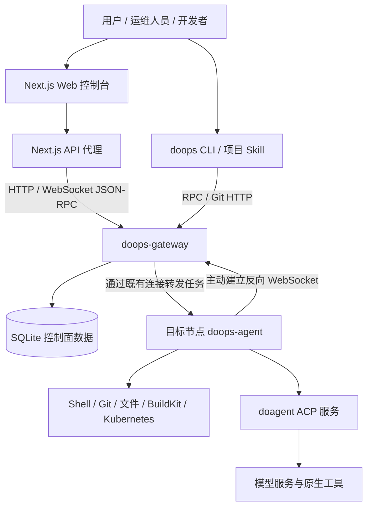

<p align="right"><b>中文</b> | <a href="README.en.md">English</a> | <a href="README.ru.md">Русский</a></p>

# DoOps

**面向服务器与 Kubernetes 环境的 AI 辅助运维控制台、统一网关与 Agent 执行通道。**

DoOps 将 Web 控制台、命令行工具、目标节点 Agent 和 AI 运维能力连接起来：用户通过统一 Gateway 访问被授权的目标，由目标 Agent 执行命令、同步代码、处理文件，或调用 doagent 完成需要分析与多步骤协作的任务。

项目采用 **Gateway-first** 架构。目标 Agent 主动建立反向连接，日常操作通过网关鉴权、授权、路由与审计，不要求为每一次运维任务单独建立 SSH 会话。首次自举、网关宿主机维护等场景仍可能使用 SSH。

**核心贡献者：孙勇、高家祺、宋晨宇。** 具体署名顺序见[贡献者](#contributors)。

[项目仓库](https://github.com/symansun/doops) · [问题反馈](https://github.com/symansun/doops/issues) · [贡献指南](CONTRIBUTING.md) · [安全政策](SECURITY.md) · [许可证](LICENSE)

> **使用前说明**：DoOps 是具有真实远程执行能力的运维软件，不是不可信任务的强隔离沙箱。正式接入生产环境前，请配置 TLS、最小权限、凭据保护、备份及部署验证。页面演示数据不代表真实环境的运行结果；当前实现边界见[已知限制](#limitations)。

## 目录

- [项目定位与适用场景](#overview)
- [主要能力](#features)
- [架构与职责边界](#architecture)
- [技术栈与运行前提](#requirements)
- [快速开始：Web 控制台](#web-quickstart)
- [快速开始：CLI 与项目 Skill](#cli-quickstart)
- [自托管 Gateway 与 Agent](#self-host)
- [常见操作](#usage)
- [业务发布与 Agent 升级](#delivery)
- [配置、权限与安全](#security)
- [仓库结构与文档](#repository)
- [开发、构建与测试](#development)
- [常见问题与已知限制](#limitations)
- [参与贡献](#contributing)
- [贡献者](#contributors)
- [许可证](#license)

<a id="overview"></a>
## 项目定位与适用场景

DoOps 关注的是从“连接目标”到“执行任务并检查结果”的运维过程，而不只是一个对话窗口。

它适用于：

- **多节点日常运维**：统一查看在线目标，按 `cluster/instance` 定位机器，执行检查、收集节点信息。
- **开发与交付协作**：将代码同步到指定会话工作区，执行构建或诊断，再拉回产物。
- **AI 辅助排障**：将需要探索的问题交给目标节点上的 doagent，查看执行事件和结果。
- **Kubernetes 环境发布**：通过明确的 `ask --apply` 任务、受管凭据、Helm 资产和执行证据推进发布。
- **团队运维管理**：管理用户、Token、目标授权、活动操作和审计记录。
- **受控巡检与问题分析**：通过 `ask`、DoSql、DoWeb 和 Kubernetes 只读入口执行检查并保留审计证据。
- **教学与实验环境**：在受控环境中学习网关、Agent、权限、工作区和声明式部署的协作方式。

DoOps 不替代 Kubernetes 本身，也不是完整的监控时序数据库、ITSM 平台或向量知识库。AI 的规划、上下文、多 Agent 协作和工具调用主要由外部 **doagent** 引擎承担，本仓库负责运维入口、控制面和执行接入。

<a id="features"></a>
## 主要能力

| 能力 | 说明 | 使用边界 |
| --- | --- | --- |
| Web 控制台 | 登录、目标选择、命令和 AI 任务界面、节点信息、审计及管理入口 | 基于 Next.js；部分文件、知识库和模型配置界面仍需与后端契约联调 |
| 统一 Gateway | Agent 注册、目标路由、用户鉴权、作用域授权、排队与并发控制 | SQLite 保存控制面状态；公网访问需部署 TLS 反向代理 |
| Agent 反向连接 | 目标节点主动连接 Gateway，以 `cluster/instance` 标识执行目标 | 生产环境可为精确 target 启用 enrollment token；用户 Token 不用于 Agent 注册 |
| 确定性命令执行 | `exec` 运行命令并返回输出；支持后台任务、日志及状态查询 | 不是持久 PTY；命令具有 Agent 进程对应的系统权限 |
| Git 工作区同步 | `push/pull` 通过 Git HTTP 和 Agent 隧道同步会话工作区 | 拉取与清理存在覆盖、删除风险；不是永久备份机制 |
| 小文本文件操作 | 在指定 session 内执行 `read/write` | 使用工作区相对路径；大文件和二进制使用 `push/pull` |
| AI 运维任务 | `ask` 通过 ACP HTTP 与 SSE 接入 doagent | 需要可用的 doagent 服务、模型配置及相应目标权限 |
| 自然语言业务发布 | `ask --apply` 读取任务指定的镜像、Chart、凭据和验收条件，并通过结构化 Helm 工具执行 | 业务发布不使用 `cicd run`、环境注册表或未审阅的 YAML 工作流 |
| 凭据资源管理 | 提供版本化凭据、授权、Bundle 和运行期材料化能力 | 启用加密存储需稳定配置 Gateway 密钥；不代表所有日志均自动脱敏 |
| 运维工作台 | 集成 DoSql、DoWeb、Kubernetes 观察和受控变更入口 | 具体能力以目标 Agent、凭据绑定和对应 Skill 的验收结果为准 |
| Agent 升级入口 | 提供带权限检查的升级通知和生命周期协调 | Kubernetes 与 Docker 路径能力不同，不能假设 Docker 模式会自动替换容器 |

<a id="architecture"></a>
## 架构与职责边界



### 各组件负责什么

- **Web 控制台**：提供浏览器操作入口，并通过服务端代理访问 Gateway。浏览器任务结果以 NDJSON 流接收；它不是只有静态页面的前端。
- **doops CLI**：管理本地目标配置、登录凭据、session、命令、文件同步及发布入口。
- **doops-gateway**：面向用户提供统一控制面，维护目标 Agent 的连接、授权与运行记录。
- **doops-agent**：运行于受管环境，提供实际的命令、工作区和 AI 执行通道。
- **doagent**：提供 AI 执行引擎；与 `doops-agent` 是不同组件。
- **运维 Skills**：描述任务所需的专业知识、执行约束与结果契约，不应与已完成端到端验收的功能等同。

### 三个关键概念

| 概念 | 含义 | 示例 |
| --- | --- | --- |
| Gateway | 用户访问的统一网关 | `https://gateway.example.com` |
| Target | 网关上的目标节点，由 cluster 和 instance 共同标识 | `demo/node-1` |
| Session | 一次任务或工作流使用的逻辑会话和工作区 | `inspect-001` |

目标用于回答“在哪里执行”，session 用于区分“哪一次任务”。工作区默认位于 `/root/ws/<session>`，**逻辑工作区隔离不等于系统级安全沙箱**。

### 端口与协议

| 组件 | 默认端口或路径 | 说明 |
| --- | --- | --- |
| Next.js 控制台 | `3000` | 主界面位于 `/console` |
| Gateway | `42222` | 提供 HTTP 与 WebSocket 服务；TLS 通常由反向代理终止 |
| 用户 RPC | `/v1/rpc` | 通过用户 Token 鉴权并指定目标 |
| Agent 注册 | `/v1/agent/connect` | Agent 主动连接 Gateway 的入口 |
| Git 工作区同步 | `/v1/git/<cluster>/<instance>/<session>.git` | Gateway 鉴权后反向转发至 Agent |
| Agent 健康接口 | `/health/live`、`/health/ready`；`/ws` 已退役 | 不应作为标准公网操作入口 |
| doagent ACP | `9000` | 内部 AI 执行服务，避免直接暴露公网 |
| BuildKit | `/run/buildkit/buildkitd.sock` | 默认使用 Unix socket |

Gateway 和 Agent 若运行在同一宿主机网络中，必须避免默认端口冲突。

<a id="requirements"></a>
## 技术栈与运行前提

| 部分 | 当前仓库采用的技术或建议版本 |
| --- | --- |
| Web | Next.js 16、React 19、TypeScript 6、Tailwind CSS 4 |
| 前端工具链 | 建议使用与 CI 一致的 **Node.js 24、pnpm 11.7.0** |
| 后端与 CLI | Go；三个模块的 `go.mod` 均声明 **Go 1.24.0** |
| 控制面存储 | SQLite |
| 通信与同步 | HTTP、WebSocket、JSON-RPC、Git HTTP |
| AI 执行 | doagent ACP HTTP 与 SSE |
| 容器及集群工具 | BuildKit、kubectl、Helm，按部署场景配置 |

按使用方式准备依赖：

- **只体验界面**：Node.js 与 pnpm 即可，演示模式不需要后端。
- **连接已有环境**：需要 Gateway 地址、用户 Token、已注册的 Agent 和目标授权。
- **安装预构建 CLI**：支持 Linux/macOS 的 amd64、arm64；需 Bash、`shasum` 及常用 Unix 工具。代码同步还需要 Git。
- **从源码构建**：需要 Go、Node.js、pnpm 和 Git。
- **完整 Agent 容器**：还需可访问的镜像、按环境启用的 Agent enrollment 配置、模型配置；操作 Kubernetes 时需有效的集群凭据。

> CLI 提供多个客户端平台制品，不代表 Agent 镜像也是多架构发布。当前 Agent 镜像发布流程以 `linux/amd64` 为基线。

<a id="web-quickstart"></a>
## 快速开始：Web 控制台

### 1. 获取代码并安装依赖

```bash
git clone https://github.com/symansun/doops.git
cd doops

corepack enable
corepack prepare pnpm@11.7.0 --activate
pnpm install --frozen-lockfile
```

如果所用 Node.js 发行版没有提供 Corepack，请先安装 Corepack，或用包管理器安装对应版本的 pnpm。

### 2. 启动开发服务器

```bash
pnpm dev
```

访问：

- 首页：`http://localhost:3000/`
- 控制台：`http://localhost:3000/console`
- 模拟演示：`http://localhost:3000/console?demo=1`

**演示模式使用本地模拟数据，不会连接真实节点，也不能用于证明部署或权限检查通过。**

### 3. 连接实际环境

在控制台中填写 Gateway 地址，并使用已有账号密码或用户 Token 登录。选择已在线且获授权的目标后，开始执行操作。

需要区分：

- 启动 Web 页面不会自动创建 Gateway 管理员。
- 启动 Web 页面不会自动安装或注册目标 Agent。
- 页面可访问不代表模型、集群权限或部署能力已配置完成。
- Gateway 地址必须能被 **Next.js 服务端进程**访问。Web 运行在容器中时，`localhost` 指向该容器自身。

Gateway 地址在界面中填写，由服务端代理使用；当前仓库不提供根目录 `.env.example`。

### 4. 构建 Web 镜像

在仓库根目录执行：

```bash
docker build -f Dockerfile.web -t doops-console:local .

docker run --rm --name doops-console \
  -p 127.0.0.1:3000:3000 \
  doops-console:local
```

`Dockerfile.web` 使用 Next.js standalone 产物，最终以 `node server.js` 运行。该镜像**仅包含 Web 控制台**，不包含完整 Gateway、目标 Agent 或模型服务。生产环境请置于受保护的 HTTPS 入口之后。

<a id="cli-quickstart"></a>
## 快速开始：CLI 与项目 Skill

以下示例假设管理员已经提供 Gateway、用户 Token 和目标信息。

### 1. 安装

在 DoOps 仓库根目录执行；`--project` 指定的业务项目目录应已存在：

```bash
bash scripts/install.sh --version <release-tag> --project /absolute/path/to/existing-project
export PATH="$HOME/.local/bin:$PATH"
```

主要安装位置：

| 内容 | 路径 |
| --- | --- |
| CLI | `~/.local/bin/doops` |
| 项目 Skill | `<project>/.agent/skills/doops/SKILL.md` |
| 配套文档 | `<project>/.agent/skills/doops/docs/` |
| 默认目标配置 | `~/.agent/skills/doops/config.json` |
| 登录缓存 | `~/.agent/skills/doops/auth.json` |

安装会更新目标项目中的 DoOps Skill 及配套文档。若曾自行修改这些文件，请先备份。CLI 配置与缓存包含敏感信息，文件权限保护不等于加密存储，不要提交到 Git。

### 2. 配置目标

以下为占位示例，需换成管理员提供的信息：

```bash
doops add \
  --name demo-node \
  --gateway https://gateway.example.com \
  --cluster demo \
  --instance node-1

# 首次登录使用 Gateway 账号密码；登录态按 Gateway URL 共享
doops login --target demo-node
```

- `demo-node` 是客户端本地别名。
- `demo/node-1` 必须对应 Gateway 中真实注册的目标。
- `doops add` 只保存 Gateway 路由，不保存 target token；用户登录态单独保存在本地 auth 缓存。
- 实际凭据不要保留在公开日志、脚本或共享终端历史中；密码登录使用交互式输入或 `--token-stdin`。

`doops login --gateway <gateway-url>` 也可在没有预配置 target 时首次登录，并发现当前账号可见的路由。`doops login --target ...` 要求目标路由已存在，不能代替首次目标创建。

### 3. 检查连接

```bash
# 本地已配置目标，不代表在线状态
doops list

# Gateway 中实际在线且可见的目标
doops targets --target demo-node

# 在指定目标进行简单检查
doops -session inspect-001 exec --target demo-node --cmd 'hostname'
```

已有目标需要重新密码登录时，可省略 `--password`，让终端隐藏输入：

```bash
doops login \
  --target demo-node \
  --gateway https://gateway.example.com \
  --username alice
```

<a id="self-host"></a>
## 自托管 Gateway 与 Agent

建议按 **控制面初始化 → Agent 注册 → CLI/Web 连接 → 能力验收** 的顺序部署，而不是先把多个端口公开。

### 1. 从源码构建本机二进制

在仓库根目录执行：

```bash
mkdir -p backend/bin

(cd backend/gateway && go build -o ../bin/doops-gateway .)
(cd backend/agent && go build -o ../bin/doops-agent ./cmd/agent)

bash backend/scripts/build-cli.sh
```

这里使用本机 Go 工具链编译 Gateway。仓库中的 `build-gateway.sh` 默认交叉编译 Linux/amd64，macOS 开发者不要将其默认产物当作本机可执行文件。

### 2. 初始化 Gateway 身份与授权

以下命令在受信任的 Gateway 宿主机上执行，所有命令必须指向**同一个持久化数据库**。示例创建初始管理员，没有默认管理员密码：

```bash
mkdir -p "$HOME/.local/share/doops-gateway"
DB="$HOME/.local/share/doops-gateway/gateway.db"

backend/bin/doops-gateway user create \
  -db "$DB" -name bootstrap-admin

backend/bin/doops-gateway grant \
  -db "$DB" -user bootstrap-admin \
  -admin

backend/bin/doops-gateway token create \
  -db "$DB" -user bootstrap-admin \
  -name initial-console -expires 24h
```

用户 Token 会输出一次，请立即私密保存。示例中的全局 `admin` 仅用于首次受信任初始化，**不要作为普通用户默认权限**。生产 Agent 的 enrollment token 由部署侧按精确 target 配置；当前 Gateway CLI 不提供通用的 `agent-token create` 命令。

启动 Gateway：

```bash
backend/bin/doops-gateway serve -db "$DB" -port 42222
```

注意：Gateway 监听对应端口的所有网络接口，不提供独立的 `-listen` 参数，也不直接配置 TLS。请通过防火墙、安全组和反向代理控制访问，不要把原始 HTTP 端口无保护地暴露到公网。

启用加密凭据库、私有仓库密码等功能时，需为服务安全注入并持久保存 `DOOPS_GATEWAY_SECRET_KEY`。不要每次启动随机更换；密钥丢失或改变会影响既有密文解密。

### 3. 注册目标 Agent

受控本地联调可使用裸二进制。例如 Gateway 位于本机 `42222` 时，让 Agent 使用不同端口：

```bash
mkdir -p "$HOME/.local/share/doops-agent/workspaces"

DOOPS_ALLOW_INSECURE_GATEWAY=1 \
DOOPS_WORKSPACE_ROOT="$HOME/.local/share/doops-agent/workspaces" \
backend/bin/doops-agent \
  -listen 127.0.0.1 \
  -port 42223 \
  -gateway-url http://127.0.0.1:42222 \
  -cluster demo \
  -instance node-1
```

这只是注册与基础执行链路的联调示例，不会自动安装 doagent、模型、BuildKit 或 Kubernetes 工具。实际服务器注册时，将地址换为可达的 HTTPS Gateway，并按目标网络设置 Agent 监听范围。

当 Gateway 为该 target 启用了 enrollment 校验时，再通过 `DOOPS_AGENT_ENROLL_TOKEN` 或 `-agent-enroll-token` 提供绑定到精确 `cluster/instance` 的注册令牌；未启用时不要把用户 Token 或业务凭据当作 Agent 注册凭据。

### 4. 完整 Agent 容器与 Kubernetes 部署

当前 Agent 镜像采用基础层与应用层分离：基础层提供运行工具，应用层提供 `doops-agent`、Skills、文档和入口脚本。构建上下文位于 `backend/`。

完整部署至少需要：

1. 可访问、可信且固定版本或 digest 的基础镜像与应用镜像。
2. Gateway URL、cluster、instance，以及启用 enrollment 时绑定到该 target 的 `DOOPS_AGENT_ENROLL_TOKEN`。
3. 已在 Gateway 创建、验证并提升的 `modelProvider` 凭据；Agent 连接后由 Gateway 材料化到 `/root/.agent/settings.json`。
4. 必需的卷挂载与持久化；Kubernetes 环境需有效的 `/root/.kube/config`。
5. 经审阅的 RBAC、网络策略、节点选择、镜像拉取凭据和资源配置。

优先阅读：

- [自然语言业务发布](backend/docs/NATURAL_LANGUAGE_DEPLOYMENT.md)
- [构建与部署 SOP](backend/docs/BUILD_DEPLOY_SOP.md)
- [集群安装指南](backend/docs/CLUSTER_INSTALL_GUIDE.md)
- [Agent Helm Chart](backend/deploy/helm/doops-agent/)
- [固定运行时版本](backend/runtime-versions.env)

Helm Chart 的关键默认值为空，需要根据实际环境补全；不能直接安装后就获得可用的生产 Agent。历史清单中的命名空间、地址、权限及证书设置也应逐项审阅。

> 仓库目前没有 Docker Compose 编排文件。不要把 `docker compose up -d` 当作现成的一键全栈启动方式，也不要认为完整 Agent 镜像在所有环境下都能免认证拉取。

<a id="usage"></a>
## 常见操作

以下示例使用已配置目标 `demo-node`。涉及远程任务时显式指定 session，并为不同任务使用不同名称。

### 查看节点与执行命令

```bash
doops -session inspect-001 info --target demo-node

doops -session inspect-001 exec \
  --target demo-node \
  --cmd 'hostname && uname -a && df -h'
```

`exec` 用于已知、明确的命令。不要假定 shell 当前目录自动等于 session 工作区；需要时显式 `cd` 到预期目录。

### AI 辅助排障

```bash
doops -session diagnose-001 ask \
  --target demo-node \
  --msg '只读检查当前 Kubernetes 节点和异常 Pod，列出证据、可能原因与后续建议，不执行修复。'
```

在具备有效模型配置和适当集群权限后使用。提示词中的“只读”是任务要求，不代替系统权限控制；重要操作仍需审阅结果和真实执行证据。

### 同步代码与拉回结果

```bash
doops -session build-001 push --target demo-node --src .

doops -session build-001 exec \
  --target demo-node \
  --cmd 'cd /root/ws/build-001 && git status --short'

doops -session build-001 pull \
  --target demo-node \
  --dest ./doops-build-output
```

上例使用默认容器工作区；若设置了 `DOOPS_WORKSPACE_ROOT`，应同步调整 shell 中的路径。

- `push/pull` 的标准路径是 Git HTTP，经 Gateway 反向隧道转发，不是手写 tar/base64 分块传输。
- 推送会考虑 `.gitignore` 与 `.doopsignore`，请确认必要的部署文件未被排除。
- 拉回结果应选择专用输出目录；对已有目标仓库的同步可能覆盖本地修改，不要指向重要的未提交工作区。

### 小文本读写

```bash
doops -session build-001 write \
  --target demo-node \
  --path notes/status.txt \
  --content 'ready for review'

doops -session build-001 read \
  --target demo-node \
  --path notes/status.txt
```

`--path` 是该 session 的**工作区相对路径**，不要写成 `/root/ws/...`，也不要使用 `..` 越出工作区。默认读取上限为 1 MiB、写入上限为 16 MiB；二进制及大文件使用 `push/pull`。

### 长任务

```bash
doops -session build-001 exec \
  --bg \
  --target demo-node \
  --cmd 'cd /root/ws/build-001 && bash ./scripts/build.sh'
```

其中 `scripts/build.sh` 是业务项目自行提供的构建脚本，并非本仓库承诺存在的文件。长任务使用原生 `--bg` 机制，不要用普通 `exec` 配合 `&`、`nohup` 等方式逃逸生命周期管理。当前后台任务登记并不等于跨 Agent 重启的持久任务编排保证。

### 清理与退出

```bash
# 会删除指定远端工作区及相关仓库，先核对 --workspace 并备份产物
doops -session build-001 clean --target demo-node --workspace build-001

# 删除本地登录缓存
doops logout --target demo-node
```

`clean` 必须同时指定 target、session 和 workspace；实际删除对象由 `--workspace` 指定。`logout` 只删除本地登录缓存，不会撤销服务端 Token，也不会删除目标配置中保存的 Token。

更多命令见[使用指南](backend/docs/DOOPS_USAGE_GUIDE.md)。若历史文档中的路径或参数与当前代码冲突，以本 README 的现行示例、当前 CLI 帮助和源码为准。

<a id="delivery"></a>
## 业务发布与 Agent 升级

DoOps 把普通业务 workload 发布收敛到 `ask --apply`，把 Agent 自身升级交给独立控制器或外部发布脚本。两条路径都要求明确 target、变更范围、镜像事实、原因和机器可检查的验收条件；模型回答、页面提示或单个健康码都不能单独证明发布完成。

### 普通业务 workload 发布

```bash
doops -session release-check ask \
  --target control-node \
  --apply \
  --credential <resource-name> \
  --msg '在 target control-node 发布服务 api；使用任务指定的 Chart、namespace 和已核验镜像 digest；原因：修复课堂权限；验收：Deployment、Pod、Service、Endpoint 与 /health 均通过。'
```

发布任务必须给出 target、服务范围、Chart 或仓库资产、镜像版本或其可核验来源、原因和验收条件。`--credential` 只传受管凭据资源名，不在参数、prompt、日志或工作区中传递密文。目标 Agent 通过结构化 `mcp_doops_helm upgrade-install` 执行发布，并返回 dry-run、实际变更和最终资源状态证据。

普通发布不使用旧的 `cicd run`、环境注册表或 prompt 推导的部署范围，也不要求先执行 `push` 或读取操作机 kubeconfig。详细契约见[自然语言业务发布](backend/docs/NATURAL_LANGUAGE_DEPLOYMENT.md)和[凭据资源](backend/docs/CREDENTIAL_RESOURCES.md)。

### 标准 Helm Agent 升级

已经具备自升级控制器的 Helm Agent 使用 `doops upgrade`；升级 Job 在目标集群内执行，Agent 进程不直接替换自己：

```bash
doops -session agent-upgrade upgrade \
  --target <configured-target> \
  --image <repository>@sha256:<verified-ci-digest>

# 仅预览参数；不会证明控制器、挂载或权限可用
doops -session agent-upgrade upgrade \
  --target <configured-target> \
  --image <repository>@sha256:<verified-ci-digest> \
  --dry-run
```

`doops upgrade` 只处理标准 Helm Agent 的镜像替换或回滚，不修改业务 workload、代理 allowlist 或其它 Helm 配置。升级前后应核对 CLI 与 Agent 的 release commit、Pod Ready、Gateway 重连和实际镜像 digest。

### 首次安装与非标准 Agent

按运行形态选择入口，不自动互相降级：

| 场景 | 入口 | 关键前提 |
| --- | --- | --- |
| 空 Ubuntu/Debian 服务器 | `backend/scripts/bootstrap-host-agent.sh` | root、明确发布版本、唯一 cluster/instance；脚本安装 Docker/Compose 并验证 Gateway 隧道 |
| K8s 首次安装或显式 Helm 配置变更 | `backend/scripts/release-managed-agent.sh` | 外部控制器 kubeconfig、Helm、kubectl 和完整 values |
| 旧 Helm Agent 或命令通道损坏 | `backend/scripts/release-managed-agent.sh` | 先完成 dry-run、备份和接管验收 |
| 已有独立 Docker Agent | `backend/scripts/release-host-agent.sh` | 外部 DockerHost 控制、显式 SSH 端口、不可变镜像和主机密钥校验 |
| Gateway 控制面 | `backend/scripts/deploy-gateway.sh --no-build` | 使用已核验的 CI Release Asset，不通过 Agent target 发布自身 |

详细的备份、回滚、镜像 provenance 和验收步骤见[构建与部署 SOP](backend/docs/BUILD_DEPLOY_SOP.md)与[集群安装指南](backend/docs/CLUSTER_INSTALL_GUIDE.md)。

<a id="security"></a>
## 配置、权限与安全

### 常用配置

| 配置或参数 | 作用 | 注意事项 |
| --- | --- | --- |
| `DOOPS_CONFIG` | 覆盖 CLI 默认配置文件路径 | 不是 Web 控制台的 Gateway 配置 |
| `-gateway-url`、`-cluster`、`-instance` | Agent 注册位置和身份 | 裸二进制应显式传参；不要假定 Helm 中的同名环境变量会自动生效 |
| `DOOPS_AGENT_ENROLL_TOKEN`、`-agent-enroll-token` | Agent 向 Gateway 注册使用的 target-scoped enrollment 凭据 | 仅在 Gateway 启用 enrollment 时设置，并且必须绑定到精确的 cluster/instance |
| `DOOPS_WORKSPACE_ROOT` | Agent 会话工作区根目录 | 默认 `/root/ws`；修改后需调整相关脚本路径 |
| `DOOPS_GATEWAY_SECRET_KEY` | Gateway 加密凭据的密钥材料 | 启用凭据功能时安全注入、持久保存并备份 |
| `DO_AGENT_PORT`、`DO_AGENT_URL` | Agent 内部 ACP 服务地址 | 默认端口 `9000`、地址 `http://127.0.0.1:9000`；自定义时保持一致 |
| `DOOPS_ALLOWED_WS_ORIGINS` | WebSocket Origin 限制 | 配合真实部署域名设置 |
| `DOOPS_ALLOW_INSECURE_GATEWAY` | 放开非回环 HTTP/WS 的开发例外 | 不作为生产默认设置 |

### 权限与凭据原则

1. **区分用户 Token 与 Agent enrollment token**：前者用于操作 Gateway，后者只在启用 enrollment 时用于精确 target 的 Agent 反向注册，两者不是可互换的密码。
2. **明确授权范围与动作**：不要将 `admin`、通配符或省略 actions 的授权当作普通用户模板。
3. **审阅管理端的默认授权**：不同创建入口的默认行为可能不同，不要假定所有新用户天然符合最小权限。
4. **限制高权限能力**：`exec`、集群凭据、宿主目录和运行时 socket 都可能具有较大影响范围。
5. **不把目录隔离当安全隔离**：当前 Helm Chart 包含特权容器配置，须针对可信运维人员和受控环境部署。
6. **限制 Web 代理的网络出口**：Next.js 会根据请求中的 Gateway 地址进行服务端访问，公网部署需额外的入口控制、目标范围或出口约束。
7. **保护审计与模型数据**：命令、提示词、结果与配置可能包含敏感信息，分享前脱敏，不向不可信模型端点发送生产秘密。
8. **备份状态**：持久化 Gateway 数据库和加密密钥；重要产物及时导出，Agent 工作区存在自动清理机制。

安全问题请按 [SECURITY.md](SECURITY.md) 私下联系维护者，不要在公开 Issue 中附上真实凭据、生产地址或可利用的漏洞细节。

<a id="repository"></a>
## 仓库结构与文档

```text
doops/
├── app/                         # Next.js 页面与 API 代理
├── components/                  # 控制台及管理界面组件
├── lib/                         # 客户端、协议类型与前端辅助代码
├── scripts/install.sh           # 根目录安装入口，转发至后端脚本
├── backend/
│   ├── agent/                   # Agent、控制面实现、ACP 接入与调度
│   │   ├── cmd/agent/           # doops-agent 入口
│   │   ├── internal/server/     # Gateway/Agent 核心服务实现
│   │   └── skills/              # Agent 端运维 Skills
│   ├── gateway/                 # doops-gateway 独立构建入口
│   ├── cli/                       # Go CLI 源码与构建入口
│   ├── deploy/                  # Helm、环境与部署工作流配置
│   ├── scripts/                 # 安装、构建及维护脚本
│   ├── docs/                    # 协议、使用与部署文档
│   ├── test/                    # Python 契约与部署检查
│   ├── Dockerfile              # Agent 应用镜像
│   ├── Dockerfile.base.light   # Agent 轻量基础镜像
│   └── runtime-versions.env    # 固定运行时版本与镜像来源
├── docs/                        # 设计文档与实施记录
├── Dockerfile.web              # Next.js 生产镜像
├── .github/workflows/ci.yml    # GitHub CI
├── .cnb.yml                    # CNB 检查与 Agent 镜像发布
├── CONTRIBUTING.md
└── SECURITY.md
```

| 文档 | 用途 |
| --- | --- |
| [CLI 使用指南](backend/docs/DOOPS_USAGE_GUIDE.md) | 命令选择、会话、同步和任务管理 |
| [API 接入指南](backend/docs/DOOPS_API_GUIDE.md) | 登录、目标、RPC、进度流与审计 |
| [Gateway 隧道与执行生命周期](backend/docs/DOOPS_GATEWAY_TUNNEL.md) | Agent 反向连接、执行生命周期和并发边界 |
| [Skill 集成指南](backend/docs/SKILL_INTEGRATION_GUIDE.md) | 对接项目 Skill |
| [模型规范](backend/docs/MODEL_STANDARDS.md) | 模型配置及使用规范 |
| [构建部署 SOP](backend/docs/BUILD_DEPLOY_SOP.md) | 构建、镜像和部署流程 |
| [集群安装指南](backend/docs/CLUSTER_INSTALL_GUIDE.md) | 集群接入参考 |
| [自然语言业务发布](backend/docs/NATURAL_LANGUAGE_DEPLOYMENT.md) | 业务发布职责边界与验收原则 |

部分历史后端文档以 `backend/` 作为当前目录，示例中的 `scripts/...` 不一定能从仓库根目录直接执行。当前主 Web 应用在仓库根目录；旧 Go WebUI 的 `8088` 端口与构建脚本仅用于 legacy 维护，不是 Next.js 的部署入口。

<a id="development"></a>
## 开发、构建与测试

在仓库根目录执行与 GitHub CI 一致的检查：

```bash
(cd backend/agent && go test ./...)
(cd backend/gateway && go test ./...)
(cd backend/cli && go test ./...)

pnpm exec tsc --noEmit
pnpm build
```

根目录没有 Go 模块，请不要把三条 Go 检查合并为在根目录运行 `go test ./...`。前端还可运行 `pnpm test:gateway-policy` 和 `pnpm test:console`；`pnpm build` 用于生产构建。

CNB 还包含 Python 契约检查。准备 Python 3、pytest、PyYAML、Helm 及相关测试依赖后执行：

```bash
python3 -m pytest backend/test -q
```

部分 Python 检查会执行 CLI 或工具，并非只扫描文本；失败时应检查环境前提及具体断言。

维护者需要重建全部 CLI 制品时：

```bash
bash backend/scripts/build-cli.sh --all
```

提交前还应检查：

- 文档中的路径、参数与当前代码一致。
- 前端、Gateway、Agent、CLI 的协议变更有对应测试。
- 没有提交 `.next/`、`node_modules/`、测试缓存、运行数据库和本地工作区。
- 没有提交 Token、API Key、kubeconfig、私钥、镜像仓库密码或内部环境信息。
- 涉及发布的变更有可检查的验证结果，而非只有生成过程描述。

<a id="limitations"></a>
## 常见问题与已知限制

### 页面可以打开，为什么看不到节点？

Web 页面不负责自动部署目标 Agent。检查 Gateway 地址、用户权限、Agent enrollment 配置，以及 cluster/instance 是否匹配。`doops list` 只显示本地配置；在线状态应查看 `doops targets`。

### 为什么 `exec` 可用，`ask` 不可用？

确定性执行与 AI 执行依赖不同。检查 doagent ACP 是否可用、目标上是否绑定并提升了 `modelProvider` 凭据、模型服务是否可达。Agent 连接 Gateway 后才会材料化模型设置；裸二进制也不会自动携带模型凭据。

### 为什么文件读写提示路径不安全？

当前后端文件工具要求 session 内的相对路径。使用 `notes/status.txt`，不要传 `/root/ws/<session>/notes/status.txt`。部分历史示例和前端模块仍使用旧路径约定，需要同步调整。

### 健康检查返回 200，是否代表所有能力都正常？

不是。`/health/live` 只说明 Agent HTTP 进程存活；`/health/ready` 说明 Gateway 反向注册已确认。二者均不能代替模型调用、镜像构建、集群权限和真实部署验收。

### 是否已经支持全部页面和所有发布格式？

当前源码仍在持续完善，需明确以下边界：

- 文件、知识库、模型配置及相关 AI 页面存在与后端路径、参数契约的适配事项，不应把“页面存在”当作已全链路可用。
- 知识库界面主要围绕 Markdown 文件管理，不是已实现的向量检索或 RAG 服务。
- 业务发布的凭据预检和执行以 `ask --apply`、`NATURAL_LANGUAGE_DEPLOYMENT.md` 及 `CREDENTIAL_RESOURCES.md` 为准，不要把旧的 `DeploymentTemplate` 或 `cicd run` 当作当前入口。
- Agent 升级的 Docker 分支不等于自动完成容器替换，实际替换需要外部管理机制配合。
- 工作区可能自动清理，后台任务也不提供无条件的重启持久化保证。
- 当前 Agent 镜像、Helm 默认值和历史环境清单不构成“所有平台一键部署”的承诺。

页面中的模拟案例与展示指标不应被解释为经独立验证的性能、效率或成本收益。是否适合生产环境，需要在自己的网络、权限、运行时和工作流上进行验收。

<a id="contributing"></a>
## 参与贡献

欢迎通过 Issue、Pull Request、文档改进和使用反馈参与项目。

- [提交 Bug](https://github.com/symansun/doops/issues/new?template=bug_report.yml)：提供复现步骤、版本或 commit、预期与实际行为，以及脱敏日志。
- [提出功能建议](https://github.com/symansun/doops/issues/new?template=feature_request.yml)：说明使用场景、当前限制和希望达到的结果。
- 提交 PR 前先运行相关检查；协议或权限变更应同时补充测试与文档。
- 对部署文档的修订，请明确执行目录、必需配置、权限边界及是否实际验证。
- 不要在 Issue、PR、截图或示例中附带真实凭据和生产环境敏感信息。

详细要求见 [CONTRIBUTING.md](CONTRIBUTING.md) 与 [PR 模板](.github/pull_request_template.md)。

<a id="contributors"></a>
## 贡献者

本项目核心贡献者按以下顺序署名：

| 顺序 | 贡献者 | 署名 |
| --- | --- | --- |
| 1 | **孙勇** | 第一贡献人 |
| 2 | **高家祺** | 第二贡献人 |
| 3 | **宋晨宇** | 第三贡献人 |

感谢所有通过代码、设计、测试、文档与使用反馈参与项目建设的贡献者。

<a id="license"></a>
## 许可证

本项目按 [MIT License](LICENSE) 发布。修改、再分发或商业集成时，请保留许可证正文和版权声明。

第三方依赖和运行时组件仍受各自许可证约束，具体以各组件随附的许可证文件为准。
