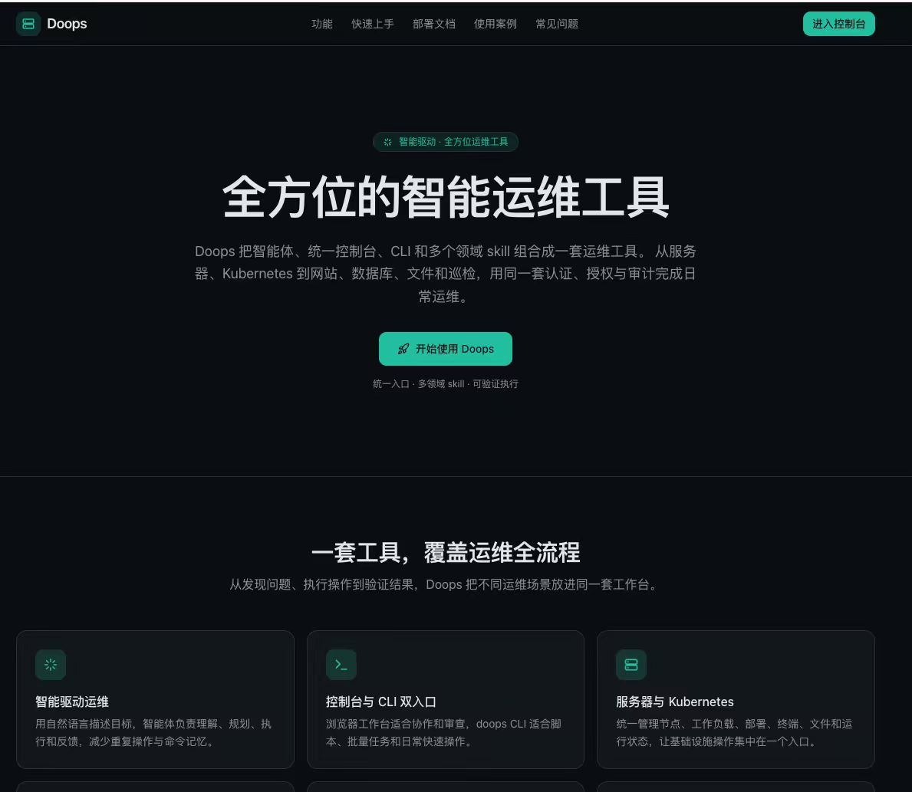
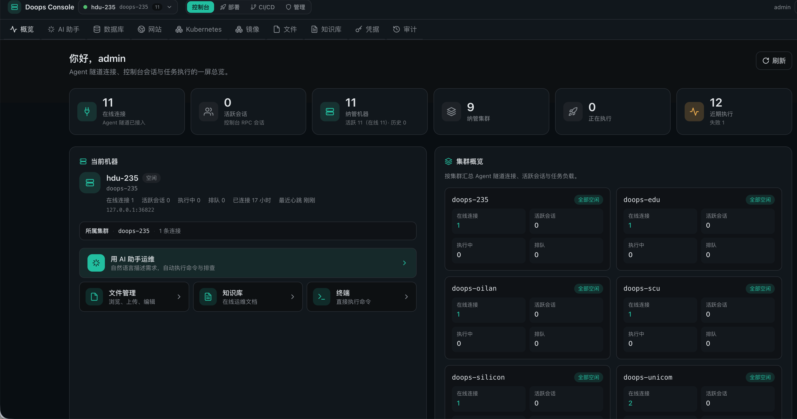
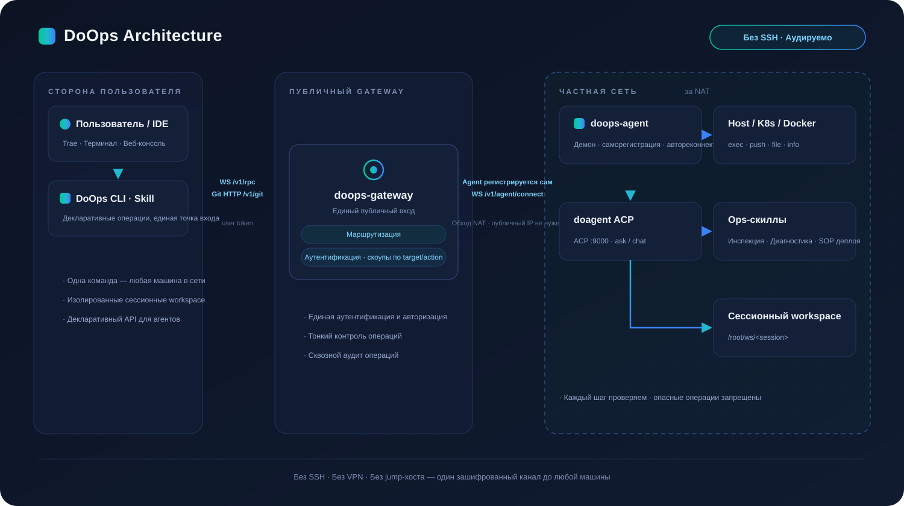

<p align="right"><a href="README.md">中文</a> | <a href="README.en.md">English</a> | <b>Русский</b></p>

# DoOps

<p align="center">
  
</p>

> Оригинальный код DoOps распространяется по [лицензии MIT](LICENSE). Сторонние компоненты сохраняют собственные лицензии; см. [уведомления о зависимостях](THIRD_PARTY_NOTICES.md).

**Основные участники: 孙勇 (Sūn Yǒng), 高家祺 (Gāo Jiāqí), 宋晨宇 (Sòng Chényǔ).** Порядок указания авторов сохранён в разделе [Contributors](#contributors).

**Всё ещё управляете SSH-портами, jump-хостами, ключами, NAT и изоляцией внутренних сетей?** `doops` предоставляет единую точку входа:

- **Одна команда для доступа к машине во внутренней сети**: агент сам устанавливает постоянное исходящее соединение с публичным шлюзом; целевой машине не нужны публичный IP, VPN, jump-хост или бастион.
- **Меньше администрирования SSH**: повседневные операции используют соединение со шлюзом вместо отдельных списков SSH-пользователей, портов, паролей и ключей.
- **Для агентов и автоматизации**: CLI, консоль и специализированные skills используют общий аудируемый путь для диагностики, инспекций, развёртывания и синхронизации файлов.
- **Единая аутентификация и авторизация**: разрешения привязаны к точному `cluster/instance`, операции фиксируются в аудите, а команды агента проверяются встроенными правилами.

## Интерфейс





DoOps объединяет агентов, консоль, CLI и специализированные skills для серверов, Kubernetes, сайтов, баз данных, файлов и инспекций с общей моделью аутентификации, авторизации и аудита.

## Структура репозитория

| Путь | Описание |
| --- | --- |
| `app/`, `components/`, `lib/` | Консоль Next.js, API-прокси и адаптеры сессий шлюза |
| `backend/agent/` | Общая среда выполнения агента и шлюза, skills DoSql/DoWeb |
| `backend/gateway/` | Точка входа Go-модуля шлюза |
| `backend/cli/` | Go-модуль DoOps CLI |
| `backend/skills/` | Операторский skill для установки в проекты пользователей |
| `backend/docs/` | Руководства по API, правам, установке, развёртыванию и эксплуатации |
| `backend/scripts/`, `backend/test/` | Скрипты сборки и выпуска, проверки контрактов |
| `backend/deploy/helm/` | Helm chart агента без инвентаря реальных окружений |
| `docs/` | Публичные руководства, архитектурные схемы и правила сопровождения |
| `vendor/agent-ui/` | Локально включённая UI-зависимость с исходной лицензией |

Здесь поддерживаются полная веб-консоль и backend. Прежние корневые каталоги `agent/`, `gateway/` и `skills/doops-cli/` перенесены в пути, указанные выше. GitHub [symansun/doops](https://github.com/symansun/doops) — единственный публичный репозиторий исходного кода, Issues, Pull Requests, Actions и Releases. Выпуски собираются из прошедших ревью коммитов `main`; незакоммиченные локальные изменения в них не входят.

## Архитектура

<p align="center">
  
</p>

Клиенты проходят аутентификацию через шлюз, который проверяет доступ к точным целям и ведёт аудит. Агенты регистрируются на шлюзе и выполняют контролируемые операции с командами, файлами, базами данных, сайтами и Kubernetes. Реализация шлюза находится в [`backend/agent/internal/server/`](backend/agent/internal/server/README.md); консоль обращается к той же плоскости управления через API-адаптеры этого репозитория.

- [Backend: использование и архитектура](backend/README.md)
- [API и протокол](backend/docs/DOOPS_API_GUIDE.md)
- [Руководство по установке](backend/docs/CLUSTER_INSTALL_GUIDE.md)
- [Интеграция Agent UI](docs/agent-ui-integration.md)
- [Жизненный цикл управляемых учётных данных](backend/docs/CREDENTIAL_RESOURCES.md)
- [Выпуск и откат](backend/docs/BUILD_DEPLOY_SOP.md)

## Базы данных и сайты

DoSql и DoWeb используют общий вход через шлюз, разрешения для точной цели и аудит. Для запросов к базам данных применяются `query`, `plan` и `discover`; изменения требуют явного `apply`:

```bash
doops -session db-check sql --target <target> --mode query --request 'Count rows in orders'
doops -session db-plan sql --target <target> --mode plan --request 'Plan an external_id column for orders'
doops -session db-discover sql --target <target> --mode discover --request 'List database workloads'
doops -session db-change sql --target <target> --mode apply --file change.sql --verify 'SELECT external_id FROM orders WHERE 1 = 0'
```

Учётные данные выбираются из управляемых ресурсов, привязанных к цели. Пароли, токены и строки подключения с учётными данными не должны попадать в команды, запросы модели, логи и документацию. См. [руководство по использованию](backend/docs/DOOPS_USAGE_GUIDE.md) и [описание учётных данных](backend/docs/CREDENTIAL_RESOURCES.md).

## Разработка и проверка

```bash
git clone https://github.com/symansun/doops.git
cd doops
(cd backend/agent && go test ./...)
(cd backend/gateway && go test ./...)
(cd backend/cli && go test ./...)
python3 -m pytest backend/test -q
corepack pnpm@11.7.0 install --frozen-lockfile
corepack pnpm@11.7.0 test:gateway-policy
corepack pnpm@11.7.0 test:console
corepack pnpm@11.7.0 exec tsc --noEmit
corepack pnpm@11.7.0 build
```

Для разработки консоли используйте `corepack pnpm@11.7.0 dev`. В рабочем окружении `DOOPS_CONSOLE_ALLOWED_GATEWAYS` должен содержать реальные origin-адреса шлюзов; демонстрационный режим доступен только при разработке. Приёмка в браузере охватывает вход, доступные цели, ошибки, пустые состояния и отображение на компьютерах и мобильных устройствах.

## Установка и выпуски

Версионные бинарные файлы CLI и шлюза распространяются через [GitHub Releases](https://github.com/symansun/doops/releases). Укажите явно опубликованный тег: установщик скачает `doops-<os>-<arch>` и `checksums.txt`, проверит контрольную сумму и идентификаторы release/commit/contract, затем получит skill и документацию из архива того же GitHub-коммита. Заранее загружать этот коммит в локальный Git не требуется.

```bash
curl --fail --location --output /tmp/doops-install.sh \
  https://raw.githubusercontent.com/symansun/doops/main/scripts/install.sh
bash /tmp/doops-install.sh --version <release-tag> --project /absolute/path/to/project
```

Замените `<release-tag>` выбранным опубликованным тегом. Клонировать репозиторий
не требуется; из клона можно запустить `bash scripts/install.sh` с теми же параметрами.
Для обновления CLI и skill повторите команду с новым опубликованным тегом.
Обновление агента описано в [руководстве по установке](backend/docs/CLUSTER_INSTALL_GUIDE.md).

Поддерживаемый путь CLI — `~/.local/bin/doops`. До замены установленной версии проверяются наличие исходников выпуска, контрольные суммы и конфигурация. Неопубликованные файлы рабочего каталога не смешиваются с выпуском.

Образы выпуска используют репозитории `ghcr.io/symansun/doops-agent`, `ghcr.io/symansun/doops-web` и `ghcr.io/symansun/doops-base-light`. Для развёртывания нужен проверенный digest выбранного образа. Образ агента не содержит бинарный файл шлюза; параметры среды выполнения зафиксированы в [`backend/runtime-versions.env`](backend/runtime-versions.env).

Процесс выпуска создаёт черновик, загружает и повторно считывает все обязательные артефакты и лишь затем публикует выпуск. Состав артефактов выбранного выпуска и соответствующий запуск Actions служат подтверждением его публикации и проверки. Развёртывание сервиса проверяется отдельно на разрешённой цели.

Удалённые операции указывают target и session. После установки или обновления выполните проверку под учётной записью с нужными правами:

```bash
doops -session acceptance login --target <target>
doops -session acceptance targets --target <target>
doops -session acceptance exec --target <target> --cmd 'hostname'
```

Для развёртывания, записи в базу данных и обновлений действуют соответствующие руководства по авторизации, проверке и откату.

## Правила проверки команд агента

Перед выполнением `exec` [dispatcher](backend/agent/internal/dispatcher/dispatcher.go) нормализует пробелы и регистр команды, затем проверяет десять встроенных правил с именованными ID. Совпадение запрещает выполнение и записывает `blocked=1` и ID правила в `.doops-audit-log`:

| ID правила | Шаблон команды |
| --- | --- |
| `disk.rm_root` | Рекурсивное удаление корневого или системных каталогов |
| `disk.dd_device` | Запись `dd` на блочные устройства |
| `disk.mkfs` | Форматирование файловой системы |
| `disk.partition` | Инструменты разметки и очистки дисков |
| `sys.shutdown` | Выключение и перезагрузка |
| `sys.fork_bomb` | Fork-бомбы |
| `perm.chmod_root` | Рекурсивное изменение прав корневого каталога |
| `fs.overwrite_key_files` | Перезапись критических файлов `/etc` |
| `net.pipe_shell` | Передача скачанного скрипта непосредственно интерпретатору |
| `proc.kill_all` | Завершение всех процессов |

Переменные окружения агента управляют правилами: `DOOPS_BLOCK_EXTRA` добавляет регулярные выражения через точку с запятой, `DOOPS_BLOCK_DISABLE` отключает ID правил, перечисленные через запятую, а `DOOPS_BLOCK_OFF=1` отключает проверки для аварийных случаев. Регулярные выражения не охватывают все способы кодирования и косвенного выполнения команд; авторизация цели и дисциплина эксплуатации остаются обязательными.

## Contributors

Основные участники в порядке указания авторов:

1. 孙勇 (Sūn Yǒng)
2. 高家祺 (Gāo Jiāqí)
3. 宋晨宇 (Sòng Chényǔ)

Приветствуются предложения через Issues и Pull Requests.

## License

Оригинальный код DoOps распространяется по [лицензии MIT](LICENSE). Включённый компонент `@agent-cloud/agent-ui` сохраняет [Business Source License 1.1](vendor/agent-ui/LICENSE), авторство и предусмотренные ею ограничения использования. Сведения о зависимостях и локальных изменениях приведены в [уведомлениях о сторонних компонентах](THIRD_PARTY_NOTICES.md).
