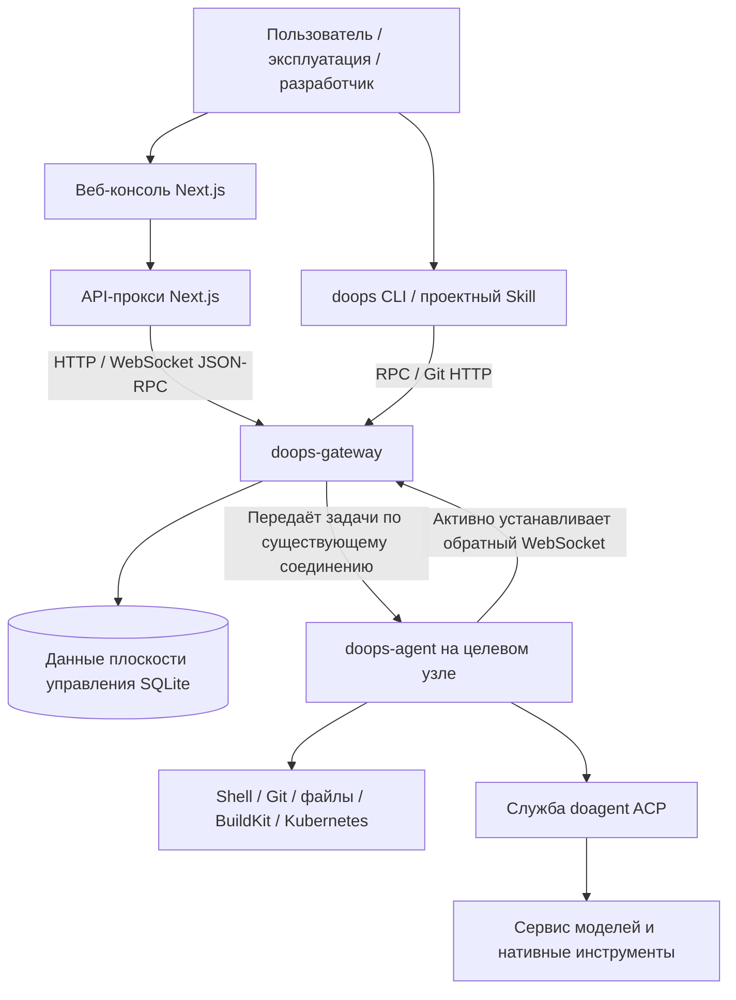

<p align="right"><a href="README.md">中文</a> | <a href="README.en.md">English</a> | <b>Русский</b></p>

# DoOps

**Консоль AI-ассистированной эксплуатации, единый шлюз и канал выполнения агента для серверов и сред Kubernetes.**

DoOps соединяет веб-консоль, инструмент командной строки, агент целевого узла и возможности ИИ-эксплуатации: пользователь через единый шлюз обращается к target, на которые у него есть авторизация, а агент целевого узла выполняет команды, синхронизирует код, обрабатывает файлы или вызывает doagent для задач, требующих анализа и многошагового взаимодействия.

Проект построен по архитектуре **Gateway-first**. Агент целевого узла сам устанавливает обратное соединение; повседневные операции проходят через шлюз с аутентификацией, авторизацией, маршрутизацией и аудитом, и отдельная SSH-сессия для каждой задачи эксплуатации не требуется. SSH по-прежнему может использоваться при первичном бутстрапе и обслуживании хоста со шлюзом.

**Основные участники: 孙勇 (Sun Yong), 高家祺 (Gao Jiaqi), 宋晨宇 (Song Chenyu).** Порядок указания авторов см. в разделе [Участники](#contributors).

[Репозиторий проекта](https://github.com/symansun/doops) · [Обратная связь](https://github.com/symansun/doops/issues) · [Руководство по участию](CONTRIBUTING.md) · [Политика безопасности](SECURITY.md) · [Лицензия](LICENSE)

> **Перед началом работы**: DoOps — это эксплуатационное ПО с реальным удалённым выполнением, а не песочница с сильной изоляцией для недоверенных задач. До подключения к продуктивной среде настройте TLS, минимальные права, защиту учётных данных, резервное копирование и приёмку развёртывания. Демонстрационные данные на страницах не отражают результаты работы реальной среды; текущие границы реализации описаны в разделе [Известные ограничения](#limitations).

## Содержание

- [Назначение и сценарии использования](#overview)
- [Основные возможности](#features)
- [Архитектура и границы ответственности](#architecture)
- [Технологический стек и требования](#requirements)
- [Быстрый старт: веб-консоль](#web-quickstart)
- [Быстрый старт: CLI и проектный Skill](#cli-quickstart)
- [Самостоятельно размещаемый Gateway и Agent](#self-host)
- [Типовые операции](#usage)
- [Развёртывание бизнес-нагрузок и обновление Agent](#delivery)
- [Конфигурация, права и безопасность](#security)
- [Структура репозитория и документация](#repository)
- [Разработка, сборка и тесты](#development)
- [Частые вопросы и известные ограничения](#limitations)
- [Участие в проекте](#contributing)
- [Участники](#contributors)
- [Лицензия](#license)

<a id="overview"></a>
## Назначение и сценарии использования

DoOps описывает процесс эксплуатации от «подключения к target» до «выполнения задачи и проверки результата», а не только окно диалога.

Он подходит для:

- **Повседневная эксплуатация множества узлов**: единый просмотр target, находящихся онлайн, поиск машины по `cluster/instance`, выполнение проверок и сбор информации об узлах.
- **Совместная разработка и доставка**: синхронизация кода в рабочую область указанной session, сборка или диагностика, затем выгрузка артефактов обратно.
- **AI-ассистированная диагностика**: передача требующих исследования задач doagent на целевом узле с просмотром событий выполнения и результатов.
- **Развёртывание в среде Kubernetes**: продвижение выпуска через явную задачу `ask --apply`, управляемые учётные данные, ассеты Helm и доказательства выполнения.
- **Управление эксплуатацией команды**: управление пользователями, Token, авторизацией на target, активными операциями и записями аудита.
- **Контролируемые инспекции и анализ инцидентов**: проверки через `ask`, DoSql, DoWeb и read-only входы Kubernetes с сохранением доказательств аудита.
- **Учебные и лабораторные среды**: изучение в контролируемой среде того, как взаимодействуют шлюз, Agent, права, рабочая область и декларативное развёртывание.

DoOps не заменяет сам Kubernetes, а также не является полноценной БД временных рядов для мониторинга, ITSM-платформой или векторной базой знаний. Планирование, контекст, взаимодействие нескольких Agent и вызов инструментов ИИ в основном обеспечивает внешний движок **doagent**; этот репозиторий отвечает за точку входа эксплуатации, плоскость управления и подключение выполнения.

<a id="features"></a>
## Основные возможности

| Возможность | Описание | Границы применения |
| --- | --- | --- |
| Веб-консоль | Вход, выбор target, интерфейс команд и ИИ-задач, информация об узлах, аудит и точки администрирования | На базе Next.js; часть интерфейсов файлов, базы знаний и настройки моделей ещё требует отладки контрактов с бэкендом |
| Единый Gateway | Регистрация Agent, маршрутизация на target, аутентификация пользователей, авторизация по областям, очереди и ограничение параллелизма | Состояние плоскости управления хранится в SQLite; для доступа из интернета нужен TLS-обратный прокси |
| Обратное подключение Agent | Целевой узел сам подключается к Gateway и указывает цель выполнения через `cluster/instance` | В продуктивной среде для точного target можно включить enrollment token; пользовательский Token не применяется для регистрации Agent |
| Детерминированное выполнение команд | `exec` выполняет команду и возвращает вывод; поддерживаются фоновые задачи, логи и запрос состояния | Это не постоянный PTY; команды получают системные права процесса Agent |
| Синхронизация рабочей области через Git | `push/pull` синхронизируют рабочую область session через Git HTTP и туннель Agent | При выгрузке и очистке возможны перезапись и удаление; это не механизм постоянного резервного копирования |
| Операции с небольшими текстовыми файлами | Выполнение `read/write` в рамках указанной session | Используются пути относительно рабочей области; для больших и бинарных файлов применяйте `push/pull` |
| ИИ-задачи эксплуатации | `ask` подключается к doagent через ACP HTTP и SSE | Нужны доступный сервис doagent, настроенная модель и соответствующие права на target |
| Развёртывание бизнес-задач на естественном языке | `ask --apply` читает указанные в задаче образы, Chart, учётные данные и критерии приёмки и выполняет работу через структурированные инструменты Helm | Бизнес-развёртывание не использует `cicd run`, реестр окружений или непроверенные YAML-воркфлоу |
| Управление ресурсами учётных данных | Версионируемые учётные данные, авторизация, Bundle и материализация во время выполнения | Включение шифрованного хранилища требует стабильной настройки ключа Gateway; это не значит, что все логи автоматически обезличиваются |
| Рабочее место эксплуатации | Объединяет DoSql, DoWeb, наблюдение за Kubernetes и контролируемые точки изменений | Конкретные возможности определяются целевым Agent, привязкой учётных данных и результатами приёмки соответствующего Skill |
| Точка входа обновления Agent | Даёт уведомление об обновлении с проверкой прав и координирует жизненный цикл | Возможности путей Kubernetes и Docker различаются; нельзя предполагать, что режим Docker сам заменит контейнер |

<a id="architecture"></a>
## Архитектура и границы ответственности



### За что отвечает каждый компонент

- **Веб-консоль**: предоставляет точку входа в браузере и обращается к Gateway через серверный прокси. Результаты задач поступают в браузер потоком NDJSON; это не фронтенд из одних статических страниц.
- **doops CLI**: управляет локальной конфигурацией target, учётными данными входа, session, командами, синхронизацией файлов и точками входа развёртывания.
- **doops-gateway**: предоставляет пользователям единую плоскость управления, поддерживает подключения целевых Agent, авторизацию и записи выполнения.
- **doops-agent**: работает в управляемой среде и предоставляет фактический канал команд, рабочей области и выполнения ИИ.
- **doagent**: предоставляет движок выполнения ИИ; это отдельный компонент, отличный от `doops-agent`.
- **Эксплуатационные Skills**: описывают необходимые для задачи предметные знания, ограничения выполнения и контракт результата; их нельзя приравнивать к функциональности, прошедшей сквозную приёмку.

### Три ключевых понятия

| Понятие | Значение | Пример |
| --- | --- | --- |
| Gateway | Единый шлюз доступа пользователей | `https://gateway.example.com` |
| Target | Целевой узел на Gateway, определяемый совместно cluster и instance | `demo/node-1` |
| Session | Логическая сессия и рабочая область одной задачи или процесса | `inspect-001` |

Target отвечает на вопрос «где выполнять», а session различает «какая это задача». По умолчанию рабочая область расположена в `/root/ws/<session>`; **логическая изоляция рабочей области не равна системной песочнице безопасности**.

### Порты и протоколы

| Компонент | Порт или путь по умолчанию | Описание |
| --- | --- | --- |
| Консоль Next.js | `3000` | Основной интерфейс доступен по `/console` |
| Gateway | `42222` | Предоставляет HTTP и WebSocket; TLS обычно терминируется обратным прокси |
| Пользовательский RPC | `/v1/rpc` | Аутентификация по пользовательскому Token с указанием target |
| Регистрация Agent | `/v1/agent/connect` | Точка входа, через которую Agent сам подключается к Gateway |
| Синхронизация рабочей области через Git | `/v1/git/<cluster>/<instance>/<session>.git` | После аутентификации на Gateway запрос по обратному туннелю передаётся Agent |
| Интерфейс здоровья Agent | `/health/live`, `/health/ready`; `/ws` выведен из эксплуатации | Не следует использовать как штатную точку входа из интернета |
| doagent ACP | `9000` | Внутренний сервис выполнения ИИ; не выставляйте его напрямую в интернет |
| BuildKit | `/run/buildkit/buildkitd.sock` | По умолчанию используется Unix-сокет |

Если Gateway и Agent работают в одной хост-сети, необходимо избегать конфликта портов по умолчанию.

<a id="requirements"></a>
## Технологический стек и требования

| Часть | Технологии или рекомендуемые версии в текущем репозитории |
| --- | --- |
| Web | Next.js 16, React 19, TypeScript 6, Tailwind CSS 4 |
| Инструменты фронтенда | Рекомендуются **Node.js 24 и pnpm 11.7.0**, как в CI |
| Бэкенд и CLI | Go; во всех трёх модулях `go.mod` объявляет **Go 1.24.0** |
| Хранилище плоскости управления | SQLite |
| Связь и синхронизация | HTTP, WebSocket, JSON-RPC, Git HTTP |
| Выполнение ИИ | doagent ACP HTTP и SSE |
| Контейнерные и кластерные инструменты | BuildKit, kubectl, Helm — настраиваются по сценарию развёртывания |

Подготовьте зависимости в зависимости от способа использования:

- **Только посмотреть интерфейс**: достаточно Node.js и pnpm, демонстрационному режиму бэкенд не нужен.
- **Подключение к существующей среде**: нужны адрес Gateway, пользовательский Token, зарегистрированный Agent и авторизация на target.
- **Установка готового CLI**: поддерживаются Linux/macOS amd64 и arm64; требуются Bash, `shasum` и обычные Unix-утилиты. Для синхронизации кода также нужен Git.
- **Сборка из исходников**: нужны Go, Node.js, pnpm и Git.
- **Полный контейнер Agent**: дополнительно нужны доступные образы, включённая для среды конфигурация enrollment Agent и настройка модели; для работы с Kubernetes — действующие учётные данные кластера.

> CLI поставляется в виде артефактов для нескольких клиентских платформ, но это не означает, что образ Agent также публикуется для нескольких архитектур. Текущий процесс выпуска образа Agent ориентирован на `linux/amd64`.

<a id="web-quickstart"></a>
## Быстрый старт: веб-консоль

### 1. Получение кода и установка зависимостей

```bash
git clone https://github.com/symansun/doops.git
cd doops

corepack enable
corepack prepare pnpm@11.7.0 --activate
pnpm install --frozen-lockfile
```

Если в используемом дистрибутиве Node.js нет Corepack, сначала установите Corepack или поставьте нужную версию pnpm через пакетный менеджер.

### 2. Запуск сервера разработки

```bash
pnpm dev
```

Адреса для доступа:

- Главная страница: `http://localhost:3000/`
- Консоль: `http://localhost:3000/console`
- Демонстрационный режим: `http://localhost:3000/console?demo=1`

**Демонстрационный режим использует локальные имитированные данные, не подключается к реальным узлам и не может служить доказательством того, что развёртывание или проверка прав пройдены.**

### 3. Подключение к реальной среде

Укажите адрес Gateway в консоли и войдите с существующим логином и паролем или с пользовательским Token. Выберите target, который находится онлайн и на который у вас есть авторизация, и приступайте к операциям.

Следует различать:

- Запуск веб-страницы не создаёт администратора Gateway автоматически.
- Запуск веб-страницы не устанавливает и не регистрирует целевой Agent автоматически.
- Доступность страницы не означает, что модель, права в кластере и возможность развёртывания уже настроены.
- Адрес Gateway должен быть доступен **серверному процессу Next.js**. Если Web работает в контейнере, `localhost` указывает на сам этот контейнер.

Адрес Gateway указывается в интерфейсе и используется серверным прокси; в текущем репозитории корневой `.env.example` не предоставляется.

### 4. Сборка образа Web

Выполните в корне репозитория:

```bash
docker build -f Dockerfile.web -t doops-console:local .

docker run --rm --name doops-console \
  -p 127.0.0.1:3000:3000 \
  doops-console:local
```

`Dockerfile.web` использует standalone-сборку Next.js и запускается в итоге через `node server.js`. Этот образ **содержит только веб-консоль** и не включает полный Gateway, целевой Agent или сервис модели. В продуктивной среде размещайте его за защищённой точкой входа HTTPS.

<a id="cli-quickstart"></a>
## Быстрый старт: CLI и проектный Skill

Примеры ниже предполагают, что администратор предоставил URL Gateway и учётные данные; маршруты target обнаруживаются при первом входе.

### 1. Установка

Выполните в корне репозитория DoOps; каталог бизнес-проекта, указанный в `--project`, должен уже существовать:

```bash
# Рекомендуется: укажите только URL Gateway; первый вход обнаружит target
bash scripts/install.sh --version <release-tag> --project /absolute/path/to/existing-project \
  --target-gateway https://gateway.example.com
export PATH="$HOME/.local/bin:$PATH"
```

Основные места установки:

| Содержимое | Путь |
| --- | --- |
| CLI | `~/.local/bin/doops` |
| Проектный Skill | `<project>/.agent/skills/doops/SKILL.md` |
| Сопутствующая документация | `<project>/.agent/skills/doops/docs/` |
| Конфигурация target по умолчанию | `~/.agent/skills/doops/config.json` |
| Кэш входа | `~/.agent/skills/doops/auth.json` |

Установка обновляет DoOps Skill и сопутствующую документацию в целевом проекте. Если вы изменяли эти файлы самостоятельно, сначала сделайте резервную копию. Конфигурация и кэш CLI содержат чувствительные данные; защита прав на файлы не заменяет шифрованное хранение, не коммитьте их в Git.

### 2. Первый вход и обнаружение target

Ниже приведён пример с заполнителями; замените их данными, предоставленными администратором:

```bash
# Если локального маршрута нет, для первого входа используйте --gateway; подходит вход по паролю или token stdin
doops login --gateway https://gateway.example.com
printf '%s' "$TOKEN" | doops login --gateway https://gateway.example.com --token-stdin

doops list
```

- При первом входе CLI вызывает `GET /v1/targets` и записывает в локальные маршруты онлайн-target, видимые этой учётной записи; имена, псевдонимы и описания существующих маршрутов не меняются.
- Оператору не нужно заранее знать `cluster/instance` Agent.
- Маршрут можно создать заранее через `doops add --name <name> --gateway <url> --cluster <cluster> --instance <instance>` только если нужно зафиксировать его до входа (или используется релиз CLI без поддержки `--gateway`); затем выполните `doops login --target <name>`.
- `doops add` сохраняет только маршрут и не сохраняет target token; состояние входа хранится в локальном кэше auth.
- Реальные учётные данные не должны оставаться в публичных логах, скриптах или общей истории терминала; для входа по паролю используйте интерактивный ввод или `--token-stdin`.

### 3. Проверка подключения

```bash
# Локальный маршрут не означает, что target онлайн
doops list

# Target, реально находящиеся онлайн и видимые в Gateway
doops targets --target <discovered-target>
doops -session diagnose targets --target <discovered-target> --admission

# Простая проверка на указанном target
doops -session inspect-001 exec --target <discovered-target> --cmd 'hostname'
```

Если для существующего маршрута нужен повторный вход по паролю, опустите `--password` — терминал скроет ввод:

```bash
doops login --target <name> --username alice
```

<a id="self-host"></a>
## Самостоятельное размещение Gateway и Agent

Развёртывание рекомендуется выполнять в порядке **инициализация плоскости управления → регистрация Agent → подключение CLI/Web → приёмка возможностей**, а не сначала открывать несколько портов.

### 1. Сборка локальных бинарных файлов из исходников

Выполните в корне репозитория:

```bash
mkdir -p backend/bin

(cd backend/gateway && go build -o ../bin/doops-gateway .)
(cd backend/agent && go build -o ../bin/doops-agent ./cmd/agent)

bash backend/scripts/build-cli.sh
```

Здесь Gateway компилируется локальным тулчейном Go. Скрипт `build-gateway.sh` в репозитории по умолчанию выполняет кросс-компиляцию под Linux/amd64; разработчикам на macOS не следует считать его артефакт по умолчанию исполняемым файлом для своей машины.

### 2. Инициализация идентичности и прав Gateway

Следующие команды выполняются на доверенном хосте Gateway, и все они должны указывать на **одну и ту же постоянную базу данных**. Пример создаёт начального администратора; пароля администратора по умолчанию не существует:

```bash
mkdir -p "$HOME/.local/share/doops-gateway"
DB="$HOME/.local/share/doops-gateway/gateway.db"

backend/bin/doops-gateway user create \
  -db "$DB" -name bootstrap-admin

backend/bin/doops-gateway grant \
  -db "$DB" -user bootstrap-admin \
  -admin

backend/bin/doops-gateway token create \
  -db "$DB" -user bootstrap-admin \
  -name initial-console -expires 24h
```

Пользовательский Token выводится один раз — сразу сохраните его в защищённом месте. Глобальный `admin` из примера предназначен только для первого доверенного бутстрапа, **не используйте его как права по умолчанию для обычных пользователей**. Enrollment token продуктивного Agent настраивается на стороне развёртывания для точного target; текущий CLI Gateway не предоставляет универсальной команды `agent-token create`.

Запуск Gateway:

```bash
backend/bin/doops-gateway serve -db "$DB" -port 42222
```

Внимание: Gateway слушает все сетевые интерфейсы на соответствующем порту, не предоставляет отдельного параметра `-listen` и не настраивает TLS напрямую. Управляйте доступом через файрвол, группы безопасности и обратный прокси и не выставляйте необработанный HTTP-порт в интернет без защиты.

При включении шифрованного хранилища учётных данных, паролей к приватным реестрам и подобных функций необходимо безопасно внедрить и постоянно хранить `DOOPS_GATEWAY_SECRET_KEY`. Не меняйте его случайным образом при каждом запуске; потеря или изменение ключа повлияет на расшифровку существующих шифротекстов.

### 3. Регистрация целевого Agent

Для контролируемой локальной отладки можно использовать «голый» бинарный файл. Например, если Gateway работает локально на `42222`, задайте Agent другой порт:

```bash
mkdir -p "$HOME/.local/share/doops-agent/workspaces"

DOOPS_ALLOW_INSECURE_GATEWAY=1 \
DOOPS_WORKSPACE_ROOT="$HOME/.local/share/doops-agent/workspaces" \
backend/bin/doops-agent \
  -listen 127.0.0.1 \
  -port 42223 \
  -gateway-url http://127.0.0.1:42222 \
  -cluster demo \
  -instance node-1
```

Это лишь пример отладки регистрации и базового канала выполнения: он не устанавливает автоматически doagent, модели, BuildKit или инструменты Kubernetes. При регистрации реального сервера замените адрес на доступный HTTPS Gateway и настройте диапазон прослушивания Agent в соответствии с сетью target.

Если для этого target в Gateway включена проверка enrollment, дополнительно передайте регистрационный токен, привязанный к точному `cluster/instance`, через `DOOPS_AGENT_ENROLL_TOKEN` или `-agent-enroll-token`; если проверка не включена, не используйте пользовательский Token или бизнес-учётные данные в качестве учётных данных регистрации Agent.

### 4. Полный контейнер Agent и развёртывание в Kubernetes

Текущий образ Agent разделён на базовый и прикладной слои: базовый слой предоставляет инструменты времени выполнения, прикладной — `doops-agent`, Skills, документацию и входные скрипты. Контекст сборки находится в `backend/`.

Для полного развёртывания как минимум необходимы:

1. Доступные, доверенные базовый и прикладной образы с фиксированной версией или digest.
2. URL Gateway, cluster, instance, а также `DOOPS_AGENT_ENROLL_TOKEN`, привязанный к этому target при включённом enrollment.
3. Учётные данные `modelProvider`, созданные, проверенные и продвинутые в Gateway; после подключения Agent они материализуются Gateway в `/root/.agent/settings.json`.
4. Необходимые монтирования томов и персистентность; в среде Kubernetes нужен действующий `/root/.kube/config`.
5. Проверенные RBAC, сетевые политики, выбор узлов, учётные данные для загрузки образов и настройки ресурсов.

Рекомендуется прочитать в первую очередь:

- [Развёртывание бизнес-задач на естественном языке](backend/docs/NATURAL_LANGUAGE_DEPLOYMENT.md)
- [SOP по сборке и развёртыванию](backend/docs/BUILD_DEPLOY_SOP.md)
- [Руководство по установке кластера](backend/docs/CLUSTER_INSTALL_GUIDE.md)
- [Helm Chart агента](backend/deploy/helm/doops-agent/)
- [Фиксированные версии среды выполнения](backend/runtime-versions.env)

Ключевые значения Helm Chart по умолчанию пусты и должны быть заполнены под реальную среду; сразу после установки нельзя получить рабочего продуктивного Agent. Названия пространств имён, адреса, права и настройки сертификатов в исторических манифестах также следует проверять по пунктам.

> В репозитории сейчас нет файла оркестрации Docker Compose. Не рассматривайте `docker compose up -d` как готовый способ запустить весь стек одной командой и не считайте, что полный образ Agent можно загрузить без аутентификации в любой среде.

<a id="usage"></a>
## Типовые операции

Примеры ниже используют уже настроенный target `demo-node`. Для удалённых задач явно указывайте session и используйте разные имена для разных задач.

### Просмотр узлов и выполнение команд

```bash
doops -session inspect-001 info --target demo-node

doops -session inspect-001 exec \
  --target demo-node \
  --cmd 'hostname && uname -a && df -h'
```

`exec` предназначен для известных, однозначных команд. Не предполагайте, что текущий каталог shell автоматически совпадает с рабочей областью session; при необходимости явно выполняйте `cd` в ожидаемый каталог.

### AI-ассистированная диагностика

```bash
doops -session diagnose-001 ask \
  --target demo-node \
  --msg '只读检查当前 Kubernetes 节点和异常 Pod，列出证据、可能原因与后续建议，不执行修复。'
```

Используйте после настройки действующей модели и необходимых прав в кластере. «Только чтение» в промпте — это требование задачи, а не замена системному контролю прав; для важных операций по-прежнему нужно проверять результаты и фактические доказательства выполнения.

Запросы к базе данных только на чтение выполняются через `doops -session <s> sql --target <t> --mode query --request '<request>'`; планы и применение изменений, а также `--credential` и `--verify` описаны в [руководстве](backend/docs/DOOPS_USAGE_GUIDE.md).

### Синхронизация кода и выгрузка результатов

```bash
doops -session build-001 push --target demo-node --src .

doops -session build-001 exec \
  --target demo-node \
  --cmd 'cd /root/ws/build-001 && git status --short'

doops -session build-001 pull \
  --target demo-node \
  --dest ./doops-build-output
```

Пример выше использует рабочую область контейнера по умолчанию; если задан `DOOPS_WORKSPACE_ROOT`, пути в shell следует скорректировать соответствующим образом.

- Штатный путь `push/pull` — это Git HTTP через обратный туннель Gateway, а не ручная передача tar/base64 блоками.
- При отправке учитываются `.gitignore` и `.doopsignore`; убедитесь, что необходимые файлы развёртывания не исключены.
- Для выгружаемых результатов выбирайте отдельный выходной каталог; синхронизация с существующим целевым репозиторием может перезаписать локальные изменения, не указывайте на важную рабочую область с незакоммиченными изменениями.

### Чтение и запись небольших текстовых файлов

```bash
doops -session build-001 write \
  --target demo-node \
  --path notes/status.txt \
  --content 'ready for review'

doops -session build-001 read \
  --target demo-node \
  --path notes/status.txt
```

`--path` — это **путь относительно рабочей области** данной session; не записывайте его как `/root/ws/...` и не используйте `..` для выхода за пределы рабочей области. Ограничение чтения по умолчанию — 1 MiB, записи — 16 MiB; для бинарных и больших файлов используйте `push/pull`.

### Длительные задачи

```bash
doops -session build-001 exec \
  --bg \
  --target demo-node \
  --cmd 'cd /root/ws/build-001 && bash ./scripts/build.sh'
```

Здесь `scripts/build.sh` — скрипт сборки, который предоставляет сам бизнес-проект, а не файл, гарантированно существующий в этом репозитории. Для длительных задач используйте штатный механизм `--bg` и не пытайтесь обойти управление жизненным циклом через обычный `exec` с `&`, `nohup` и подобными приёмами. Текущая регистрация фоновых задач не равна гарантии постоянного выполнения при перезапуске Agent.

### Очистка и выход

```bash
# Удаляет указанную удалённую рабочую область и связанные репозитории; сначала проверьте --workspace и сделайте резервную копию артефактов
doops -session build-001 clean --target demo-node --workspace build-001

# Удаление локального кэша входа
doops logout --target demo-node
```

`clean` требует одновременного указания target, session и workspace; фактический объект удаления задаётся через `--workspace`. `logout` удаляет только локальный кэш входа, не отзывает серверный Token и не удаляет Token, сохранённый в конфигурации target.

Другие команды см. в [руководстве по использованию](backend/docs/DOOPS_USAGE_GUIDE.md). Если пути или параметры в исторических документах конфликтуют с текущим кодом, ориентируйтесь на актуальные примеры этого README, текущую справку CLI и исходный код.

<a id="delivery"></a>
## Развёртывание бизнес-нагрузок и обновление Agent

DoOps сводит развёртывание обычных бизнес-нагрузок (workload) к `ask --apply`, а обновление самого Agent передаёт отдельному контроллеру или внешнему скрипту выпуска. Оба пути требуют явного target, области изменений, фактов об образах, причины и машинно-проверяемых критериев приёмки; ответ модели, подсказка на странице или отдельный индикатор здоровья сами по себе не доказывают завершение выпуска.

### Развёртывание обычных бизнес-нагрузок

```bash
doops -session release-check ask \
  --target control-node \
  --apply \
  --credential <resource-name> \
  --msg '在 target control-node 发布服务 api；使用任务指定的 Chart、namespace 和已核验镜像 digest；原因：修复课堂权限；验收：Deployment、Pod、Service、Endpoint 与 /health 均通过。'
```

Задача развёртывания обязана указывать target, область сервисов, ассеты Chart или репозитория, версию образа или её проверяемый источник, причину и критерии приёмки. `--credential` передаёт только имя управляемого ресурса учётных данных; шифротекст не передаётся в параметрах, промпте, логах или рабочей области. Целевой Agent выполняет развёртывание через структурированный `mcp_doops_helm upgrade-install` и возвращает доказательства dry-run, фактических изменений и итогового состояния ресурсов.

Обычное развёртывание не использует старый `cicd run`, реестр окружений или выведенную из промпта область развёртывания, а также не требует предварительного `push` или чтения kubeconfig операционной машины. Подробный контракт см. в разделах [Развёртывание бизнес-нагрузок на естественном языке](backend/docs/NATURAL_LANGUAGE_DEPLOYMENT.md) и [Ресурсы учётных данных](backend/docs/CREDENTIAL_RESOURCES.md).

### Стандартное обновление Helm Agent

Для Helm Agent, у которого уже есть контроллер самообновления, используйте `doops upgrade`; Job обновления выполняется внутри целевого кластера, и процесс Agent не заменяет сам себя:

```bash
doops -session agent-upgrade upgrade \
  --target <configured-target> \
  --image <repository>@sha256:<verified-ci-digest>

# Только предпросмотр параметров; не доказывает доступность контроллера, монтирований или прав
doops -session agent-upgrade upgrade \
  --target <configured-target> \
  --image <repository>@sha256:<verified-ci-digest> \
  --dry-run
```

`doops upgrade` обрабатывает только замену образа или откат стандартного Helm Agent и не изменяет бизнес-нагрузки, allowlist прокси или другие настройки Helm. До и после обновления следует сверять release commit CLI и Agent, готовность Pod, переподключение к Gateway и фактический digest образа.

### Первая установка и нестандартный Agent

Выбирайте точку входа по форме эксплуатации; автоматического взаимного понижения между ними нет:

| Сценарий | Точка входа | Ключевые предпосылки |
| --- | --- | --- |
| Пустой сервер Ubuntu/Debian | `backend/scripts/bootstrap-host-agent.sh` | root, явная версия выпуска, уникальные cluster/instance; скрипт устанавливает Docker/Compose и проверяет туннель Gateway |
| Первая установка в K8s или явное изменение конфигурации Helm | `backend/scripts/release-managed-agent.sh` | kubeconfig внешнего контроллера, Helm, kubectl и полный values |
| Старый Helm Agent или повреждённый командный канал | `backend/scripts/release-managed-agent.sh` | Сначала выполнить dry-run, резервное копирование и приёмку передачи управления |
| Существующий отдельный Docker Agent | `backend/scripts/release-host-agent.sh` | Внешнее управление DockerHost, явный SSH-порт, неизменяемый образ и проверка ключей хоста |
| Плоскость управления Gateway | `backend/scripts/deploy-gateway.sh --no-build` | Использовать проверенный CI Release Asset и не публиковать себя через target Agent |

Подробные шаги резервного копирования, отката, provenance образов и приёмки см. в [SOP по сборке и развёртыванию](backend/docs/BUILD_DEPLOY_SOP.md) и [руководстве по установке кластера](backend/docs/CLUSTER_INSTALL_GUIDE.md).

<a id="security"></a>
## Конфигурация, права и безопасность

### Основные настройки

| Настройка или параметр | Назначение | Примечания |
| --- | --- | --- |
| `DOOPS_CONFIG` | Переопределяет путь к файлу конфигурации CLI по умолчанию | Это не конфигурация Gateway для веб-консоли |
| `-gateway-url`, `-cluster`, `-instance` | Место регистрации и идентичность Agent | Для «голого» бинарного файла параметры следует передавать явно; не предполагайте, что одноимённые переменные окружения из Helm заработают автоматически |
| `DOOPS_AGENT_ENROLL_TOKEN`, `-agent-enroll-token` | target-scoped учётные данные enrollment, которые Agent использует для регистрации в Gateway | Задаются только при включённом enrollment в Gateway и должны быть привязаны к точному cluster/instance |
| `DOOPS_WORKSPACE_ROOT` | Корневой каталог рабочих областей сессий Agent | По умолчанию `/root/ws`; после изменения нужно скорректировать пути в связанных скриптах |
| `DOOPS_GATEWAY_SECRET_KEY` | Ключевой материал для шифрования учётных данных Gateway | При включении функций учётных данных безопасно внедрить, постоянно хранить и резервировать |
| `DO_AGENT_PORT`, `DO_AGENT_URL` | Адрес внутреннего ACP-сервиса Agent | Порт по умолчанию `9000`, адрес `http://127.0.0.1:9000`; при кастомизации соблюдайте согласованность |
| `DOOPS_ALLOWED_WS_ORIGINS` | Ограничение Origin для WebSocket | Настраивайте вместе с реальным доменом развёртывания |
| `DOOPS_ALLOW_INSECURE_GATEWAY` | Разрешает исключение для разработки с не-loopback HTTP/WS | Не использовать как настройку по умолчанию в продакшене |

### Принципы прав и учётных данных

1. **Различайте пользовательский Token и Agent enrollment token**: первый используется для работы с Gateway, второй — только для обратной регистрации Agent на точном target при включённом enrollment; это не взаимозаменяемые пароли.
2. **Чётко определяйте область и действия авторизации**: не используйте `admin`, подстановочные знаки или авторизации без указания actions как шаблон для обычных пользователей.
3. **Проверяйте авторизации по умолчанию на стороне управления**: поведение по умолчанию у разных точек создания может различаться; не предполагайте, что все новые пользователи автоматически соответствуют принципу минимальных прав.
4. **Ограничивайте высокопривилегированные возможности**: `exec`, учётные данные кластера, каталоги хоста и runtime-сокеты могут иметь большой радиус воздействия.
5. **Не считайте изоляцию каталогов изоляцией безопасности**: текущий Helm Chart содержит конфигурацию привилегированных контейнеров, поэтому развёртывайте его для доверенных эксплуатационных сотрудников и контролируемых сред.
6. **Ограничивайте сетевой выход веб-прокси**: Next.js выполняет серверные запросы по адресу Gateway из запроса, поэтому публичному развёртыванию нужны дополнительные контроль входа, ограничение области target или исходящих соединений.
7. **Защищайте аудит и данные моделей**: команды, промпты, результаты и конфигурация могут содержать чувствительные данные; обезличивайте их перед публикацией и не отправляйте производственные секреты на недоверенные endpoint моделей.
8. **Резервируйте состояние**: сохраняйте постоянную базу данных Gateway и ключ шифрования; важные артефакты своевременно экспортируйте — в рабочих областях Agent действует механизм автоматической очистки.

По вопросам безопасности приватно свяжитесь с сопровождающими согласно [SECURITY.md](SECURITY.md) и не прикладывайте к публичным Issue реальные учётные данные, производственные адреса или детали эксплуатируемых уязвимостей.

<a id="repository"></a>
## Структура репозитория и документация

```text
doops/
├── app/                         # Страницы и API-прокси Next.js
├── components/                  # Компоненты консоли и интерфейсов администрирования
├── lib/                         # Клиент, типы протокола и вспомогательный код фронтенда
├── scripts/install.sh           # Корневая точка входа установки, перенаправляет к скриптам бэкенда
├── backend/
│   ├── agent/                   # Agent, реализация плоскости управления, подключение ACP и диспетчеризация
│   │   ├── cmd/agent/           # Точка входа doops-agent
│   │   ├── internal/server/     # Реализация основных сервисов Gateway/Agent
│   │   └── skills/              # Эксплуатационные Skills на стороне Agent
│   ├── gateway/                 # Отдельная точка входа сборки doops-gateway
│   ├── cli/                       # Исходный код и точка входа сборки Go CLI
│   ├── deploy/                  # Helm, окружения и конфигурация рабочих процессов развёртывания
│   ├── scripts/                 # Скрипты установки, сборки и обслуживания
│   ├── docs/                    # Документация по протоколам, использованию и развёртыванию
│   ├── test/                    # Python-проверки контрактов и развёртывания
│   ├── Dockerfile              # Прикладной образ Agent
│   ├── Dockerfile.base.light   # Лёгкий базовый образ Agent
│   └── runtime-versions.env    # Фиксированные версии среды выполнения и источники образов
├── docs/                        # Проектные документы и записи о реализации
├── Dockerfile.web              # Продуктивный образ Next.js
├── .github/workflows/ci.yml    # GitHub CI
├── .cnb.yml                    # Проверки CNB и публикация образа Agent
├── CONTRIBUTING.md
└── SECURITY.md
```

| Документ | Назначение |
| --- | --- |
| [Руководство по использованию CLI](backend/docs/DOOPS_USAGE_GUIDE.md) | Выбор команд, сессии, синхронизация и управление задачами |
| [Руководство по подключению API](backend/docs/DOOPS_API_GUIDE.md) | Вход, target, RPC, поток прогресса и аудит |
| [Туннель Gateway и жизненный цикл выполнения](backend/docs/DOOPS_GATEWAY_TUNNEL.md) | Обратное подключение Agent, жизненный цикл выполнения и границы параллелизма |
| [Руководство по интеграции Skill](backend/docs/SKILL_INTEGRATION_GUIDE.md) | Подключение проектных Skills |
| [Стандарты моделей](backend/docs/MODEL_STANDARDS.md) | Настройка моделей и правила использования |
| [SOP по сборке и развёртыванию](backend/docs/BUILD_DEPLOY_SOP.md) | Процессы сборки, образов и развёртывания |
| [Руководство по установке кластера](backend/docs/CLUSTER_INSTALL_GUIDE.md) | Справочник по подключению кластера |
| [Развёртывание бизнес-нагрузок на естественном языке](backend/docs/NATURAL_LANGUAGE_DEPLOYMENT.md) | Границы ответственности и принципы приёмки бизнес-развёртывания |

Часть исторических документов бэкенда использует `backend/` как текущий каталог, поэтому примеры вида `scripts/...` не всегда можно выполнить напрямую из корня репозитория. Основное веб-приложение сейчас находится в корне репозитория; порт `8088` и скрипты сборки старого Go WebUI используются только для поддержки legacy и не являются точкой входа развёртывания Next.js.

<a id="development"></a>
## Разработка, сборка и тесты

Выполните в корне репозитория проверки, соответствующие GitHub CI:

```bash
(cd backend/agent && go test ./...)
(cd backend/gateway && go test ./...)
(cd backend/cli && go test ./...)

pnpm exec tsc --noEmit
pnpm build
```

В корне нет модуля Go, поэтому не объединяйте три проверки Go в один запуск `go test ./...` из корня. Во фронтенде также можно запускать `pnpm test:gateway-policy` и `pnpm test:console`; `pnpm build` используется для продуктивной сборки.

CNB также включает проверки Python-контрактов. Подготовьте Python 3, pytest, PyYAML, Helm и соответствующие тестовые зависимости и выполните:

```bash
python3 -m pytest backend/test -q
```

Часть проверок Python выполняет CLI или инструменты, а не только сканирует текст; при сбое следует проверить предпосылки среды и конкретные утверждения.

Если сопровождающему нужно пересобрать все артефакты CLI:

```bash
bash backend/scripts/build-cli.sh --all
```

Перед коммитом также проверьте:

- Пути и параметры в документации соответствуют текущему коду.
- Изменения протокола во фронтенде, Gateway, Agent и CLI сопровождаются тестами.
- Не закоммичены `.next/`, `node_modules/`, кэши тестов, рабочие базы данных и локальные рабочие области.
- Не закоммичены Token, API Key, kubeconfig, приватные ключи, пароли к реестрам образов или внутренняя информация о среде.
- Изменения, связанные с выпуском, имеют проверяемые результаты, а не только описание процесса генерации.

<a id="limitations"></a>
## Частые вопросы и известные ограничения

### Страница открывается, но почему не видно узлов?

Веб-страница не отвечает за автоматическое развёртывание целевого Agent. Проверьте адрес Gateway, права пользователя, конфигурацию enrollment Agent и совпадение cluster/instance. `doops list` показывает только локальную конфигурацию; состояние онлайн смотрите в `doops targets`.

### Почему `exec` работает, а `ask` — нет?

Детерминированное выполнение и выполнение ИИ зависят от разного. Проверьте доступность doagent ACP, наличие привязанных и продвинутых учётных данных `modelProvider` на target и доступность сервиса модели. Настройки модели материализуются только после подключения Agent к Gateway; «голый» бинарный файл также не несёт учётные данные модели автоматически.

### Почему при чтении и записи файлов сообщается о небезопасном пути?

Текущие файловые инструменты бэкенда требуют относительный путь внутри session. Используйте `notes/status.txt` и не передавайте `/root/ws/<session>/notes/status.txt`. Часть исторических примеров и модулей фронтенда всё ещё использует старое соглашение о путях, и их нужно привести в соответствие.

### Возврат 200 от проверки здоровья означает, что все возможности в порядке?

Нет. `/health/live` говорит лишь о том, что HTTP-процесс Agent жив; `/health/ready` — что обратная регистрация в Gateway подтверждена. Ни то, ни другое не заменяет вызов модели, сборку образа, права в кластере и приёмку реального развёртывания.

### Уже поддержаны все страницы и все форматы выпуска?

Исходный код всё ещё дорабатывается, и необходимо чётко обозначить следующие границы:

- Для файлов, базы знаний, настройки моделей и связанных страниц ИИ есть вопросы адаптации к путям и контрактам параметров бэкенда; не считайте «страница существует» доказательством полной работоспособности цепочки.
- Интерфейс базы знаний в основном работает с файлами Markdown и не является реализованным сервисом векторного поиска или RAG.
- Предпроверка учётных данных и выполнение бизнес-развёртывания определяются `ask --apply`, `NATURAL_LANGUAGE_DEPLOYMENT.md` и `CREDENTIAL_RESOURCES.md`; не считайте старые `DeploymentTemplate` или `cicd run` текущей точкой входа.
- Ветка Docker обновления Agent не означает автоматической замены контейнера: для фактической замены нужен внешний механизм управления.
- Рабочие области могут автоматически очищаться, а фоновые задачи не дают безусловной гарантии сохранения после перезапуска.
- Текущий образ Agent, значения по умолчанию Helm и исторические перечни окружений не образуют обещания «развёртывания на всех платформах одной кнопкой».

Имитационные примеры и демонстрационные метрики на страницах не следует трактовать как независимо проверенную производительность, эффективность или экономический эффект. Пригодность для продуктивной среды требует приёмки в собственной сети, с собственными правами, runtime и рабочими процессами.

<a id="contributing"></a>
## Участие в проекте

Приглашаем участвовать в проекте через Issue, Pull Request, улучшение документации и обратную связь по использованию.

- [Сообщить о баге](https://github.com/symansun/doops/issues/new?template=bug_report.yml): укажите шаги воспроизведения, версию или commit, ожидаемое и фактическое поведение, а также логи без чувствительных данных.
- [Предложить функцию](https://github.com/symansun/doops/issues/new?template=feature_request.yml): опишите сценарий использования, текущие ограничения и желаемый результат.
- Перед отправкой PR сначала запустите соответствующие проверки; изменения протокола или прав должны сопровождаться тестами и документацией.
- При правках документации по развёртыванию указывайте рабочий каталог, необходимую конфигурацию, границы прав и то, проверялось ли это на практике.
- Не прикладывайте к Issue, PR, скриншотам или примерам реальные учётные данные и чувствительную информацию о продуктивной среде.

Подробные требования см. в [CONTRIBUTING.md](CONTRIBUTING.md) и [шаблоне PR](.github/pull_request_template.md).

<a id="contributors"></a>
## Участники

Основные участники проекта указываются в следующем порядке:

| Порядок | Участник | Атрибуция |
| --- | --- | --- |
| 1 | **孙勇 (Sun Yong)** | Первый участник |
| 2 | **高家祺 (Gao Jiaqi)** | Второй участник |
| 3 | **宋晨宇 (Song Chenyu)** | Третий участник |

Спасибо всем, кто участвует в развитии проекта кодом, дизайном, тестами, документацией и обратной связью по использованию.

<a id="license"></a>
## Лицензия

Проект распространяется по [MIT License](LICENSE). При изменении, повторном распространении или коммерческой интеграции сохраняйте текст лицензии и уведомление об авторских правах.

Сторонние зависимости и компоненты среды выполнения остаются под своими лицензиями; конкретные условия определяются лицензионными файлами, прилагаемыми к соответствующим компонентам.
