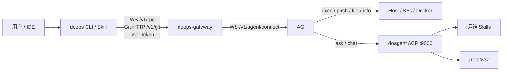

# doops.sh

`doops` 是 SSH 的替代入口。日常使用只走公网 `doops-gateway`，再由 gateway 路由到主动注册的内网 `doops-agent`；不需要 SSH 用户、SSH 端口或 SSH 密码。

## GitHub 发布说明

本仓库的公开发布分支使用脱敏配置：文档和测试中的公网地址、镜像仓库、模型网关和凭据均使用示例占位。真实 gateway token、API key、registry 密码、SSH 凭据和 kubeconfig 必须通过环境变量、Kubernetes Secret 或本机忽略配置提供，不能提交到 git。

标准验证命令：

```bash
(cd agent && go test ./...)
(cd gateway && go test ./...)
(cd skills/doops-cli && go test ./...)
```

## 架构图

自然语言发布的权威职责边界见
[docs/NATURAL_LANGUAGE_DEPLOYMENT.md](docs/NATURAL_LANGUAGE_DEPLOYMENT.md)。DoOps 不实现另一套
Agent 框架；上下文、规划、多 Agent、Skill 和工具调用由 doagent 原生引擎负责。



系统里有两条正交维度：

- 连接模式：CLI/skill 连接 gateway，内网 agent 主动注册 gateway
- 执行模式：快路径 `exec/read/write/push/pull/info/check/clean`，慢路径 `ask` / 后续 `chat`

组件分工：

- 客户端：`doops` CLI + doops skill
- 公网控制面：`gateway/` 构建 `doops-gateway`，负责 RBAC、审计、排队和内网 agent 路由
- 边缘执行端：`agent/` 构建 `doops-agent`，负责目标机器上的 exec、push/pull、文件和 AI 任务
- 运行安全边界：`doops-agent` 默认只启动 `doops-agent`、`do-agent`、`buildkitd`；默认不启动 `sshd`，不启动 WebIDE
- 连接方式：CLI/skill 访问 gateway `42222`，gateway 通过已建立的 agent WebSocket 进入内网 agent
- 鉴权方式：用户连接 gateway 使用 gateway user token；agent 反向注册只声明 `cluster/instance`，不使用 token
- 代码同步：gateway 使用 Git HTTP；gateway 只通过已建立的 agent WebSocket 反向隧道透传 Git 请求，不再使用 tar 分块上传作为 `push/pull` 路径
- 镜像构建：统一使用 `buildctl + buildkitd`

## Target 口径

target 只来自本机 Gateway-only `config.json` 与 Gateway 当前在线注册状态。仓库文档不维护
环境 target 清单，也不根据业务名、IP、历史 cluster 或旧节点别名生成 target。

## 当前镜像与协议

当前维护版 agent 默认采用轻量双镜像发布：

```text
docker.cnb.cool/l8ai/ai/doops.sh/base-light:<release>  # 基础工具：buildkit / kubectl / Python+PyYAML / Helm / git / ssh client / tini / bash
docker.cnb.cool/l8ai/ai/doops.sh:<release>             # doops-agent / 精确 doagent / skills / docs / entrypoint
```

`Dockerfile` / `agent/Dockerfile` 不提供可用的可变基础镜像默认值；占位地址会在遗漏参数时立即失败。构建时必须显式传入本次不可变 `DOOPS_AGENT_BASE_IMAGE` 和 `DO_AGENT_VERSION`，当前运行架构固定为 `linux/amd64`。

```text
Dockerfile.base.light                     # 轻量基础镜像：doagent / buildkit / kubectl / Python+PyYAML / Helm / git / ssh client / tini / bash
docker.cnb.cool/l8ai/ai/doops.sh/base-light:<release>
docker.cnb.cool/l8ai/ai/doops.sh:<release>
```

`base-light` 的目标是作为纯 `doops-agent` 运行时，不再默认继承 WebIDE 启动器或
SSH 服务端。镜像保留 `ssh` 客户端，已在线 Agent 可通过 `doops exec` 代理执行用户
明确给出的任意 SSH 命令；它不会启动 `sshd`，也不会恢复 SSH target 或直连入口。

镜像构成：

- 基础镜像源码：`Dockerfile.base.light`
- doAgent 版本基线：`runtime-versions.env`
- 更新镜像源码：`Dockerfile` / `agent/Dockerfile`
- doagent 来源：最终镜像直接从 `runtime-versions.env` 的不可变 `DO_AGENT_IMAGE` 复制，不依赖基础镜像内的历史二进制
- 网关二进制：`/app/doops-agent`
- doagent AI 内核：`/usr/local/bin/do-agent`
- 构建闸门：独立 `DO_AGENT_IMAGE` 和最终镜像必须确认 `/usr/local/bin/do-agent --version` 与声明的 `DO_AGENT_VERSION` 完全一致；基础镜像只负责 BuildKit、kubectl、Python/PyYAML、Helm 等工具，并固定到 OCI digest
- 发布原则：最终镜像同时固定 `DOOPS_AGENT_BASE_IMAGE` 和 `DO_AGENT_IMAGE`；app 镜像 push 前必须校验两者 label、`/app/doops-agent -help`、`/usr/local/bin/do-agent --version` 与声明版本一致、`buildctl --version`、Python/PyYAML 与 Helm。部署由明确授权的自然语言任务进入 Gateway；任务必须给出 target、服务范围、镜像版本、变更原因和验收条件。

协议与端点：

- CLI 到 gateway 使用 `WS /v1/rpc?cluster=<cluster>&instance=<instance>`
- 内网 agent 到 gateway 使用 `WS /v1/agent/connect?cluster=<cluster>&instance=<instance>`
- 模型网关地址使用 `https://api.example.com` / `https://api.example.com/v1`，不带 `:8443`

本轮维护已清理的技术债：

- 将 doagent 依赖镜像固定为公开 doAgent 的版本标签和 OCI digest，并在每层镜像中校验二进制版本
- 将 agent 发布拆为 `doops.sh/base-light:<release>` 和 `doops.sh:<release>`，避免每次代码更新都拉取多 GiB 基础层
- 统一发布脚本与 DaemonSet 使用 CI 产出的不可变镜像 digest
- 关闭默认攻击面：`agent-entrypoint.sh` 改为仅在显式 `DOOPS_ENABLE_SSHD=1` / `DOOPS_ENABLE_WEBIDE=1` 时才启动 SSH 或 WebIDE
- 标准运行镜像保留出站 SSH 客户端，但不安装或启动 SSH 服务端
- 将 doagent 旧叙述收敛为当前 doagent ACP HTTP 路径
- 新增多用户多集群 `doops-gateway`：SQLite、user token、scope/action 权限、审计和 gateway Git HTTP 反向隧道
- 统一 `push/pull`：gateway 使用 Git 快照语义，并按 `/v1/git/<cluster>/<instance>/<session>.git` 精确路由到目标 agent
- 加固多人使用：user token 按 token id 单行校验，密码登录 token 默认 24 小时过期，同一 target 默认有界排队串行执行
- 将 `agent:upgrade` 收敛为只读预览；Agent 和 Gateway 都拒绝直接修改承载 Agent 的工作负载

## Gateway 代码入口

`doops-gateway` 是一等组件，源码入口在仓库一级目录：

```bash
bash scripts/build-gateway.sh
./bin/doops-gateway serve -db /var/lib/doops-gateway/gateway.db -port 42222
```

兼容入口 `agent/cmd/gateway` 仍保留，但只作为旧构建路径 wrapper；新文档和新部署应使用 `gateway/`。

面向外部系统的 API 使用指南见 [docs/DOOPS_API_GUIDE.md](docs/DOOPS_API_GUIDE.md)，包括登录、目标查询、WebSocket JSON-RPC、自然语言部署、进度流和审计查询。

2026-05-11 gateway 验收状态（历史记录）：

- 公网 gateway：当前标准入口为 `https://doops.l8ai.cn`；早期明文 HTTP
  地址只属于历史受控实验，不得进入当前客户端配置
- 已接入 target：`doops-114/vm-114`、`doops-jm/jm-228`
- 已验证：`targets`、`exec`、`write/read`、`push`、高危 action 未授权拒绝、90 秒以上 heartbeat 保活
- `ask` 链路通过 `doops-agent -> doagent ACP HTTP`；模型配置必须来自 `doagent-model-settings` Secret，Agent 镜像升级不得覆盖该 Secret
- 89/114/JM 的运行容器命名已统一为标准 `doops-agent`；JM 通过 89 内网路径接入 gateway。

## Agent 双镜像发布

版本化 CNB Release Workflow 负责测试、构建并发布两类镜像：

```text
docker.cnb.cool/l8ai/ai/doops.sh/base-light:<release>
docker.cnb.cool/l8ai/ai/doops.sh:<release>
```

分层边界：

- `doops.sh/base-light`：doagent、BuildKit、kubectl、系统包、通用运行工具；变化频率低，拉取成本高。
- `doops.sh`：`/app/doops-agent`、`/app/skills`、`/app/self-docs`、entrypoint；变化频率高，拉取成本低。

禁止把基础 rootfs 压平成每次 release 都变化的大层。CI 可以生成 release tag
供制品发现，但线上升级必须把选中的 `doops.sh` 解析并固定为 OCI digest；节点仍可
复用已缓存的基础层，同时避免 tag 漂移造成不可复现发布。

CNB 非同名制品必须使用仓库下级路径，例如 `docker.cnb.cool/l8ai/ai/doops.sh/base-light:v1`。不要写成 `docker.cnb.cool/l8ai/ai/doops.sh-base-light:v1`，那会发布到另一个制品名，也无法被当前 release 流水线复用。

## 固定路径

- CLI：`~/.local/bin/doops`
- Skill 源码权威位置：`skills/SKILL.md`
- Skill 安装目标：`<project>/.agent/skills/doops/SKILL.md`
- CLI 唯一默认配置：`~/.agent/skills/doops/config.json`
- Gateway 登录态：`~/.agent/skills/doops/auth.json`
- Gateway target 只保存路由；同一 Gateway 的所有 target 共享按 Gateway URL 保存的一份登录态
- CLI 发布资产：CNB Release 的 `doops-<os>-<arch>` 与 `checksums.txt`

`~/.config/doops/`、`~/.doops/` 和项目 `.doops/` 不属于当前 CLI 状态目录。`DOOPS_CONFIG=/path/to/config.json` 只改变配置文件位置，不放宽 Gateway-only schema 校验。

## 安装模型先看这里

Doops 有两件事容易混淆，文档里必须先分开看：

1. **agent 部署形态**：`doops-agent` 在目标机器上怎么跑起来。
2. **连接模式**：CLI/skill 怎么连到这个 agent。

### Agent 部署形态

| 形态 | 怎么识别 | 适用场景 | 是否容器化 |
| :--- | :--- | :--- | :--- |
| K8s/DaemonSet | `kubectl get pod -A -l app=doops-agent` 能看到 Pod | K8s/K3s 集群节点，推荐标准安装 | 是 |
| Docker/nerdctl 容器 | `docker ps` 或 `nerdctl ps` 里有名为 `doops-agent` 的容器 | 单机或没有 DaemonSet 的节点，推荐标准安装 | 是 |
| 裸二进制/systemd | `ps -ef | grep doops-agent` 显示 `/usr/local/bin/doops-agent -port ...`，但没有 Pod/容器 | 临时自举、旧节点兼容 | 否 |

例如某台机器上看到：

```text
/usr/local/bin/doops-agent -port 42222 ...
```

同时 `kubectl get pod -A -l app=doops-agent` 没有 Pod，`docker ps` 也没有 `doops-agent` 容器，就说明它是 **裸二进制直装**，不是 K8s/K3s 镜像安装。裸二进制不会自动获得容器镜像里的 doagent、BuildKit、skills 和自恢复能力；生产环境建议升级成 K8s/DaemonSet 或容器模式。

### Gateway 连接

标准 target 只配置 gateway：

| CLI/skill 连哪里 | 目标 agent 要怎么运行 |
| :--- | :--- |
| `ws(s)://<gateway>/v1/rpc` | 内网 agent 主动 `-gateway-url ... -cluster ... -instance ...` 连公网 gateway |

是否“可以操作某节点”取决于该 agent 是否已经主动注册到 gateway。`doops targets --target <gateway-target>` 只查询配置中对应的 `cluster/instance`，离线时明确失败。CLI 不提供绕过 target 配置的 Gateway/token 查询入口。

## 客户端安装与连接

### 1. 安装 CLI 和 skill

doops skill 的权威源码在本仓库 `skills/SKILL.md`。不要在用户项目里手写或反向维护 skill；安装脚本只负责把仓库里的 `skills/SKILL.md` 拷贝到业务项目的 `.agent/skills/doops/SKILL.md`。

```bash
git clone https://cnb.cool/l8ai/ai/doops.sh.git
cd doops.sh
bash scripts/install.sh --version <release-tag> --project /absolute/path/to/your/project
```

这一步会完成：

1. 从 CNB Release Assets 下载指定版本的 CLI 和 `checksums.txt`，校验后原子替换 `~/.local/bin/doops`
2. 把 doops.sh 源码里的 `skills/SKILL.md` 安装到 `/absolute/path/to/your/project/.agent/skills/doops/SKILL.md`

如果 `~/.local/bin` 还不在 `PATH`：

```bash
export PATH="$HOME/.local/bin:$PATH"
```

也可以安装时直接写入 gateway 目标配置。

```bash
bash scripts/install.sh \
  --version <release-tag> \
  --project /absolute/path/to/your/project \
  --target-name jm \
  --target-gateway https://gateway.example.com \
  --target-cluster doops-jm \
  --target-instance jm-228 \
  --target-aliases jy \
  --use 'JM via gateway'
```

Skill 会随安装同步到项目目录。标准 target 的配置只包含
`gateway`/`cluster`/`instance` 路由。安装后运行一次
`doops login --target jm`，登录态会供同一 Gateway 的全部 target 使用。

- target 支持短名和别名，例如主名 `jm`，别名 `jy`。后续 `doops -session smoke exec --target jy --cmd hostname` 会解析到同一个 `doops-jm/jm-228`。

## Gateway 用户维护

用户、密码、token、授权和审计都由 gateway 统一维护，不保存在业务项目里。

产品层只暴露 `doops` 作为日常入口。发账号、发 token、grant 权限、审计查询、审计清理属于管理员能力，应收敛到 `doops admin ...` 管理入口；业务项目和 skill 不应引导用户直接调用 gateway 内部维护命令。

授权模型：

- 普通 user token 必须通过显式 grant 获得对应 `cluster/instance/action` 权限；无 grant 默认拒绝，`targets:list` 不隐式授予 exec、ask、read、write、push 等操作。
- 全局管理员需要显式授予 `admin` 权限。
- 审计记录按 `user_id`、`token_id`、`cluster`、`instance`、`action`、`session`、`status` 可追溯。

故障判断：

- `401 Unauthorized`：token 无效或过期，认证失败
- `403 Forbidden`：token 有效，但该用户缺少当前 `cluster/instance/action` 的显式 grant，或缺少 gateway 管理员 `admin` 权限

### 2. 通过 gateway 添加内网集群目标

gateway 由管理员维护用户、user token 和授权。agent 部署只声明绑定的
`cluster/instance`；业务侧 CLI 配置只消费管理员发放的 user token，不直接维护
gateway 数据库。

gateway 支持用户名密码登录，先换取 user token 再用 token 操作：

```bash
doops login --target prod-master --username alice
```

内网 agent 主动连接公网 gateway：

```bash
doops-agent \
  -gateway-url https://gateway.example.com \
  -cluster prod \
  -instance master-1 \
```

客户端配置 gateway target：

```bash
doops add \
  --name prod-master \
  --gateway https://gateway.example.com \
  --cluster prod \
  --instance master-1 \
  --aliases prod,master \
  --use 'prod cluster via gateway'

doops login --target prod-master
```

doops 支持 `http` / `https` gateway；`http` 会自动转换为 WebSocket 隧道使用的 `ws`。
公网生产环境建议使用 `https` / `wss`，但 CLI 和 agent 不会因为 gateway 是 HTTP 而拒绝连接。

验证：

```bash
doops targets --target prod-master
doops -session smoke exec --target prod-master --cmd 'hostname'
```

### 3. 验证连接

```bash
doops list
doops targets --target prod-master
doops -session smoke exec --target prod-master --cmd 'hostname'
doops -session smoke ask --target prod-master --msg '用一句话说明当前机器状态'
```

## 服务端安装 Agent

如果 `doops-agent` 已经在目标机器上运行并注册到 gateway，只需要给客户端配置 gateway target 和 gateway user token，不需要 SSH。

从客户端直接 SSH 到 Agent 宿主机只用于首次安装或 Agent 完全不可用时的自恢复，
不是日常 DoOps 连接方式。该限制不适用于在线 Agent 通过 `doops exec` 代理的出站
SSH 命令；用户可以显式要求它执行任意 SSH 客户端命令。

Agent 的安装和升级只有一条命令，见
[docs/CLUSTER_INSTALL_GUIDE.md](docs/CLUSTER_INSTALL_GUIDE.md)：

```bash
bash scripts/release-managed-agent.sh \
  --release doops-agent \
  --namespace doops-system \
  --values /path/to/complete-values.yaml \
  --version <vX.Y.Z>
```

已在线节点把 `--values` 换成 `--target` / `--session`。不要用 `agent.yaml`、
`kubectl set image` 或 `docker run` 发版。

### 维护者发布业务 workload

发布者通过 `doops ask --apply` 提交明确授权的自然语言任务。任务必须直接给出 Gateway
target、服务范围、不可变镜像 digest、变更原因和验收条件；需要凭据时仅以可重复的
`--credential <resource-name>` 元数据引用声明。Gateway 绑定用户、target 和 session，
按精确 workload/image/Helm scope 授权并在目标 doops-agent 的内部控制面物化；公开
prompt、doagent 上下文和 metadata binding 不接收凭据 payload。完整流程见
[docs/NATURAL_LANGUAGE_DEPLOYMENT.md](docs/NATURAL_LANGUAGE_DEPLOYMENT.md) 和
[docs/CREDENTIAL_RESOURCES.md](docs/CREDENTIAL_RESOURCES.md)。

`doops upgrade` 仅用于 doops-agent 自身升级的 dry-run 预览，非 dry-run 请求会在分发前
被拒绝。Helm 托管 Agent 的正式替换只走 `scripts/release-managed-agent.sh`。普通业务
workload 由 target 指向的 Agent/doagent 执行发布；不要用 Job/`kubectl set image` 改
Agent。正式业务发布统一使用 Gateway 上的 `doops ask --apply`；CI 可以在镜像
构建成功后调用同一自然语言入口，但不拥有另一套环境注册表或结构化发布协议。

## 常用命令

```bash
doops list
doops -session demo exec --target gpu-ampere01 --cmd 'uptime && df -h'
doops -session demo ask --target gpu-ampere01 --msg '检查磁盘和内存压力，给出结论'
doops -session demo push --target gpu-ampere01 --src .
doops -session demo pull --target gpu-ampere01 --dest ./demo-output
doops -session demo write --target gpu-ampere01 --path /root/ws/demo/pod.yaml --file ./pod.yaml
doops -session demo exec --target gpu-ampere01 --cmd 'ls -la /root/ws/demo'
```

常用命令说明：

| 命令 | 说明 |
| :--- | :--- |
| `doops add --gateway --cluster --instance` | 添加 gateway target 路由 |
| `doops login --target <name>` | 登录该 target 所属 Gateway |
| `doops list` | 列出客户端已配置的 Gateway target 路由 |
| `doops exec` | 在远端 agent 容器内执行确定性命令 |
| `doops ask` | 交给远端 doagent 自主分析和执行 |
| `doops push` | 同步本地代码到 `/root/ws/$SESSION`，尊重 `.gitignore`/`.doopsignore` |
| `doops pull` | 基于 Git 拉取远端 `/root/ws/$SESSION` 工作区到本地 |
| `doops read` | 查看远端小文本文件，不用于下载大文件或二进制 |
| `doops write` | 写入远端小文本文件，支持 `--content`、`--file` 和 stdin |
| `doops clean` | 清理远端工作区 |
| `doops credential` | 创建、查询、授权、验证、轮换和吊销受管凭据 |
| `doops upgrade` | 预演 agent 镜像升级；不执行自身替换 |

### Agent 升级预演

`doops upgrade` 只接受 dry-run，用于检查外部发布控制器应执行的镜像变更：

```bash
doops -session upgrade_20260511 upgrade \
  --target jm \
  --cluster doops-jm \
  --image docker.cnb.cool/l8ai/ai/doops.sh@sha256:<digest-from-successful-CI> \
  --mode k8s \
  --namespace oilan-system \
  --workload daemonset/doops-agent \
  --container doops-agent \
  --dry-run
```

正式发布必须由目标集群外真实存在的 CI/CD 或 GitOps controller 执行。旧 Agent 必须保持在线，直到替代实例完成 Gateway 注册和首次心跳。

## 维护者说明

发布新的多平台 CLI：

```bash
git tag v1.2.4
git push cnb v1.2.4
```

CNB 的 `main` push 会构建并推送以 commit SHA 命名的 Agent 镜像。`tag_push` 则在完整测试后推送同 tag 的 Agent 镜像，构建四个平台 CLI、生成 `checksums.txt`、上传到同名 Release，并从公开下载入口回读校验。二进制不进入 Git。

## 边界

- `doops` 日常连接不依赖 SSH。
- 标准 target 配置不包含 token；Gateway user token 只保存在统一 `auth.json` 登录态。
- agent 反向注册只声明 `cluster/instance`，不读取或发送注册 token。
- CLI target schema 只有 `name/aliases/use/gateway/cluster/instance`。
- `targets`、`unlock`、`upgrade` 和 `credential` 只接受配置 target，不接受临时 Gateway 或 user token。
- 缺少 Gateway 登录态时远程命令直接失败，必须先执行 `doops login --target <name>`。
