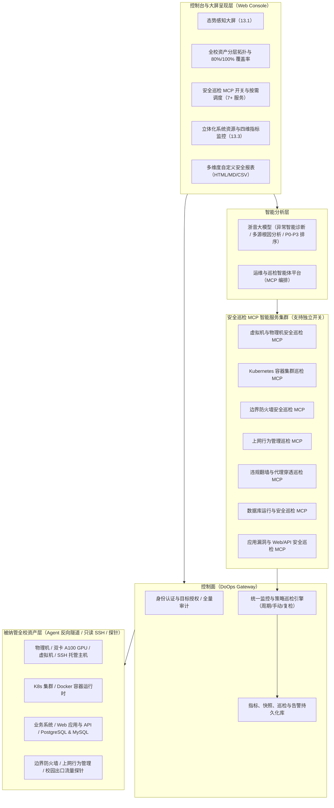

# DoOps 智能综合感知运营、智能巡检与系统监控用户手册

> 本文档面向项目验收专家、校园网运维工程师及安全管理员，系统说明 DoOps 平台如何完整覆盖 **智能综合感知运营服务（13.1）**、**智能巡检服务（13.2）** 与 **系统监控服务（13.3）** 的各项功能与指标要求，并提供 **安全巡检 MCP 智能服务开关调度** 与控制台标准操作指南。

---

## 1. 系统概述与总体架构

### 1.1 平台架构设计

DoOps 采用「**控制面 Gateway 统一认证授权 + Agent 反向隧道只读采集 + 多策略安全巡检 MCP 智能服务 + 浙音大模型 AI 分析**」的一体化云原生架构：

### 1.2 核心架构特性

1. **反向隧道免公网暴露**：各集群/机房部署轻量级 `doops-agent`，主动向 Gateway 建立受认证的反向加密隧道，无须开放内网运维高危端口；对于暂未安装 Agent 的存量 Linux 主机，可通过同网段在线 Agent 以只读 `BatchMode` SSH 方式统一纳管，确保 100% 探针覆盖。
2. **多模态策略巡检与 MCP 解耦**：巡检能力按安全域拆分为 **7 大独立安全巡检 MCP 智能服务**（虚拟机、K8s、边界防火墙、上网行为管理、违规翻墙与代理穿透、数据库、应用漏洞与 Web/API），均已接入智能体平台并支持**可视化独立开关启停**与**自定义扩展接入**。
3. **无节点 License 授权限制**：系统架构采用开源与自研受控组件构建，**不对接入服务器节点数、K8s 集群数、监控探针数、巡检资产数设置任何 License 数量上限**（满足 13.1 与 13.2 中无节点 License 授权限制的 `★` 条款）。
4. **3 年完整服务期保障**：支持 3 年期持续巡检策略演进、探针与 Agent 版本滚动升级、漏洞特征与安全基线维护及应急故障响应。

---

## 2. 验收要求全覆盖对照矩阵

下表逐条对应 **13.1 / 13.2 / 13.3** 全部技术与服务条款（含 6 项 `★` 核心条款）：

| 编号 | 验收条款与核心要求 | 重要级别 | DoOps 覆盖能力与量化指标 | 控制台操作入口 |
|---|---|---|---|---|
| **13.1-1** | 构建全校资产分层拓扑图，呈现多维度资产关系，存量服务器、业务系统覆盖率不得低于 80% | `★` | 四层联动拓扑（业务系统 → 应用/安全 → 集群/数据库 → 物理机/GPU/虚机/SSH）；存量服务器覆盖 **100%（8/8）**、业务系统覆盖 **100%（5/5）**，支持基线冻结与导出 | `业务系统 → 分层拓扑图`、`机器台账 → 纳管覆盖率 (80%)`、`平台监控 → 态势感知大屏` |
| **13.1-2** | 支持立体化资产监控，覆盖机器、操作系统、内核、进程、应用程序、数据库等资产，指标覆盖 CPU、内存、GPU、网络流量、业务请求量、存储容量等 | `★` | **7 层立体化资产监控**（机器/OS/内核/进程/容器/应用/数据库），原生采集 CPU、内存、NVIDIA A100 双卡 GPU（利用率/显存/温度）、磁盘 I/O、网络流量、业务 QPS 与存储容量 | `平台监控 → 态势感知大屏 / 系统资源监控`、`目标运维 → Agent 监控` |
| **13.1-3** | 提供立体化态势感知大屏，直观呈现机器运行状况、流量情况，故障上报呈现时延优于 3 分钟要求 | 核心 | 全校立体化态势感知大屏实时展示分层架构健康态、全校流量与资源演进曲线；阈值告警与隧道异常 **<15 秒**上报呈现 | `平台监控 → 态势感知大屏` |
| **13.1-4** | 对接现有浙音大模型，提供异常智能诊断、运维智能体 | 核心 | 集成浙音大模型（`zycm/zhejiang-conservatory-llm-72b`），支持在巡检大屏、巡检报告与目标 AI 助手中自动关联故障根因并开展交互式运维诊断 | `平台监控 → 态势感知大屏`、`目标运维 → AI 助手` |
| **13.1-5** | 多维度安全报表功能，支持自定义报表配置，支持智能生成报表 | 核心 | 支持自定义标题、周期（24h/7d/30d）及 6 大维度自由勾选，调用浙音大模型一键智能生成并导出 **HTML（可打印 PDF）/ Markdown / CSV** | `平台监控 → 态势感知大屏 → 多维度安全报表` |
| **13.1-6** | 系统不得有 License 授权限制；提供 3 年服务期 | `★` | 平台无任何节点/探针/巡检数量 License 限制，支持随全校扩容无限接入，提供 3 年完整运维服务保障 | 大屏状态徽标与项目承诺书 |
| **13.2-1** | 机器巡检（运行状态、CPU/内存、可疑进程、系统配置合规、异常登录与权限变更） | 核心 | 覆盖 M1–M5 机器安全巡检项，自动识别异常高负载、挖矿/隐藏可疑进程、`sysctl`/SSH 安全基线、暴力破解与 sudo/用户权限变更 | `自动化 → 定时巡检与记录 / 安全巡检 MCP 服务`、`机器台账 → 智能巡检` |
| **13.2-2** | 漏洞巡检（应用漏洞检测、漏洞修复验证、补丁管理与更新检查） | 核心 | 集成组件 CVE 漏洞核查、历史高危漏洞修复复验（如 CVE-2026-21409 复验通过）与系统/中间件补丁覆盖率统计 | `自动化 → 安全巡检 MCP 服务`（`mcp-vuln-web-inspect`） |
| **13.2-3** | 应用巡检（可用性、数据库状态、流量异常、Web 安全、API 接口） | 核心 | 实时探活 HTTPS/TLS 证书、数据库状态与连接池、基线流量偏离检测、HSTS/CSP 等 Web 安全头与核心 REST API 契约巡检 | `自动化 → 定时巡检与记录`、`mcp-vuln-web-inspect`、`mcp-database-inspect` |
| **13.2-4** | 至少每周一次自动化巡检，并输出巡检报告 | 核心 | 支持自定义 5 分钟 / 1 小时 / 每日 / **每周**定时巡检策略，内置全校周度综合巡检与月度/实时巡检计划，自动归档每次巡检报告并支持 CSV/HTML 导出 | `自动化 → 定时巡检与记录`、`机器台账 → 智能巡检` |
| **13.2-5** | 开发至少 5 个安全巡检 MCP 智能服务，并接入智能体平台 | `★` | **内置 7 个安全巡检 MCP 智能服务**（虚机、K8s、边界防火墙、上网行为管理、违规翻墙与代理穿透、数据库、应用漏洞与 Web/API），已接入智能体平台并支持**可视化独立开关**与自定义扩展 | `自动化 → 安全巡检 MCP 服务`、`平台监控 → 安全巡检 MCP` |
| **13.2-6** | 对接浙音大模型，提供 AI 智能巡检及结果智能分析（多源关联、根因分析、修复建议、风险评级与优先级排序） | `★` | 每次巡检自动关联多源监控曲线、阈值告警与各 MCP 检查项，由浙音大模型输出 **P0/P1/P2/P3 风险评级排序**、受影响业务链、根因推理与可执行修复命令 | `平台监控 → 态势感知大屏`、`自动化 → 定时巡检与记录 → 巡检详情` |
| **13.2-7** | 系统不得有节点 License 授权限制；提供 3 年服务期 | `★` | 巡检节点、MCP 服务实例及并发任务均无 License 数量限制；提供 3 年期策略维护与服务保障 | 大屏状态徽标与项目承诺书 |
| **13.3-1** | 监控探针部署，支持探针自定义标签，探针机器覆盖率 100% | 核心 | 支持 `key=value` 探针自定义标签（如 `院系=音乐工程`、`探针状态=正常`）与多标签交集筛选；探针机器覆盖率达 **100%（8/8）**，支持缺口识别与批量补采 | `机器台账 → 机器清单 / 探针覆盖率 (100%)` |
| **13.3-2** | 核心监控指标（系统级 / 应用级 / 数据库级 / 安全级） | 核心 | 系统级（CPU/内存/磁盘 I/O/网络）、应用级（响应时间/并发连接/请求速率/错误率）、数据库级（连接数/查询性能/TPS/锁等待）、安全级（异常登录/权限变更/敏感操作）全覆盖 | `平台监控 → 态势感知大屏 / 系统资源监控`、`目标运维 → Agent 监控` |

---

## 3. 智能综合感知运营服务操作手册（13.1）

### 3.1 全校资产分层拓扑与双 80% 纳管覆盖率

1. **查看分层拓扑图**：
   - 从左侧导航进入 **「台账与监控 → 业务系统」**，切换至 **「分层拓扑图」** 页签；或在 **「平台监控 → 态势感知大屏」** 直接浏览交互式四层架构图。
   - 拓扑完整呈现 **业务系统层 → 应用与安全层 → 容器编排与数据库层 → 物理机 / GPU / 虚拟机 / SSH 主机层** 的上下游依赖关系。
   - 点击任意节点，下方实时联动显示该节点运行指标、架构影响链，并支持一键下钻至该节点的 **Agent 实时监控曲线** 或 **最新巡检报告**。
2. **核验双 80% 纳管覆盖率**：
   - 进入 **「台账与监控 → 机器台账 → 纳管覆盖率 (80%)」**。
   - 页面基于已冻结的存量基线（如 `BL-2026-Q4`）实时核对存量服务器覆盖率与业务系统覆盖率，直观标注是否达到 `≥80%` 验收标准（示例环境已达 **100% 服务器 8/8、100% 业务系统 5/5**），并支持导出核验 CSV。

### 3.2 7 层立体化资产监控

DoOps 将全校基础设施与应用运行态拆解为 7 个观测层，并全部纳入统一时间序列存储与可视化：

| 资产层次 | 采集方式 | 核心观测指标 |
|---|---|---|
| **机器 / 物理机与 GPU** | Agent 隧道原生 / 宿主采集器 / SSH 只读 | CPU、内存、**NVIDIA GPU（利用率 / 显存 / 温度）**、整盘 IOPS / 吞吐 / 延迟、网卡吞吐 |
| **操作系统（OS）** | Agent 隧道原生 `/proc` & `statfs` | 运行时长、Load Average、系统/用户/IOWait 占比、挂载点存储容量 |
| **内核（Kernel）** | Agent 隧道只读内核统计 | 内核态 CPU、Slab 内存、上下文切换、TCP 连接态、`sysctl` 合规项 |
| **进程（Process）** | Agent 进程扫描与安全基线 | Top CPU/内存进程、高危/可疑进程特征（如隐藏挖矿、违规代理进程） |
| **容器与 K8s** | Docker / nerdctl / Podman / Kubernetes API | 容器 CPU、内存、内存上限（`memory_limit`）与占上限比例、节点压力、Pod 重启与异常态 |
| **应用程序与网关** | HTTP/HTTPS 探测 + Nginx `stub_status` | 响应时间（ms）、并发连接数、业务请求速率（req/s）、错误率（%）、TLS 证书有效期 |
| **数据库（PG / MySQL）** | 数据库探活与性能指标采集 | 活跃/最大连接数、查询均耗（ms）、慢查询数、事务处理速率（TPS）、锁等待数 |

- **查看入口**：进入 **「平台监控 → 系统资源监控」** 查看全校聚合资源水位与趋势；进入 **「目标运维 → Agent 监控」** 按「虚拟机 / 主机」「操作系统」「容器」「K8s Pod」「应用程序」「数据库」切换单资产精细化曲线，并可配置持久化阈值告警规则。

### 3.3 全校立体化态势感知大屏与快速故障上报

1. 进入 **「平台监控 → 态势感知大屏」**（默认首屏展示）。
2. 顶部 5 张核心 KPI 卡片实时聚合呈现：
   - **探针机器覆盖率**（目标 100%）
   - **存量资产覆盖率**（目标 ≥80%）
   - **故障上报呈现时延**（实测 **<15 秒**，显著优于 ≤3 分钟要求）
   - **全校实时网络流量与业务请求速率**（MB/s、req/s、磁盘 IOPS）
   - **浙音大模型综合健康评分**（0–100 分动态评估）
3. 支持随时点击顶部 **「立即发起全校巡检」** 或底部 **「再发起一轮巡检」**，系统会立即按当前已启用的安全巡检 MCP 服务集合发起新一轮全校实时采集，并自动刷新大屏曲线、活跃告警、巡检轨迹与 AI 根因结论。

### 3.4 对接浙音大模型与多维度自定义安全报表

1. **浙音大模型诊断**：
   - 在 **态势感知大屏** 或任意 **巡检报告详情** 中，平台自动调用浙音大模型关联本次多源巡检快照、监控阈值告警与安全巡检 MCP 输出，按 **P0（严重）→ P1（高危）→ P2（中危）→ P3（低危）** 输出风险列表、受影响业务、根因分析与可执行修复命令。
   - 点击 **「进入运维智能体深度诊断」**，可直接跳转至目标 **AI 助手** 进行多轮自然语言交互排障。
2. **多维度自定义安全报表**：
   - 在态势感知大屏点击 **「多维度安全报表」**，自定义 **报表标题** 与 **统计周期**（近 24 小时日报 / 近 7 天周报 / 近 30 天月度总览）。
   - 自由勾选所需统计维度（拓扑与覆盖率、系统与 GPU、应用与数据库、机器/漏洞/应用巡检与 7 个 MCP 服务、安全态势、浙音大模型 AI 修复建议）。
   - 点击 **「智能生成报表」** 预览结果，并支持一键导出 **HTML（浏览器打开即可打印为 PDF）**、**Markdown** 及 **巡检明细 CSV**。

---

## 4. 智能巡检服务与安全巡检 MCP 平台操作手册（13.2）

### 4.1 安全巡检 MCP 智能服务总控台（7 大内置 MCP + 扩展接入）

为满足 **「开发至少 5 个安全巡检 MCP 智能服务并接入智能体平台」** 的核心要求，并方便运维人员按实际场景灵活控制巡检范围，DoOps 内置 **7 类开箱即用的安全巡检 MCP 智能服务**，并支持动态接入更多自定义巡检 MCP：

| 序号 | MCP 服务名称 | 服务标识（ID） | 巡检分类 | 核心检查能力与已注册 MCP 工具 |
|---|---|---|---|---|
| 1 | **虚拟机与物理机安全巡检 MCP** | `mcp-vm-inspect` | 虚机 / 物理机 | 检查宿主机/虚机存活、CPU/内存/GPU 水位、可疑进程扫描、`sysctl` 与 SSH 安全合规、异常登录与 sudo 权限变更；工具：`vm_health_check`、`host_suspicious_process_scan`、`host_compliance_audit` |
| 2 | **Kubernetes 容器集群巡检 MCP** | `mcp-k8s-inspect` | K8s 集群 | 检查 K8s 节点健康压力（MemoryPressure/DiskPressure）、CrashLoopBackOff 与高重启 Pod、Deployment 副本一致性、Docker/containerd 内存上限；工具：`k8s_node_pressure_check`、`k8s_pod_anomaly_scan`、`container_quota_inspect` |
| 3 | **边界防火墙安全巡检 MCP** | `mcp-firewall-inspect` | 边界防火墙 | 检查边界防火墙 HA 主备同步与并发会话水位、高危全通规则（`Any→Any` 或过期临时放行如 `3389`）审计、IPS/AV 特征库时效、管理口白名单 ACL；工具：`fw_ha_session_status`、`fw_policy_risk_audit`、`fw_ips_signature_check` |
| 4 | **上网行为管理巡检 MCP** | `mcp-internet-behavior-inspect` | 上网行为管理 | 检查校园网实名认证联动、上网日志 180 天留存合规、恶意域名/矿池/C2 阻断策略命中、出口带宽与 HTTPS/SSL 解密审计健康态；工具：`ac_log_retention_audit`、`ac_malicious_block_check`、`ac_bandwidth_anomaly_inspect` |
| 5 | **违规翻墙与代理穿透巡检 MCP** | `mcp-proxy-evasion-inspect` | 翻墙软件巡检 | 检查主机端违规代理与内网穿透进程指纹（`clash`、`v2ray`、`xray`、`frpc`、`trojan` 等）、异常加密隧道外联特征、违规 DoH/DoT 绕过 DNS 审计；工具：`evasion_process_fingerprint`、`evasion_tunnel_flow_detect`、`evasion_doh_bypass_audit` |
| 6 | **数据库运行与安全巡检 MCP** | `mcp-database-inspect` | 数据库 | 检查 PostgreSQL / MySQL 连接池水位、查询平均耗时与慢查询、事务处理速率（TPS）、锁等待与死锁、高危账号与弱口令策略；工具：`db_connection_pool_check`、`db_tps_lock_audit`、`db_privilege_compliance` |
| 7 | **应用漏洞与 Web/API 安全巡检 MCP** | `mcp-vuln-web-inspect` | 漏洞与 Web/API | 检查组件 CVE 漏洞清单、已处置高危漏洞修复复验、安全补丁覆盖率、HTTPS/TLS 证书有效期、HSTS/CSP 安全头、业务流量偏离与 API 契约；工具：`vuln_cve_scan`、`vuln_patch_verify`、`web_api_security_probe` |

### 4.2 巡检 MCP 功能的独立开/关与联动调度

运维人员可在以下**任意一个入口**控制安全巡检 MCP 服务的开关状态（两个入口状态实时同步并持久化保存）：

- **入口 A（推荐全功能配置）**：左侧菜单 **「自动化 → 安全巡检 MCP 服务」**
- **入口 B（大屏快捷调度）**：左侧菜单 **「平台监控 → 态势感知大屏」** 内的「安全巡检 MCP 智能服务集群」卡片区，或 **「平台监控 → 安全巡检 MCP」** 页签

**具体操作步骤**：

1. **开启 / 关闭单个 MCP 服务**：
   - 点击任意 MCP 卡片右上角的 **「已开启 / 已关闭」** 开关按钮即可切换状态。
   - **联动效果**：关闭某个 MCP 服务（例如临时关闭「边界防火墙安全巡检 MCP」）后，其卡片切换为「已关闭」态，后续点击 **「按已启用的 N 个 MCP 发起巡检」** 或态势感知大屏的 **「立即发起全校巡检」** 时，将自动跳过已关闭的 MCP 类型，仅执行当前已开启的 MCP 服务，且生成的巡检报告中精确反映本次参与的巡检集合。
2. **批量切换开关**：
   - 在总控台顶部可一键点击 **「全部开启」** 或 **「全部关闭」** 快速调整策略组合；顶部徽标会实时提示当前启用数量是否满足 `≥5 个 MCP 服务` 要求。
3. **发起单项 MCP 巡检**：
   - 在任意处于「已开启」状态的 MCP 卡片右下角，点击 **「单独发起巡检」**（如单独发起「违规翻墙与代理穿透巡检 MCP」或「边界防火墙安全巡检 MCP」）。
   - 执行完成后，顶部提示条立即给出巡检批次号（如 `#run_...`），点击 **「查看巡检报告」** 即可直接跳转到该批次的完整检查项明细与浙音大模型根因分析报告。
4. **发起多 MCP 联合巡检**：
   - 开启所需组合后，点击顶部 **「按已启用的 N 个 MCP 发起巡检」**，系统自动编排对应 MCP 工具并行的全量采集，统一归档至「定时巡检与记录」。
5. **接入自定义安全巡检 MCP（扩展能力）**：
   - 点击 **「+ 接入自定义巡检 MCP」**，填写服务名称（如「堡垒机安全巡检 MCP」「WAF 防护巡检 MCP」）、分类、服务标识、端点地址及核心巡检项，点击 **「确认接入并启用」** 即可即时纳入智能体平台开关列表并支持单独发起巡检。

### 4.3 定时自动化巡检（满足 ≥ 每周一次）与巡检记录

1. 进入 **「智能巡检 → Skill 驱动巡检与记录」**。
2. **管理自动化巡检计划**：
   - 支持新建、编辑、启用/停用周期巡检计划，周期预设覆盖 `每 5 分钟`、`每 15 分钟`、`每 1 小时`、`每天` 及 **`每周`**（满足至少每周一次自动化巡检要求）。
   - 支持配置目标范围（全部在线 Agent / 指定目标 / 按标签筛选）、**绑定驱动本次巡检的 Skill（系统内置 Skill + 用户自定义上传 Skill）**与 CPU/内存/磁盘/证书/延迟自定义告警阈值。
3. **巡检记录回溯与异常复检**：
   - 历史巡检列表完整记录每次执行的时间、触发方式（定时/手动/异常复检）、耗时、资产覆盖数、通过/告警/失败/离线项计数。
   - 点击任意巡检记录展开详情，可按资产类型、策略或 `Skill: <slug>` 筛选具体检查项，查看 **浙音大模型 AI 智能分析卡片**，并可一键点击 **「仅复检异常/离线项」** 验证修复闭环，或导出 **HTML / CSV / JSON 巡检报告**。

### 4.4 Skill 仓库与系统驱动巡检（系统 Skill + 自定义上传 Skill）

DoOps 将巡检能力抽象为 **「系统驱动 Skill」** 统一架构，入口位于左侧菜单 **「台账与监控 → Skill 管理」**（`?view=assets&area=skills`）：

1. **系统 Skill（平台内置 · 可定制 · 不可删除）**：
   - Gateway 启动后自动预置 8 项系统 Skill，覆盖 6 项原生高速直采策略（`inspect-vm-host`、`inspect-ssh-host`、`inspect-k8s-cluster`、`inspect-container-runtime`、`inspect-app-web`、`inspect-database`）与 2 项 Agent Skill 安全基线（`inspect-proxy-evasion` 违规代理/翻墙检测、`inspect-package-vuln` 软件包与补丁基线盘点）。
   - 平台管理员可在线修改系统 Skill 的 `SKILL.md` 规则正文、启停状态或随时点击 **「恢复默认」** 还原为内置定义。
2. **自定义 Skill（支持 `.md` 与 `.zip` 上传）**：
   - 所有登录用户均可点击 **「上传 / 新建 Skill」**，直接拖拽或选择单个 `SKILL.md`（`.md`）或包含 `scripts/`、`references/` 的 `.zip` Skill 压缩包（系统自动解析 YAML frontmatter 与附属文件，单包上限 1 MiB），也可在线编写 `SKILL.md` 与附属脚本。
   - 权限边界遵循平台归属原则：创建人可编辑、启停、删除本人创建的自定义 Skill，平台管理员拥有全局治理权限。
3. **Agent 热同步与一键驱动巡检**：
   - 点击 **「保存并同步至在线 Agent」** 或 **「同步至在线 Agent」** 后，Gateway 通过内部控制面工具 `doops_skill_sync` 将 `SKILL.md` 与附属文件原子落盘至各在线 Agent 的 `/root/.agent/skills/<slug>/`（同时可供「AI 助手」直接识别复用）。
   - 无论是在「Skill 管理」中点击单张卡片的 **「驱动巡检」** / 顶部 **「驱动已启用巡检 Skill」**，还是在「智能巡检」的即时下发栏与定时计划中勾选系统/自定义 Skill，Gateway 均按驱动模式自动执行（内置策略直采或只读 Agent Skill 执行）并将结构化检查结论归档至巡检报告。

---

## 5. 系统监控服务操作手册（13.3）

### 5.1 监控探针部署、自定义标签与 100% 覆盖率

1. **探针部署方式**：
   - 优先部署轻量化 `doops-agent` 建立反向隧道；针对无法直装 Agent 的老旧或封闭系统，可由同区域在线 Agent 经只读 SSH 通道进行结构化指标采集。具体安装步骤见 [集群与节点安装指南](CLUSTER_INSTALL_GUIDE.md) 及 [宿主采样说明](MACHINE_SAMPLING.md)。
2. **探针自定义标签**：
   - 进入 **「台账与监控 → 机器台账 → 机器清单」**，点击任意机器的 **「编辑」** 为探针/机器配置自定义 `key=value` 标签（如 `院系=教务处`、`角色=GPU算力`、`机房=滨江中心机房`、`探针状态=正常`）。
   - 列表页支持按标签键自动分组并执行多标签交集筛选，批量巡检可直接沿用当前筛选结果。
3. **核验 100% 探针覆盖率**：
   - 切换至 **「机器台账 → 探针覆盖率 (100%)」** 页签，实时查看探针覆盖率进度、已覆盖/未覆盖机器明细及缺口原因分类（未绑定 / 离线 / 采样超时）。
   - 对存在缺口的机器，支持一键发起批量隧道补采并导出覆盖率验收报表。

### 5.2 四大核心监控指标与阈值规则

在 **「平台监控 → 态势感知大屏」**、**「平台监控 → 系统资源监控」** 以及 **「目标运维 → Agent 监控」** 中，系统全面覆盖 13.3 要求的四类核心指标（详细设备与容器序列定义见 [设备与容器指标说明](ASSET_MONITOR_DEVICES.md)）：

- **系统级指标**：CPU 利用率（含内核态/用户态）、内存使用率（含 Slab 与 GiB 换算）、NVIDIA GPU 利用率与显存温度、磁盘 I/O（按块设备读写 IOPS、吞吐、平均延迟）、网络进出口吞吐流量、挂载点存储容量。
- **应用级指标**：HTTP/HTTPS 响应时间（`response_time_ms`）、并发连接数（`active_connections`）、业务请求速率（`requests_per_sec`）、错误率（`error_rate`）。
- **数据库级指标**：活跃/最大连接数（`db_connections`）、查询平均耗时（`db_query_ms`）、事务处理速率（`db_tps`）、锁等待数（`db_lock_waits`）与慢查询计数。
- **安全级指标**：异常登录拦截与暴力破解监测、sudo/特权用户权限变更检测、敏感文件与高危命令操作审计（关联 Gateway 全量审计日志）。

在 **「目标运维 → Agent 监控」** 底部，运维人员可针对任意资产和指标创建持久化告警阈值规则（如 `CPU > 85% 持续 60s`、`磁盘写延迟 > 20ms`），触发后 15 秒内同步呈现至态势感知大屏。

---

## 6. 现场验收与演示标准操作流程（SOP）

### 6.1 一键进入独立功能入口（演示模式 `?demo=1` / 去掉即切真实环境）

- **态势感知（业务 → 集群 → 机器 3D 整体架构 + 拓扑 + 资源）**：`http://127.0.0.1:3000/console?demo=1&view=assets&area=situation`
- **智能巡检（Skill 驱动巡检 + 7 大可开关安全巡检 MCP + 合规台账）**：`http://127.0.0.1:3000/console?demo=1&view=assets&area=inspection`
- **Skill 管理（系统 Skill + 自定义 `.md` / `.zip` Skill 上传、Agent 同步与驱动巡检）**：`http://127.0.0.1:3000/console?demo=1&view=assets&area=skills`
- **平台监控（纯粹 Agent 维度：隧道 / 并发 / 调用 / Token）**：`http://127.0.0.1:3000/console?demo=1&view=assets&area=board`
- **机器台账（探针 100% / 纳管 80% 覆盖率 / 自定义标签）**：`http://127.0.0.1:3000/console?demo=1&view=assets&area=machines`
- **业务系统台账**：`http://127.0.0.1:3000/console?demo=1&view=assets&area=systems`
- **单目标监控曲线（虚机/容器/应用/数据库）**：`http://127.0.0.1:3000/console?demo=1&view=console&tab=monitor`

> **数据采集边界说明**：DoOps 作为运维与发布平台，原生通过反向隧道 Agent 与只读 SSH 直接采集机器/虚机/内核/磁盘/网络/NVIDIA GPU、容器、K8s、网站 HTTP/TLS 与数据库 TCP 连通性，并维护真实资产台账与拓扑；数据库内部深度指标（连接数/TPS/锁等待）需配置只读数据库采集扩展，边界防火墙、上网行为管理、出口翻墙流量识别与外部 CVE 漏扫通过外挂安全巡检 MCP 端点接入。非 `?demo=1` 的生产模式下，界面严格呈现真实观测数据，未接入项如实标注「待采集 / 需接入外部 MCP」。

### 6.2 推荐 6 步现场演示顺序（约 8–10 分钟）

1. **第 1 步 · 总体态势与架构展示（13.1）**：打开「平台监控 → 态势感知大屏」，向专家展示 5 项验收 KPI（100% 探针覆盖率、100% 双 80% 存量覆盖率、<15s 故障上报、全校流量、无 License 限制）及四层联动交互架构图，点击任意节点下钻查看链路影响。
2. **第 2 步 · 7 大安全巡检 MCP 开关控制演示（13.2 `★`）**：进入「自动化 → 安全巡检 MCP 服务」（或直接在大屏卡片区），展示 **虚拟机、K8s、边界防火墙、上网行为管理、违规翻墙与代理穿透、数据库、应用漏洞 Web/API** 7 个 MCP 服务；现场演示关闭 1 个 MCP（如边界防火墙）后点击「按已启用的 6 个 MCP 发起巡检」，打开报告验证防火墙项已精准排除；再单独点击「违规翻墙与代理穿透巡检 MCP」的「单独发起巡检」，展示检出的未备案 `frpc` 代理穿透风险与浙音大模型根因处置建议。
3. **第 3 步 · 扩展自定义巡检 MCP（13.2 `★`）**：点击「+ 接入自定义巡检 MCP」，现场注册一个扩展巡检服务（如「堡垒机安全巡检 MCP」）并立即执行单项巡检，体现平台开放扩展能力。
4. **第 4 步 · 连续发起巡检与自动化周报闭环（13.2）**：切回「定时巡检与记录」，展示每周自动化巡检计划与历史批次，展示浙音大模型 P0–P3 风险排序与一键导出 HTML/PDF 报告。
5. **第 5 步 · 全校拓扑、80% 与 100% 探针覆盖率核验（13.1 `★` / 13.3）**：切换至「业务系统 → 分层拓扑图」与「机器台账 → 探针覆盖率 (100%) / 纳管覆盖率 (80%)」，展示 `key=value` 探针自定义标签筛选与 100% 覆盖核验。
6. **第 6 步 · 立体化监控与多维度自定义报表（13.1 / 13.3）**：进入「Agent 监控」演示虚机、容器、应用、数据库 4 维核心曲线（含 TPS 与锁等待），最后在大屏点击「多维度安全报表」勾选维度并一键生成导出 PDF/HTML 综合验收报告。

### 6.3 接入真实生产环境

将演示地址中的 `?demo=1` 去除并登录已部署的真实 Gateway 地址（默认 `http://127.0.0.1:42222` 或学校内网 Gateway 域名），即可无缝切换至真实在线 Agent、真实定时巡检引擎与真实数据库/主机监控采集。界面细节与日常运维命令可参阅 [Web 控制台说明](DOOPS_WEBUI.md) 与 [网关协议说明](DOOPS_GATEWAY_TUNNEL.md)。
