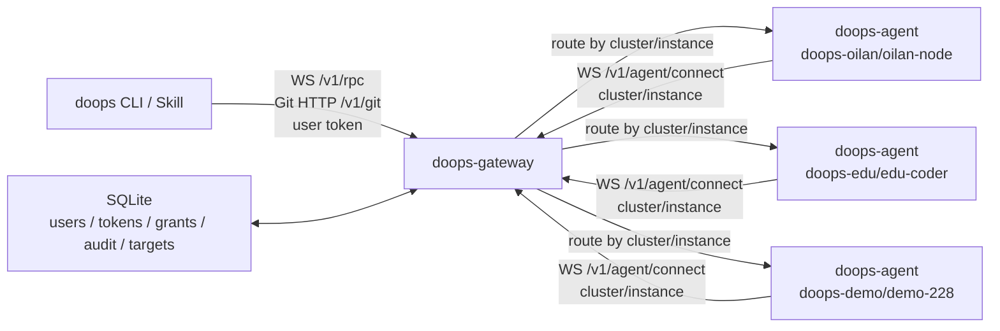
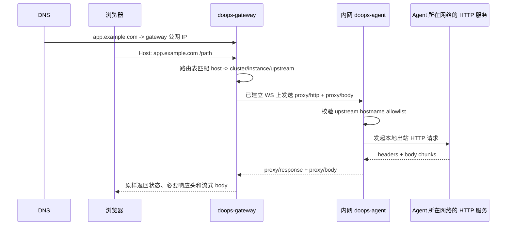

# Doops Gateway Tunnel

`doops-gateway` 是公网控制面。内网 `doops-agent` 不暴露端口，而是主动连到
gateway；`doops` CLI 和 skill 再连接 gateway，通过 `cluster/instance` 选择目标。

## Topology



gateway 是统一公网控制面：

- 用户侧只连接 gateway，不直接暴露内网 agent
- agent 主动长连接注册自己
- gateway 负责鉴权、授权、审计、排队和目标路由

## 公网网站代理关键节点

第一阶段的网站代理只承载 HTTP/HTTPS 请求和流式响应，链路是：



关键节点与边界：

1. DNS 只负责把任意业务域名解析到 Gateway；域名本身不携带 Agent 身份。
2. Gateway 以请求 `Host` 查 `proxy_routes`，路由记录固定绑定一个
   `cluster/instance` 和一个 HTTP(S) `upstream`。
3. Agent 只通过主动建立的 `/v1/agent/connect` 长连接接收请求，不需要入站端口，
   因此单向网络只要求 Agent 能出站访问 Gateway。
4. Agent 在实际出站前再次执行精确 hostname allowlist；allowlist 为空时拒绝所有代理
   请求，并且不跟随重定向，避免路由被上游响应带出 allowlist。
5. Gateway 与 Agent 之间使用分帧 body，不把请求体一次性读入内存；响应收到一帧就向
   客户端 flush，支持 SSE/分块 HTTP 这类流式响应。
6. Agent 发往上游时会把 `Host` 和 `X-Forwarded-Host` 重写为路由的上游主机，
   并丢弃客户端携带的 `Forwarded`/`X-Forwarded-Host`，避免上游租户解析误把公网
   测试域名当成业务域名。
7. 第一阶段明确不支持 WebSocket Upgrade 和裸 TCP；收到 Upgrade 请求返回
   `426 Upgrade Required`，后续如需 WebSocket 必须扩展成独立的二进制/帧协议。

### 配置路由

管理员使用 `POST /v1/admin/proxy-routes` 创建或更新路由，必须携带 Gateway
管理员 token：

```json
{
  "host": "app.example.com",
  "cluster": "prod",
  "instance": "node-1",
  "upstream": "http://127.0.0.1:8080",
  "enabled": true
}
```

省略 `id` 时新建路由；带 `id` 时原地更新这条路由，并可带上读取时拿到的
`updated_at` 作为版本。`POST` 的错误状态码：

| 状态码 | 响应文本 | 含义 |
|---|---|---|
| `400` | 校验文案，或 `invalid proxy route updated_at` | 域名、上游或目标无效；`updated_at` 不是 RFC3339 时间 |
| `404` | `proxy route not found` | 带 `id` 的更新，但这条路由不存在（例如已被删除）。Gateway 不会按旧 `id` 重建 |
| `409` | `proxy host already in use` | 域名已被另一条路由使用。比较前先规范化域名：忽略大小写和末尾的点 |
| `409` | `proxy route changed since it was read` | 请求带了 `updated_at`，但路由在读取后已被修改，本次不写入 |

不带 `updated_at` 的更新仍然整体覆盖现值，与旧客户端行为一致。每次写入都会推进
`updated_at`，客户端应原样回传列表里拿到的字符串。

`GET /v1/admin/proxy-routes` 列出路由，`DELETE /v1/admin/proxy-routes?id=<id>`
删除路由。CLI 等价命令：

```bash
doops admin proxy list --target <gateway-target>
doops admin proxy set --target <gateway-target> --host app.example.com \
  --scope-target <target> --upstream http://127.0.0.1:8080
doops admin proxy set --target <gateway-target> --id <route-id> --enabled=false
doops admin proxy delete --target <gateway-target> --id <route-id>
```

带 `--id` 时只修改传入的字段，其它字段保持现值，并把读到的 `updated_at` 带回
Gateway：读取后路由被别人改过就返回 409，路由已被删除就返回 404，都不会写入；`--scope-target` 取本机已配置 target
的 cluster/instance，且必须属于同一 Gateway。Agent 侧通过 `DOOPS_PROXY_ALLOW_HOSTS` 配置精确的上游 hostname，
例如 Helm values 中的
`proxy.allowedHosts: "127.0.0.1,internal.example.com"`。Chart 会把它注入为
`DOOPS_PROXY_ALLOW_HOSTS`；默认空值会拒绝所有上游。这个配置不是公网域名
allowlist，而是 Agent 所在网络允许访问的上游主机 allowlist。

已有自升级控制器的 Helm Agent 用 `doops upgrade`；Job 复用 Agent 已挂载的
kubeconfig，操作机不需要 kubeconfig。普通 workload 发布使用
`doops ask --apply`，也不需要本机 kubeconfig。

`doops upgrade` 仅更新镜像并保留现有 values，不修改代理 allowlist。新集群 bootstrap、
已有 Helm Agent 首次启用自升级控制器，或本节显式修改运行配置时，使用
`scripts/release-managed-agent.sh`，由外部控制器显式提供 kubeconfig。脚本不自动接管
未受 Helm 管理的 workload；已有 target 路径要求 release 已存在：

```bash
bash scripts/release-managed-agent.sh \
  --target <target> \
  --session <session> \
  --cluster <gateway-cluster> \
  --instance <gateway-instance> \
  --release <release> \
  --namespace <namespace> \
  --kubeconfig <operator-kubeconfig> \
  --proxy-allowed-hosts 127.0.0.1,internal.example.com \
  --image <repository>@sha256:<digest>
```

当前 Agent 进程不执行自身 Helm mutation。省略 allowlist 参数会保留现网值；传空字符串会显式恢复为拒绝全部。

## Managed Gateway Host

当前受管 gateway 主机的公开信息。真实 SSH 地址与维护用户只保存在内部 runbook 或密钥库，
文档与示例统一使用文档保留地址 `203.0.113.10` 和维护用户 `doops-admin`：

- Gateway 服务端口：`42222`
- Gateway URL：`https://doops.l8ai.cn`
- 维护用途：发布和自恢复 `doops-gateway` 控制面，不作为普通 `doops-agent` target 使用。

维护凭据不得写入仓库。需要发布 gateway 时使用：

```bash
bash scripts/deploy-gateway.sh \
  --host 203.0.113.10 \
  --user doops-admin \
  --source-commit <verified-main-commit> \
  --verify-target gw-edu-coder \
  --verify-session gateway-release-<release>
```

第一版是 SQLite + 单活可靠部署：

- SQLite WAL 数据库：用户、token、权限、审计。
- agent 注册 gateway 不使用 token，只携带声明的 `cluster/instance`；用户操作继续由 user token 和权限控制。
- `/v1/agent/connect` 当前按设计开放注册。未来如增加 Agent 工作负载身份，
  必须作为独立协议扩展并绑定 `cluster/instance`，不得复用 Gateway user token
  或重新引入 CLI per-target token。

- user token 只能操作有 grant 的 target。
- gateway 转发 doops JSON-RPC 操作流量和 Git HTTP 请求，不做裸 TCP 隧道。
- `read` / `write` / `push` / `pull` 默认走 Gateway 配置的 COS。桶、endpoint、region 和密钥只读 Gateway 进程环境：`DOOPS_COS_BUCKET`、`DOOPS_COS_ENDPOINT`、`DOOPS_COS_REGION`、`DOOPS_COS_ACCESS_KEY_ID`、`DOOPS_COS_SECRET_ACCESS_KEY`。调用方不能改这些值。`--storage gateway` 才走 Git HTTP：`/v1/git/<cluster>/<instance>/<session>.git/...`，再通过目标 agent 已建立的反向 WebSocket 透传给 agent 本地 `/git/<session>.git/...`。Git HTTP 不服务默认的 `cos` 模式。
- `doops_workspace_*` 是低层文件传输工具；通用 CLI 的目录同步使用 Git HTTP
  `push/pull`。这些接口不属于发布授权协议，发布任务不得用文件同步替代明确的
  target、范围、镜像、原因和验收条件。
- 密码登录签发短期 user token，默认 24 小时过期。登录只签发新 token，不清理过期记录；`GET /v1/admin/tokens` 返回 `expires_at` / `revoked` 供管理员判断，鉴权失败按 `gateway_auth_expired` 等稳定类别返回。
- token 校验通过 token id 定位单行哈希，避免多人多 token 时全表 bcrypt 扫描。
- 同一 `cluster/instance` 的普通调用可并发；只有 workspace 写入、精确资源和 Agent 自升级互斥，
  详见 Multi-User Behavior。

## Endpoints

用户接口（user token）：

- `POST /v1/auth/login`、`GET /v1/auth/me`
- `GET /health`
- `GET /v1/targets`
- `GET/DELETE /v1/audit`（DELETE 是平台管理员的审计清理）
- `/v1/credentials`、`/v1/credentials/<id>/...`、`/v1/credential-bundles`（凭据语义见 [CREDENTIAL_RESOURCES.md](CREDENTIAL_RESOURCES.md)）

管理员接口（平台管理员 `is_admin`）：

- `GET/POST /v1/admin/users`
- `POST /v1/admin/users/password`
- `POST /v1/admin/users/disable`
- `GET/POST/DELETE /v1/admin/grants`
- `GET /v1/admin/instances`、`POST /v1/admin/instances/archive`、`POST /v1/admin/instances/unarchive`
- `GET/POST/DELETE /v1/admin/tokens`
- `GET/POST/DELETE /v1/admin/proxy-routes`

隧道与代理接口：

- `WS /v1/agent/connect?cluster=<cluster>&instance=<instance>`
- `WS /v1/rpc?cluster=<cluster>&instance=<instance>`
- `WS /v1/edge/connect?cluster=<cluster>&instance=<instance>`（Edge 隧道；Gateway `-edge-listen` 默认空，未启用时不监听，见 [design/DOOPS_EDGE_TUNNEL.md](design/DOOPS_EDGE_TUNNEL.md)）
- `GET/POST /v1/git/<cluster>/<instance>/<session>.git/...`
- `GET/POST /`（按 Host 匹配代理路由的公网网站代理）

旧 gateway 草稿端点和共享 token 模式已经废弃。

## Start Gateway

用户、user token 和授权由管理员维护。Agent 部署只声明绑定的
`cluster/instance`，注册连接不使用 token。Gateway 用户接口仍严格校验 user token。
产品和 skill 的日常入口是 `doops`；gateway 内部维护命令不作为业务用户操作手册暴露。

gateway 是独立发布包，不登记为 doops target，也不通过任何 target 发布自己。

标准发布入口：

```bash
bash scripts/deploy-gateway.sh \
  --host <gateway-host> \
  --user <ssh-user> \
  --source-commit <verified-main-commit> \
  --verify-target <configured-doops-target> \
  --verify-session <session-name>
```

脚本只走 SSH/SCP，并在宿主机真实 root 下校验 DB、备份二进制、替换、重启和
校验 `/proc/<pid>/exe` hash。`--source-commit` 必须与本次构建和候选二进制的
provenance 一致；旧的本地 `bin/doops-gateway` 会在上传前拒绝。`--verify-target` 只用于复用本机 DoOps CLI 的认证检查
发布前后 target 基线，不通过 target 传输或替换 Gateway。不要用
`doops exec/push/write` 或 base64 分片部署 `doops-gateway`。

手工构建入口是 `backend/gateway/`；在 `backend/` 目录下执行（脚本内部切到 `gateway/` 构建）：

```bash
bash scripts/build-gateway.sh
```

```bash
./bin/doops-gateway serve -db /var/lib/doops-gateway/gateway.db -port 42222 \
  -login-token-ttl 24h \
  -operation-timeout 30m \
  -max-queued-per-target 10 \
  -target-queue-timeout 10m
```

Edge 公网流量入口 `-edge-listen` / `-edge-proxy-protocol` 默认关闭，当前生产未启用；
已实现与未上线边界见 [design/DOOPS_EDGE_TUNNEL.md](design/DOOPS_EDGE_TUNNEL.md)。

Token 只打印一次，数据库里只保存哈希。

如果用户使用密码登录，gateway 会通过 `POST /v1/auth/login` 签发一个 user token；CLI 不保存用户密码，
但会在 `auth.json` 中保存 token ID、用户名、签发时间、到期时间和来源等非密码元数据。
`logout` 只删除本机缓存，不会撤销 Gateway token；撤销必须使用管理员 token 管理接口。

## User Management

维护用户、密码、token、授权和审计属于 gateway 管理员能力。业务用户和自动化脚本只使用 `doops` 操作 target；不要在业务文档、skill 或日常流程里直接暴露 gateway 内部维护命令。

管理员签发用户 token 使用 CLI，而不是 SSH 到 gateway 主机上手工操作数据库：

```bash
doops admin token create \
  --target <gateway-target> \
  --user <username> \
  --name <label> \
  --expires 720h
```

`--target` 用于选择本机配置里的 gateway 地址和管理员 token。管理员 token
不得通过命令行参数传入。如需把新 token 写入本机缓存，必须显式加
`--save-as <configured-target>`。

轮换旧 token：

```bash
doops admin token list --target <gateway-target>
doops admin token revoke --target <gateway-target> --id <token-id>
```

管理员能力应覆盖：

- 创建/禁用用户，设置或重置密码。
- 创建、吊销、轮换 user token。
- 授权只按 (user, cluster, instance)：一个 DoOps Agent 就是一个授权单元，有 grant 即可完整使用该 target 的全部操作及其绑定的凭据，不设 per-action 授权（开放性优先）；Gateway 内部按工具推导 action 只用于审计分类，不是独立权限。平台管理员是用户的 `is_admin` 标记，不是 grant。
- 按 `user_id`、`token_id`、`cluster`、`instance`、`action`、`session`、`status` 查询审计。
- 按保留周期清理过期审计，清理前保留可追溯导出。

`POST /v1/admin/users` 创建的普通用户没有任何 target grant，管理员按精确 `cluster/instance`
逐个授权。完整操作顺序见 `DOOPS_USAGE_GUIDE.md`。

说明：

- `401 Unauthorized`：先读取 JSON `code` 和 `auth_domain`。`gateway_auth_missing|invalid|expired|revoked|user_disabled|invalid_expiry` /
  `auth_domain=gateway` 表示对应的 Gateway user token 状态；`gateway_auth_unavailable` 表示鉴权存储不可用；
  `edge_enrollment_auth_failed` / `auth_domain=edge_enrollment` 表示边缘通道 enrollment
  token 缺失、无效、过期或目标绑定不匹配。裸 `401` 不足以判断受管凭据错误。
- `403 Forbidden`：token 有效，但用户没有匹配该 `cluster/instance` 的 grant，或调用管理接口时不是平台管理员。

## Multi-User Behavior

多人同时使用时，gateway 只控制资源所有权，没有全局或单用户执行额度：

- 不同 target 可以并发执行。
- 同一 target 上的 Shell/SSH/bg/apply 调用可以并发，同一 session 内也不串行。缺少有效
  session 的 mutation 直接拒绝；只有 Agent 自升级独占 target。
- 同一客户端 WebSocket 上的多个 `tools/call` 可以并行；Agent 的每条
  `notifications/message` 必须带 `params.request_id`，Gateway 和 CLI 按请求 ID
  路由，不得用 session 名称覆盖另一个并发请求的通知。CLI 原样保留输出文本及分块边界，
  不按业务 JSON 的 `type` 字段猜测事件或任务完成。CLI/Web 取消使用原 Gateway RPC
  连接的 `tools/cancel`，只能操作该连接自己的请求。Agent 断连后先等待连接所属执行
  清理完成，再重新注册，避免旧进程与新请求重叠。
- `finalizing` 只表示终态审计待落盘，不持有执行锁、不阻断后续任务；持久化失败会报告
  错误并自动重试原始证据。
- 普通 `exec`/`ssh`/`bg`、`ask --apply`、Kubernetes mutation 和凭据物化使用
  `target + session` 共享 lease，同 session 内可并发；该 session 的 workspace 写入要等这些调用结束。
  session 不是 OS 或远端资源沙箱，不同 session 不得同时修改同一 Helm release 或数据库。
- 独立 session 的 push/write/clean/pull 按实际 workspace 互斥；清理其它 workspace
  时锁定被清理的 workspace，不是调用者的 session。排队超时返回 `target queue timeout`。
- 结构化文件和工作区 read 使用共享只读通道，可并发读取，也可查看正在执行的 session；
  目标 read 权限和会话路径边界仍逐次校验，Agent 自升级期间仍禁止读取。
- 结构化 K8s 的 `get/describe/logs/top/events/rollout-status/configmap-keys`、任务状态和节点信息
  可与 target mutation 并行，结果未知时仍可诊断；Agent 自升级阻止这些查询。
- 公网 HTTP 代理只有 `GET/HEAD/OPTIONS/TRACE` 按只读查询处理；`POST/PUT/PATCH/DELETE`
  等其它方法按精确代理 route 互斥，不阻塞其它 route 或普通 session。转发中断且
  缺少终态时保留 `outcome_unknown`，不宣称业务没有执行或自动重放。
  上游收到写请求后的连接/响应体传输失败同样是未知结果；不能把代理返回的传输
  错误当成业务没有执行。下游写失败必须等待取消结果后完成审计。
- `-operation-timeout` 控制单个转发操作的最长运行时间；超时请求取消并等待原始终态。
  取消 ACK 不是终态；缺失终态时持久化 `outcome_unknown` 后释放本次 lease，不自动重放。
  历史未知审计不参与准入。取消中或审计收尾中的活跃操作只阻挡同 session/资源的冲突请求；
  审计持久化失败保留该 lease 并自动重试，不扩展为整台 target 的屏障。
- 每个互斥资源最多 10 个等待者、等待上限 10 分钟，没有全局或单用户执行配额。
  workspace 锁和 session mutation 都使用有界等待队列；同 session 冲突在允许排队时会等待
  reader/resource 终态，只有队列满、排队关闭或超时才返回
  `target busy`/`target queue timeout`。`-max-queued-per-target` 设为负数可关闭排队。
- `-login-token-ttl` 控制密码登录生成 token 的有效期；长期自动化应使用管理员发放的可轮换服务 token。

取消只能由发起方在原 RPC 连接上通过 `tools/cancel` 请求（CLI 超时或 Ctrl-C、Web 停止按钮）。

取消只确认请求已登记。原始操作的资源所有权
保留到 terminal response；取消 ACK 不是终态。shell/SSH/bg 等本地命令等待进程组
终止，`ask` 发起 doagent `session/cancel` 并等待匹配的 `turn_finished`。
`executionLifecycle` 能力只在后台 `doops_bg` 的派发前校验，要求完整终态、受控任务寿命
和取消能力。普通前台执行不要求此声明；超时/取消仍等待原始终态，不能因为缺少声明
而宣告停止或跳过未知结果保护。后台任务在断连时取消，不作为可脱离连接运行的任务队列。
本地进程退出不证明远端控制器或脱离进程组的工作停止。Shell/SSH/bg、apply、K8s
写操作等被中断时，即使收到本地取消终态也记录 `outcome_unknown`；缺失终态同样
阻止后续目标 mutation。该阻塞在 Gateway 重启和
Agent 重连后继续有效。人工声明不能改写审计或解除执行守卫；历史记录仍可读取。
已验证的 Helm 工具失败属于明确失败，不是未知结果，按正常终态释放运行锁。
受管凭据只锁本次使用的资源 ID，不再跨不同凭据串行化整个 Gateway。

workspace 写入、清理和 clone/commit 缺失终态时同样保留未知结果；真实本地终态
可以证明这些本地操作已经结束，不能将其与缺失终态混淆。客户端 WebSocket 使用
已有的 60 秒写截止时间，超时关闭连接并进入取消/终态处理，不无限占用资源 lease。

结构化 SSH 收到 Agent 的终态工具结果时，远端退出状态 `1..254` 或没有退出码的
结构化工具错误都按普通失败处理，不产生未知结果隔离。退出码 `255`、信号终止、
取消、断连或缺少结构化终态仍按未知结果处理；不得解析输出文本或按命令关键字推断
终态。

Git HTTP 的 `init`、`upload-pack`、`receive-pack` 及其 hook 也由请求拥有进程组。
请求取消、输入/输出复制失败时先终止并回收进程组，再发原始请求终态；不能以
handler 返回、取消 ACK 或已经发出的 HTTP 200 作为成功依据。流式响应开始后
Git 退出失败仍返回 `execution_outcome_unknown`，不会发送成功 EOF。取消仍保留
未知结果保护，因为 hook 可能已提交部分工作区变更或触发外部操作；本地进程停止
不等于这些副作用已回滚。

`ask` 链路是 `CLI -> gateway -> doops-agent -> doagent ACP HTTP`。如果 `exec` 成功而 `ask` 失败，优先检查目标 agent 容器内：

```bash
ps -ef | grep 'do-agent acp-http'
grep -n 'baseURL\|model' /root/.agent/settings.json
```

`/root/.agent/settings.json` 是 doagent 唯一读取的配置文件（不接受环境变量或命令行
指定其他路径）。入口脚本启动时只写入运行时 MCP 和权限；模型和 provider 由 Gateway
按 [CREDENTIAL_RESOURCES.md](CREDENTIAL_RESOURCES.md#model-provider) 下发。没有模型时
doagent 照常启动，`ask` 返回“模型未配置”；此时检查 `doops credential list --target <t>`
是否有已 promote 的 `modelProvider` 绑定。Gateway 不会改用其它 target 的模型。

## Start Private Agent

优先用容器或 K8s 部署。裸二进制 `/usr/local/bin/doops-agent -port ...` 只适合临时自举/排障；没有 `-gateway-url` 的进程不会自动出现在 gateway。

### 容器或 K8s 方式

```bash
docker run -d --name doops-agent \
  --privileged --pid=host --network=host \
  --restart=unless-stopped \
  -v /var/run/docker.sock:/var/run/docker.sock \
  -v /root/.kube:/root/.kube:ro \
  -v /etc/kubernetes:/etc/kubernetes:ro \
  registry.example.com/doops-agent@sha256:<digest-from-successful-build> \
  -port 42222 \
  -gateway-url https://gateway.example.com \
  -cluster prod \
  -instance master-1 \
```

```bash
doops-agent \
  -gateway-url https://gateway.example.com \
  -cluster prod \
  -instance master-1 \
```

如果省略 `-instance`，agent 使用主机名。agent 断线后会自动重连；gateway
不会重放已中断的高危操作。任何中断的 mutation 都按失败处理，调用方必须检查真实终态，
不得由 Gateway 重新发送 apply 请求。
`-gateway-url` 必须填写 doops-gateway 的 base URL，或显式填写 `/v1/agent/connect`；
其它 WebSocket 路径都会被拒绝。Agent 不再暴露客户端直连 WebSocket 端点。

### 裸二进制自举/排障方式

如果当前机器只有 `/usr/local/bin/doops-agent -port 42222 ...` 这样的裸进程，而没有 Pod/容器，就说明还不是容器化安装。此时：

- 标准做法是重新用 `-gateway-url ... -cluster ... -instance ...` 启动 agent，或迁移为容器/K8s 安装
- 进程和健康端点只能用于本机运行状态检查；所有远程操作仍必须经过 Gateway

## Configure CLI

```json
{
  "servers": [
    {
      "name": "prod-master",
      "aliases": ["prod", "master"],
      "gateway": "https://gateway.example.com",
      "cluster": "prod",
      "instance": "master-1",
      "use": "prod cluster master via gateway"
    }
  ]
}
```

Target config stores routing only. Run `doops login --target prod-master` once;
the resulting Gateway login state is shared by every target using the same
Gateway URL.

首次接入也可以跳过手写配置：`doops login --gateway https://gateway.example.com` 登录后
会拉取该账号可见的在线 target 并写入配置；已有配置时 `--target` 只刷新对应 Gateway 的登录态。

或者：

```bash
doops add \
  --name prod-master \
  --aliases prod,master \
  --gateway https://gateway.example.com \
  --cluster prod \
  --instance master-1

doops login --target prod-master
```

## Use

```bash
doops targets --target prod-master
doops -session smoke exec --target prod --cmd 'hostname'
doops -session smoke exec --target prod-master --cmd 'hostname && kubectl get nodes'
doops -session smoke ask --target prod-master --msg '只读巡检集群节点状态'
doops -session build push --target prod-master --src .
```

## Authorization

COS 快照同步的能力声明区分处理者：Gateway 的 `gatewayProtocols.cosSnapshotExecutable`
声明清单执行位处理能力，Agent 的 `protocols.cosSnapshotExecutable` 声明落盘能力。
两者都为 `doops.sh/cos-snapshot-executable/v1`、`executable=true`。CLI 按实际 WebSocket
连接校验 Gateway；内部同步派发检查同一个选定 Agent，不用版本号或历史连接推断支持。
清单、旧快照错误和文件模式语义以 [COS API 合同](DOOPS_API_GUIDE.md#cos-存储模式) 为准。

Grant 只有 `cluster`、`instance` 两个维度，`*` 是唯一通配。有 grant 的用户可以执行该 target 的
全部操作，包括 exec、ask、读写、push/pull、Agent 升级和使用该 target 绑定的凭据。平台管理员
（用户 `is_admin`）可使用全部 target，并管理用户、grant、token 和代理路由。凭据资源由 owner
或平台管理员管理。旧客户端发送的 `actions: ["target:use"]` 仍被接受，其它 action 返回 `400`。

## Agent Upgrade

Agent 进程不执行承载自身的 Helm mutation。直接在 Agent 里跑 `kubectl set image` 或
`helm upgrade` 会在滚动更新时把回滚方一起杀掉，新 Pod 启动失败后目标可能永久离线。

`doops upgrade` 让 Agent 创建一个独立 Job。Job 复用 Agent 已挂载的 kubeconfig，
按 Chart 的 `maxSurge=1`、`maxUnavailable=0` 拉起新 Pod，并在新 Pod 未持续就绪时回滚。
镜像可以是 `repository:tag` 或 `repository@sha256:<64 hex>`。tag 使用 `Always` 拉取，
并校验 Deployment 镜像规格、Pod Ready 和实际 `imageID`；`--dry-run` 只预演。
升级台账统一使用 `audit_events`，不再创建或维护没有写入者的 `upgrade_operations` 表；
已有数据库的旧表不会自动删除。Gateway 重启后，已派发但缺终态的审计保留为 `outcome_unknown`。

前置条件是在线 Agent 已包含控制器、标准 Helm Deployment 和精确 Gateway 身份，
并有可供 Job 共享的 `/root/.kube` 或 `/root/.kube/config` volume，以及所需集群权限。
缺少这些条件是目标运行配置问题，不得把普通业务发布引导成寻找操作机 kubeconfig。
操作规范要求显式传 `-session`；CLI 未传时会自动生成并打印 session。Gateway 在派发前要求
Agent 声明 `upgradeAudit` v1；旧协议目标返回 `upgrade_audit_protocol_required`，不会先创建
Job 再补做协议检查。Job accepted 仅代表已提交，不代表升级成功。只有 Job 完成、
最终 Deployment 验证、协议探针和实际 release commit 核验通过后才能报告成功。
CLI/控制台的最终探针在同一 operation 下写入 `phase=verify` 审计，记录 Agent 实际
commit、所需协议与通过/失败原因；Gateway 自身 commit 不作为 Agent 验收依据。

CLI/控制台生成 `upgrade_operation_id`，贯通预检、执行、观察和回滚，Gateway 写入
`correlation_id` 并以认证身份覆盖 `requester_id` 和 `audit_id`。Job 注解与验收回执使用
同一编号。请求的 phase、风险开关、镜像与期望 commit，以及结构化结果和脱敏输出，
一起进入有界 JSON 审计证据；`accepted` 表示提交，`observing` 表示仍运行，失败写
`error`，只有对应阶段成功才写 `success`。缺少或不匹配的结构化结果显式失败。

已派发的升级或回滚失去终态时记录 `outcome_unknown`，不能把客户端断连当作集群变更取消。
审计收尾失败返回 `audit_completion_failed`，其 `error.data` 保留 `audit_id`、
`upgrade_operation_id` 和原始 MCP `result`，供客户端继续核验已提交 Job；错误不会变成成功，
也不会自动重放 mutation。Gateway 保留原终态重试落库，并记录脱敏恢复证据。

```bash
doops -session agent-upgrade upgrade \
  --target prod-master \
  --image registry.example.com/doops-agent@sha256:<digest> \
  --dry-run

doops -session agent-upgrade upgrade \
  --target prod-master \
  --image registry.example.com/doops-agent@sha256:<digest>
```

## Reliability Notes

- SQLite 数据库建议放持久卷：`/var/lib/doops-gateway/gateway.db`。
- 单活部署即可，K8s 使用单副本 Deployment 或 systemd 托管。
- 构建入口是 `backend/gateway/`，实现在 `backend/agent/internal/server/`（与 Agent 共用，
  文件索引见该目录 `README.md`）。
- gateway 默认监听 `42222`；公网部署时云安全组/防火墙也必须放行 TCP 42222。
- gateway 按 `cluster/instance` 和资源键隔离操作；独立结构化 workspace 可并发。
  不同 target 指向同一 release/数据库时尚无统一所有权或执行器 fencing；不得用另一
  target 绕过已有锁，也不能将当前实现描述为安全抢占或分布式 release 锁。
- 发布通过 `doops ask --apply` 的明确自然语言任务进入 Gateway。任务必须给出
  target、服务范围、镜像版本、原因和验收条件；`--credential <resource-name>` 只传递
  metadata-only 引用。Gateway 将引用绑定用户、target 和 session；凭据使用只要求该 target 的 grant，凭据本身按 target binding/use 解析。workload、image 和 Helm scope
  是本次执行事实，不是凭据授权条件。公开 prompt、doagent 上下文和 metadata binding
  不接收凭据 payload；Gateway 仅通过内部物化调用向目标 Agent 短暂传递 payload。
- `/v1/targets` 中 `busy=true` 只表示 target-wide 阻塞；普通 session 运行显示为 `status=active`、`busy=false`，并在 `resources` 中标出锁住的资源。
- gateway 会主动对 agent WebSocket 发 ping，agent pong 后刷新租约和 SQLite `last_seen`。
- agent 上下线状态写入 SQLite，在线目标由内存连接表提供，断线时立即标记 offline。
- agent 重连替换旧连接时，旧连接的关闭不会把新连接错误标记为 offline。
- 实例记录会自动过滤和清理。活跃窗口是 7 天：在线实例，以及离线但 `last_seen` 距今不超过 7 天（含恰好 7 天）的实例，出现在 `GET /v1/admin/instances` 的默认结果里。没有心跳时间的离线记录不算活跃。`include=history` 才一并返回尚未删除的历史记录，包括已归档记录；`include` 的其它取值返回 `400`。控制台实例页用 `include=history` 拉取后自行折叠历史和已归档记录；概览的纳管数量和配置发布使用默认结果，不列出历史实例。归档只改变展示，不改变这套保留期。
- Gateway 进程启动时先清理一次，之后每小时再清理一次，只有一条清理路径：
  `PruneOfflineAgentStatus` 删除 `status=offline` 且超过 90 天保留窗口的实例记录（优先用
  `last_seen`，缺失时用 `updated_at`，两者都没有则保留）。7 天活跃窗口只决定默认列表是否
  显示，不参与删除。状态为 online 的行不删除，删除语句再次要求 `status = 'offline'`，
  避免清理过程中重连的实例被删掉。删除只移除连接状态，不删除用户授权、令牌、凭据绑定、审计、
  代理路由或 Edge 路由。Agent 再次连接时会重新写入该 `cluster/instance`。
- `ask --apply` 发生客户端或隧道断连时，当前等待路径取消并保留真实审计状态。系统不恢复或
  重放 mutation；实际状态不确定时必须返回 outcome unknown，并由
  操作者核查目标资源。
- 审计记录包含 user、token、target、action、session、命令摘要、状态、错误和输出尾部。存储上限为
  8 KiB；普通工具的敏感信息清洗还会把文本收敛到最多 1,200 字节，prompt/配置写入有更严格
  的内容边界。升级使用完整的有界 JSON 证据，错误文本最多 1,200 字节。`/v1/audit` 支持
  `user_id`、`cluster`、`instance`、`session`、`action`、`status`、`correlation_id`，
  以及 `before_id` 游标、RFC3339 `since`（含）/`until`（不含）。`hide_upgrade_observe=true`
  只隐藏 `observing` 轮询，保留成功和失败终态；没有 `token_id` 过滤维度。
- 管理员清理已结束记录时，在同一数据库事务写入 `audit:purge` 回执（操作者、截止时间、删除数量）。
  回执落库失败则整个清理回滚。运行中、执行中、`outcome_unknown` 和清理回执不被删除；
  `accepted/observing` 在同一目标、operation、Job 的后续终态证据到达前也不删除。
  未知结果没有自动到期或“手动标记成功”入口。审计库没有自动清理策略，保留期由管理员明确执行。
- `/v1/audit` 的下列筛选组合都有按 `id` 倒序的索引（`audit_indexes.sql`）：用户、用户+session、
  目标、单独 action 或 status、用户或目标再加 action/status、目标内的 session、单独 session
  （凭据的资源级审计不带目标，session 存凭据 ID）。只按 `cluster` 或只按 `instance` 过滤
  （只有 `doops-gateway audit list` 或手写的 `/v1/audit` 查询会这样发）不在覆盖范围内，会退化为
  排序或全表扫描。Gateway 启动时在一个事务里补建缺失的索引，
  并用 `EXPLAIN QUERY PLAN` 确认每个组合用到对应索引，任一不符则回滚并启动失败，期限 4 分钟。
  结果顺序不变（按 `id` 倒序）。已有库升级后首次启动要补建索引，耗时随审计行数增长。
- gateway 模式只转发操作流量和 Git HTTP 流量，不保存仓库快照。`cos` 模式把对象字节交给腾讯云 COS 桶 `doops-1253657668`：16 MiB 及以下由 Gateway 用受管凭据单次 PutObject，更大的对象由客户端持预签名直接 PUT。字节不进 Gateway SQLite，也不进 Git 对象库。Gateway 不把自己变成对象存储。

## Current Managed Targets

当前文档维护口径只使用 Gateway 的 `cluster/instance` 身份，不维护推断或示例 IP：

- `doops-oilan / oilan-node`，oilan 集群，标准 k3s 部署
- `doops-edu / edu-coder`，edu-coder 集群
- `doops-demo / demo-228` -> DEMO 集群
- `doops-zheyin / node-239` -> 浙音集群
- `doops-114 / vm-114` -> 114 集群
- `doops-235 / hdu-235` -> 杭电节点

注意：

- `oilan` 和 `edu-coder` 是两套不同集群，不能混写成同一个 cluster
- 历史上的 `doops-89/master-node` 是旧链路名，不再作为当前标准纳管名称

## Cloud Firewall Note

如果 gateway 进程在机器本机 `127.0.0.1:42222` 健康，但从公网访问 `http://<gateway-ip>:42222/health`
超时，通常是云安全组没有放行 TCP 42222。系统防火墙放行不能替代云安全组放行。

在安全组尚未开放前，可以临时让内网 agent 经 SSH local forward 连接到 gateway 本机端口：

```bash
ssh -N \
  -L 127.0.0.1:32223:localhost:42222 \
  ubuntu@<gateway-ip>

doops-agent \
  -gateway-url http://127.0.0.1:32223 \
  -cluster prod \
  -instance master-1 \
```

这只是内网 agent 到 gateway 的临时通路；CLI/skill 作为公网入口使用时，仍应开放 gateway 公网 TCP 42222。
