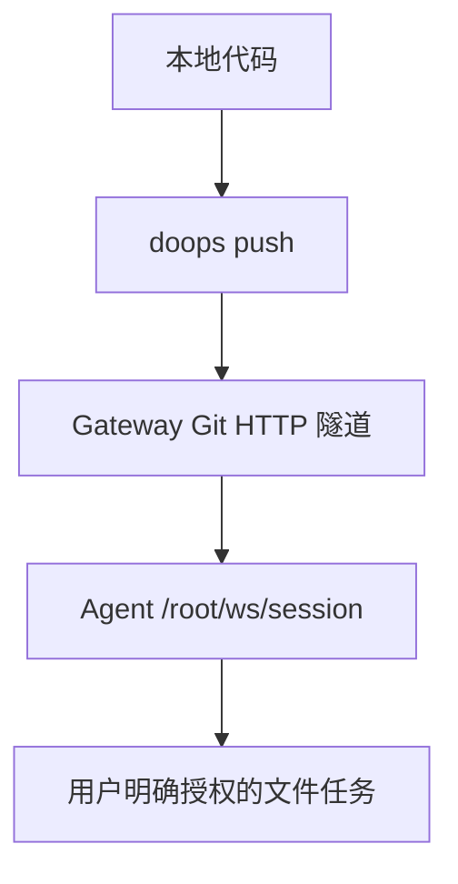
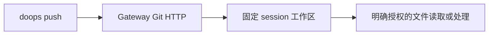

# DoOps 代码同步方案

> [!IMPORTANT]
> 本文记录代码同步方案的收敛结果，不是多路径兼容指南。标准路径只有
> `doops -session <session> push --target <gateway-target> --src <dir>`：
> CLI 通过 Gateway Git HTTP 隧道把工作区同步到目标 Agent 的
> `/root/ws/<session>`。不得使用 tar/base64、`write`、自建 `/upload`
> 端点、rsync 或客户端直连 SSH 作为代码同步替代路径。在线 Agent 仍可通过
> `doops ssh` 代理用户明确给出的出站 SSH 命令；这不改变 `push/pull`
> 的标准工作区协议。

## 核心问题

本文只处理用户明确要求的远端文件任务，不定义镜像构建或部署前置条件：

1. **代码如何到达 agent 工作目录**
2. **代码变更后如何高效增量同步**

---

## 现有能力盘点

| 能力 | 工具/方式 | 限制 |
|:---|:---|:---|
| 工作区上传 | `doops -session <s> push --target <gateway-target> --src <dir>` | 标准路径，基于 Gateway Git HTTP |
| 工作区下载 | `doops -session <s> pull --target <gateway-target> --dest <dir>` | 标准路径，基于 Gateway Git HTTP |
| 单文件写入 | `doops -session <s> write ...` | 仅用于小文本，不用于源码树或二进制 |
| 小文本查看 | `doops -session <s> read ...` | 仅配置、脚本、短日志等小文本 |
| Shell 执行 | `doops -session <s> exec ...` | 使用显式 session；读取同步文件时才需要先 push |

> [!IMPORTANT]
> 批量文件传输已经由 `doops push/pull` 提供。若出现 512KB 分块、tar、
> base64 或直连 Agent 上传，说明调用方绕过了标准路径，应修复调用方、
> Gateway Git HTTP 隧道或目标 Agent 版本。

---

## 方案对比



### 已淘汰：tar + write 管道

该路径把二进制数据塞进小文本接口，无法提供可靠的工作区身份、增量同步
和 Gateway 审计，禁止使用。

| 维度 | 评价 |
|:---|:---|
| 结论 | 禁止 |
| 原因 | 错用小文本通道，绕过标准工作区协议 |

---

### 标准方案：`doops push` + Gateway Git HTTP

```bash
doops -session myproject-build push \
  --target gw-example \
  --src ./myproject
```

内部流程：
1. CLI 根据 `.gitignore` 和 `.doopsignore` 生成 session 工作区 Git 快照。
2. 通过 `/v1/git/<cluster>/<instance>/<session>.git` 进入 Gateway。
3. Gateway 把 Git HTTP 请求路由到在线且匹配的 Agent。
4. Agent 将工作区固定到 `/root/ws/<session>`。

| 维度 | 评价 |
|:---|:---|
| 可靠性 | Gateway 身份、Agent 路由和 session 隔离均可验证 |
| 效率 | Git 对象增量传输 |
| 适用 | 所有标准 DoOps 工作区同步 |

---

### 已淘汰：rsync over SSH

| 维度 | 评价 |
|:---|:---|
| 结论 | 禁止作为日常同步路径 |
| 原因 | 绕过 Gateway 身份、审计、target 路由和 session 工作区 |

> [!TIP]
> SSH 主机不进入标准 target 配置。需要执行 SSH 命令时，通过已有 Gateway target
> 调用 `doops ssh --host <user@host> -- <command> [args...]`，由在线 Agent
> 代理并接受 Gateway 审计。不要把多层 SSH 拼进 `doops exec --cmd` 字符串。

---

### 发布任务

普通 `push/pull` 仍只走 Gateway Git HTTP。发布不解析仓库中的 environment、
template 或 workflow 声明；调用方通过明确授权的自然语言任务给出 target、服务范围、
镜像版本、原因和验收条件。需要凭据时，CLI 只传递 `--credential` 的资源名，Gateway
在用户、target 和 session 绑定后按精确 scope 授权并物化。
发布镜像由 CNB CI 产出，发布者先核对 source commit、digest 和 CI 成功证据。
`ask --apply` 直接使用任务授权的远程 Chart 和可选 values URL，不要求先 `push`、
创建 Git worktree 或 target 源码快照。完整发布规范见 `NATURAL_LANGUAGE_DEPLOYMENT.md`。

---

## 文件任务流程



### 同步并核对文件

```bash
# 任务确实需要远端文件时，显式同步
doops -session inspect-source push --target gw-example --src ./myproject

# 读取本次同步文件，不触发构建或部署
doops -session inspect-source read --target gw-example --path README.md
```

## 文件工作目录管理

> [!NOTE]
> 文件同步的工作区使用 `/root/ws/<session>`。这是文件任务的隔离边界，不是
> 发布输入或 CI 来源证明，不能通过另建共享源码目录破坏 session 隔离。

| 项目 | 路径 | 说明 |
|:---|:---|:---|
| 工作区根目录 | `/root/ws/` | Agent 管理的 session 工作区根目录 |
| 项目工作区 | `/root/ws/<session>/` | `push/pull/exec/ask` 的唯一工作区 |

```bash
/root/ws/
├── exam-lab-api-build/    # session 工作区
│   ├── Dockerfile
│   ├── main.go
│   └── ...
├── go-judge-build/        # 另一个 session
│   └── ...
```

---

## 关键决策点

1. 所有远程命令必须显式携带 `-session`。
2. target 必须是 Gateway target，不登记直连 Agent。
3. 工作区同步只使用 `push/pull` 的 Git HTTP 路径。
4. 路径故障必须修复 Gateway、Agent 或调用方，不设计传输 fallback。
