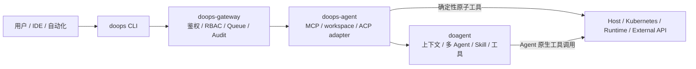

# doops.sh 分布式 Agent 运维系统

自然语言发布的权威职责边界见
[`NATURAL_LANGUAGE_DEPLOYMENT.md`](../NATURAL_LANGUAGE_DEPLOYMENT.md)。

`doops.sh` 把确定性控制面与 Agent 原生执行面分开：CLI、Gateway 和边缘适配器负责
可重复验证的协议、安全和工作区边界；doagent 负责上下文、规划、多 Agent、Skill 和
工具执行。

## 架构

## 分层职责

| 层 | 负责 |
| :--- | :--- |
| CLI | 配置读取、协议编译、工作区同步、结构化结果验证 |
| Gateway | 用户和 target 鉴权、队列、并发限制、资源锁、审计、路由 |
| doops-agent | MCP 工具、session 工作区、ACP 会话和事件适配 |
| doagent | 上下文、规划、多 Agent 委派、Skill 组合、工具选择 |
| Skill | 领域目标、不变量、授权、证据和输出契约 |
| 工具 | 小而确定的执行或观察能力 |

DoOps 不在 Gateway 或脚本中复制 doagent 的 Agent 引擎。

## 执行路径

| 路径 | 入口 | 适用任务 |
| :--- | :--- | :--- |
| 确定性工具 | `exec/read/write/push/pull/info` | 调用方已经知道准确原子操作 |
| Agent 任务 | `ask` / `doops_agent_prompt` | 需要观察、推理、Skill 或多 Agent 协作 |

这两条路径没有自动 fallback。失败必须保留原路径的真实错误，不能静默改写成另一种
执行方式。

## Agent 原生约束

- doops-agent 只通过 ACP 创建会话、设置模式、发送 prompt 和转发事件。
- 每个 prompt 都显式设置 `auto`、`plan` 或 `build` 模式。
- doops-agent 不自动回复 `permission.updated`。
- Skill 选择和多 Agent 调度由 doagent 完成。
- system prompt 和 Skill 不写死环境命令、target 坐标或固定回滚实现。
- 部署使用明确授权的自然语言任务；任务直接给出 target、服务范围、镜像版本、原因和验收条件。
- 凭据只通过 `doops ask --apply --credential <resource-name>` 的 metadata-only 引用进入 Gateway；Gateway 绑定用户、target 和 session 后按精确 scope 授权和物化。

## 工作区与状态

- session 工作区是 Agent 和确定性工具共享的任务上下文。
- 当调用方显式使用 `push/pull` 时，Git 工作区同步必须绑定精确 commit。
- 普通 `ask --apply` 不要求先同步仓库、创建隔离 workspace 或校验 `.doops-ready`；
  发布输入来自任务明确给出的远程 Helm 资产、镜像版本和验收条件，或来自任务明确授权
  读取的现有 release。apply 仍与其它 target mutation 共用资源锁。
- 密钥通过 Secret 或节点本地设置注入，不进入 Skill、计划、日志和仓库。

## Skill 和脚本

Skill 描述“要达到什么状态、哪些事实不能改变、什么证据算完成”，不描述固定命令
序列。doagent 可以组合多个 Skill 和工具，也可以委派多个 Agent。

脚本仅用于经过审查的原子能力或确定性校验。脚本必须显式输入、严格失败、可观察，
不得承担规划、Skill 路由、自动修复、权限批准或完整发布控制。

## 部署形态

边缘镜像包含：

- `/app/doops-agent`：Go 网关与 ACP 适配器；
- `/usr/local/bin/do-agent`：doagent 原生 Agent 引擎；
- `/app/skills`：运行时安装的 Skills；
- `/root/ws/<session>`：会话工作区；
- `/tmp/doops-doagent/settings.json`：由只读 Secret 物化出的模型和 provider 运行时配置。

普通业务发布遵循 Agent 原生 `ask --apply` 路径：CI 生成制品，发布者先核对精确 source
commit、registry digest 和构建成功证据，调用方再显式选择 configured
target 并提交远程 Helm 资产、镜像版本和验收条件；CLI、Agent 和 Helm 工具不自动验证
CI provenance。Gateway 完成鉴权、审计和凭据预物化，
目标 Agent/doagent 执行 mutation，最终状态由实际工具和功能证据验证。它不依赖仓库同步
或隔离 workspace。Gateway 本体仍通过 `extract-gateway-from-image.sh` 提取不可变制品后，
由 `deploy-gateway.sh` 从 SSH 宿主机发布，不通过 doops target。Agent 自升级在控制器已
存在且满足自身 namespace、标准 Deployment、已有匹配 Helm release 和
`/root/.kube` 或 `/root/.kube/config` 共享挂载时使用 `doops upgrade`；Job 的 Kubernetes
权限来自该挂载 kubeconfig。新集群无 Agent 或已有 Helm release 的旧 Agent 使用
`release-managed-agent.sh`；其 `--values` 新集群模式是 bootstrap-only，只做 Helm wait
和最终 Deployment 检查，不做 Gateway 接管或自动回滚，完成后必须继续安装验收。该脚本
不接管没有 Helm release 的既有 workload，且 `proxy.allowedHosts`/`hostAliases` 只由该
外部脚本显式修改。
