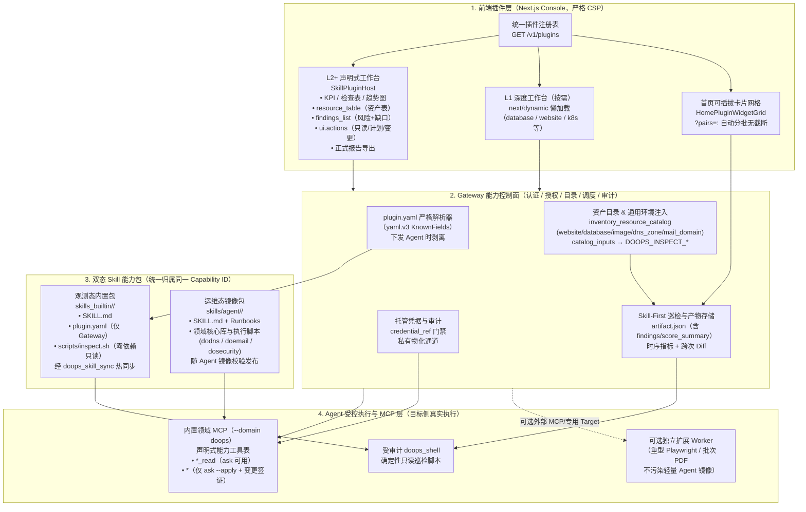
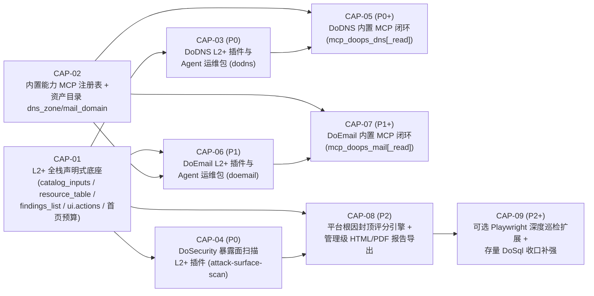

# DoOps 全栈能力插件整合架构规范（Capability Plugin Integration Spec）

> **状态**：已实施并完成「真插件化架构解耦（`PLG-03`）」——DoOps 核心保留 12 个通用核心内置 L2+ 插件与通用扩展底座（`catalog_schemas[]`、`mcp_server`、`${SKILL_DIR}` 安全展开、插件中心 `.zip` 安装/卸载）；**DoDNS（`plugins/dodns/`）与 DoEmail（`plugins/doemail/`）已彻底剥离出内核代码与基础镜像，作为零核心耦合的外部可安装全栈插件包交付**；平台级根因评分/管理报告导出（`CAP-08`）与机器部署挖掘打标（`CAP-10`/`CAP-11`）均已闭环；重型 Playwright 扩展 `CAP-09` 按需排队。
> **适用范围**：DoOps 全栈能力插件底座（Core Shell + L1 + L2+ 通用扩展原语）、外部可安装插件包（`plugins/dodns/`、`plugins/doemail/`）、Gateway 声明式资产目录与 MCP 生命周期编排、平台级根因评分与管理报告交付。
> **关联权威文档**：[PLUGIN_ARCHITECTURE_SPEC.md](PLUGIN_ARCHITECTURE_SPEC.md)、[SKILL_FIRST_INSPECTION_SPEC.md](SKILL_FIRST_INSPECTION_SPEC.md)、[DOSQL_ENGINE_SPEC.md](DOSQL_ENGINE_SPEC.md)、[AGENT_RESOURCE_SYNC.md](AGENT_RESOURCE_SYNC.md)、[CREDENTIAL_RESOURCES.md](../CREDENTIAL_RESOURCES.md)、[DOOPS_WEBUI.md](../DOOPS_WEBUI.md)、[DOOPS_API_GUIDE.md](../DOOPS_API_GUIDE.md)。

---

## 1. 设计目标与现状诊断

### 1.1 核心愿景：每个能力是一个全栈插件（Skill + 控制面 + 执行通道 + 前端插件）

DoOps 已在 `PLG-01` / `PLG-02` 落地了「极薄内核 Core Shell + L1 内置插件 + L2 声明式 `plugin.yaml` 插件」基础底座，并完成了 `DoSql`、`DoWeb` 的运行时收口。但面对 `DoDNS`、`DoEmail`、`DoSecurity` 等成体系运维能力的深度整合，现状存在五处结构性割裂：

1. **能力资产碎片化**：以现有 `DoWeb`（`doops.website`）与 `DoSql`（`doops.database`）为例，单一能力横跨 5 处松散耦合的位置——镜像内 `skills/agent/<cap>/`、Gateway 内嵌 `skills_builtin/inspect-*`、硬编码 `doagent_tools.go` / `k8s_mcp_stdio.go`、硬编码 `asset_catalog.go`、以及手写 React 工作台组件。每接入一个新能力都要跨前后端改写多处硬编码。
2. **L2 插件止步于“只读巡检”**：当前 `plugin.yaml`（`doops.sh/v1alpha1`）与 `<SkillPluginHost>` 仅支持定时/即时只读巡检（`POST /v1/monitor/runs`）和跳转 AI 助手，缺乏**资源台账表格、结构化风险发现与覆盖缺口视图、以及就地受控操作面板（只读 / 计划 / 受控变更）**。
3. **目标资产注入硬编码且目录类型受限**：`monitor_engine_runner.go` 的 `skillScriptExtraEnv` 目前仅对 `inspect-app-web` 注入 `DOOPS_INSPECT_URLS`；`inventory_resource_catalog` 仅接受 `website` / `database` / `image` 三种 `kind`，导致 DNS Zone、邮件域等新能力缺少一等资产归宿（而外部仓库靠硬编码 `config/resources.json` 会直接触碰公仓脱敏红线）。
4. **首页 L2 指标聚合预算即将见顶**：`GET /v1/monitor/metrics/latest` 当前硬上限为 **6 个 Skill / 12 个指标键**。已有 `gpu-governance`（4 键）与 `host-security`（4 键）已占 `8/12`，再引入 2–3 个内置能力插件就会在 `all-in-one` 模式下触发指标静默截断。
5. **缺少“在线巡检 → 正式交付报告”的最后一公里**：DoOps 现有 `artifact.md` / `artifact.json`（256 KiB 上限）面向单次技术留痕，缺少 DoSecurity 体系里最稀缺的**根因归并封顶评分模型、质量审计门禁与中文管理级 HTML/PDF 报告交付能力**。

本规范的目标，是在**零妥协守住 DoOps 全部安全与开放红线**的前提下，将插件架构从「巡检 UI 声明」演进为 **「全栈能力插件架构（Capability Plugin Architecture）」**：**每个运维能力以统一插件单元交付，前端工作台、资产目录、Skill 双态包与受控 MCP 执行通道一次对齐、按场景包装配、开箱即用。**

### 1.2 上级目录（l8ai 生态）全景盘点与整合裁决

| 源项目 / 子模块 | 现有体量与核心资产 | 与 DoOps 现状关系 | 整合裁决与目标落位 |
|---|---|---|---|
| **DoDNS** | `Skill/`（9 文件 / 56 KiB）+ `Server/core`（纯 Python `dns_wire.py` / `zone.py`）+ `ensure-alidns-record.mjs` + `mcp-server` | DoOps 核心无须耦合 DNS 领域代码 | **独立可安装全栈插件包（`plugins/dodns/`，`PLG-03`）**：自含 `plugin.yaml`（`opt_in: true` + `catalog_schemas: [zone]` → `plugin:dodns:zone` / `DOOPS_PLUGIN_DNS_ZONES`）、零 `dig` 巡检脚本与独立 Python stdio MCP（`mcp/server.py`），经「插件中心」上传 `.zip` 即装即用、卸载即清 |
| **DoSecurity — `security-scanner`** | 6 文件 / 80 KiB：低速只读子域/指纹/安全头/敏感路径暴露检查、allowlist Nuclei 约束 | 高价值互补：现有 `host-security` 偏主机内部，`inspect-app-web` 仅做基础探活与 2 个安全头 | **核心内置安全插件**：L2+ 插件 `skill.attack-surface-scan`（自动复用核心 `website` 资产目录）+ 只读工具库 `skills/agent/dosecurity/` |
| **DoEmail（仅 `main` 分支）** | `Skill/`（22 文件）+ `Server/lib/email-policy.mjs` + K8s GitOps 基线（注：严禁接触含明文账号的站点分支） | DoOps 核心无须耦合邮件领域代码 | **独立可安装全栈插件包（`plugins/doemail/`，`PLG-03`）**：仅从 `main` 安全抽取，自含 `plugin.yaml`（`opt_in: true` + `catalog_schemas: [domain]` → `plugin:doemail:domain` / `DOOPS_PLUGIN_MAIL_DOMAINS`）、只读巡检脚本与独立 Node stdio MCP（`mcp/server.mjs`，强制 `passwordSecretRef` 零明文口令），经「插件中心」上传 `.zip` 按需安装卸载 |
| **DoSecurity — `website-health-inspector` + `server-health-monitor` + 根 V1 Schema 合同** | 72 + 12 文件 + 12 份 JSON Schema + `scoring_model.py` + 中文管理级 HTML/PDF 渲染器（重依赖 Playwright/Chrome/reportlab） | 主机/站点基础巡检已被 `inspect-vm-host`/`inspect-app-web` 覆盖；但**根因封顶评分、质量审计、管理级 HTML/PDF 报告与深度浏览器实测**是 DoOps 空缺 | **P2 平台化拆解吸收（严禁整包塞入 1 MiB Skill）**：① 抽离根因封顶评分模型与质量审计契约进平台通用层；② 控制台提供零重依赖的管理级 HTML / 打印 PDF 导出；③ Playwright 深度浏览器实测与 N+1 批次打包以独立可选扩展 Worker 接入 |
| **DoSql** | 旧版 Node `dosql-agent.mjs`；其 `UNIFIED_RUNTIME.md` 已声明 DoOps 为权威运行时 | DoOps 已有更成熟的 Go 引擎（`internal/dosql` + `SQL-08` 结构治理/门禁预检） | **不倒灌旧代码**；仅纳入收口项：清理 `skills/agent/dosql/config/` 历史遗留静态清单，按需将只读慢查询/安全基线补强进 `inspect-database` |
| **DoWeb** | 30.4 KB 旧版 `doweb.mjs`；其 `UNIFIED_RUNTIME.md` 已声明 DoOps 为权威运行时 | DoOps `skills/agent/doweb/scripts/doweb.mjs`（35.8 KB）更权威且已接通 `mcp_doops_web[_read]` | **不倒灌**；作为内置能力 MCP 与 L1 工作台对齐的参考样板 |
| **doagent / AgentForge** | 22 个教学办公 Skill / 29 个办公科研 Skill | 与运维定位正交 | **不并入运维插件**；仅保留 `AgentForge/skill-creator` 的对话式引导思路作后续自定义 L2 插件生成参考 |

---

## 2. 架构红线（不可妥协约束）

本规范的所有设计均须严格满足以下 7 条平台红线，并由自动化测试持续守卫：

1. **授权模型零改变**：目标授权保持 `(user, cluster, instance)` 与平台管理员标记 `is_admin`。任何 L1/L2+ 能力插件开关只控制 UI 装配与路由可见性，**绝不**演化为按插件/按操作权限门禁；`TestPluginTablesOnlyReadByPluginFiles` AST 守卫持续生效。
2. **变更通道失败关闭（Fail-Closed）**：
   - `ask --apply` 会话保持**无 `Bash` 工具**，所有受控基础设施变更必须走结构化内置 MCP 工具，受 `DO_AGENT_MUTATION_AUTHORITY_SECRET` 变更签证、`DisallowUnknownFields` 严格参数校验与 Gateway 审计先行约束。
   - L2+ 脚本直跑参数严格保留 **Q3 禁令（禁止自由文本 `text` 输入类型）**，只允许 `number | boolean | select | credential_ref` 与 Gateway 严格校验后的资产目录注入。
3. **凭据隔离红线**：明文密码、API Key、TSIG/DNSSEC 私钥、Cookie、邮箱口令**绝不**进入 Skill 源码、`plugin.yaml`、`DOOPS_INPUT_*`、自然语言提示词、审计记录、巡检产物或导出报告。L2+ `credential_ref` 仅传递资源名；真实密钥仅在目标授权通过后经 Gateway 私有物化通道交付给目标 Agent。
4. **严格 CSP 与零未受信任前端代码**：保持 `next.config.mjs` 安全头（无 `'unsafe-eval'`、`frame-ancestors 'none'`、`connect-src 'self'`）；前端只消费 Gateway 校验后的 JSON 声明或一等仓库内 `next/dynamic` 懒加载组件。
5. **SQLite 与 MySQL 5.7/8.0/8.4 双库同构**：优先复用现有表结构（零不必要 DDL）；如涉及新表/新列，必须三方一致（SQLite 运行期迁移 + 冻结导出 + MySQL 5.7 `innodb_large_prefix=OFF` 兼容 DDL），并过全套 parity 与 `affected_rows` 守卫。
6. **轻量基础镜像不膨胀**：不往 `backend/Dockerfile.base.light` 塞入 Chromium、Playwright、`reportlab` 或高危渗透工具套件。所有内置 L2+ 巡检脚本主路径必须仅依赖镜像已有运行时（`python3` + stdlib、`nodejs`、`curl`、`kubectl`、`helm`），对可选外部二进制（`named-checkzone`、`nuclei` 等）坚持「缺失则如实写入 `coverage_gaps[]`，绝不伪造健康」。
7. **公共仓库零私有信息泄露**：源仓库中全部私有公网 IP、客户域名、高校/内部代号、`config/resources.json` 以及 DoEmail 站点明文分支必须 100% 剔除，所有示例使用 RFC 2606 / RFC 5737 占位值，并通过 `backend/test/test_stale_contracts.py`。

---

## 3. 深度统一架构：四层合一能力插件模型

### 3.1 总体架构拓扑



### 3.2 核心底座升级一：L2 → L2+ 声明式全栈工作台协议

在不破坏任何已有 `doops.sh/v1alpha1` 清单的前提下，对 `backend/agent/internal/server/plugin_skill_ui.go` 与 `components/plugins/skill-plugin-host.tsx` 做 4 项增量扩展，使 **80% 的运维能力无需编写专有前端页面即可获得“观测 + 资产 + 风险 + 受控变更 + 报告导出”全栈工作台**：

#### (1) `capabilities.catalog_inputs`：通用资产目录只读注入（消除硬编码）

替代 `monitor_engine_runner.go` 中 `if slug != "inspect-app-web"` 的硬编码分支。仅对 `scope == "system"` 的内置插件生效（自定义 Skill 不可随意拉取全局目录），白名单枚举如下：

| 声明值 | 数据源（`inventory_resource_catalog`） | 注入环境变量 | 校验与数量上限 |
|---|---|---|---|
| `website_urls` | `kind='website'`（当前目标） | `DOOPS_INSPECT_URLS` | `http/https`、`catalogHost`、无凭据/查询串，最多 12 个 |
| `website_domains` | `kind='website'` 派生唯一域名 | `DOOPS_INSPECT_DOMAINS` | `catalogHost` 去重小写，最多 24 个 |
| `dns_zones` | `kind='dns_zone'`（Phase 2 启用） | `DOOPS_INSPECT_DNS_ZONES` | 合法 FQDN 根域 + 可选权威服务器元信息（非秘密），最多 24 个 |
| `mail_domains` | `kind='mail_domain'`（Phase 2 启用） | `DOOPS_INSPECT_MAIL_DOMAINS` | 合法邮件域与主机名（非秘密），最多 16 个 |

Gateway 在 `skillScriptExtraEnv` 中按 `manifest.Capabilities.CatalogInputs` 统一构建环境变量，经 `shellSingleQuote` 转义后下发，并将注入计数写入 `evidence.catalog_inputs`。

#### (2) `capabilities.companion_agent_skill`：双态 Skill 显式关联

在 `plugin.yaml` 允许声明可选的 `companion_agent_skill: dodns`（匹配 `^[a-z0-9][a-z0-9-]{0,62}$`），用于在「插件中心」同时核验并呈现该能力插件的完整依赖栈：
- 巡检包状态（Gateway `platform_skills` 是否启用）
- 运维包状态（目标 Agent `/root/.agent/skills/<cap>/` 是否就绪，读取现有 `doops_skills_inspect`）
- MCP 能力状态（`requires_mcp` 工具对是否就绪）

#### (3) `ui.views` 新增两个声明式视图原语

在现有 `kpi_grid | checks_table | charts | trend_series | artifact_viewer` 基础上，新增两个强类型视图原语（上限仍为 `maxPluginViews = 8`）：

- **`resource_table`**：渲染 `artifact.json` 中指定数组字段（默认 `resources`）的只读资产表。
  - 清单声明 `source_key`（白名单键模式）、`columns[]`（最多 8 列：`key`、`label`、`kind: text|badge|code|number`）、`row_action_preset`（可选，引用 `ui.actions` 中的某项 ID）。
  - 交互效果：支持客户端关键词过滤与状态筛选；点击任意资产行，自动把该行标识（如域名、Zone 名、邮件域）作为只读上下文带入下方操作区或 AI 协同预设——把 DoDNS/DoSecurity 独立控制台的核心交互沉淀成通用底座。
- **`findings_list`**：渲染 `artifact.json` 中的 `findings[]`、`coverage_gaps[]` 与可选 `score_summary`。
  - 统一字段约定：`{ id, severity, title, root_cause?, asset, evidence, recommendation, priority? }`（与 DoSecurity `finding.v1.schema.json` 对齐）。
  - 交互效果：顶部展示严重度分布（Critical / High / Medium / Low / Info）与根因封顶健康分（如有）；中间按优先级分组展示发现卡片；底部独立高亮「覆盖缺口（`coverage_gaps[]`）」，强制落实践行“未覆盖绝不当作健康”。

#### (4) `ui.actions`：就地受控操作面板（只读 / 计划 / 受控变更）

为使每个能力插件都能像 `WebsitePanel` 一样完成「巡检 → 规划 → 受控执行」闭环，同时**绝不放宽脚本直跑 Q3 禁令**，`plugin.yaml` 新增 `ui.actions[]`（上限 6 项）：

```yaml
ui:
  actions:
    - id: dns-record-plan
      label: 规划解析变更
      description: 核查当前权威解析与 SOA 序列号，生成可审阅的变更计划与回滚方案
      mode: plan                # check | plan | apply
      skill: dodns              # 绑定的目标 Agent 运维 Skill
      requires_mcp: doops       # 仅展示就绪态，非权限门禁
      prompt_template: "请使用 dodns Skill 核查目标当前权威 Zone 配置，针对用户需求生成变更计划、验证命令与回滚方案，严禁直接修改文件。"
    - id: dns-record-apply
      label: 执行受控解析变更
      description: 经 mcp_doops_dns 完成备份、SOA 递增、named-checkzone 校验、reload 与解析验证
      mode: apply               # 触发 doops_agent_prompt operation=apply
      skill: dodns
      requires_mcp: doops
      credential_use: opaqueSecret   # 可选：若变更涉及云 DNS 托管凭据，引导选择已绑定资源名
      prompt_template: "请使用 dodns Skill 与 mcp_doops_dns 执行受控 DNS 变更，必须先备份、校验语法并验证解析生效，失败时自动回滚。"
```

**安全边界**：
- `ui.actions` 走既有 `POST /v1/tools/call`（`doops_agent_prompt`），完全复用 Gateway 目标授权、`operation=apply` 变更签证、`doagentAllowedTools` 白名单与全量审计，**不引入新执行后门**。
- 当 `mode: apply` 但目标 Agent 尚未升级提供对应结构化 MCP 工具时，由 Agent 侧 `doagentAllowedTools` 自动 fail-closed 报错并如实提示升级，绝不静默退化到无保护的 Shell。
- `<SkillPluginHost>` 内嵌紧凑操作抽屉/卡片（复用 `<AgentRunOutput>` 流式渲染执行证据与停止按钮），用户在插件页内即可完成“看巡检 → 点资源 → 跑计划 → 受控执行 → 一键复检”闭环。

#### (5) 首页 L2 指标聚合预算升级

- 后端 [monitor_engine_http.go](../../agent/internal/server/monitor_engine_http.go) 与前端 [dashboard-panel.tsx](../../../components/dashboard-panel.tsx) 将 `GET /v1/monitor/metrics/latest` 上限从 `maxSkills=6, maxKeys=12` 升级为 **`maxSkills=12, maxKeys=36`**。
- 内置 L2+ 插件首页卡片建议只放 **2–3 个高信号核心指标**，保证 `all-in-one` 模式下所有已启用能力插件的首页卡片均在单次批量请求内完整渲染且零截断。

---

### 3.3 核心底座升级二：声明式内置能力 MCP 注册与变更护栏

对照 `doagent_tools.go`、`k8s_mcp_stdio.go` 与 `web_tool.go` 的成熟范式，将分散的 `switch skill` 重构为统一的 **内置能力工具规格表（`builtinCapabilityToolSpecs`）**：

| Skill 标识 | `ask`（只读）工具 | `ask --apply`（受控变更）工具 | Agent 侧执行器 | 变更必检证据 |
|---|---|---|---|---|
| `""` / `k8s` / `image-build` | `mcp_doops_k8s_read`（K8s 可用时） | `mcp_doops_helm` | Go 原生 Helm/K8s | `--wait` deployed 校验 + revision 回读 |
| `doweb` | `mcp_doops_web_read` | `mcp_doops_web` | `/app/skills/doweb/scripts/doweb.mjs` | SiteSpec + `nginx -t` + reload + 健康验证 + 回滚快照 |
| `dosql` | `mcp_dosql_read` | `mcp_dosql_exec` | Go `internal/dosql` | Policy-as-Code + 分段事务 + 版本流水 + Schema 快照 |
| **`dodns`（新）** | **`mcp_doops_dns_read`** | **`mcp_doops_dns`** | `/app/skills/dodns/scripts/dodns.py`（+ 可选 AliDNS 助手） | 时间戳备份 + SOA 递增 + `named-checkconf`/`named-checkzone` + `rndc reload` + 解析验证 + 失败自动还原 |
| **`doemail`（新）** | **`mcp_doops_mail_read`** | **`mcp_doops_mail`** | `/app/skills/doemail/scripts/doemail.mjs` | K8s Secret 引用校验（零明文密码）+ 策略分级 + K8s/SMTP/IMAPS 实证 |
| **`dosecurity`（新）** | 复用只读 `Bash` / `scripts/` | **不开放破坏性 `apply`** | `/app/skills/dosecurity/` | 低速只读预算、请求速率封顶、零正文泄密、`quality-audit` |

**统一契约要点**：
1. 所有内置 MCP 工具均挂在既有 `doops-agent mcp-stdio --domain doops` 下（除独立 `dosql` 域外），**零新增常驻子进程**。
2. 所有写工具严格实行：JSON `DisallowUnknownFields`、绝对路径白名单校验、`DO_AGENT_MUTATION_AUTHORITY_SECRET` 运行时签证、超时/未知终态返回 `errExecutionOutcomeUnknown` 防盲目重试、以及全量 Gateway 审计与脱敏。
3. 遵循 `RES-01` 目标能力探测机制：离线目标保留能力摘要，老版本 Agent 缺少新 MCP 工具时明确返回不支持错误码，不做静默降级。

---

### 3.4 核心底座升级三：资产目录模型平滑扩展（零 DDL 变更）

`inventory_resource_catalog` 表在 SQLite 与 MySQL 5.7/8.0/8.4 中均为 `(id, kind, cluster, instance, created_by, name, environment, details, identity_key, revision)`，其唯一性触发器与索引基于 `(kind, cluster, instance, identity_key)`，因此新增 `kind` **不需要 `ALTER TABLE` 也不需要新触发器**。

分两阶段演进：
- **阶段 A（P0 立即可用）**：`attack-surface-scan` 直接消费既有 `kind='website'`；`dns-governance` 结合本机 BIND/Unbound 自动发现 + 从 `kind='website'` 派生的 `DOOPS_INSPECT_DOMAINS`。
- **阶段 B（能力目录完整化）**：在 `backend/agent/internal/server/asset_catalog.go` 与前端台账增加两个一等资源 `kind`：
  - **`dns_zone`**：`details = { zone, provider, authority_server, runtime_mode }`
    - `zone`：小写合法域名（`catalogHost`）；`provider`：`bind | unbound | alidns | cloudflare | external`；`authority_server`：主机名或 IP（不含端口凭据）；`runtime_mode`：`host | docker | k8s | managed`。
  - **`mail_domain`**：`details = { domain, mail_hostname, namespace, deployment }`
    - `domain` / `mail_hostname`：小写合法域名；`namespace` / `deployment`：合法 K8s 资源名（`^[a-z0-9]([-a-z0-9]*[a-z0-9])?$`）。
- 同步接入 `RES-01` `agent_resource_store.go` 清单对账范围（`kind IN ('website','database','image','dns_zone','mail_domain')`），让每个目标的资产清单统一可观测、可对账、可审计。

---

### 3.5 L2+ 与 L1 前端插件分层选型准则

为防止前端无限膨胀同时保证重交互场景体验，设定明确边界：

| 判定维度 | 采用 **L2+ 声明式插件**（默认首选） | 升格为 **L1 懒加载专有插件**（按需） |
|---|---|---|
| 核心交互形态 | 资产表 + 巡检/扫描表单 + KPI/图表/趋势 + 风险发现列表 + 引导式 `check/plan/apply` 操作 + 报告导出 | 复杂多页签工作台、在线代码/SQL/Zone 文本编辑器、复杂向导、文件上传/批量任务编排 |
| 前端代码成本 | **零前端路由样板**（由 `<SkillPluginHost>` 驱动） | 独立 `components/` + `next/dynamic` + `plugin_catalog.go` 注册 |
| 适用能力 | `gpu-governance`、`host-security`、`dns-governance`、`attack-surface-scan`、`mail-governance` | 既有 `database`、`website`、`k8s`、`delivery`、`image`、`inspection`、`cmdb`、`automation`；未来若需独立「安全合规报告中心」或「可视化 Zone 编辑器」时再平滑升格 |
| 治理体验一致性 | 两者在「插件中心」、场景包预设、权限隔离与路由守卫中保持完全一致 | 同左 |

---

## 4. 四大能力域整合详细设计

### 4.1 能力插件一：DoDNS — DNS 基础设施治理（`skill.dns-governance`）

#### 定位与价值
填补 DoOps 在权威 DNS（BIND 9）、递归解析器（Unbound）与云 DNS（AliDNS）治理上的空白。

#### 四层落位清单
1. **前端插件（L2+ `plugin.yaml`）**：
   - ID：`skill.dns-governance`，分类：`infrastructure`，图标：`globe`，默认挂载场景：`app-delivery-web`、`host-security-ops`、`all-in-one`。
   - 插槽：侧栏「DNS 治理」、目标页签「DNS 治理」、首页汇总卡（3 指标：`dns_risk_total`、`dns_zones_total`、`dns_latency_max_ms`）。
   - 受控输入（严格符合 Q3）：
     - `CHECK_OPEN_RECURSION`（`boolean`，默认 `true`）
     - `CHECK_AXFR`（`boolean`，默认 `true`）
     - `LATENCY_WARN_MS`（`number`，默认 `200`，范围 `20–5000`）
     - `QUERY_SCOPE`（`select`：`local_and_catalog | local_only | catalog_only`）
   - 视图：`kpi_grid` + `resource_table`（展示发现的本机 Zone 与探测域名表）+ `findings_list`（展示开放递归/AXFR/语法错/解析不一致风险与缺口）+ `trend_series` + `artifact_viewer`。
   - `ui.actions`：提供「只读排查解析与日志」「生成 Zone/记录变更计划」「受控应用解析变更（`apply`）」三个结构化入口。
2. **观测态 Skill（`skills_builtin/dns-governance/`，≤ 4 文件）**：
   - `SKILL.md`、`plugin.yaml`、`scripts/inspect.sh`、`scripts/dns_wire.py`（纯 Python stdlib）。
   - **零 `dig` 依赖实现**：在 `DoDNS/Server/core/do_dns/dns_wire.py` 基础上补全 `A / AAAA / CNAME / MX / TXT / NS / SOA` RDATA 解码、UDP/TCP 双传输、`RD`/`RA` 位开放递归判定与 TCP AXFR 探针，在无 `dnsutils` 的轻量 Agent 镜像中原生运行。
   - 采集范围：① 检测本机 53/5353 监听与 `named`/`unbound` 服务状态；② 若存在 `/etc/bind/named.conf*` 与 `named-checkconf`/`named-checkzone`/`unbound-checkconf`，执行只读语法校验并自动发现 zone 列表（不存在则如实记入非 BIND 节点或覆盖缺口）；③ 探测开放递归与 AXFR 暴露；④ 对发现的 zone 顶点及 `DOOPS_INSPECT_DOMAINS`/`DOOPS_INSPECT_DNS_ZONES` 测量解析延迟与 RCODE 一致性。
3. **运维态 Skill（`skills/agent/dodns/`）**：
   - 彻底脱敏重构后的 `SKILL.md`、`references/{operations,security}.md`（删除源仓 `gateway.md` 里的真实公网 IP 与 `config/resources.json`）。
   - 统一 Python 执行器 `scripts/dodns.py`（整合 `do_dns/dns_wire.py` 与 `do_dns/zone.py`，支持 `zone-list`、`zone-show`、`query`、`check-config`、`record-upsert`、`record-delete`、`zone-reload`），所有写操作强制：时间戳备份 → SOA `YYYYMMDDNN` 自动递增 → `named-checkconf` & `named-checkzone` 校验 → `rndc reload <zone>` → 解析回读验证；任一步失败自动还原备份并返回清晰错误。
   - 脱敏版 `scripts/ensure-alidns-record.mjs`：移除硬编码域名/IP 示例，增加 `A/AAAA/CNAME/TXT/MX` 支持，凭据仅从运行期受控凭据通道注入，缺失即 fail-closed 报错。
4. **内置 MCP 工具（`CAP-04`）**：
   - 在 `k8s_mcp_stdio.go` 新增 `dns_read` 与 `dns` 工具对（镜像 `web_tool.go` 契约），在 `doagent_tools.go` 登记 `dodns` 能力，打通 `ask --apply` 全程签证与审计。

---

### 4.2 能力插件二：DoSecurity — 外部暴露面与基线扫描（`skill.attack-surface-scan`）

#### 定位与价值
与现有 `host-security`（主机内部）和 `inspect-app-web`（基础 HTTP 探活 + 证书天数）严格错位互补，补齐 DoOps 的**外部 Web 攻击面与安全基线评估能力**。

#### 四层落位清单
1. **前端插件（L2+ `plugin.yaml`）**：
   - ID：`skill.attack-surface-scan`，分类：`security`，图标：`radar`，默认挂载场景：`host-security-ops`、`app-delivery-web`、`all-in-one`。
   - 插槽：侧栏「暴露面扫描」、目标页签「暴露面扫描」、首页汇总卡（3 指标：`surface_risk_total`、`surface_exposed_paths`、`surface_missing_csp`）。
   - `capabilities.catalog_inputs: [website_urls]`（直接消费目标已登记 `website` 目录，零自由文本注入风险）。
   - 受控输入（严格符合 Q3）：
     - `CHECK_SECURITY_HEADERS`（`boolean`，默认 `true`）
     - `CHECK_SENSITIVE_PATHS`（`boolean`，默认 `true`）
     - `DETECT_LOGIN_SURFACES`（`boolean`，默认 `true`）
     - `REQUEST_DELAY_MS`（`number`，默认 `500`，范围 `200–3000`）
     - `MAX_URLS`（`number`，默认 `12`，范围 `1–12`）
     - `RUN_OPTIONAL_NUCLEI`（`boolean`，默认 `false`；仅在目标已安装 `nuclei` 且存在只读 allowlist 模板时运行，严禁 broad/dos/fuzz/default-login）
   - 视图：`kpi_grid` + `findings_list`（带根因归并标签与覆盖缺口）+ `resource_table`（已扫描资产矩阵：URL、状态码、TLS 协议、缺失安全头数、敏感路径命中数）+ `charts` + `trend_series` + `artifact_viewer`。
   - `ui.actions`：提供「生成授权扫描计划（只读）」「AI 研判暴露面风险与 Nginx 加固方案（只读）」；**不提供破坏性 `apply`**，加固变更引导跳转 `doops.website`（`doweb`）执行。
2. **观测态 Skill（`skills_builtin/attack-surface-scan/`，≤ 4 文件）**：
   - 零外部工具依赖主路径（Python 3 stdlib `urllib`/`ssl` 或 Node.js `fetch`）：
     - **完整 OWASP 安全响应头基线**：`Content-Security-Policy`、`Strict-Transport-Security`、`X-Frame-Options`、`X-Content-Type-Options`、`Referrer-Policy`、`Permissions-Policy` 以及 `Server` / `X-Powered-By` 版本指纹泄露检测。
     - **低速只读敏感路径暴露基线**：受严格请求预算与延时控制，探测 `/.git/config`、`/.env`、`/swagger-ui.html`、`/swagger-ui/index.html`、`/v3/api-docs`、`/openapi.json`、`/server-status`、`/actuator/env`、`/actuator/health`。
     - **安全与防误报硬加固**（修正源仓 `dosecurity-scanner.mjs` 隐患）：
       1. 必须同时满足 `200 <= status < 300` + 严格特征正则 + 非同源 SPA 兜底 HTML（比对根路径内容哈希/Content-Type），杜绝 SPA 200 误报；
       2. 命中 `/.env` 或 `/.git/config` 等高敏路径时，**只输出路径、状态码、Content-Length 与命中规则名，严禁把响应正文片段写入 stdout / `artifact.json` / 日志**，彻底阻断扫描器反向泄密；
       3. 目标无已登记 `website` 且未检出本机监听站点时，明确返回 `status=warning` 与 `coverage_gaps`，绝不伪造 `0 风险`。
     - **登录面识别**：信息级记录公开管理后台/统一认证登录入口，提示复核 MFA、验证码与限速。
     - **可选 `nuclei` 守卫**：开启 `RUN_OPTIONAL_NUCLEI=true` 时，若二进制或只读 allowlist 模板缺失，写入 `coverage_gaps[]`；运行时强加 `-rl 1 -c 1 -retries 0 -etags intrusive,dos,fuzz,bruteforce,default-login`。
3. **运维态 Skill（`skills/agent/dosecurity/`）**：
   - 承接脱敏精简后的扫描计划生成器、历史产物汇总、V1 Schema 合同校验器（精简自 `dosecurity-contract.mjs` 与核心 schemas）及统一评分辅助库，供 AI 助手做复杂多资产复盘与合规自检。

---

### 4.3 能力插件三：DoEmail — 邮件服务与域治理（`skill.mail-governance`）

#### 定位与价值
将基于 Kubernetes（如 `docker-mailserver`）的邮件域接入、DNS/rDNS 合规校验、SMTP/IMAPS 探活、账号与权限生命周期管理完整纳入 DoOps。

#### 强安全抽取门禁（执行前必核）
- **唯一源码来源**：仅允许从 `DoEmail` 仓库 **`main` 分支** 抽取，**严禁读取或检出任何包含站点明文账号文件的站点分支**。
- **强制代码剥离**：删除对 `Server/lib/site-branches.mjs` 的全部引用与 `account open/send` 站点明文分支命令；删除 `Skill/config/resources.json`；将 `Skill/docs/`（9 份）精简合并为 2–3 份通用脱敏参考文档。

#### 四层落位清单
1. **前端插件（L2+ `plugin.yaml`）**：
   - ID：`skill.mail-governance`，分类：`ops`，图标：`network`，默认挂载场景：`app-delivery-web`、`all-in-one`。
   - 插槽：侧栏「邮件服务治理」、目标页签「邮件治理」、首页汇总卡（3 指标：`mail_risk_total`、`mail_dns_pass_pct`、`mail_endpoints_up`）。
   - `capabilities.catalog_inputs: [mail_domains]`（Stage 1 可同时支持自动探测目标 K8s 集群中带标准标签或名称含 `mailserver` 的工作负载与环境变量中的非秘密域名元信息）。
   - 受控输入（Q3 合规）：`CHECK_DNS_AUTH`（SPF/DKIM/DMARC/rDNS，默认 `true`）、`CHECK_SMTP_IMAPS`（25/587/993 探活与 TLS 证书天数，默认 `true`）、`CHECK_K8S_RUNTIME`（Pod/PVC 健康，默认 `true`）、`CERT_WARN_DAYS`（`number`，默认 `14`）。
   - 视图：`kpi_grid` + `resource_table`（邮件域与服务端点状态表）+ `findings_list`（缺失 SPF/DKIM/DMARC/rDNS、PVC 未绑定、证书临期、端口不通）+ `trend_series` + `artifact_viewer`。
   - `ui.actions`：提供「生成域名接入 DNS 清单与开发者接入指南（只读）」「规划账号/别名/配额变更（`plan`）」「受控执行邮件账号或配置变更（`apply`）」「有界 `run-once` 监听演练规划」。
2. **观测态 Skill（`skills_builtin/mail-governance/`，≤ 5 文件）**：
   - 复用纯 Python DNS Wire 库检验 `A`、`MX`、`TXT(SPF)`、`TXT(<selector>._domainkey)`、`TXT(_dmarc)` 与 `PTR(rDNS)`；
   - 纯 Python `socket`/`ssl` 探测 TCP `25`、`587`（STARTTLS）、`993`（IMAPS TLS 证书剩余天数）；
   - `kubectl`（若目标具备 K8s 能力）只读核查邮件命名空间 Pod Ready、重启次数与 `mail-data`/`mail-state`/`mail-config` PVC 绑定状态。
3. **运维态 Skill（`skills/agent/doemail/`）**：
   - 脱敏版 `SKILL.md`、合并后的 Runbook（域名接入、账号与权限、开发者 SMTP/IMAP 接入模板、有界监听规范）、合规策略模块 `email-policy.mjs` 与精简规划/执行 CLI `doemail.mjs`、以及通用 Kustomize/Helm 脱敏参考模板。
   - **凭据红线**：账号创建/重置/测试发信统一只接受 `passwordSecretRef`（K8s Secret 引用或 DoOps 托管凭据绑定），严禁在参数、manifest 或操作日志中落明文密码。
4. **内置 MCP 工具（`CAP-07`）**：
   - 在 `k8s_mcp_stdio.go` 新增 `mail_read` 与 `mail` 工具对，接入 `doagent_tools.go` 声明式能力表，实现 `ask --apply` 下的受控账号/别名/配额/发信验证闭环。

---

### 4.4 能力域四：平台级根因评分引擎与正式报告交付体系（源自 DoSecurity 精华）

将 `DoSecurity/Skill/website-health-inspector` 与 `server-health-monitor` 中最有价值的**评分方法论与交付呈现能力**从特定脚本解耦出来，升级为**全平台通用观测交付层**：

#### 1. 轻量化 `artifact.json` 扩展协议（向后 100% 兼容）

在 [SKILL_FIRST_INSPECTION_SPEC.md](SKILL_FIRST_INSPECTION_SPEC.md) §4.1 可选字段之外，新增三组可选顶层字段：

```json
{
  "findings": [
    {
      "id": "SURF-001",
      "severity": "medium",
      "confidence": "high",
      "root_cause": "missing-csp-header",
      "title": "站点缺少 Content-Security-Policy 响应头",
      "asset": "https://app.example.com/",
      "evidence": "GET / HTTP 200; missing header content-security-policy",
      "recommendation": "在反向代理层按业务白名单配置 CSP 响应头",
      "priority": "P2"
    }
  ],
  "coverage_gaps": [
    {
      "module": "nuclei-allowlist",
      "reason": "nuclei binary not installed on target",
      "impact": "未执行 CVE 模板扫描，结果不等同于无已知漏洞"
    }
  ],
  "score_summary": {
    "model": "doops.root-cause-capped.v1",
    "score": 86,
    "grade": "B",
    "deductions": [
      { "root_cause": "missing-csp-header", "count": 4, "penalty": 10, "capped": true }
    ],
    "quality_audit": {
      "status": "pass",
      "checks": ["no_plaintext_secret", "coverage_gaps_explicit", "score_reasonableness_ok"]
    }
  }
}
```

#### 2. 根因归并封顶评分引擎（纯函数库，前后端共享口径）
借鉴 DoSecurity `website-health-inspector/scripts/scoring_model.py` 核心机制：
- **同根因重复扣分封顶**：同一根因跨多个 URL/主机重复出现时，按 `min(base + (count - 1) * increment, cap)` 计扣，避免单一配置缺失把整体评分压成 0 分；
- **边界与缺口零误扣但强展示**：自动化登录边界、未安装可选工具等归入 `coverage_gaps[]`，不伪造高分也不误判为线上宕机；
- **环境与置信度校准**：非生产环境扣分封顶、TLS 证书剩余天数分档（已过期 / ≤7 天 / ≤30 天）、低置信度风险降权；
- **渲染前质量与评分合理性门禁**：导出正式报告前自动运行只读校验（敏感字段扫描、覆盖缺口显式性检查、核心故障分数上限校验），结果写入报告附录。

#### 3. 两阶段正式报告交付路径
- **Phase A — 控制台原生管理级报告导出（零重型依赖，`CAP-08`）**：
  - 在「智能巡检」批次详情与所有 `<SkillPluginHost>` 插件页提供「导出正式报告」按钮，支持导出：
    1. **单文件自包含中文管理级 HTML 报告**（离线可开、内置完整样式、封面管理摘要、健康分与根因矩阵、风险处置优先级表、覆盖缺口声明、可折叠技术证据附录与质量审计徽标）；
    2. **打印级 PDF**（基于同一套 `@media print` 分页优化的正式 HTML 视图，通过浏览器原生打印/保存为 PDF，零服务器端 Chromium / reportlab 依赖）；
    3. **标准化交付包（JSON + Markdown）**（对齐 `scan-report.json` + `quality-audit.json` + `delivery-manifest.json` 语义）。
- **Phase B — 可选重型深度巡检 Worker（按需独立部署，`CAP-09`）**：
  - 针对需要真实浏览器登录态实测、SPA 页面内容完整性审计、截图取证与 N+1 多站点批量渲染的高级客户，以独立可选镜像（携带 Playwright/Chromium）作为专用 Agent Target 或外部 MCP 接入，通过标准 `plugin.yaml` 插件 `skill.web-deep-audit` 挂载进控制台，**绝不污染默认轻量 `doops-agent` 镜像**。

---

### 4.5 存量能力（DoSql / DoWeb）收口策略

- **DoSql**：保持 Go 统一引擎（`internal/dosql` + `SQL-08`）权威地位；单独列收口任务清理 `skills/agent/dosql/config/` 遗留静态发现样本，并按需将 `DoSql` 原规划中的「慢查询/索引/只读安全风险扫描」以标准 `findings[]` 格式增量补强进 `skills_builtin/inspect-database/`。
- **DoWeb**：保持既有 `doops.website`（L1）+ `skills/agent/doweb/` + `mcp_doops_web[_read]` 权威地位；在 `dns-governance` 与 `attack-surface-scan` 中提供清晰的能力衔接引导（例如发现缺安全头或需 URL/路径路由时，经 `canNavigateDestination` 守卫直达 `website` 面板）。

---

## 4.6 各整合 Skill 核心能力提炼矩阵

将各源能力仓库的冗杂脚本与客户定制内容去重清洗后，提炼为 **5 组原子核心能力**（全部归口到 DoOps 统一插件模型）：

| Skill 能力包 | 观测态核心能力（零重依赖脚本直跑 `scripts/inspect.sh`） | 运维态核心能力（`skills/agent/` 工具与 Runbook） | 关键指标键（`metrics[]`） | 安全与依赖硬边界 |
|---|---|---|---|---|
| **DoDNS** (`dns-governance` + `dodns`) | ① 53/5353 监听与 `named`/`unbound` 服务状态探测<br>② `/etc/bind/named.conf*` 与 zone 文件自动发现 + `named-checkconf`/`named-checkzone`/`unbound-checkconf` 语法校验<br>③ 纯 Python DNS Wire 协议（零 `dig` 依赖）探测公网开放递归（RD/RA 位）与 TCP AXFR 区域传送暴露<br>④ 本机 zone 顶点与 `DOOPS_INSPECT_DOMAINS` 解析延迟与 RCODE 一致性核验 | ① 纯 Python `dodns.py`（`query` / `check-recursion` / `zone-list` / `zone-render` / `record-add` / `record-replace` / `record-delete`），强制时间戳备份 + `YYYYMMDDNN` SOA 序列号递增<br>② 脱敏版 `ensure-alidns-record.mjs`（支持 A/AAAA/CNAME/TXT/MX，幂等更新 + 公共解析等待）<br>③ DNS 与 Web 路由边界决策 Runbook | `dns_risk_total`<br>`dns_zones_total`<br>`dns_latency_max_ms`<br>`dns_open_recursion`<br>`dns_axfr_exposed`<br>`dns_query_failed` | 零私有 IP/客户域；AliDNS 凭据绝不入 Skill/L2 参数，缺凭据 fail-closed；无 BIND/Unbound 节点按目录域名巡检并如实报本机服务缺口 |
| **DoSecurity 暴露面** (`attack-surface-scan` + `dosecurity`) | ① 消费 `DOOPS_INSPECT_URLS`（来自目标 `website` 目录），低速限流 + 请求预算硬上限<br>② 完整 OWASP 6 项安全响应头基线（CSP / HSTS / X-Frame-Options / X-Content-Type-Options / Referrer-Policy / Permissions-Policy）+ `Server`/`X-Powered-By` 版本指纹泄露<br>③ 8 类敏感路径只读探测（`.git/config`、`.env`、Swagger/OpenAPI、`server-status`、`actuator/env`）<br>④ 公开登录面/后台入口识别（信息级治理提示）<br>⑤ 可选 `nuclei` 只读 allowlist 探测（未安装显式写入 `coverage_gaps[]`） | ① `dosecurity_plan.mjs`：授权范围校验、低速扫描计划生成、历史产物去噪汇总与脱敏凭据引用规范化<br>② 只读扫描纪律手册（严禁爆破、默认口令、利用、DoS、fuzzing） | `surface_risk_total`<br>`surface_urls_scanned`<br>`surface_exposed_paths`<br>`surface_missing_csp`<br>`surface_missing_headers`<br>`surface_login_surfaces` | 敏感路径严格要求 `200<=status<300` + 根路径哈希防 SPA 200 误报；命中 `.env`/`.git` **严禁回显响应正文**防二次泄密；不开放破坏性 `apply` |
| **DoEmail** (`mail-governance` + `doemail`) | ① K8s 邮件工作负载（Pod Ready / 重启次数 / `mail-data`/`mail-state`/`mail-config` PVC 绑定）只读巡检<br>② 纯 Python `socket`/`ssl` 探活 TCP 25（SMTP）、587（STARTTLS）、993（IMAPS + TLS 证书剩余天数）<br>③ 纯 Python DNS Wire 校验邮件域 `A` / `MX` / `TXT(SPF)` / `TXT(DKIM)` / `TXT(DMARC)` / `PTR(rDNS)` | ① `email-policy.mjs`：操作风险分级（low/medium/high）、审批判定与敏感字段零落盘守卫<br>② 脱敏版 `doemail.mjs`（100% 剥离 `site-branches.mjs`）：域名接入 DNS 计划/评估、账号/别名/配额/发信/监听 `run-once` 规划、Java/Python/Node.js SMTP/IMAP 接入指南生成 | `mail_risk_total`<br>`mail_domains_checked`<br>`mail_dns_pass_pct`<br>`mail_endpoints_up`<br>`mail_cert_min_days`<br>`mail_k8s_unready` | 仅取源仓 `main` 分支，严禁接触明文站点分支；所有账号清单一律使用 `passwordSecretRef`，拒绝任何明文 `password`/`token`/`apiKey` 字段 |
| **DoSecurity 评分与报告引擎**（平台通用层 `lib/inspection-scoring.ts` + `lib/formal-inspection-report.ts`） | ① 根因归并 + 同根因重复扣分封顶模型（`min(base + (count-1)*inc, cap)`）<br>② 覆盖缺口与自动化边界零误扣，但强制显式展示<br>③ 非生产环境封顶、TLS 证书剩余天数分档扣分<br>④ 导出前评分合理性与敏感词质量审计门禁 | ① 控制台一键导出自包含单文件中文管理级 HTML 报告（封面摘要、健康分与评级、KPI、根因扣分矩阵、风险清单、覆盖缺口、资产表、可折叠技术证据、质量审计声明）<br>② 同源 `@media print` 分页优化，浏览器一键另存高保真 PDF（零服务器端 Chromium/reportlab 依赖） | 通用计算输出 `score`（0–100）、`grade`（A–E）、`deductions[]`、`quality_audit` | 零外部 CDN/JS、全字段 HTML 转义防 XSS、敏感键值二次脱敏校验 |
| **既有标杆插件对照** (`gpu-governance` / `host-security` / `doweb` / `dosql`) | `gpu-governance` 聚焦 NVIDIA 算力/显存/温度/ECC；`host-security` 聚焦挖矿/代理/SSH/补丁；`inspect-app-web` 聚焦基础探活与 Nginx 语法 | `doweb`（`mcp_doops_web[_read]`）与 `dosql`（Go 引擎 + `mcp_dosql_read/exec`）维持权威运行时 | 保持既有全部指标键与曲线连续性 | 零破坏性变更，所有插件统一接入根因评分与正式 HTML/PDF 报告导出 |

---

## 5. 每个功能页面的详细设计与实现方案

所有新增能力插件均由升级后的 **L2+ 声明式工作台宿主 `<SkillPluginHost>`**（[skill-plugin-host.tsx](../../../components/plugins/skill-plugin-host.tsx)）+ 首页 `<DeclarativeHomeWidgets>` + 「插件中心」统一承载，遵循「零手写重复路由、严格 CSP、统一设计令牌、真实数据零造假」原则。

### 5.1 统一工作台页面骨架（`<SkillPluginHost>` L2+ 升级架构）

```text
┌──────────────────────────────────────────────────────────────────────────────┐
│ [图标] 插件名称  [系统 L2+ 插件] [分类] [伴生 Skill: dodns]   skill.<slug>   │
│        一句话能力描述                [导出正式报告(HTML/PDF)] [推荐定时] [刷新] │
├──────────────────────────────────────────────────────────────────────────────┤
│ 1. 快捷巡检预设区（3 列卡片：标准巡检 / 严格巡检 / AI 深度研判）             │
├──────────────────────────────────────────────────────────────────────────────┤
│ 2. 执行范围与受控参数表单（目标选择器 + Q3 强类型参数：开关/数字/枚举/凭据名）│
│    （系统自动提示已挂载的资产目录注入，如「自动注入当前目标已登记站点 URL」）│
├──────────────────────────────────────────────────────────────────────────────┤
│ 3. 最近批次状态条（状态徽标 + #run_id + 摘要 + 多目标切换胶囊 + 时间戳）     │
├──────────────────────────────────────────────────────────────────────────────┤
│ 4. 声明式多视图工作区（按 plugin.yaml ui.views 顺序渲染）：                  │
│    • kpi_grid       — 关键指标卡（带阈值变色；未产出键诚实提示，绝不伪造 0）  │
│    • findings_list  — 根因封顶健康分条 + 严重度统计 + 发现卡片 + 覆盖缺口区   │
│    • resource_table — 可搜索/筛选的领域资产表（点击行→带入下方就地操作上下文）│
│    • charts         — 通用 SVG/CSS 柱状图/仪表盘/折线图                      │
│    • checks_table   — 逐项状态/实测值/阈值/详情表                            │
│    • trend_series   — 1h/6h/24h/7d/30d 历史时序趋势曲线                      │
│    • artifact_viewer— 可视化 / Markdown / JSON 三态 + 跨次 Diff + 导出       │
├──────────────────────────────────────────────────────────────────────────────┤
│ 5. 就地受控操作台（ui.actions，展开式卡片，同屏流式证据）：                  │
│    • 模式分段器：只读诊断 (check) | 变更规划 (plan) | 受控变更 (apply)       │
│    • 上下文对象标签（由 resource_table 点击行自动带入，可清除）              │
│    • 快捷操作按钮 + 需求输入框 + (apply 可选)受管凭据名选择器                │
│    • 提交走 callTool(TOOLS.prompt) → 实时流式 <AgentRunOutput> + 停止按钮    │
└──────────────────────────────────────────────────────────────────────────────┘
```

### 5.2 各业务能力功能页面实现明细

| 功能页面（路由与入口） | 核心数据来源 | 页面专属视图装配（`ui.views`） | 专属交互与闭环操作（`ui.actions` & 预设） | 空态 / 缺口 / 权限边界 |
|---|---|---|---|---|
| **1. DNS 治理工作台**<br>侧栏：`?view=plugin&plugin=skill.dns-governance`<br>目标页签：`plugin:skill.dns-governance` | • `POST /v1/monitor/runs` (`dns-governance`)<br>• Gateway 自动注入 `DOOPS_INSPECT_DOMAINS`（源自 `website` 目录）<br>• `GET /v1/monitor/metrics?skill=dns-governance` | ① `kpi_grid`（风险合计、纳管 Zone 数、最高解析延迟、开放递归数、AXFR 暴露数、解析失败数）<br>② `resource_table`（`source_key: resources`：名称、类型 Zone/Domain、权威/监听、解析结果、延迟 ms、状态）<br>③ `findings_list`（开放递归/AXFR/语法错误/高延迟发现 + 覆盖缺口）<br>④ `checks_table` + `trend_series` + `artifact_viewer` | • 预设：标准 DNS 体检 / 安全审计（开放递归+AXFR）/ AI 解析排障<br>• 点击资产表任一 Zone/域名行，自动带入就地操作台<br>• 操作台：`只读排查解析与日志`、`规划记录变更与 SOA 递增`、`受控变更指引（dodns）`<br>• 顶栏一键导出中文管理级 HTML/打印 PDF 报告 | 非 BIND 节点如实标明「本机未部署 BIND/Unbound」，仅巡检目录域名；目录也为空时给出「前往网站目录登记站点」引导，绝不伪造 0 风险；非管理员隐藏「创建推荐定时计划」 |
| **2. 暴露面扫描工作台**<br>侧栏：`?view=plugin&plugin=skill.attack-surface-scan`<br>目标页签：`plugin:skill.attack-surface-scan` | • `POST /v1/monitor/runs` (`attack-surface-scan`)<br>• Gateway 自动注入 `DOOPS_INSPECT_URLS`（源自 `website` 目录）<br>• `GET /v1/monitor/metrics?skill=attack-surface-scan` | ① `kpi_grid`（暴露面风险合计、扫描站点数、敏感路径命中、缺 CSP 站点、安全头缺失总数、公开登录面）<br>② `findings_list`（**顶部高亮根因封顶健康分与评级** + 按 P1–P4 排列的安全头/敏感路径/登录面发现 + `nuclei` 未安装覆盖缺口区）<br>③ `resource_table`（`source_key: resources`：站点 URL、状态码、TLS、缺失安全头、敏感路径、状态）<br>④ `charts` + `checks_table` + `trend_series` + `artifact_viewer` | • 预设：低速标准暴露面体检 / 严格基线（含可选 Nuclei 检出）/ AI 生成 Nginx 加固方案<br>• 点击问题站点行带入就地操作台，一键让 AI 基于 `doweb` 生成只读加固规划<br>• **无破坏性 `apply` 按钮**（严格只读评估边界）<br>• 顶栏一键导出可对外交付的中文安全评估 HTML/PDF 报告 | 无已登记 `website` 时显式告警缺口；`.env`/`.git` 命中仅展示路径、状态码与规则名，界面与导出报告均零正文回显；请求预算超限诚实标注截断范围 |
| **3. 邮件服务治理工作台**<br>侧栏：`?view=plugin&plugin=skill.mail-governance`<br>目标页签：`plugin:skill.mail-governance` | • `POST /v1/monitor/runs` (`mail-governance`)<br>• Gateway 自动注入 `DOOPS_INSPECT_DOMAINS` + 目标 K8s 邮件工作负载自动探测<br>• `GET /v1/monitor/metrics?skill=mail-governance` | ① `kpi_grid`（邮件风险合计、检测域名数、DNS 认证通过率%、存活端口数、证书最短剩余天、异常 Pod/PVC）<br>② `resource_table`（`source_key: resources`：邮件域/端点、类型 DNS/SMTP/IMAPS/K8s、详情、状态）<br>③ `findings_list`（缺失 SPF/DKIM/DMARC/rDNS、端口不可达、TLS 证书临期、PVC 未绑定 + 覆盖缺口）<br>④ `checks_table` + `trend_series` + `artifact_viewer` | • 预设：全链路邮件体检 / DNS 认证专项核验（SPF/DKIM/DMARC/rDNS）/ AI 邮件连通性排障<br>• 操作台：`生成域名接入 DNS 与客户端配置指南 (check)`、`规划账号/别名/配额变更 (plan)`、`有界 run-once 监听演练规划 (plan)`<br>• 顶栏一键导出邮件运维评估 HTML/PDF 报告 | 无 K8s 权限或无邮件工作负载时写入 `coverage_gaps[]` 并继续完成外网 DNS/端口巡检；任何账号规划仅引用 `passwordSecretRef`，拒绝明文密码 |
| **4. 首页可插拔「专项能力监测」卡片区**<br>入口：`?view=home` | • `<HomePluginWidgetGrid>` 通过 `fetchMonitorLatestMetricsForWidgets` 自动按 32 对/批并发拉取 `GET /v1/monitor/metrics/latest?pairs=<skill>:<key>`（无硬上限截断，后端按对查询防高频 Skill 饥饿） | • `HOME_WIDGET_RENDERERS` 可插拔渲染注册表<br>• 通过 `partitionHomeWidgets` 实行数据优先分区：全未采集时自动收敛为单行轻量入口条；已有采集数据时按 `critical > warning > ok` 排序渲染实时指标卡（支持分类筛选、用户级「自定义」显隐持久化与默认 6 卡渐进展开/收起）并将剩余未采集项折叠为底部芯片 | 10 秒超时 + 分批故障隔离，单批失败不影响其他卡片；按用户授权目标实时隔离聚合值 | 尚未跑过巡检的插件不铺设大片「暂无数据」空卡片，而是以紧凑单行入口引导进入工作台发起首次采集，绝不伪造 `0` |
| **5. 插件中心「声明式 L2+ 能力插件」区**<br>入口：`?view=assets&area=plugins` | • `GET /v1/plugins`（ETag / 304）<br>• `POST /v1/admin/plugins` | 在原有插槽徽标（侧栏/目标页签/首页指标卡/定时计划）基础上，补充展示 `资产目录联动`、`就地操作台`、`伴生 Skill: <cap>` 徽标，一眼看清全栈装配状态 | 管理员可切换场景包（含干跑预览受影响插件与定时计划）、单插件启停覆写、点击「打开工作台」直达 | 非管理员只读查看，禁止看到其他用户的自定义 L2 插件 |
| **6. 正式管理报告导出（HTML / 打印 PDF）**<br>入口：`<SkillPluginHost>` 顶栏 & `<InspectionArtifactViewer>` 工具栏 | • 基于当前批次 `MonitorRunItemRecord` + `artifact_json` + 实时运行的 `computeInspectionScore()`（纯函数，零额外后端请求） | 自包含离线单文件 HTML：封面页（标题、目标、时间、健康分圆环与 A–E 评级）→ 管理摘要与 KPI → 根因扣分封顶表 → 按 P1–P4 分级的风险发现表 → 覆盖缺口专项声明 → 领域资产清单 → 折叠式检查项与技术证据 → 质量审计声明 | 点击「导出 HTML 报告」即时下载离线文件；点击「打印 / 导出 PDF」在新标签打开带 `@media print` 分页样式的正式页面并拉起打印对话框 | 所有动态字段严格 HTML 转义；导出前自动执行敏感词与评分合理性质量审计，存在警告时在报告头部诚实标注 |

---

## 6. 全站场景包与能力插件全景矩阵（目标态）

| 场景包 ID | 默认启用 L1 插件 | 默认启用内置 L2 / L2+ 能力插件 |
|---|---|---|
| `all-in-one`（全功能） | 全部 8 个 L1 | `skill.gpu-governance`、`skill.host-security`、`skill.dns-governance`、`skill.attack-surface-scan`、`skill.mail-governance` |
| `ai-compute-cluster`（AI 算力 / 集群） | `inspection`、`k8s`、`cmdb`、`automation` | `skill.gpu-governance`、`skill.host-security` |
| `app-delivery-web`（应用交付与 Web 运维） | `inspection`、`k8s`、`delivery`、`database`、`website`、`image` | `skill.dns-governance`、`skill.attack-surface-scan`、`skill.mail-governance` |
| `host-security-ops`（主机与安全合规） | `inspection`、`cmdb`、`automation` | `skill.host-security`、`skill.attack-surface-scan`、`skill.dns-governance` |
| `minimal-workbench`（极简 AI + 终端） | 无（仅 Core Shell） | 无 |

> **向后兼容原则**：新增内置 L2+ 插件通过 `platform_skills` 自动注册；管理员在旧版覆盖表中的已有配置不受影响，且场景切换干跑（`dry_run`）自动计算新插件的 `show`/`hide` 差异。

---

## 7. 实施路线图与任务依赖



### 分期验收与闭环基线

| 阶段 | 包含任务 | 风险等级 | 核心验收门禁 |
|---|---|---|---|
| **底座期** | `CAP-01`、`CAP-02` | **T2**（触及插件执行输入、凭据引用、MCP 白名单与资产目录校验） | 反向实验覆盖 Q3 禁 `text`、`catalog_inputs` 防命令注入、`apply` 无 MCP 拒绝、`TestPluginTablesOnlyReadByPluginFiles` AST 守卫、SQLite & MySQL 5.7/8.4 真库测试、`test:console`、`pnpm build`、`test_stale_contracts.py` |
| **第一批（P0）** | `CAP-03`、`CAP-04`、`CAP-05` | **T2**（含 DNS 变更回滚、暴露面扫描防正文泄密、脱敏门禁） | Linux 容器实跑 `dns-governance`（含模拟 BIND zone + 纯 Python wire 探测）与 `attack-surface-scan`（含模拟 SPA 200 与 `.env` 不回显验证）；`mcp_doops_dns` 语法错自动回滚测试；真实浏览器 E2E 验证 `<SkillPluginHost>` 资产表/风险列表/操作流；全仓 `test_stale_contracts.py` 零命中 |
| **第二批（P1）** | `CAP-06`、`CAP-07` | **T2**（含邮件凭据隔离与明文站点分支阻断） | 校验源码 0 `site-branches` 引用、0 明文密码入参；容器实跑 DNS/SMTP/IMAPS/K8s 探活；`mcp_doops_mail` 变更签证与审计测试；浏览器 E2E 闭环 |
| **第三批（P2）** | `CAP-08`、`CAP-09` | **T1**（纯评分/报告渲染与可选外置 Worker） | 评分引擎单测覆盖根因重复封顶、非生产封顶、覆盖缺口零误扣与质量门禁反向实验；控制台导出 HTML 离线渲染与打印样式无溢出验证；轻量 `doops-agent` 镜像零重型依赖回归 |
