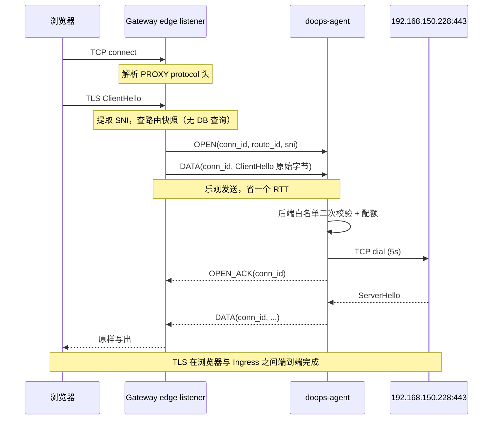

# doops-edge：Agent 反向代理 + Gateway 动态域名映射

设计日期 2026-09-06。状态：阶段 1–3 已实现（协议、调度、本地 e2e）；阶段 4 管理 API/CLI 与阶段 5 nginx/DNS 未上线。`-edge-listen` 与 agent `-edge` 默认关闭。

`doops-edge` 是 doops.sh 的新增模块，与现有运维控制面（`ops` 隧道）和 Git 隧道并列
且互不共享连接。它解决一类现有能力覆盖不到的问题：**内网站点没有公网入口，但需要让
普通浏览器用户直接访问**。

首个落地对象是 JM 环境，其 Ingress 只有校内地址 `192.168.150.228:443`，
学校侧不提供 DNAT。

## 一句话原理

内网 agent 主动向公网 gateway 建一条 WebSocket 长连接，gateway 在 443 端口只读 TLS
握手里的 SNI 域名、不解密，按一张可热更新的域名映射表把这条 TCP 连接的原始字节多路
复用进那条 WebSocket，agent 再拨到内网站点原样转发回去。

## 0. 已锁定的部署前提

这三条是评审确认的硬前提，后续设计不再讨论替代分支。

| # | 前提 | 影响 |
| :--- | :--- | :--- |
| P1 | 公网只有**一个 IP 一个 443 端口**，多域名靠 SNI 区分 | 必须与 `doops.aiedulab.cn` 控制面共用 nginx `stream`；必须走 PROXY protocol 拿真实客户端 IP（§3.3） |
| P2 | 需要承载**大量域名站点**，含 HTTP 接口、WebSocket、文件上传下载 | 必须支持通配路由；隧道必须做半关闭、公平调度和长空闲保活（§4） |
| P3 | 站点证书留在源站 | `tls-passthrough` 是默认且首期唯一模式，Gateway 不解密、不持源站私钥 |

## 1. 目标与非目标

### 目标

| # | 目标 |
| :--- | :--- |
| G1 | 内网站点由本地 `doops-agent` 主动出网连到 `doops-gateway`，不要求内网任何入向端口 |
| G2 | Gateway 在公网 443 接受浏览器流量，按 SNI 把连接映射到对应 agent |
| G3 | 域名映射可运行时增删改，热生效，不重启 Gateway、不改 nginx、不改 agent 启动参数 |
| G4 | 三类流量同时达标：短 HTTP 接口低延迟、WebSocket 长连接长空闲不断、大文件高吞吐 |
| G5 | Edge 流量与 `ops` / `git` 隧道故障隔离：任一侧打满或断线不影响另一侧 |
| G6 | Agent 只允许连到显式授权的后端，Gateway 被攻破不能变成内网任意跳板 |
| G7 | 单条隧道内一路大文件不得饿死同隧道的接口请求 |

### 非目标

- 不做 CDN、缓存、WAF、限速计费。
- 不做 L7 改写（不重写 Host、不注入 header、不做 URL rewrite）。passthrough 下网关看不到 HTTP。
- 不做会话保持：Edge 隧道断开时在途连接一起断，由浏览器重连。
- 不替代 `ops` 隧道执行运维命令，Edge 隧道上不跑 JSON-RPC。
- 不做 UDP，HTTP/3 / QUIC 不支持（§4.11）。

## 2. 为什么不能复用现有隧道

| 现有机制 | 位置 | 为什么不适用 |
| :--- | :--- | :--- |
| `ops` JSON-RPC 隧道 | `internal/server/handler_ws.go`、`tunnel_hub.go` | 请求—响应语义，没有双向流；`handler_ws.go` 读到二进制帧直接丢弃 |
| Git HTTP 隧道 | `internal/server/git_tunnel.go` | `git/http` + `git/body` 分片 JSON，payload 需 base64 膨胀 33%，每片一次 JSON 编解码；半双工语义，长连接会卡死 |
| 共用同一条 agent WS | `agent_registry.go` 每 `cluster/instance` 只保留一条活跃连接 | 浏览器流量与运维命令抢同一条连接和同一把写锁（`agentWSDataWriteTimeout` 60s），Edge 打满会让运维失联 |
| 复用 target 并发/busy 槽 | `tunnel_hub.go` | 运维并发按"一次一个命令"设计，几百并发浏览器连接会立刻耗尽 |

结论：Edge 必须是**独立 WebSocket 连接、独立二进制协议、独立注册表和配额**，
只与现有代码共享 WS 心跳工具（`writeHeartbeatPing`、`websocketDataWriteState`）和 SQLite store。

## 3. 总体架构

```mermaid
flowchart LR
    B["浏览器 / API 客户端\n多个 *.jm.aiedulab.cn"]
    NG["nginx stream :443\nssl_preread + proxy_protocol"]
    GWE["doops-gateway\nedge listener :42443"]
    ER["EdgeRegistry\n+ edge_routes 原子快照"]
    WS["Edge WS x N\nwss://doops.aiedulab.cn/v1/edge/connect"]
    AG["doops-agent (jm/gw-jm)"]
    ING["JM Ingress\n192.168.150.228:443"]

    B -->|"TCP + TLS(SNI)"| NG
    NG -->|"default 全部下沉"| GWE
    GWE --> ER
    ER -->|"SNI 命中"| WS
    WS --> AG
    AG -->|"本地 TCP"| ING
```



数据面全程不解 TLS：Gateway 只读 ClientHello 的 `server_name` 扩展做路由，
其余字节原样搬运。证书由 JM 集群内的 `aiedulab-wildcard-tls` 提供。

### 3.1 passthrough 对三类流量为什么是最优选择

P2 的三类流量在 passthrough 模式下**都不需要隧道做任何特殊处理**，这是选它的主要理由：

| 流量 | passthrough 下的表现 |
| :--- | :--- |
| HTTP 接口 | 网关看不到 HTTP，keep-alive、pipelining、chunked 全部透明 |
| WebSocket | `Upgrade` 握手在 TLS 内部完成，网关无感知，不存在"网关不支持 WS 升级"问题 |
| 大文件 | 纯字节流，没有 body 大小上限、没有 `client_max_body_size` 一类的限制 |
| HTTP/2 | 源站若 ALPN 协商 `h2`，同样透明支持，多路复用在 TLS 内部 |

如果改用 `http-terminate`，上面每一项都要在网关侧重新实现一遍。所以首期只做 passthrough。

### 3.2 与 doops.aiedulab.cn 共用同一个 443（P1）

现有 `backend/gateway/nginx/doops-proxy.conf` 已用 `stream` + `ssl_preread` 做 SNI 分流。
为满足 G3（加域名不改 nginx），map 的语义必须**反过来写**——控制面走显式白名单，其余下沉：

```nginx
stream {
    map $ssl_preread_server_name $doops_upstream {
        doops.aiedulab.cn   127.0.0.1:42222;   # 控制面：唯一显式白名单
        default         127.0.0.1:42443;   # 其余一律交给 edge listener
    }

    server {
        listen 443;
        ssl_preread on;
        proxy_pass $doops_upstream;
        proxy_protocol on;                 # 见 §3.3，非可选
    }
}
```

新增任何域名只落在 SQLite 的 `edge_routes`，nginx 配置永不改动。
未命中 `edge_routes` 的 SNI 由 Gateway 直接关连接（§6.4），不会因 `default` 而被误放行。

`127.0.0.1:42222` 是现有控制面上游，行为不变；`42443` 是 Edge 新监听。

### 3.3 PROXY protocol 是必需项，不是优化

P1 决定了 nginx 前置，于是 Gateway 的 `Accept()` 拿到的源地址全是 `127.0.0.1`。
后果是 per-IP 并发配额（§6.4）完全失效、异常流量无法定位、审计日志里所有连接同源。

所以 nginx 侧 `proxy_protocol on`，Gateway edge listener 在读 ClientHello **之前**
先解析 PROXY protocol 头：

- 同时支持 v1（文本 `PROXY TCP4 ...\r\n`）与 v2（二进制签名 `\r\n\r\n\x00\r\nQUIT\n`），nginx 默认发 v1。
- 由 `-edge-proxy-protocol`（默认 `true`）控制。设为 `false` 时（独立监听 443、无前置代理）直接用 `RemoteAddr`。
- 开启时**强制要求**：读不到合法 PROXY 头就关连接，不回落到 `RemoteAddr`。
  回落会让攻击者绕过 per-IP 配额，属于典型的"兼容分支掩盖问题"。
- 头部读取受 `DOOPS_EDGE_HELLO_TIMEOUT` 同一超时约束。

## 4. 隧道方案（核心）

一条 Edge WebSocket 承载多条 TCP 连接，用 `conn_id` 多路复用；控制与数据统一走
**二进制帧**，不用 JSON，避免 base64 膨胀和逐帧 JSON 编解码。

### 4.1 三类流量推导出的协议约束

| 约束 | 来源 | 设计应对 |
| :--- | :--- | :--- |
| C1 必须支持单向关闭 | HTTP 请求体结束但响应仍在传；文件上传完客户端 `FIN` 但服务端还在回 | `SHUTDOWN` 帧（§4.4），只有 `CLOSE` 会截断响应 |
| C2 长空闲不能被杀 | WebSocket（noVNC / webide）可以几十分钟无数据 | per-conn 无空闲超时，保活靠隧道级 ping + TCP keepalive（§4.7） |
| C3 大流不能饿死小流 | 文件下载与接口请求同隧道 | per-conn 队列 + 加权轮转调度（§4.5），不用全局 FIFO |
| C4 内存必须有上限 | 数千并发连接 × 缓冲 | 全局在途字节预算 + 三层背压（§4.6） |
| C5 同连接字节严格有序 | TCP 语义 | 单 writer goroutine，帧内不拆分不重排 |
| C6 单隧道吞吐可扩展 | 一个 agent 承载整站流量 | agent 可开 N 条 Edge WS，连接级分担（§4.9） |

### 4.2 帧格式

```
+--------+--------+--------------------+------------------+
| type   | flags  | conn_id (uint32 BE)| payload (0..N)   |
| 1 byte | 1 byte | 4 bytes            | 变长             |
+--------+--------+--------------------+------------------+
```

固定 6 字节头，`payload` 上限 `DOOPS_EDGE_FRAME_BYTES`（默认 32 KiB），
与 `readWebSocketMessage` 的 32 KiB 读缓冲对齐。
一个 WebSocket 二进制消息承载一帧，整体受 `maxWebSocketMessageBytes()` 约束。

头部开销 6 / 32774 ≈ 0.018%，相比 Git 隧道 base64 的 33% 膨胀是量级差异。
`flags` 目前全部保留为 0，留给后续压缩协商等用途。

### 4.3 帧类型

| type | 名称 | 方向 | payload |
| :--- | :--- | :--- | :--- |
| `0x01` | `OPEN` | GW → Agent | `route_id`（uint32 BE）+ SNI 字符串 |
| `0x02` | `OPEN_ACK` | Agent → GW | 空 |
| `0x03` | `DATA` | 双向 | 原始字节 |
| `0x04` | `SHUTDOWN` | 双向 | 空，表示本方向不再有 `DATA`（半关闭） |
| `0x05` | `CLOSE` | 双向 | 1 byte reason + 可选 UTF-8 说明，连接彻底结束 |
| `0x06` | `PAUSE` | 双向 | 空，请求对端暂停该 `conn_id` 的 `DATA` |
| `0x07` | `RESUME` | 双向 | 空 |
| `0x10` | `ROUTES` | GW → Agent | 路由快照 JSON（含 `version`），`conn_id` 为 0 |
| `0x11` | `STATS` | Agent → GW | 周期性聚合计数 JSON，`conn_id` 为 0 |

`conn_id` 由 Gateway 单向分配（每条 Edge WS 内自增，回绕时跳过在用值），Agent 不分配，
因此不存在双方同时分配导致的 ID 冲突。`conn_id = 0` 保留给隧道级控制帧。

`CLOSE` reason：`0` 正常、`1` 后端拒连、`2` 后端超时、`3` 路由未授权、
`4` 配额超限、`5` 上游异常、`6` 隧道过载。

### 4.4 连接状态机与半关闭（C1）

每个 `conn_id` 两个方向独立收敛，这是 C1 的实现：

```
                 OPEN
                  │
                  ▼
            ┌───────────┐
            │  OPENING  │──OPEN 失败──▶ CLOSE(reason≠0) ──▶ CLOSED
            └─────┬─────┘
              OPEN_ACK
                  ▼
            ┌───────────┐
   SHUTDOWN │   OPEN    │ SHUTDOWN
   (GW→AG)  │ 双向可传  │ (AG→GW)
       ┌────┴─────┬─────┴────┐
       ▼          │          ▼
 ┌───────────┐    │    ┌───────────┐
 │ HALF_UP   │    │    │ HALF_DOWN │
 │ 仅下行可传│    │    │ 仅上行可传│
 └─────┬─────┘    │    └─────┬─────┘
       └──────────┼──────────┘
            两方向都 SHUTDOWN
                  ▼
               CLOSED
```

- 收到 `SHUTDOWN` 的一侧对本地 TCP 调 `CloseWrite()`，让后端看到正常 `FIN`，
  而不是 `RST`。这一点直接决定文件上传能否正常收尾：如果发 `RST`，
  Ingress 会把已收完的上传判为客户端中断。
- `SHUTDOWN` **不**释放 `conn_id`，只有 `CLOSE` 或两向都 `SHUTDOWN` 才释放。
- `CLOSE` 是硬关闭，对应 `RST` 或异常路径，丢弃该 conn 所有排队帧。
- `conn_id` 释放后进入 `DOOPS_EDGE_CONN_ID_QUARANTINE`（默认 30s）隔离期
  再回收，避免延迟到达的帧落到新连接上。

### 4.5 多路复用与加权轮转调度（C3、G7）

原始方案的单条全局 FIFO 写队列在 P2 场景下是错的：一个 100 MB 文件下载会连续塞满
队列，同隧道的接口请求排在几百帧之后，延迟涨到秒级。改为**两级队列 + 加权轮转**：

```go
type edgeSession struct {
    conns   map[uint32]*edgeConn
    ready   chan uint32        // 有待发数据的 conn_id（去重入队）
    budget  *edgeMemBudget     // 全局在途字节预算
    // ...
}

type edgeConn struct {
    id       uint32
    sendQ    chan edgeFrame    // per-conn 有界队列，默认 8 帧
    inflight atomic.Int64      // 本 conn 在途字节，计入 budget
    queued   atomic.Bool       // 是否已在 ready 中，防重复入队
}
```

单个 `writer` goroutine 循环：从 `ready` 取一个 `conn_id`，
最多连发 `DOOPS_EDGE_QUANTUM`（默认 2 帧 = 64 KiB）后让位，若该 conn 仍有待发数据则重新入队尾。

效果：N 条活跃连接时，任一连接的排队延迟上界是 `(N-1) × quantum / 带宽`，
与该连接自身要传多少数据无关。100 MB 下载与 2 KB 接口请求公平共享隧道。
控制帧（`OPEN`/`CLOSE`/`SHUTDOWN`/`PAUSE`/`RESUME`/`ROUTES`）走独立优先队列，
永远抢在 `DATA` 之前，保证连接建立和关闭不被大流阻塞。

单 writer 同时满足 C5：同一 `conn_id` 的帧按入队顺序写出，不重排不拆分。

### 4.6 三层背压与内存预算（C4）

| 层 | 机制 | 触发 |
| :--- | :--- | :--- |
| L1 TCP | per-conn `sendQ` 满则停止 `Read()`，靠 TCP 接收窗口把压力传回对端 | 单连接过快 |
| L2 会话 | `budget` 达 75% 时对在途字节最多的若干 conn 发 `PAUSE`，回落 40% 发 `RESUME` | 单隧道整体过载 |
| L3 隧道 | `budget` 满且持续 `DOOPS_EDGE_WRITE_STALL`（默认 30s）判定隧道不健康，关整条 WS 触发重连 | 对端卡死 |

全局预算 `DOOPS_EDGE_MEM_BUDGET`（默认 512 MiB）按**字节**而非帧数计，
因为帧数配额在 4096 并发下的最坏内存是 `4096 × 8 × 32KiB = 1 GiB`，不可接受。
预算在 Gateway 与 Agent 两侧对称实现，各自独立记账。

不做自定义滑动窗口计数：TCP 窗口 + 有界队列 + `PAUSE`/`RESUME` + 字节预算四层已足够，
再叠一层窗口只会引入难排查的对账 bug。

### 4.7 空闲与保活（C2）

WebSocket 业务连接可以长时间零字节，这里最容易误杀。规则：

- **per-conn 无空闲超时。** 一条 `conn_id` 空闲多久都不主动关。
- 隧道级保活沿用 `writeHeartbeatPing` + `websocketDataWriteState`（`handler_ws.go` 已验证的机制）：
  ping 间隔 `agentWSPingInterval` 5s，配合 `websocketDataWriteState.overlaps` 避免
  数据大写与心跳互相误判超时。隧道断则该 session 全部 conn 关闭。
- Agent 对内网后端 TCP 开 `SetKeepAlive(true)` + `SetKeepAlivePeriod(30s)`，
  让中间设备不悄悄回收空闲会话。
- Gateway 对公网侧同样开 TCP keepalive。
- `OPENING` 状态有超时（`-edge-dial-timeout` + 1s），防止 agent 不回 `OPEN_ACK` 时 `conn_id` 泄漏。

### 4.8 建连路径与乐观发送



Gateway 在 `OPEN_ACK` 之前即可发 `DATA`，Agent 侧缓存在 per-conn 队列；
若最终返回 `CLOSE`，缓存丢弃并关闭浏览器侧连接。
ClientHello 的字节必须**全部缓存并原样转发**，不能因为解析过就吞掉。

### 4.9 吞吐与横向扩展（C6）

单条 Edge WS 的协议开销可忽略（§4.2），gorilla/websocket 单连接写 32 KiB 二进制帧
在本机可达 GB/s 量级，实际瓶颈是公网带宽与 nginx `stream` 转发，不在隧道协议。

但单条 WS 仍是一个串行 writer，属于单点。当一个 agent 要承载整站流量时，
支持 `-edge-conns N`（默认 1）开 N 条并行 Edge WS：

- N 条连接注册为同一 `cluster/instance` 下的 N 个 `edgeSession`，共享同一份路由。
- 新连接按 session 的**当前在途字节数**选最空闲的一条（least-loaded），
  不用轮转——轮转会把大文件和接口请求随机堆到同一条。
- 单条断开只影响其上的 conn，其余 N-1 条继续服务，可用性同时提升。
- 这也是 §6.1 里 `EdgeRegistry` 用 `[]*edgeSession` 而非单个指针的原因。

### 4.10 重连语义

Edge 隧道断开时**不做会话保持**，理由是 passthrough 下网关不理解 TLS 状态，
任何"重放续传"都会破坏 TLS 记录序号。行为：

1. session 上所有 `conn_id` 立即 `Close()`，公网侧连接被重置。
2. Agent 以指数退避重连（1s 起，30s 上限，带 jitter），与 `ops` 隧道的退避状态机独立。
3. 重连后 `conn_id` 从 0 重新分配，Gateway 下发最新 `ROUTES` 快照。
4. 浏览器自行重连。HTTP 接口重试即恢复；WebSocket 业务需自身有重连逻辑
   （noVNC / webide 均有），这一点要写进 JM 的用户告知。

### 4.11 明确不支持 HTTP/3

Edge 只搬 TCP。若源站 Ingress 通告 `Alt-Svc: h3=...`，浏览器会尝试 UDP 443
并在失败后回落 TCP，表现为首次访问多几百毫秒延迟。
因此 JM Ingress 必须确认未启用 HTTP/3、未发送 `Alt-Svc`。

## 5. Agent 侧设计

代码位置：`backend/agent/`。

### 5.1 新增文件

| 文件 | 职责 |
| :--- | :--- |
| `internal/server/edge_frame.go` | 帧编解码，Gateway 与 Agent 同包共用一份实现 |
| `internal/server/edge_conn.go` | `conn_id` 状态机、半关闭、per-conn 队列 |
| `internal/server/edge_sched.go` | 加权轮转 writer、控制帧优先队列、内存预算 |
| `internal/server/edge_tunnel.go` | `ServeEdgeWebSocket`：帧分派、session 生命周期 |
| `internal/server/edge_backend.go` | 后端白名单校验、拨号超时、keepalive、连接计数 |
| `cmd/agent/edge.go` | `runEdgeTunnel`：N 条 Edge WS 的连接、重连、退避 |

`edge_frame.go` / `edge_conn.go` / `edge_sched.go` 被两端共用，是本模块唯一的共享层，
避免 Gateway 和 Agent 各写一份编解码导致协议漂移。

### 5.2 与 ops 隧道的关系

`cmd/agent/main.go` 现有 `runReverseTunnel` 建立 `/v1/agent/connect`。
Edge 是**独立 goroutine 组**，连 `/v1/edge/connect`：

- 独立退避与重连状态机，一条断不影响另一条。
- 不参与 `agent_registry.go` 的 `cluster/instance` 单活跃连接约束，改用 `EdgeRegistry`。
- 不写 `agent_status` 表的 `status`，避免运维视角误判；Edge 在线状态存 `edge_agent_status`。
- 不占用 target 并发/busy 槽，不影响 `/health/ready`。
- `-edge` 未启用时 agent 行为与今天完全一致（默认关闭）。

启动参数：

```
-edge                      启用 Edge 隧道（默认 false）
-edge-gateway-url          默认从 -gateway-url 推导 /v1/edge/connect
-edge-enroll-token         Edge 注册令牌（§7.1），必填
-edge-backend-allow        后端白名单，逗号分隔 host:port 或 CIDR:port，必填
-edge-conns                并行 Edge WS 条数（默认 1，见 §4.9）
-edge-max-conns            本 agent 最大并发 Edge 连接（默认 512）
-edge-dial-timeout         后端拨号超时（默认 5s）
```

### 5.3 后端白名单是 agent 侧的硬闸门

Gateway 通过 `ROUTES` 帧下发 `backend`，但 **agent 不信任它**：
每次 `OPEN` 都用 `-edge-backend-allow` 二次校验，不在白名单一律回 `CLOSE reason=3`
并记本地审计。这样即使 Gateway 被攻破、`edge_routes` 被改成 `10.0.0.1:22`，
agent 也不会变成内网跳板。

JM 的参数是 `-edge-backend-allow 192.168.150.228:443`，只此一项。
P2 的"很多域名站点"全部指向同一个 Ingress，所以白名单仍然只有一条——
新增域名不需要改 agent 参数，这是 G3 的一部分。

## 6. Gateway 侧设计

代码位置：`backend/agent/pkg/gatewaycmd/` 与 `backend/agent/internal/server/`。

### 6.1 `EdgeRegistry`

新增 `internal/server/edge_registry.go`，与 `agent_registry.go` 平行但不共用状态：

```go
type EdgeRegistry struct {
    mu       sync.RWMutex
    sessions map[edgeKey][]*edgeSession   // key: cluster/instance，N 条并行隧道
    routes   atomic.Pointer[edgeRouteSnapshot]
    budget   *edgeMemBudget
}
```

同一 `cluster/instance` 允许最多 `-edge-conns` 条 session；超出的新连接被拒绝，
避免 agent 反复重连时旧 session 堆积。每条 session 带 `generation`，
agent 重启后旧 session 的心跳超时会被清理（语义与 `agent_registry.go` 一致）。

### 6.2 `edge_routes` 表与热生效（G3）

`gateway_store.go` 的 `migrate()` 追加：

```sql
CREATE TABLE IF NOT EXISTS edge_routes (
    id            INTEGER PRIMARY KEY AUTOINCREMENT,
    hostname      TEXT NOT NULL,           -- amp.jm.aiedulab.cn 或 *.jm.aiedulab.cn
    cluster       TEXT NOT NULL,
    instance      TEXT NOT NULL,
    backend       TEXT NOT NULL,           -- 192.168.150.228:443
    mode          TEXT NOT NULL DEFAULT 'tls-passthrough',
    enabled       INTEGER NOT NULL DEFAULT 1,
    max_conns     INTEGER NOT NULL DEFAULT 0,   -- 0 = 用全局默认
    note          TEXT NOT NULL DEFAULT '',
    created_at    TEXT NOT NULL,
    updated_at    TEXT NOT NULL
);
CREATE UNIQUE INDEX IF NOT EXISTS idx_edge_routes_hostname ON edge_routes(hostname);

CREATE TABLE IF NOT EXISTS edge_agent_status (
    cluster       TEXT NOT NULL,
    instance      TEXT NOT NULL,
    status        TEXT NOT NULL DEFAULT 'offline',
    sessions      INTEGER NOT NULL DEFAULT 0,
    remote        TEXT NOT NULL DEFAULT '',
    generation    INTEGER NOT NULL DEFAULT 0,
    connected_at  TEXT NOT NULL DEFAULT '',
    last_seen     TEXT NOT NULL DEFAULT '',
    updated_at    TEXT NOT NULL,
    PRIMARY KEY(cluster, instance)
);
```

热生效机制：

1. 任何写 `edge_routes` 的 API 成功后，重新 `SELECT` 全表构建 `edgeRouteSnapshot`，
   `version` 递增，`atomic.Pointer` 原子替换。
2. 数据面查路由只读快照：零锁竞争、**零 SQLite 查询**。
   `gateway_store.go` 里 `SetMaxOpenConns(1)`，数据面在连接路径上查库会被串行化死锁级放大，
   所以快照是硬要求而非优化。
3. 对受影响的 `cluster/instance` 推 `ROUTES` 帧更新 agent 视图。
4. 禁用或删除路由**不断开已建立的连接**（避免误操作打断在考的学生），只拦新连接；
   需要立即断开时用 `doops edge route disable --drain` 显式要求。

### 6.3 SNI 匹配与"禁用即拒绝"

```go
type edgeRouteSnapshot struct {
    version  int64
    exact    map[string]*edgeRoute   // amp.jm.aiedulab.cn
    wildcard map[string]*edgeRoute   // key 为去掉 "*." 的父域：jm.aiedulab.cn
}
```

匹配顺序：**精确 → 单级通配 → 未命中拒绝**。
单级通配语义与 TLS 通配证书一致：`*.jm.aiedulab.cn` 匹配 `a.jm.aiedulab.cn`，
不匹配 `a.b.jm.aiedulab.cn`。

这个优先级顺序顺带解决了通配路由的暴露面问题（§7.3），不需要额外的 deny 表：
**一条 `enabled=0` 的精确路由就是一条 deny 规则**，因为它优先于通配命中，
命中后因 `enabled=0` 被拒。所以配了 `*.jm.aiedulab.cn` 之后，
给 `grafana.jm.aiedulab.cn` 加一条禁用的精确路由即可把它挡在公网之外。

SNI 提取自己实现，不引 `crypto/tls`：只解析 TLS record header 与 ClientHello 的
`server_name` 扩展，最多读 `DOOPS_EDGE_HELLO_BYTES`（默认 4 KiB）。
拒绝条件：record type ≠ `0x16`、无 SNI 扩展、`DOOPS_EDGE_HELLO_TIMEOUT`（默认 5s）内未读满。

### 6.4 Edge listener

`-edge-listen`（默认空即关闭）指定监听地址，JM 部署为 `127.0.0.1:42443`。
接受连接后：

1. 解析 PROXY protocol 头，得到真实客户端 IP（§3.3）。
2. 读 ClientHello，提取 SNI。
3. 查快照。未命中 / `enabled=0` / 对应 agent 无在线 session → 直接 `Close()`，
   **不返回任何 TLS alert**（对扫描者不泄露 Edge 的存在），记采样日志。
4. 命中 → 选最空闲 session（§4.9），分配 `conn_id`，发 `OPEN`，进入搬运。

配额：`DOOPS_EDGE_MAX_CONNS`（全局，默认 4096）、per-route `max_conns`、
`DOOPS_EDGE_MAX_CONNS_PER_IP`（默认 64，防单机耗尽）。超限直接 `Close()` 并计数。
per-IP 配额依赖 §3.3 的真实 IP，两者是绑定的。

### 6.5 HTTP 路由与权限

`gatewaycmd.go` 现有 mux 追加：

| 路由 | 用途 | 鉴权 |
| :--- | :--- | :--- |
| `/v1/edge/connect` | agent 建 Edge WS | Edge enrollment token（§7.1） |
| `/v1/admin/edge/routes` | `GET` 列出 / `POST` 新增 | 用户 token + `edge:admin` |
| `/v1/admin/edge/routes/{id}` | `PATCH` 改 / `DELETE` 删 | 用户 token + `edge:admin` |
| `/v1/admin/edge/enrollments` | 签发 / 吊销注册令牌 | 用户 token + `edge:admin` |
| `/v1/admin/edge/status` | session、连接数、字节数、路由版本 | 用户 token + `edge:view` |

`gateway_store.go` 的 `GatewayAction` 追加：

```go
ActionEdgeAdmin GatewayAction = "edge:admin"
ActionEdgeView  GatewayAction = "edge:view"
```

两者都**不进** `defaultGatewayUserActions`——Edge 直接决定公网可达面，必须显式授权。
`ActionAdmin` / `ActionAll` 经现有 `gatewayActionAllows` 自然覆盖，无需改动该函数。

## 7. 安全边界

### 7.1 Edge enrollment token（不能沿用 ops 的开放注册）

`ops` 隧道目前允许 agent 自注册。Edge 不能照抄：谁注册成 `jm/gw-jm`，
谁就接走该 agent 名下**所有域名**的流量，自带证书即可做中间人。
P2 的"很多域名站点"把这个后果放大到整站。

新增：

```sql
CREATE TABLE IF NOT EXISTS edge_enrollments (
    id          TEXT PRIMARY KEY,
    cluster     TEXT NOT NULL,
    instance    TEXT NOT NULL,
    prefix      TEXT NOT NULL,
    hash        TEXT NOT NULL,     -- bcrypt，与现有 tokens 表一致
    revoked_at  TEXT NOT NULL DEFAULT '',
    created_at  TEXT NOT NULL
);
```

`/v1/edge/connect` 校验 `Authorization: Bearer <token>`，token 绑定的
`cluster/instance` 与请求参数不一致直接 401。签发走
`doops edge enroll create --cluster jm --instance gw-jm`，明文只返回一次。

### 7.2 三层双向白名单

| 方向 | 闸门 | 位置 |
| :--- | :--- | :--- |
| 公网 → Gateway | `edge_routes` 命中且 `enabled=1` 才放行 | Gateway 数据面 §6.3 |
| Gateway → Agent | Edge enrollment token 绑定身份 | `/v1/edge/connect` §7.1 |
| Agent → 内网 | `-edge-backend-allow` 硬校验 | `edge_backend.go` §5.3 |

三层都 fail-closed：缺配置就不通，不存在"默认放行"或"回落"分支。

### 7.3 通配路由的暴露面（P2 必须处理）

P2 要求支持大量域名，所以通配路由是必选。代价是 `*.jm.aiedulab.cn` 一条路由会把
JM Ingress 上**所有** host 暴露到公网，包括 Grafana、Harbor、MinIO 控制台。
Edge 不做 L7 过滤，只能在 SNI 层面处理。

处理方式（利用 §6.3 的优先级，不需要新表）：

```bash
doops edge route add --hostname '*.jm.aiedulab.cn' --cluster jm --instance gw-jm \
    --backend 192.168.150.228:443
# 逐个把运维类 host 加为禁用的精确路由 = deny
doops edge route add --hostname grafana.jm.aiedulab.cn --disabled --note "运维台不出公网"
doops edge route add --hostname harbor.jm.aiedulab.cn  --disabled --note "运维台不出公网"
doops edge route add --hostname minio.jm.aiedulab.cn    --disabled --note "运维台不出公网"
```

deny 清单必须在开通配路由**之前**落库，否则中间存在暴露窗口。
上线前用 `doops edge status --dry-run-host <host>` 逐个核对判定结果。
JM 的完整 host 清单需要从集群 Ingress 实际枚举，作为上线前置检查项（§12）。

### 7.4 审计与隐私

Edge 承载公众流量，**不记录任何正文、URL、header、cookie**。
passthrough 模式下网关技术上也看不到这些，隐私边界由架构保证而非纪律保证。

`audit_events` 只记控制面动作（路由增删改、enrollment 签发吊销、session 上下线）。
数据面只记聚合计数，独立表 + 周期滚动：

```sql
CREATE TABLE IF NOT EXISTS edge_conn_stats (
    id           INTEGER PRIMARY KEY AUTOINCREMENT,
    route_id     INTEGER NOT NULL,
    window_start TEXT NOT NULL,
    conns        INTEGER NOT NULL,
    rejected     INTEGER NOT NULL,
    bytes_up     INTEGER NOT NULL,
    bytes_down   INTEGER NOT NULL
);
```

聚合窗口 60s，内存累加后批量落一行。绝不做 per-connection 插入——
SQLite 单写连接下 per-conn 插入会直接成为吞吐瓶颈。

## 8. CLI

`backend/cli/` 新增 `edge` 子命令。

```bash
# 路由
doops edge route list
doops edge route add --hostname amp.jm.aiedulab.cn \
    --cluster jm --instance gw-jm --backend 192.168.150.228:443 \
    --mode tls-passthrough --note "JM AMP 公网入口"
doops edge route add --hostname grafana.jm.aiedulab.cn --disabled --note "deny"
doops edge route disable --hostname amp.jm.aiedulab.cn [--drain]
doops edge route rm --hostname amp.jm.aiedulab.cn

# 注册令牌
doops edge enroll create --cluster jm --instance gw-jm
doops edge enroll revoke --id <id>

# 观测与核对
doops edge status
doops edge status --hostname amp.jm.aiedulab.cn
doops edge status --dry-run-host grafana.jm.aiedulab.cn   # 只报路由判定，不建连
```

`route add` 成功即生效，无需任何重启——这是本模块对运维体验的核心承诺。

## 9. 失败模式

| 场景 | 行为 | 用户可见结果 |
| :--- | :--- | :--- |
| 某条 Edge WS 断（`-edge-conns > 1`） | 仅该 session 的 conn 关闭，其余继续服务 | 部分连接重置，其余无感 |
| Agent 全部 Edge WS 断 | 路由标记 agent 离线，新连接直接被关 | 浏览器连接重置；退避重连（1s→30s）后恢复 |
| Agent 在线但后端拒连 | `CLOSE reason=1` | 浏览器报连接重置；`rejected` 计数上升 |
| Gateway 重启 | session 全断，`edge_routes` 从 SQLite 恢复 | 数秒不可用后 agent 自动重连恢复 |
| 内存预算持续打满 30s | 关整条 Edge WS 触发重连 | 一次全量重连，避免静默卡死 |
| 单条大文件下载 | 加权轮转限制其占用，控制帧优先 | 同隧道接口请求延迟不受影响（G7） |
| WebSocket 长空闲 40 分钟 | per-conn 无空闲超时，隧道 ping 保活 | 连接不断（C2） |
| 文件上传完客户端 `FIN` | `SHUTDOWN` → 后端收到正常 `FIN` | 上传正常收尾，不被判为客户端中断（C1） |
| SNI 未命中或被 deny | 直接 `Close()`，无 TLS alert | 扫描者拿不到任何指纹 |
| PROXY 头缺失或非法 | 直接 `Close()`，不回落 `RemoteAddr` | 绕过 per-IP 配额的路径被堵死 |
| 全局配额打满 | 新连接直接关，已有连接不受影响 | 新访问失败，在线用户不受影响 |
| 路由被误删 | 已有连接保留，新连接被拒 | 在线用户可继续，给运维留回滚窗口 |

## 10. 测试计划

单元测试（`internal/server/`，沿用 `handler_ws_test.go` 的 in-process WS 风格）：

- `edge_frame_test.go`：编解码往返、超长 payload 拒绝、截断帧报错、`conn_id=0` 保留语义。
- `edge_sni_test.go`：真实 ClientHello 字节样本（无 SNI、多扩展、TLS 1.3、分片 record、
  非 TLS 垃圾输入）提取正确性且不 panic。
- `edge_proxyproto_test.go`：v1/v2 解析、非法头拒绝、超时拒绝、关闭开关时的行为。
- `edge_route_test.go`：精确优先于通配、`enabled=0` 精确路由作为 deny 生效、
  单级通配边界、快照原子替换、`version` 递增。
- `edge_conn_test.go`：状态机全路径、`SHUTDOWN` 双向收敛、`CloseWrite` 被调用、
  `conn_id` 隔离期不复用。
- `edge_sched_test.go`：**公平性断言**——一路持续大流 + 一路小请求，
  小请求 p99 排队延迟应在 `N × quantum / 带宽` 上界内；控制帧永远先于 `DATA`。
- `edge_budget_test.go`：预算触发 `PAUSE`/`RESUME` 阈值、持续满触发隧道关闭。
- `edge_backend_test.go`：白名单命中 / 不命中 / CIDR 形式 / 端口不符。

端到端（本地，Gateway + Agent 同机，后端为自签 TLS 服务）：

| 用例 | 验证 |
| :--- | :--- |
| `curl --resolve` HTTPS | passthrough 与证书链完整（浏览器视角证书是源站的） |
| `websocat` 升级 + 40 分钟空闲 | C2 长空闲不断 |
| 1 GiB 下载 | 吞吐、内存不超预算、不 OOM |
| 1 GiB 上传后立即读响应 | C1 半关闭正确，上传不被判中断 |
| 大文件与 200 QPS 接口并发 | G7 公平性，接口 p99 无明显抬升 |
| 200 并发连接 | 配额、per-IP 限制、`conn_id` 分配无冲突 |
| 拔掉 Edge WS | 连接全断、退避重连、恢复可用 |
| `-edge-conns 4` | 最空闲选择生效，单条断只影响其上连接 |

回归：跑现有 `ops` 与 `git` 隧道全部测试，确认 `-edge` 关闭时零行为变化；
`-edge` 开启并打满时 `doops exec` 延迟无明显退化（G5）。

## 11. 交付顺序

| 阶段 | 内容 | 验收 |
| :--- | :--- | :--- |
| 1 | `edge_frame` / `edge_sni` / `edge_proxyproto` / `edge_route` 快照 + store migration | 单测全绿，两个二进制现有行为不变 |
| 2 | `edge_conn` 状态机 + `edge_sched` 调度与预算 | `edge_sched_test` 公平性与 `edge_conn_test` 半关闭全绿 |
| 3 | `EdgeRegistry` + `/v1/edge/connect` + `runEdgeTunnel` + enrollment token | 本地 e2e：一条精确路由跑通 HTTPS、WebSocket、1 GiB 双向 |
| 4 | Admin API + CLI + 热生效 + 配额 + 聚合统计 + `-edge-conns` | 运行中 `route add` 立即生效；`route rm` 不断在途连接 |
| 5 | nginx `default` 下沉与 `proxy_protocol`、生产发布、JM 路由与 deny 清单、DNS 切换 | JM 站点公网可用，`doops exec` 不受影响 |
| 6（可选） | `http-terminate` 模式 | 无可信证书的源站也能接入 |

阶段 1–4 全部在本地完成，不碰生产。阶段 5 才需要授权的 Gateway 发布。

## 12. JM 落地清单

上线前置检查：

1. 枚举 JM 集群所有 Ingress host，划分"对外"与"仅运维"两类。
2. `zhiyong-ingress` 的 TLS secret 名改为 `aiedulab-wildcard-tls`，
   否则 passthrough 过来的握手会拿到错误证书。这一项独立于 Edge，需并行修复。
3. 确认 JM Ingress 未启用 HTTP/3、未发送 `Alt-Svc`（§4.11）。

Gateway 侧（deny 清单先落库，再开通配）：

```bash
doops edge enroll create --cluster jm --instance gw-jm      # 明文 token 只显示一次
for h in grafana harbor minio prometheus; do
  doops edge route add --hostname "$h.jm.aiedulab.cn" --disabled --note "仅运维"
done
doops edge route add --hostname jm.aiedulab.cn --cluster jm --instance gw-jm \
    --backend 192.168.150.228:443
doops edge route add --hostname '*.jm.aiedulab.cn' --cluster jm --instance gw-jm \
    --backend 192.168.150.228:443
doops edge status --dry-run-host grafana.jm.aiedulab.cn      # 期望 denied
doops edge status --dry-run-host amp.jm.aiedulab.cn          # 期望命中通配
```

Agent 侧（JM 内网，出网只需 443 到 `doops.aiedulab.cn`）：

```
-edge -edge-enroll-token <token> \
-edge-backend-allow 192.168.150.228:443 \
-edge-conns 2
```

DNS（BIND，见 `gateway-bind-deployment.md`）：把 `jm.aiedulab.cn` 与
`*.jm.aiedulab.cn` 从 `192.168.150.228` 改为 Edge 的公网 IP。
因为 §7.3 的 deny 清单已在网关侧生效，通配 DNS 可以整体切换。

## 13. 配置项汇总

| 环境变量 | 默认 | 说明 |
| :--- | :--- | :--- |
| `DOOPS_EDGE_FRAME_BYTES` | 32768 | 单帧 payload 上限 |
| `DOOPS_EDGE_CONN_QUEUE` | 8 | per-conn 发送队列帧数 |
| `DOOPS_EDGE_QUANTUM` | 2 | 轮转调度单次连发帧数 |
| `DOOPS_EDGE_MEM_BUDGET` | 512MiB | 单侧全局在途字节预算 |
| `DOOPS_EDGE_WRITE_STALL` | 30s | 预算持续打满多久判定隧道不健康 |
| `DOOPS_EDGE_HELLO_BYTES` | 4096 | PROXY 头 + ClientHello 读取上限 |
| `DOOPS_EDGE_HELLO_TIMEOUT` | 5s | PROXY 头 + ClientHello 读取超时 |
| `DOOPS_EDGE_CONN_ID_QUARANTINE` | 30s | `conn_id` 回收隔离期 |
| `DOOPS_EDGE_MAX_CONNS` | 4096 | Gateway 全局并发 Edge 连接 |
| `DOOPS_EDGE_MAX_CONNS_PER_IP` | 64 | 单源真实 IP 并发上限 |
| `DOOPS_EDGE_STATS_WINDOW` | 60s | 聚合统计落库窗口 |

沿用现有：`DOOPS_MAX_WS_MESSAGE_BYTES` 约束整个 WS 消息大小；
`agentWSPingInterval` / `agentWSDataWriteTimeout` 复用 `handler_ws.go` 的心跳参数。
