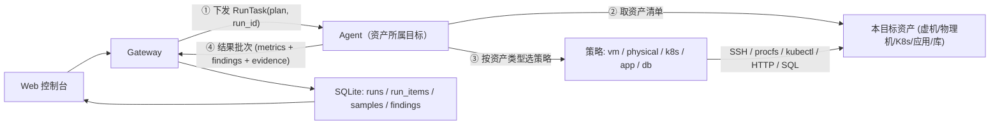

# 监控与巡检闭环产品设计（提案）

> 状态：核心闭环已实现（`monitor_engine_*.go`、`/v1/monitor/*`、`system-resource-monitor.tsx`、`inspection-center-panel.tsx`）。权威行为见 `DOOPS_API_GUIDE.md`、`DOOPS_WEBUI.md`、`ASSET_MONITOR_DEVICES.md`。

## 1. 核心模型：资产归 Agent，任务由 Gateway 下发

原则：
1. **资产属于一个 Agent 目标**（`cluster/instance`）。Gateway 只持有台账与任务，不直连资产。
2. **Gateway 下发任务，Agent 执行**。Agent 离线则任务标记 `target_offline`，不静默跳过（沿用现有 `inspectBlock` 语义）。
3. **策略按资产类型选择**，策略是 Agent 内置的固定白名单采集模板，不接受自由命令输入。
4. **结果合并存储**：一次运行产生 `run`，每个资产一条 `run_item`，其下有指标样本、检查结果、证据。
5. **前端两个视图**：巡检运行记录（每次执行的明细）与全系统资源监控（跨资产汇总）。
6. 沿用 AGENTS.md：Agent 是授权单元，不加按动作授权；SSH 凭据只走 credential 生命周期，不进参数、日志、证据。

## 2. 数据模型

| 对象 | 关键字段 | 说明 |
|---|---|---|
| Asset | `asset_id, kind, cluster, instance, labels{}, access{ssh_credential/k8s/…}` | `kind`：`vm` `physical` `k8s_cluster` `k8s_node` `workload` `app` `database`；复用现有 `inventory_*` 表并加 `labels` |
| Policy（策略） | `policy_id, asset_kind, collectors[], checks[], thresholds{}` | Agent 内置默认策略，Gateway 可按标签覆盖阈值 |
| Plan（计划） | `plan_id, selector(labels/kind/target), policy, schedule, timezone` | 扩展现有巡检计划（已有周期与时区冻结） |
| Run（一次执行） | `run_id, plan_id, trigger(manual|schedule|retest), started, finished, status, counts` | 状态：`queued→dispatched→running→done|partial|failed|cancelled` |
| RunItem | `run_id, asset_id, policy, status, reason, started, finished` | 每个资产独立状态；`reason` 如 `target_offline`、`ssh_auth_failed`、`timeout`、`unsupported` |
| Sample | `asset_id, metric, device_id, ts, value, origin` | 复用现有监控序列表与 `origin` |
| Finding | `finding_id, asset_id, check, severity, state, first_seen, last_seen, run_id` | 状态：`open→acknowledged→remediating→verifying→resolved/suppressed` |
| Evidence | `run_item_id, kind, redacted_text/digest, ts` | 脱敏、限长；复检必须产生新证据 |

任务调度复用现有 `detached_tasks` 与租约/并发准入（`agent_leases.go`），避免新建并发机制。

## 3. 下发与执行协议

1. **触发**：定时器 / 手动 / 复检。Gateway 创建 `run`，按 `instance` 把选中资产分组，每组生成一个 `RunTask`。
2. **下发**：经现有内部工具调用通道（`RunInternalToolCall`）发新工具 `doops_inspect_run`，参数：`run_id, policy 版本, 资产清单（id/kind/访问引用）, 超时, 并发上限`。不含凭据负载。
3. **执行**：Agent 对每个资产，按 `kind` 选策略；资产间并发有上限，单资产有超时；单个失败不影响其他。
4. **回传**：按资产分批回传（`run_item` 完成即上报），Gateway 幂等落库（`run_id+asset_id` 唯一）。断线后 Agent 保留结果，重连按 `run_id` 补报；超过截止时间仍未补报则 `outcome_unknown`，不当作通过。
5. **收尾**：全部 item 终态后汇总 `run.status`；有 `target_offline` 或失败项为 `partial`，不得显示为全部通过。
6. **安全**：命令模板白名单只读；输出过滤凭据特征；Agent 能力版本不足时 `unsupported` 并提示升级。

## 4. 各资产类型的策略

### 4.1 虚拟机 / 物理机（policy `vm` / `physical`）
采集方式（按资产 `access` 选择，优先级：本机 Agent 宿主 > SSH）：
- **宿主模式**：Agent 就是该机本身，读 `/proc`、`/sys`（现有 `agent_host`）。
- **SSH 模式**：Agent 通过受管 SSH 凭据执行固定命令（复用 `ssh_command.go`），采 `/proc/stat`、`/proc/meminfo`、`/proc/diskstats`、`df`、`uptime`、`ps`。
- 指标：CPU、内存、网络、磁盘容量与 I/O、负载、GPU（`nvidia-smi`）、OS/内核版本、重启次数。
- 巡检项：M1 运行与重启、M2 CPU/内存、M3 可疑进程、M4 配置合规（sysctl、`sshd -T`、密码策略）、M5 登录与权限（读 auth 日志与 `passwd/group/sudoers` 哈希，auditd 可选）、V1/V2 软件包清单与待更新补丁。
- 物理机额外：虚机→物理机关系、IPMI/SMART 作为可选扩展，不进首期。

### 4.2 Kubernetes（policy `k8s`）
采集方式：Agent 用自身 ServiceAccount（现有 `k8s_*`/`kubectl`）。
- 指标：Node/Pod CPU 内存（metrics-server）、Pod 重启数、Pending/CrashLoop 数、PVC 容量、Node Ready 状态。
- 巡检项：节点 NotReady、Pod 异常状态、Deployment 副本不足、证书过期、Ingress/Service 可用性、资源配额接近上限、镜像不可拉取事件。
- 缺 metrics-server 时：该项 `unsupported` 并给明确原因，不显示为 0。

### 4.3 应用 / Web（policy `app`）
- A1 可用性、A4 Web 安全配置（证书、HSTS、CSP 等）、A5 API 断言、nginx `stub_status`（请求速率、并发连接）、响应时间与错误率（合成探测窗口统计）。
- 探测从 Agent 所在网络发出，目标 IP 限制沿用现有 `isDisallowedProbeIP`。

### 4.4 数据库（policy `db`）
- 通过 DoSql 只读通道执行固定语句：存活、连接数/最大连接、慢查询、TPS、锁等待。凭据走 managed credential 自动绑定。
- 也接受 exporter 的 `database_up`（现有 `exporter` 来源）。

## 5. 前端设计

### 5.1 巡检运行记录
- **计划页**：计划列表、范围（标签/类型/目标）、策略、周期、下次执行、最近结果。
- **运行列表**：时间、触发方式、计划、资产数、通过/告警/失败/离线计数、耗时、状态；可按计划与状态筛选。
- **运行详情**：按资产的 `run_item` 表（状态、原因、各检查项通过/失败/不适用）；展开看证据与原始采集时间；支持"仅重跑失败项"。
- **对比**：同计划两次运行的差异（新增/消失的 Finding）。
- **Finding 页**：认领、备注、绑定修复动作（走现有 `exec` 审计通道）、复检→新证据→`resolved`。

### 5.2 全系统资源监控
- **总览**：在线 Agent/资产数、各类型资产数、CPU/内存/磁盘使用 Top N、告警数、采集健康度（最后成功时间、失败原因分布）。
- **机器列表**：按标签/类型/集群筛选分组；一行一机，当前 CPU、内存、磁盘、网络、最后采样时间，异常高亮。
- **资产详情**：时间范围（1h/6h/24h/7d）曲线，设备维度（网卡、挂载点、磁盘、GPU 卡）；关联 Finding 与最近巡检。
- **K8s 视图**：集群→节点→命名空间→工作负载，资源与异常数下钻。
- **规则**：阈值与持续时间，触发生成 Finding。
- **导出**：运行记录与监控摘要 CSV。

## 6. 逐功能映射（对应测试清单）

| 清单项 | 设计落点 | 说明 |
|---|---|---|
| 分层拓扑 | 资产 `kind`+关系表；K8s 策略实时补充 | 依赖边由进程/端口推荐、人工确认 |
| 覆盖率≥80% | 分母＝冻结基线，分子＝近 24h 有成功 `run_item`/样本的资产 | 未覆盖清单可导出 |
| 机器/OS/内核/进程/CPU/内存/网络/存储 | `vm`/`physical` 策略 | 宿主或 SSH 两种采集 |
| GPU | 同上，`nvidia-smi` | 无 GPU 标记不适用 |
| 应用程序/请求量/响应时间/连接数/错误率 | `app` 策略 + k8s Pod 指标 | 先验证现有实现并补 UI 与规则 |
| 数据库全部指标 | `db` 策略 | 连接数、慢查询、TPS、锁 |
| 探针部署 | 接入向导：SSH 批量安装、K8s DaemonSet，首个样本到达才算成功 | 批量进度按资产展示 |
| 自定义标签 | Asset 标签，作为计划选择器与视图分组 | 标签变更记审计 |
| 探针覆盖率100% | 分母＝`probe_required` 资产，分子＝探针/通道在线 | 与 80% 纳管覆盖率分开 |
| 磁盘 I/O | 现有 `disk_*` 指标，补前端曲线与规则 | 代码已有，需验收 |
| 异常登录/权限变更/敏感操作 | `vm` 策略 M5 + Gateway 审计转 Finding | 不依赖 auditd |
| M1–M5、V1–V3 | `vm`/`physical` 策略 | V3 复检要求新证据 |
| A1–A5 | `app`/`db` 策略 | A3 加同比基线 |

## 7. 分期（每期自成闭环）

| 期 | 范围 | 验收 |
|---|---|---|
| P0 | Run/RunItem 模型、下发协议 `doops_inspect_run`、幂等回传、运行记录页 | 手动触发一次→Agent 执行→前端看到每资产结果；断线显示 `partial` 而非通过 |
| P1 | `vm`/`physical` 策略（宿主 + SSH）、机器资源总览与列表、标签 | 无 Agent 机器经 SSH 纳管并出图 |
| P2 | 定时调度、规则→Finding 状态机、复检 | 阈值触发→认领→处置→复检→resolved |
| P3 | `k8s` 策略与视图 | K8s 节点、Pod 异常出现在总览并可下钻 |
| P4 | `app`/`db` 策略、探针覆盖率、批量部署 | 数据库连接数超限→Finding→复检 |
| P5 | 拓扑依赖推荐、报告导出、漏洞库比对 | 报告含覆盖率与未闭环项 |

## 8. 风险与取舍

- **规模**：每 Agent 并发与单资产超时可配；单资产失败隔离。样本量大时 SQLite 降采样（分钟→小时），超过阈值提供外部 TSDB 写出。
- **Agent 版本**：下发前检查能力版本，旧 Agent 返回 `unsupported`。
- **SSH 风险**：只读白名单、主机密钥固定、凭据 managed、证据脱敏；写操作（补丁、整改）只走现有审计通道且人工确认。
- **与现有实现的关系**：磁盘 I/O、连接数、响应时间、错误率代码已有（工作区未提交），按"验收并补齐"处理；现有巡检计划与证据（`asset_inspection*.go`）是 P0 的扩展对象，需先确认其"执行人提交证据"流程如何改为"Agent 自动执行"。
- 验收口径遵循 AGENTS.md：行为变更同步更新权威文档与 CHANGELOG。
