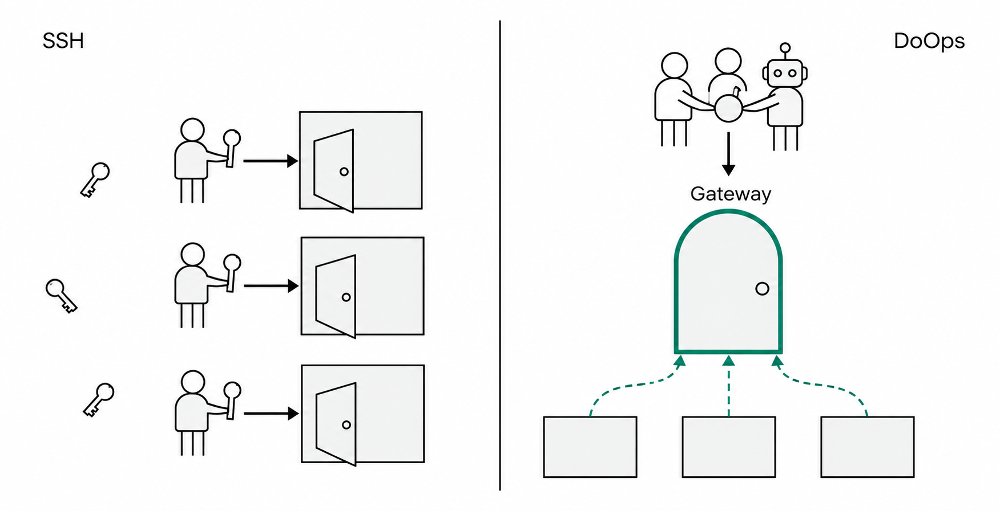
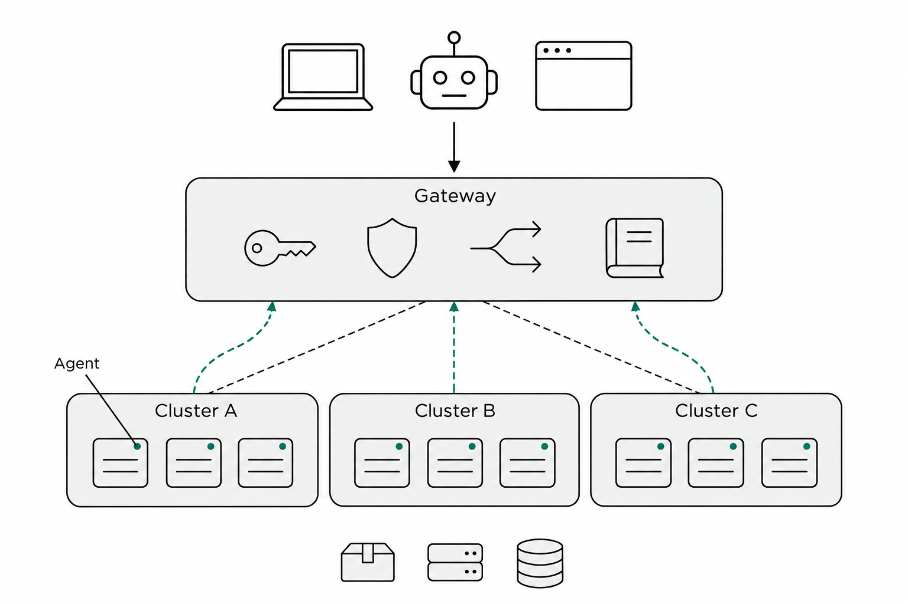
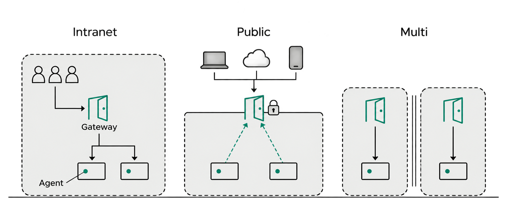
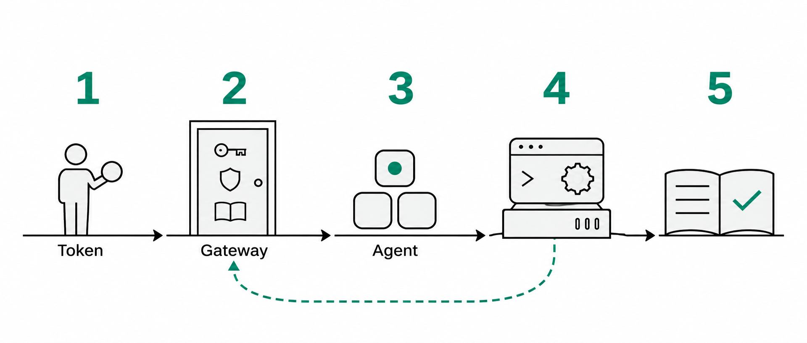
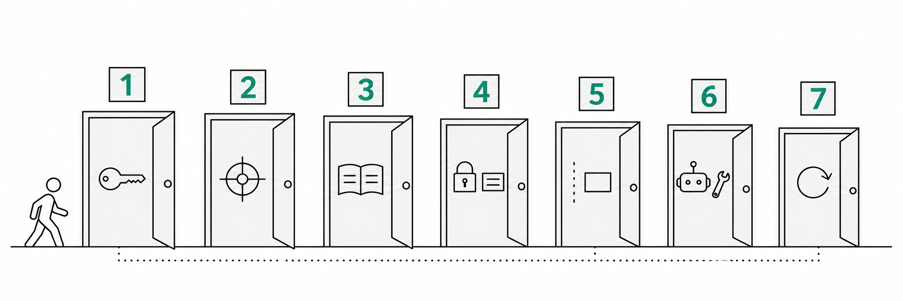
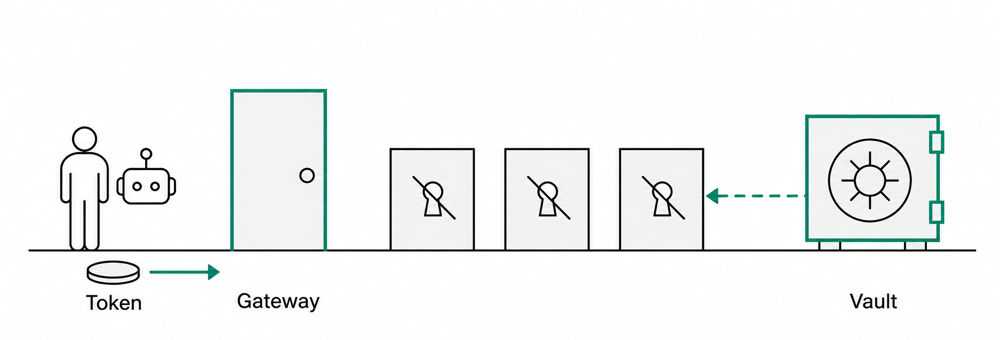
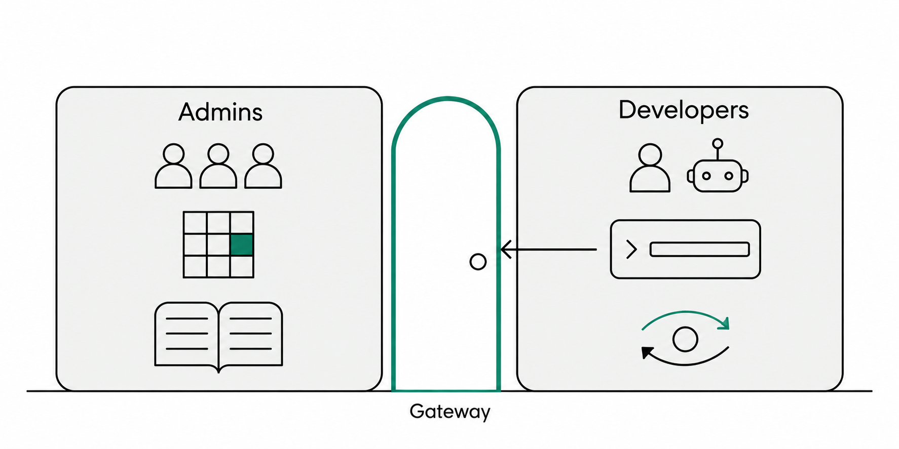
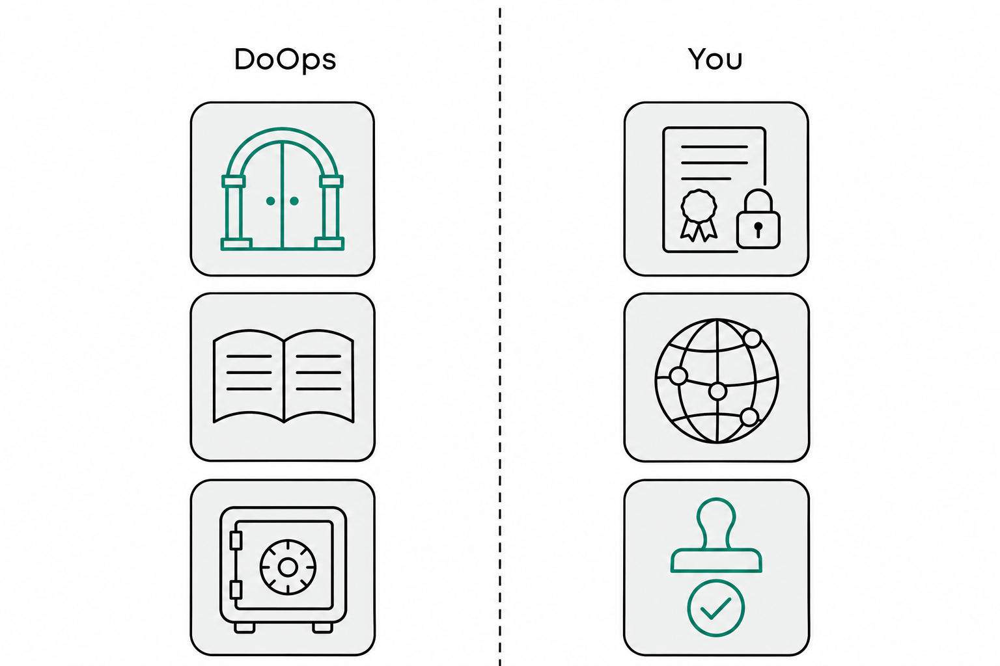

<a href="../zh/after-goodbye-ssh-what-is-doops-and-security.md">中文</a> | <b>English</b> | <a href="../ru/after-goodbye-ssh-what-is-doops-and-security.md">Русский</a>

# After Goodbye, SSH: What DoOps Is, and How Its Security Is Guaranteed

After the previous post, 《再见，SSH。》 ("Goodbye, SSH."), went out, two questions came up most often in the comments:

- "Isn't this just SSH with a wrapper around it?"
- "Compromise the public-facing server and you take everything down in one shot, right?"

This post won't lead with security. Using eight figures, we'll go from "the SSH we know best" to "the DoOps architecture," then follow a single operation along its execution path on one machine, and work out — layer by layer — why it dares to gather the operations entry point behind one door. **Each step makes one point.**

---

## 1. Two paths first: why "one more machine" is where it gets hard

The SSH way is one door per machine, and one key in every hand:

*Figure 1 · Left: one door per machine, one key in every hand. Right: people, programs, and AI share a single token and pass through the same Gateway door; the machines have no door at all, only dashed outbound connections*

The problem is not SSH itself. SSH has been the most reliable operations tool of the past twenty years. The problem is **scale**:

- **Too many doors**: a few dozen machines means a few dozen doors, each with its own security configuration;
- **Too many scattered keys**: keys and passwords end up in spreadsheets, chat histories, and home directories — and the moment personnel change, control is gone;
- **No bookkeeping**: who did what and when rests, more or less, on shell history and memory.

What DoOps changes is not the connection method but **the number and location of the doors**: everyone walks through the same door, and machines no longer open one — they connect outward on their own.

---

## 2. The big picture: one door, many clusters, machines that connect outward

*Figure 2 · Across the top is the entry point (laptop / bot / browser); inside the Gateway door in the middle, the four small icons are authentication, authorization, routing, and audit; below sit three clusters, Cluster A / B / C, each machine with an Agent connection point; Agent-to-Gateway is an outbound connection, and machines open no inbound ports*

Four roles, each owning one segment:

| Role | What it is | What it does |
|---|---|---|
| Entry point | CLI, web console, AI inside the editor | Initiates operations |
| Control plane | The unified gateway (its location is flexible: an internal network or the public internet) | Authentication, authorization, routing, queueing, audit |
| Execution side | The Agent installed on a managed machine | Executes locally, returns results |
| Target | Cluster / host / container | The thing actually being operated |

Two design decisions in this figure matter most, and everything about security later rests on them:

1. **The connection direction is reversed.** Traditionally, someone outside connects into the machine; in DoOps, the Agent on the machine connects outward. A managed machine therefore needs no public IP and opens no inbound ports, and it can be onboarded from behind NAT and a firewall.
2. **Identity stays inside the door.** A person holds a token, not the account and key of every machine. When that person leaves and the token is revoked, their access to every target disappears with it.

Compare the two architectures:

| | SSH | DoOps |
|---|---|---|
| Where the door is | One on every machine | A single, unified one |
| Who holds the keys | One in every engineer's hand | One token per person, checked inside the door |
| What ports a machine opens | An SSH port that has to be reachable inbound | No inbound ports; it connects outward |
| Who keeps the logs | Each machine, in its own format | The unified entry point, recorded in one place |
| How access is revoked | Change passwords, delete keys, machine by machine | Revoke a token or a grant once; it takes effect immediately |

---

## 3. Where the door lives: intranet, public internet, or one gateway per domain

Let's correct a common misunderstanding first: **DoOps is not a product that "has to be deployed on the public internet."** It has no fixed network position — **where the Gateway lives depends on who needs to reach it and where you are willing to draw the security boundary.** The architecture itself does not change: the Agent always connects outward, and authentication, authorization, and audit always happen at the Gateway.

| Form | Where the Gateway lives | Who needs to reach it | Typical scenario |
|---|---|---|---|
| Intranet-only | The corporate intranet | Users and CI inside the intranet, plus the Agents inside it | A single company with strict compliance requirements; machines and people already live on the intranet |
| Public entry | The public edge (TLS terminated) | Remote and multi-site users, Agents across networks | Distributed teams, edge nodes, external collaboration |
| Per-domain gateways | One in each network domain | Users and Agents within that domain | Multiple subsidiaries, isolated clusters, separate production / test domains |

What matters is not whether the door faces the public internet or the intranet; it is that **the direction the door faces determines who can reach it**:

- **Inside**: someone outside has to get into your network before they can even find the door, so the security boundary is the network boundary (VPN, zero trust, the office network);
- **Public**: the door faces the internet directly, so the boundary is TLS, authentication, authorization, rate limiting, and monitoring;
- **Multiple gateways**: each domain guards its own door, and domains do not share keys.

In all three forms, authentication, authorization, and audit are identical — the only thing that changes is who the door is defending against. So our advice is: **decide who can access it first, then decide where the Gateway lives — not the other way around.** One more note: the Agent has to be able to reach the Gateway, so crossing networks still requires network reachability (peering, VPN, or a dedicated line); the only thing you do not need is inbound ports on the machines.

*Figure 3 · Three deployment topologies: intranet-only (the door inside the wall), public entry (the door at the wall, with only the encrypted entrance open), per-domain gateways (each domain guarding its own door)*

---

## 4. How one operation runs its course

The architecture figure describes the static "who is connected to whom." Now the dynamic side: when you type "run uptime on prod-node" in a terminal, which steps does it actually take?

*Figure 4 · Five steps of one request: 1 the token → 2 the Gateway (authentication / authorization / bookkeeping) → 3 routing to the Agent → 4 execution on that machine → 5 results and audit records written back (dark-green dashed line)*

1. The request reaches the control plane carrying a **token**;
2. The control plane first confirms who you are, then confirms whether you are **authorized** for that target, and **writes this operation down** at the same time;
3. The task is routed to the **Agent** online on that target — note that this is the persistent connection the Agent established outward, not the control plane reaching in to the machine;
4. The Agent executes locally;
5. The result comes back to you, and that record is updated to succeeded, failed, or "outcome unknown."

The order is the easiest thing to overlook: **authentication, authorization, and bookkeeping all come first; execution comes last.** No record, no execution. Without a grant, the machine will not even appear in your target list.

All three channels go through the same door, with no bypass:

- Commands, files, code synchronization, and releases are the **control channel**;
- File and code synchronization, which gives each session its own workspace, is the **data channel**;
- AI breaking a task down on its own and executing it in multiple steps is the **AI channel**.

---

## 5. Where the security comes from: seven gates per operation

With the architecture in view, "why is it secure" stops being abstract. Unpack a single operation and it passes through seven gates in turn — each gate answers exactly one question.

*Figure 5 · Seven gates, numbered 1–7 on the doors: from "who are you" all the way to "how do we change versions without an incident"; the small figure is walking toward gate 1*

**Gate 1: who you are.**
A token is shown once, at issuance; the server stores only its hash. It can be given an expiry, and it can be revoked at any time — revoke or disable it and the change takes effect on the next request. On the web side, it sits in a cookie the browser cannot read.

**Gate 2: where you can go.**
Every operation checks whether you hold a grant for that target. Without a grant, the machine will not even show up in your target list. Grants are issued per target, and one grant covers every operation on that target — that is the cost of keeping it coarse, and we will come back to how it is compensated for.

**Gate 3: what has been done.**
Bookkeeping first, work after; if it cannot be recorded, it is not executed. Whatever the outcome — success or failure — the same single record is updated; a record that has already ended is never rewritten. Administrators see everything; ordinary users see their own.

**Gate 4: which identity does the work.**
Credentials are stored encrypted, and the key does not live in the database. Only the authorized target receives them, only for that one operation, and only until it finishes. Credentials do not go into the command line, the prompt, or the audit summary.

**Gate 5: where the work happens, and how far it reaches.**
An Agent opens no inbound ports and only performs the operations handed to it; but it runs on a managed machine and **inherently holds administrator rights on it**. So it has to be said plainly: **DoOps is not a sandbox.** The security boundary is the container, the virtual machine, or the node itself.

**Gate 6: what AI is allowed to do.**
AI can diagnose, but a change needs an extra grant and must leave verification evidence; AI cannot sign its own change ticket. A reminder, too: an AI on a diagnostic path still has execution capability, and may run commands you did not anticipate.

**Gate 7: changing versions.**
An Agent cannot replace itself — if it is interrupted mid-replacement, no one is left to verify or roll back. Upgrades therefore run as a separate job: precheck, then change, confirm the new version really came up, and roll back automatically on failure.

One more gate is not on the flow diagram, but the deployment side must hold it: **transport**. The control plane owns the business logic; TLS is the job of the reverse proxy in front of it. If the door is exposed externally or accessed across domains, expose only the encrypted entrance — never the management port directly. If the door lives on the intranet, that responsibility becomes consolidating intranet entry points and securing the network boundary.

---

## 6. Identity and credentials: nobody leaves with a key, no credential is left behind

Of the seven gates, gate 4 is the one most often misunderstood. A common first reaction: "Doesn't that just mean all the passwords sit on the control plane?"

*Figure 6 · Left: people and AI share a single token into the same Gateway door. Middle: the keyholes on all three machines are crossed out (no one else's keys live on the machines). Right: the Vault keeps credentials encrypted and hands them out only to the authorized target, on demand (dashed line)*

Take these as two separate things.

**Identity.** Every person, every program, every AI holds exactly one token. There are no keys for Zhang San or Li Si on any machine; when Zhang San leaves, one revocation ends it. This is identity decoupled from machines.

**Credentials.** Database passwords, image registry accounts, Kubernetes credentials — all stored encrypted on the control plane, and delivered on demand to the authorized target only when they are used, then wiped. They do not go into the command line, the prompt, or the audit summary.

We should be honest here: the control plane holds the decryption capability, so this is not an end-to-end zero-knowledge design. The control plane itself must therefore be protected as a top-tier asset — we come back to that in the next section.

---

## 7. Two roles: how a company governs it, how a developer uses it

DoOps has two kinds of typical users: **the people who govern it** (platform and operations leads, team leaders, security administrators) and **the people who use it** (developers, operations engineers, and the AI working on their behalf). One architecture, two interfaces in two sets of hands.

*Figure 7 · The left side is the management surface (users and tokens, grant lists, audit, fleet inventory); the right side is the usage surface (login, execution, code synchronization, AI troubleshooting); in the middle, the same Gateway door*

### 7.1 For companies and teams: how to govern

The goal of governance fits in one sentence: **turn "who can operate which machine" into entries that are configurable, auditable, and revocable, instead of keys scattered between people and machines.**

In practice, that is five things:

| What you govern | How | When |
|---|---|---|
| People and tokens | One token per person with an expiry; revoke on departure; separate tokens for CI and automation | Onboarding and offboarding, plus a quarterly review |
| Targets and grants | Create targets by cluster / instance, keeping production and test apart; grant only specific targets, never wildcards | Onboarding a new environment, plus a quarterly review |
| Credentials | Keep the master key separately and back it up; bind credentials to targets, grant on demand, revoke when done | On change, plus periodic verification |
| Audit | Ship off-site to a log system / SIEM in real time; alert on failures, unknown outcomes, and anomalous registrations | Always on |
| Agent onboarding | Install only on the nodes you intend to manage; network ACLs; check the online inventory regularly; upgrade through approval and image admission | At onboarding, then monthly |

Then three things on the platform side: expose only encrypted channels at the entry point; back up the control-plane database and keys; monitor the control plane's own health.

In a multi-cluster setup, the naming convention is the permission boundary. Keep production, test, edge, and customer environments distinct, and issue grants along those environment boundaries. **What a company actually needs is not finer-grained command permissions; it is the ledger of who did what, on which machine, and when.**

### 7.2 For developers: how to use it

The goal of usage also fits in one sentence: **install it once, and from then on use it like a single command.**

1. **Get ready.** Install the CLI and the Skill in your project, log in to get a token, and take a look at "where can I go" — the list you can see is exactly your permission scope.
2. **Four everyday operations.** Run commands, read and write small files, synchronize code, and let AI troubleshoot. All four go through the same authorization and the same records.
3. **Changes.** Releases and configuration changes that alter state go through the change channel that carries verification — state the target, the scope, and the acceptance criteria; the AI proposes a plan and delivers verification evidence after execution.
4. **When something goes wrong.** Look at the session and its records first, then decide whether to retry, roll back, or bring in someone. When the outcome is uncertain, do not blindly run it again.

A real troubleshooting flow: an alert before dawn → let the AI check first → run one command when hands-on work is needed → process and result both go into the record → at handover, pass on the session and its records together, instead of saying "I changed it" and leaving it at that.

Three rules for developers:

- Touch only the targets you are granted; verify in the test environment before going to production;
- Do not put keys on the command line — hand them to credential custody; both the command line and the records leave traces;
- Send changes through the verified channel; when in doubt, ask before you act.

### 7.3 How the two roles work together

The management surface owns the door, the keys, and the ledger; the usage surface owns walking through the door and doing the work. The contract between them is one sentence:

> **Every operation maps to one identity, one target, and one record.**

That is the most fundamental difference between DoOps and "handing everyone an SSH key": permissions go from scattered keys to manageable entries, and behavior goes from per-machine logs to one ledger kept at a single entry point.

---

## 8. Boundaries and division of labor: what DoOps owns, what you have to add

No tool can do security for you. The real division of labor looks like this:

*Figure 8 · A dashed seam splits the two sides: on the left, what DoOps owns (the gates, the ledger, the vault, execution consolidation); on the right, what the deployment side must add (certificates and locks, network and boundaries, approvals)*

| Item | DoOps owns | You must add |
|---|---|---|
| Entry encryption | The business logic | Depends on the deployment form: an intranet deployment consolidates its intranet entry point; only an externally facing deployment needs a public TLS entry and source control; the management port is never exposed |
| Identity | Token issuance, expiry, revocation | One token per person, short lifetimes, revocation on departure, separate tokens for CI |
| Authorization | Per-target checks | Separate production / test targets, no wildcards, periodic review |
| Audit | Records, query permissions, no record means no execution | Real-time off-site shipping to a log system, alerts on failures and anomalies |
| Credentials | Encrypted storage, on-demand delivery | Master key backup and custody, on-demand grants, periodic verification |
| Agent | Outbound connections, execution consolidation | Install only on the nodes to be managed, network ACLs, monitoring for anomalous registrations |
| Upgrades | Precheck, verification, rollback | Image signing, registry admission, release approval |
| AI | Tool scope, change authorization | Model key management, diagnose-only in production to start with |

**Three known boundaries at the architecture level:**

1. **The control plane is a single point.** If it is compromised, every managed target under it is compromised with it — so it must be deployed in a controlled network and expose only an encrypted entry point.
2. **Agent onboarding relies on the network boundary.** When an Agent registers, it only declares which target it is, with no additional credential; the control plane's network position, ACLs, and anomalous-registration monitoring are therefore the security boundary for this channel. (The channel that serves web traffic to the outside is a separate link, with a registration token scoped to an exact target.)
3. **Audit is not yet a tamper-proof ledger.** It lives in the control-plane database, where anyone with the right permissions can delete it; the correct practice is to ship it off-site in real time.

In one sentence: **DoOps gathers operations behind a single door, but the lock, the monitoring, and the key management on that door are still yours to configure.**

---

## 9. The comment section, answered in one go

**"Compromise the public-facing server and you take everything down in one shot, right?"**
The concern is real: a centralized control plane is the single point of highest value, so one compromise there takes down every target it manages. But first look at where the door sits: on an intranet, the risk boundary is your intranet's boundary; on the public internet, only then do you also have to carry the internet's exposure surface (TLS, rate limiting, source control, monitoring). Either way, the control plane's database, keys, and audit records must be managed as core assets, and audit must be shipped off-site. The claim is not that it cannot be breached, but that when it is breached, you know immediately and can trace what happened.

**"Isn't this just a bastion host?"**
The common ground is that both consolidate access. The difference: a bastion host manages people's sessions; DoOps manages tasks and calls — people and AI use the same interface, and commands, files, code synchronization, and releases are all structured operations that can be orchestrated across several clusters and called directly from scripts and pipelines.

**"It's just AI doing SSH for you."**
The AI holds no SSH credentials; it calls controlled operations, and change-type operations carry extra authorization and verification. But the sentence is half true: the AI really can execute commands. So the question is not whether there is an AI, but whether every single thing the AI does can be traced and can be stopped.

**"How do you get in to deploy this thing the first time?"**
Kubernetes, Docker, or a one-time SSH session. This is "the last time you use SSH," not "never using SSH."

**"Other than beginners, no one would really use this."**
Two kinds of users. For operations and platform engineers, the pain is repetitive work across many clusters and many applications; for developers writing code with AI, the pain is "the last mile of deployment." People who don't understand SSH will share passwords and connect straight through with an admin account anyway — at least here, they have grants and records.

**"Expose one agent and everything goes down at once."**
Be precise about this: a compromised Agent affects the one machine it runs on; the real "everything at once" risk is the control plane. And since Agent onboarding relies on the network boundary, the control plane belongs in a network whose access sources you control (an intranet, or a public entry with TLS and ACLs), with monitoring for anomalous registrations.

**"frp + SSH is better."**
If all you need is one temporary tunnel, frp really is simpler. DoOps's value shows up at team scale: identity, authorization, audit, task orchestration, and pipeline integration — the things tunneling tools do not have.

**"There's no sandbox."**
Right. If you need a sandbox, use a container, a virtual machine, or a separate node; what DoOps manages is who can operate, and what was operated on.

---

## 10. Closing: security is not about whether there is a sandbox, but about three questions

We would rather define security as three questions:

**Where is the boundary? Who can come in? Can what was done be looked up?**

The DoOps architecture turns those three questions into structural answers: the boundary is the target, the entry point is a single door, and everything that was done is on record. It is not without risk; the risk is visible, controllable, and revocable.

What "Goodbye, SSH" really means is this: **turning the operations entry point from "a key in everyone's hand" into "one door, with someone watching it and a record to check."**

If you still have questions, keep the brickbats coming — they are welcome. For anything security-related, contact the maintainers privately as described in the repository's security policy, and do not post real addresses or credentials in public channels.
