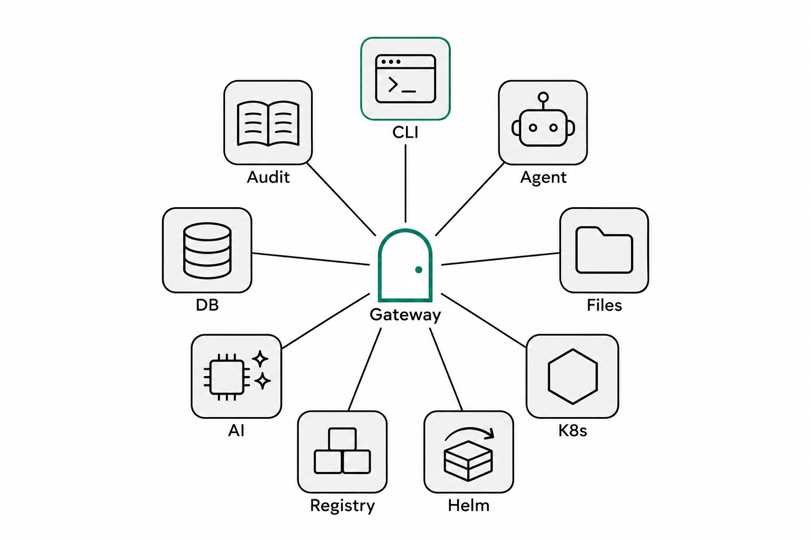
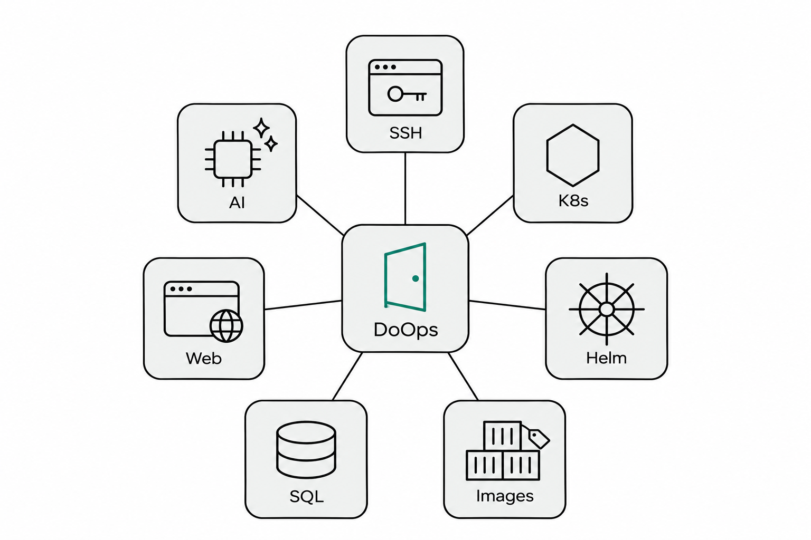
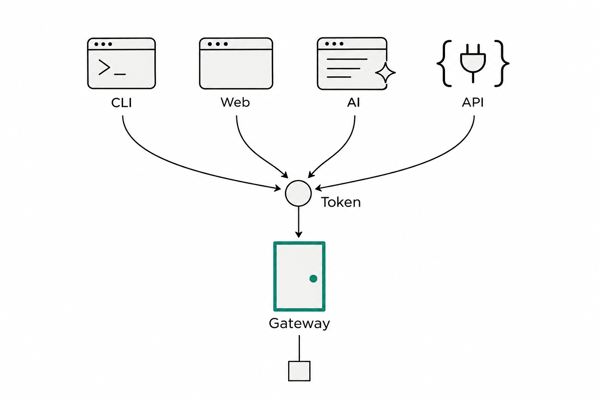
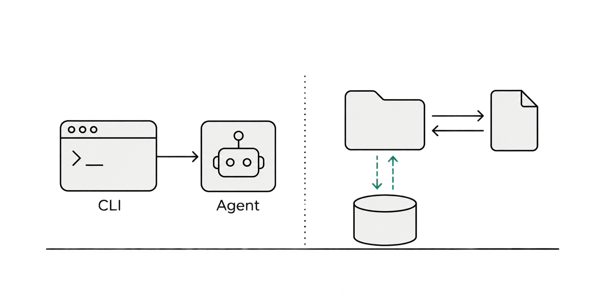
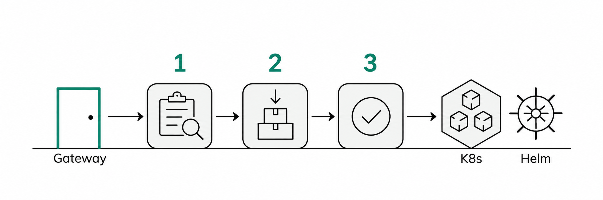
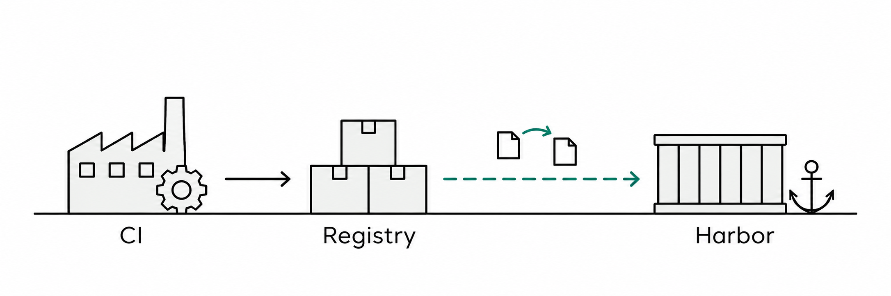
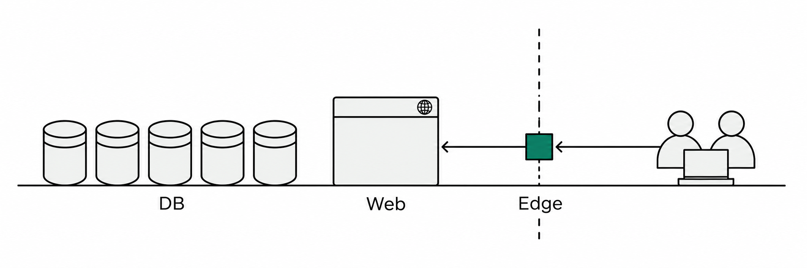
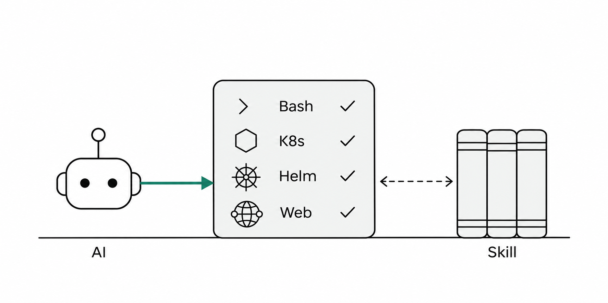
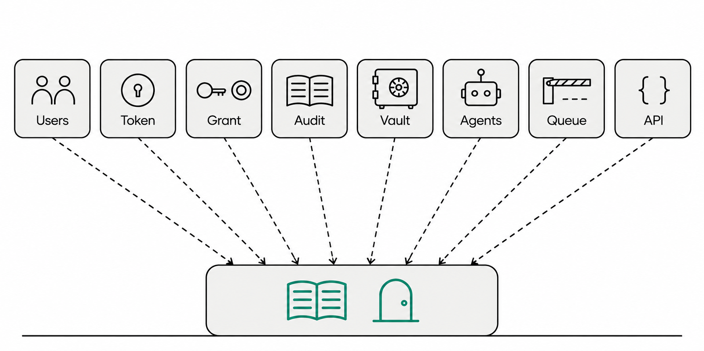
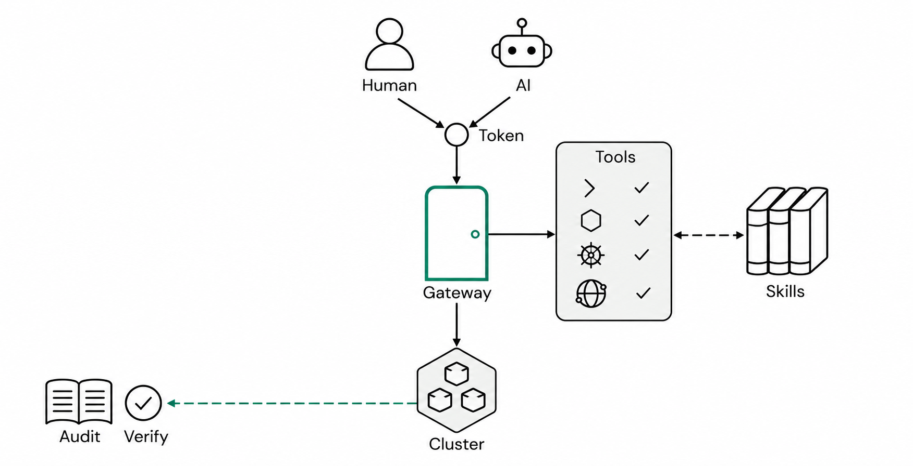

<a href="../zh/doops-core-features.md">中文</a> | <b>English</b> | <a href="../ru/doops-core-features.md">Русский</a>

# What DoOps Can Do: Business Capabilities, the Management Plane, and AI-Native Design

The previous post was about architecture and security. This one switches to the user's point of view and answers two different questions:

- **A business colleague asks**: what exactly can it get done for me?
- **A platform or admin colleague asks**: across multiple teams and clusters, how are these capabilities kept under control?

So what follows comes in three parts: **seven business capability areas** (what it can do), **five supporting management capability groups** (how it is kept under control), and one thread running through both — **AI-native design** (why these capabilities ended up shaped the way they are). All three share one identity, authorization, and audit layer, and that is the essential difference between DoOps and "a pile of scripts plus a pile of permissions."

*Figure 1 · The overall capability map: the top half is business capability, the bottom half is the management foundation those capabilities rest on*

---

## Part One · Business capability: what it can get done for you

*Figure 2 · Seven business capability areas: connectivity and access, remote operations and files, Kubernetes and application delivery, images and artifacts, databases, websites and external services, AI operations*

| Business area | Concrete capabilities | Typical scenario | Mainly for |
|---|---|---|---|
| Connectivity and access | Unified Gateway, Agent reverse connection, four entry points | Intranet troubleshooting, remote collaboration, CI invocation | Everyone |
| Remote operations and files | Commands, background tasks, structured SSH, file and code synchronization, host access | Reading logs, restarting services, transferring artifacts, reaching physical machines | Operations / development |
| Kubernetes and delivery | Observation, controlled changes, Helm release and rollback, natural-language delivery, Agent upgrades | Checking pods, shipping releases, rolling back, upgrading the Agent | Operations / release owners |
| Images and artifacts | Build, copy, registry synchronization, Harbor convergence | Producing images, pushing to registries, distributing across clusters | Release owners / CI |
| Databases | DoSql with five engines, query / plan / change / replication | Querying data, altering tables, moving data across databases | DBAs / backend |
| Websites and external services | DoWeb site publishing, Edge reverse proxy | Publishing sites, exposing intranet services externally | Operations |
| AI operations | ask diagnosis, apply changes, the Skill system | Troubleshooting, making changes, codifying SOPs | Development / operations |

### 1. Connectivity and access: solve reachability first

*Figure 3 · Terminal, browser, AI in the editor, API — four entry points through the same Gateway door*

The first thing DoOps solves is reachability:

- **Agent reverse connection**: the Agent on the target machine connects out to the Gateway on its own initiative, so the machine needs no public IP and no inbound ports, and can be onboarded from behind NAT and firewalls;
- **One unified entry**: the terminal CLI, the web console, AI in the editor (the Skill), and the HTTP/WebSocket API — four ways in, sharing a single login;
- **Target routing**: locate a target by cluster/instance, with several clusters sitting behind the same door;
- **External exposure**: when an intranet HTTP service has to be opened up (including long-lived connections such as WebIDE and noVNC), go through the Edge reverse proxy — a registration token scoped to an exact target, plus TLS passthrough — instead of punching a hole in the firewall.

### 2. Remote operations and files: taking over SSH's job

*Figure 4 · Commands are dispatched to the Agent for execution; workspaces and code/artifacts synchronize both ways; large files go through storage*

- **Command execution**: one foreground command straight to the target; long commands can run in the background, with status, logs, and cancellation whenever you need them;
- **Structured SSH**: when you have to hop from machine A to machine B, a parameterized SSH proxy keeps multiple layers of quoting from being re-parsed by the remote shell;
- **Node information**: CPU, memory, disk, and toolchain (build / image / runtime) at a glance;
- **Files and code**: small text files are read and written directly (with explicit size limits); code and artifacts synchronize with push/pull, stored through the Gateway or a Git tunnel, and .gitignore is respected;
- **Hosts and physical machines**: a Kubernetes Agent can enter the node it runs on to perform host checks; a physical machine can be onboarded on its own, or reached through an existing VM as a hop; the first connection still uses a DaemonSet, Docker, or a one-time SSH bootstrap.

One detail: a timeout, a dropped connection, or termination by a signal is marked **"outcome unknown"** rather than "success" — a reminder to check the actual state before deciding whether to retry.

### 3. Kubernetes and application delivery: look, then move, then verify

*Figure 5 · Observe → preflight → apply → verify: three-stage delivery*

**Look**: pods, Deployments, Services, events, logs, top, rollout status, Helm's list/history/status/values (key paths only), and ConfigMap key names.

**Move**: restarts, scaling, cordon/uncordon, and pod deletion — these write operations must be explicitly confirmed and run under a target-level change lease; **Secrets and ServiceAccounts are not even readable**.

**Deliver**: a Helm release is split into preflight (dry-run renders and validates first) → apply (the real execution) → verify (read the revision back and compare it item by item against the live objects, with expected_image catching "the command succeeded but the image did not change"). You can also deliver in natural language directly: state the target, the scope, the image source, the reason, and machine-checkable acceptance criteria in the task, and receive verification evidence when it finishes.

Two more pieces come alongside: `check` compares the live image against the build for consistency; and Agent self-upgrade runs as a separate Job (backup → upgrade → verify → roll back on failure), so an Agent never replaces itself while running.

### 4. Images and artifacts: from CI to the target cluster

*Figure 6 · CI is the authoritative source of images; the target side only copies and synchronizes, and Harbor converges by pull*

- **Build**: produce OCI images with BuildKit on the target Agent, with multi-platform support and output to a local file or a direct push;
- **Copy**: copy between registries by digest, so nothing "looks the same but is actually different";
- **Registry synchronization**: bulk synchronization, with digest verification on both source and target;
- **Harbor convergence**: a pull model from CI → this cluster's Harbor, with scheduled jobs and verification scripts; no copying between clusters.

The boundary: an image is a CI artifact. Building and copying on the target machine are only the execution side and cannot replace CI — otherwise "which commit is running in production" cannot be stated clearly.

### 5. Databases and websites: two specialist operations entry points

*Figure 7 · DoSql manages data, DoWeb manages sites, and Edge safely exposes intranet services*

**Databases (DoSql)**: supports PostgreSQL, MySQL, Oracle, SQL Server, and MongoDB, with external drivers for other engines; four modes — query, change plan, execute, and asset discovery; dry-run and result verification are supported; cross-database replication is read and written directly by the Agent, never through the model; every step has a hash-chained version log, so afterwards you can prove "exactly which statements were executed."

**Websites (DoWeb)**: a site is described with a SiteSpec, and Nginx configuration generation, validation, reload, health checks, rollback, and evidence form one chain; read-only and change operations are separated, and when facts are missing it blocks rather than guesses.

**External services (Edge)**: exposes intranet web services (including long-lived connections such as WebIDE and noVNC) through the Agent's reverse proxy plus dynamic domain mapping at the Gateway; the registration token is scoped to an exact target, and TLS passthrough is supported.

### 6. AI operations: an AI agent inside a tool allowlist

*Figure 8 · What the AI gets is not a shell, but a tool allowlist; the Skill decides what it can do on that target*

- **Diagnosis mode (ask)**: can read files, check state, and run commands to help you think a problem through;
- **Change mode (apply)**: gets only structured change tools (Helm or website publishing, one or the other), requires a change authorization, and produces verification evidence;
- **Combinations that never happen**: diagnosis cannot get change tools, change cannot get a free-form Bash, and database or unknown Skills do not inherit change capability;
- **Success determination**: decided jointly by the change authorization, the attestation, and final-state evidence; the model saying "done" does not count;
- **Skill**: the Agent ships with six built-in Skills — shell, Kubernetes, image builds, databases, websites, and distillation — and a team can also write its own SKILL.md to codify an SOP.

---

## Part Two · Supporting management: making these capabilities manageable

*Figure 9 · Five supporting management capability groups: identity and authorization, audit and credentials, nodes and Agent, tasks and reliability, console and scale*

| Management area | Concrete capabilities | What problem it solves |
|---|---|---|
| Identity and authorization | Users, login, token, target grant, administrators | Who can get in, and where they can go |
| Audit and credentials | Operation records, queries, credential lifecycle and materialization | What was done, and how keys are managed |
| Nodes and Agent | Onboarding, online / archived, upgrades, registration tokens, capability gates | How machines join, and how they are updated |
| Tasks and reliability | Session workspaces, concurrency, queues, admission, outcome unknown | Staying orderly under large-scale concurrency |
| Console and scale | Web admin pages, API, Skill extension, multi-form deployment | How teams collaborate, and how the system extends |

### 7. Identity and authorization: who can get in, and where they can go

- **Identity**: users are created, disabled, and have their passwords changed; logging in exchanges for a token (24 hours by default, with an optional specified lifetime); the token is shown only once, only its hash is stored, and it can be revoked by id; disable the user or revoke the token and it takes effect on the next request;
- **Entry-point side**: the CLI stores credentials locally; the web console uses an HttpOnly cookie and never writes to localStorage;
- **Authorization**: one grant is scoped to a cluster/instance and covers that target and the credentials bound to it; platform administrator is a flag on the user;
- **The trade-off, stated plainly**: authorization exists only at target granularity — there is no action-level breakdown such as "logs only" — so in production you compensate with target separation (production and test in separate clusters), short TTLs, and audit.

### 8. Audit and credentials: what was done, and how keys are managed

- **Audit**: bookkeeping before execution, and no execution if it cannot be recorded; failures, denials, and unknown outcomes all land in the database; a final state cannot be rewritten; administrators see everything, ordinary users see their own; if audit is unavailable, requests are refused;
- **Credentials**: the full lifecycle of create → stage → grant → verify → promote; versioned; bound to targets; materialized on demand to the authorized target (and wiped after use); Bundle (credential group) support and a metadata-only preflight during development; payloads travel only over stdin or a private channel, are encrypted at rest, and are refused when the key is missing.

### 9. Nodes and Agent: how machines join, and how they are updated

- **Onboarding**: Kubernetes DaemonSet, Docker, or a one-time SSH bootstrap; online / offline / history / archived views; instance records offline for more than 24 hours are cleaned up automatically, while grants are retained;
- **Registration tokens**: issued for the Edge channel per exact target, with the plaintext returned only once;
- **Capability gates**: `capabilities` checks the protocol capabilities of the target Agent; an old Agent fails outright instead of silently degrading (both ssh and upgrade enforce the check);
- **Upgrades**: run as a separate Job — precheck → change → verify (pod Ready, image digest, version number, Gateway reconnection) → automatic rollback on failure;
- **Consistency**: `check` compares the live image against the build artifact; `info` shows whether the node's toolchain is complete.

### 10. Tasks, concurrency, and reliability

- **Session workspaces**: a separate directory /root/ws/<session> per task, so tasks do not tread on each other, and it can be cleaned up;
- **Concurrency semantics**: the same target and the same session can run concurrently; Agent self-upgrade takes the target exclusively; workspace writes and exact resources are locked per action and resource key;
- **Queues and admission**: each target queues 10 tasks for up to 10 minutes by default; a rejection before admission carries a stable error code rather than "outcome unknown," so bulk releases do not double-write because of retries;
- **The "outcome unknown" discipline**: when a trustworthy final state is missing, the result stays "unknown" (-32008); nothing is claimed as success and nothing is replayed automatically; a historical unknown does not block new tasks, but real resource locks still apply;
- **Observability**: `targets --admission` reads live slots, holders, and queues at zero model cost — the first step when a release seems stuck.

### 11. Console, open interfaces, and scaled deployment

- **Web console**: 11 tabs — overview, AI assistant, databases, websites, Kubernetes, images, files, knowledge base, credentials, audit, terminal — plus three more views: deployment, CI/CD, and administration; the admin pages cover users, tokens, grants, instances, and audit;
- **What's new**: the console reads the repository CHANGELOG and shows a popup with the changes after an upgrade;
- **Open interfaces**: JSON-RPC over WebSocket, Git HTTP, and REST management interfaces; 12 public JSON-RPC tools, with the rest being internal control-plane tools;
- **Extension**: secondary development of Skills (write a SKILL.md in the project); the installation path verifies release/commit/sha256 and distributes the CLI plus Skill/docs;
- **Deployment forms**: three — intranet-only, public entry, and per-domain gateways (see the previous post); the control plane is a single point, the database and master key must be backed up, and TLS/ACLs at the entry point are configured per form.

---

## Part Three · AI-native: why these capabilities are shaped this way

DoOps is not "an operations tool with an AI chat box bolted on." From day one, AI has been a formal class of user standing alongside people — with its own entry point, permissions, audit trail, tools, and evidence chain. The business and management capabilities above are shaped the way they are, in large part, because of that design premise.

*Figure 10 · AI and people share the same identity, authorization, and audit; what the AI can do is decided by the tool allowlist and the Skill, what it did is recorded, and changes rest on evidence*

### 12. AI is a formal user, not a bolt-on

- **It has its own entry point**: AI connects through the Skill in the editor or the Agent interface, instead of simulating keystrokes into a terminal;
- **It shares the same identity**: an AI's operations go through the same token, grant, and audit; revoking a grant or disabling it takes effect immediately for the AI too;
- **It does not share every tool**: diagnosis (ask) and change (apply) get different tool lists — diagnosis can run commands, while change may only use structured change tools and needs a change authorization.

### 13. Six details designed for AI

1. **Structured primitives, not a simulated terminal**: operations are tool calls, and inputs and outputs are machine-readable (structured results, stable error codes); there is no interactive PTY and no "screen scraping." The AI does not have to understand the shell's quirks, and people and programs receive the same facts.
2. **Interfaces built for automation**: the CLI, the web console, and the AI are all just clients of the same API; the JSON-RPC tool surface, Git HTTP, and REST management interfaces can be called directly from CI; retry semantics are explicit — when the outcome is unknown, nothing is replayed automatically.
3. **Permissions come from the same place as people's**: an AI overstepping is a person overstepping, and revoking a grant takes effect immediately; there is no "AI-only back door."
4. **Capability is taught through Skills**: six built-in Skills (shell / Kubernetes / images / databases / websites / distillation) plus a project's own SKILL.md codify the team's SOPs into procedures the AI can follow; the model delivers per target, and credentials never land in the prompt.
5. **Success rests on evidence, not on words**: a change goes through preflight → apply → verify, reading back the live objects and the digest; the model saying "done" does not count, only final-state evidence does; an unknown outcome stays "unknown" — nothing pretends to have succeeded.
6. **Traceability is the floor**: audit covers five layers — commands, execution, changes, data, and credentials; bookkeeping comes before execution; if audit is unavailable, requests are refused.

### 14. The cost and the boundaries of AI-native design

AI-native is not a marketing word; it means some trade-offs:

- The AI has real execution capability — **a tool allowlist is not a sandbox** — so watch the audit and keep grants minimal;
- Changes still need human review — we let the AI "propose and verify," but we did not hand it the power to decide whether a change should happen;
- The model's "intelligence" is not provided by DoOps — DoOps only gets the tools, permissions, evidence, and records right; the model itself is configured per target.

In one sentence: **being AI-native, for DoOps, is not about putting AI at the front; it is about designing AI as an executor that must be authorized, audited, and verified.**

---

## Closing: business capability decides whether the work gets done, management capability decides whether it stays under control

Back to the two questions from the start:

- **What can it do for the business?** Connectivity, remote operations, Kubernetes and delivery, images, databases, websites, AI — seven kinds of capability that cover the main path of day-to-day operations and releases;
- **How is it governed?** Identity, authorization, audit, credentials, nodes, tasks, console — five capability groups that ensure these operations have an owner, a record, and a way to be reclaimed.

The seven business capability areas, the five management capability groups, and one AI-native design thread **share the same identity, authorization, and audit layer**. That is why it can serve as an operations tool, be managed as a team's infrastructure, and let AI take part with confidence.

If you only want to try one thing first, start with two: run one `exec` for read-only troubleshooting, and one `ask` to watch how the AI calls tools; then open the admin pages and see what those two operations look like in the audit log.
