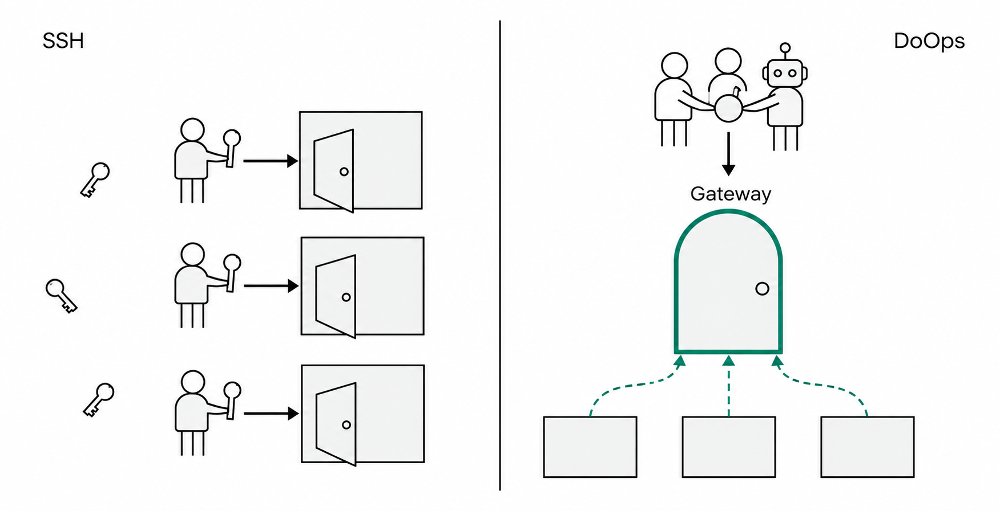
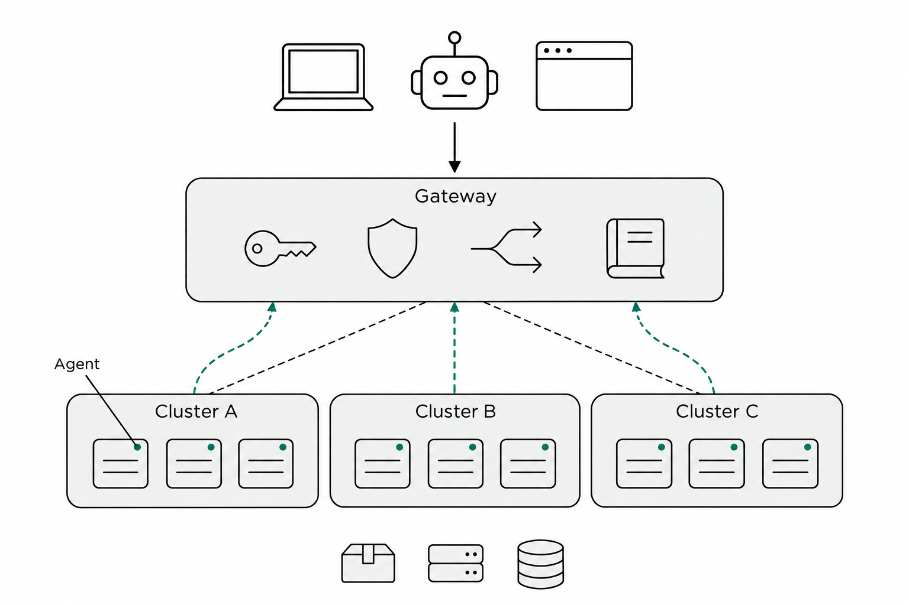
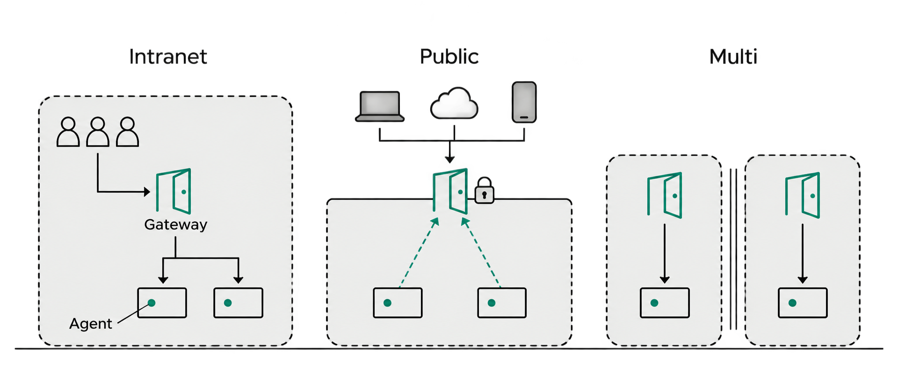
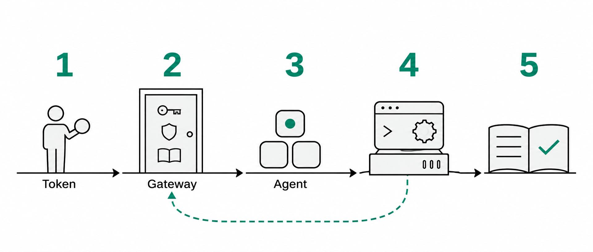
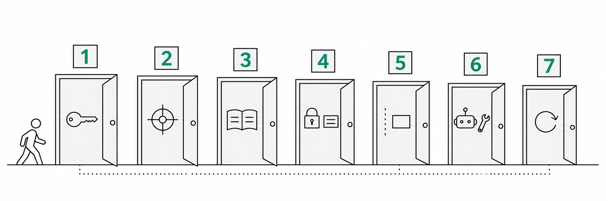
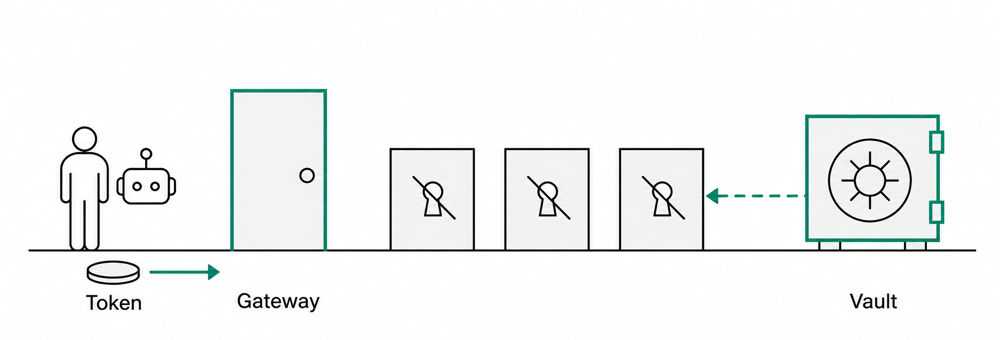
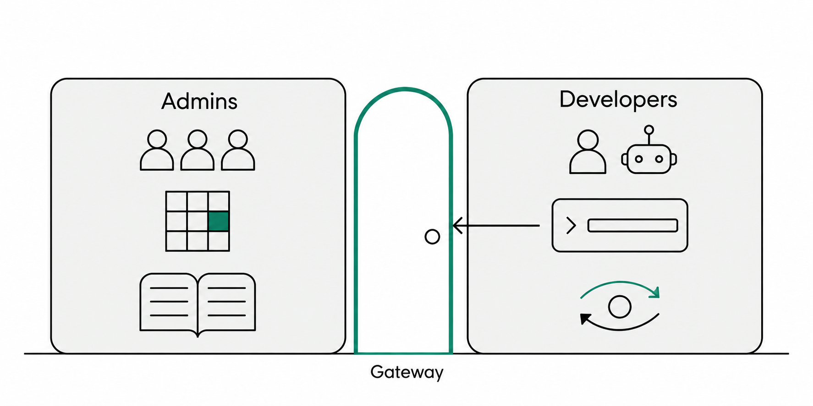
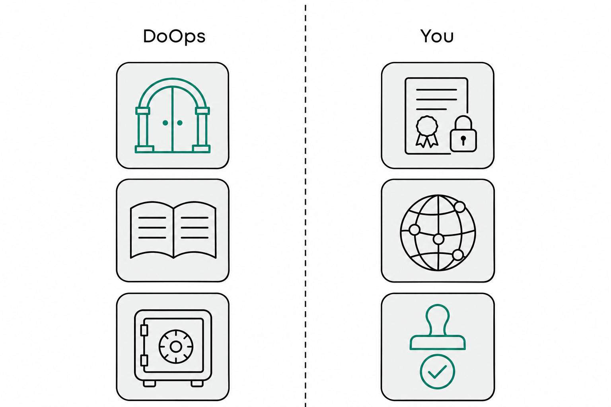

<a href="../zh/after-goodbye-ssh-what-is-doops-and-security.md">中文</a> | <a href="../en/after-goodbye-ssh-what-is-doops-and-security.md">English</a> | <b>Русский</b>

# После «Прощай, SSH»: что такое DoOps и как обеспечивается безопасность

После выхода прошлой статьи «再见，SSH。» («Прощай, SSH») в комментариях чаще всего спрашивали две вещи:

- «Это же просто SSH в обёртке?»
- «Взломали сервер в интернете — и всё, всем сразу конец?»

В этой статье мы не спешим с безопасностью. Восемь иллюстраций проведут нас от «самого привычного SSH» к архитектуре DoOps, а затем — по пути одной операции на машине, слой за слоем, — и мы увидим, на чём держится уверенность, что точки входа эксплуатации можно свести к одной. **На каждом шаге — одна мысль.**

---

## 1. Два пути: почему «ещё одна машина» всё усложняет

Подход SSH: на каждой машине открыта своя дверь, у каждого человека — свой ключ:

*Рис. 1 · Слева: у каждой машины своя дверь, у каждого человека свой ключ; справа: люди, программы и ИИ с одним и тем же Token проходят через одни ворота Gateway, у машин дверей нет — они только соединяются наружу по пунктирной линии*

Проблема не в самом SSH. Последние двадцать лет это самый надёжный инструмент эксплуатации. Проблема — в **масштабе**:

- Дверей слишком много: десятки машин — это десятки дверей, и у каждой своя конфигурация безопасности;
- Ключи разбросаны: приватные ключи и пароли лежат в Excel, в переписке и в домашних каталогах; меняется человек — и всё выходит из-под контроля;
- Никто не ведёт учёт: кто, когда и что сделал — восстанавливается по истории shell и по памяти.

DoOps меняет не «способ подключения», а **число и расположение дверей**: все проходят через одни ворота, а машины больше не открывают дверей — они сами идут на подключение.

---

## 2. Общая картина: одни ворота, несколько кластеров, машины подключаются сами

*Рис. 2 · Сверху — точки входа (ноутбук, бот, браузер); в середине — Gateway, а в его воротах четыре маленькие иконки: аутентификация, авторизация, маршрутизация и аудит; внизу три кластера, Cluster A / B / C, и на каждой машине — точка подключения Agent; соединение от Agent к Gateway исходящее, машины не открывают входящих портов*

Четыре роли, у каждой свой участок:

| Роль | Что это | Что делает |
|---|---|---|
| Точка входа | Командная строка, веб-консоль, ИИ в редакторе | Инициирует операцию |
| Плоскость управления | Единый Gateway (расположение переменное: можно во внутренней сети, можно в интернете) | Аутентификация, авторизация, маршрутизация, очередь, аудит |
| Узел выполнения | Agent, установленный на управляемой машине | Выполняет локально и возвращает результат |
| Цель | Кластер / хост / контейнер | То, над чем реально выполняется операция |

На этой схеме держатся два ключевых решения, и вся дальнейшая безопасность строится на них:

1. **Направление соединения обратное.** Традиционно человек снаружи подключается к машине; в DoOps Agent на машине сам идёт на подключение. Поэтому управляемой машине не нужен публичный IP, она не открывает входящих портов, и её можно взять под управление даже из-за NAT и файрвола.
2. **Идентичность остаётся за воротами.** Человек получает один Token, а не учётные записи и ключи каждой машины. Ушёл человек, отозван Token — и права на всех целях исчезают одновременно.

Сравним две архитектуры:

| | SSH | DoOps |
|---|---|---|
| Где ворота | Своя дверь на каждой машине | Одни общие ворота |
| У кого ключи | Свой ключ у каждого инженера | У каждого свой Token, проверяется за воротами |
| Какие порты открыты | SSH-порт, доступный для входящих подключений | Входящие порты закрыты, соединение исходящее |
| Кто ведёт журнал | Каждая машина сама, форматы разные | Единые ворота — единая запись |
| Как отзываются права | Меняем пароли, удаляем ключи — по одной машине | Один отзыв Token или авторизации срабатывает сразу |

---

## 3. Где стоят эти ворота: внутренняя сеть, интернет или по воротам на каждый домен

Сразу развеем частое недоразумение: **DoOps — не продукт, который «обязательно разворачивается в интернете».** У него нет фиксированного сетевого положения: **где поставить Gateway, зависит от того, кому нужен доступ и где вы хотите провести границу безопасности.** Сама архитектура при этом не меняется: Agent всегда сам идёт наружу, а аутентификация, авторизация и аудит всегда остаются в Gateway.

| Схема | Где стоит Gateway | Кому нужен доступ к нему | Типичный сценарий |
|---|---|---|---|
| Замкнутый контур внутренней сети | Во внутренней сети компании | Пользователи и CI внутри сети, а также Agent внутри сети | Одна компания, высокие требования соответствия; машины и люди и так находятся во внутренней сети |
| Вход из интернета | На внешнем периметре (терминация TLS) | Удалённые пользователи и пользователи из разных мест, Agent из других сетей | Распределённая команда, граничные узлы, внешнее сотрудничество |
| Отдельные ворота на каждый домен | По одному в каждом сетевом домене | Пользователи и Agent этого домена | Несколько дочерних компаний, изоляция кластеров, разделение production / test по доменам |

Ключевой вопрос не в том, «в интернете или во внутренней сети стоят ворота», а в том, что **их расположение определяет, кто до них может дотянуться**:

- **Во внутренней сети**: чтобы найти ворота, снаружи сначала нужно попасть в вашу сеть; граница безопасности — сетевой периметр (VPN, zero trust, офисная сеть);
- **В интернете**: ворота смотрят прямо в интернет, и граница безопасности — это TLS, аутентификация, авторизация, ограничение частоты запросов и мониторинг;
- **Несколько Gateway**: каждый домен охраняет свои ворота, а ключи между доменами не разделяются.

Во всех трёх схемах аутентификация, авторизация и аудит полностью одинаковы — меняется только ответ на вопрос «от кого ворота защищают». Поэтому наш совет такой: **сначала решите, кто должен иметь доступ, и только потом — где ставить Gateway, а не наоборот.** И ещё одно напоминание: Agent должен иметь возможность подключиться к Gateway, поэтому при работе через разные сети по-прежнему нужна сетевая доступность (пиринг, VPN, выделенный канал) — просто машинам не нужно открывать входящие порты.

*Рис. 3 · Три схемы развёртывания: замкнутый контур внутренней сети (ворота внутри стены), вход из интернета (ворота у стены, открыт только зашифрованный вход), отдельные ворота на каждый домен (в каждом домене свои ворота)*

---

## 4. Как проходит одна операция

Архитектурная схема — это «статика»: кто с кем соединён. Теперь «динамика»: вы говорите в терминале «выполни uptime на prod-node» — какие шаги на самом деле проходит эта операция.

*Рис. 4 · Пять шагов одного запроса: 1 — Token → 2 — Gateway (аутентификация, авторизация, учёт) → 3 — маршрутизация на Agent → 4 — выполнение на машине → 5 — результат и аудит записываются обратно (пунктир тёмно-зелёного цвета)*

1. Запрос с **Token** приходит в плоскость управления;
2. Плоскость управления сначала выясняет «кто ты», затем — «есть ли у тебя авторизация на эту цель», и одновременно **записывает операцию**;
3. Задача маршрутизируется на **Agent**, который в этот момент онлайн на этой цели. Обратите внимание: это постоянное соединение, которое Agent сам установил наружу, а не плоскость управления подключается к машине;
4. Agent выполняет всё локально на машине;
5. Результат возвращается к вам, а запись обновляется — успех, сбой или «результат неизвестен».

Чаще всего упускают именно порядок: **аутентификация, авторизация и учёт идут первыми, выполнение — последним.** Нет записи — нет выполнения; нет авторизации — этой машины даже не будет в списке целей.

Все три канала идут через одни ворота, без обходных путей:

- Команды, файлы, синхронизация кода и выпуски — это **канал управления**;
- Синхронизация файлов и кода с отдельной рабочей областью на каждую session — это **канал данных**;
- ИИ, который сам разбирает задачу и выполняет её по шагам, — это **канал ИИ**.

---

## 5. Откуда берётся безопасность: семь дверей на одну операцию

Когда архитектура ясна, разговор о том, «почему это безопасно», перестаёт быть абстрактным. Разберём одну операцию: ей нужно последовательно пройти семь дверей — и каждая отвечает ровно на один вопрос.

*Рис. 5 · Семь дверей с номерами 1–7: от «кто ты» до «как пройти выпуск новой версии без происшествий»; человечек идёт к первой двери*

**Первая дверь: кто ты.**
Token показывается только один раз, в момент выпуска, а на сервере хранится лишь его хеш. Срок действия можно задать, а отозвать — в любой момент; отзыв или блокировка действуют уже на следующем запросе. В веб-консоли Token лежит в cookie, которое браузер прочитать не может.

**Вторая дверь: куда тебе можно.**
Каждая операция проверяет «есть ли у тебя авторизация на эту цель». Без авторизации машины даже не будет в списке целей. Авторизация выдаётся на цель, и одна авторизация покрывает все операции с этой целью — такова цена «грубости»; о том, как её компенсировать, — дальше.

**Третья дверь: что ты сделал.**
Сначала запись, потом работа; не записалось — не выполняется. По завершении операции — при любом исходе — обновляется одна и та же запись; уже завершённые записи не переписываются. Администратор видит всё, обычный пользователь — только своё.

**Четвёртая дверь: под какой идентичностью идёт работа.**
Учётные данные хранятся в зашифрованном виде, ключ — вне базы данных. Их получает только та цель, на которую есть авторизация, и только в рамках этой операции, а после использования они стираются. Учётные данные не попадают ни в командную строку, ни в промпт, ни в сводку аудита.

**Пятая дверь: где и в каких пределах.**
Agent не открывает входящих портов и делает только то, что ему передали на выполнение; но он установлен на управляемой машине и **по сути обладает правами администратора этой машины**. Поэтому скажем прямо: **DoOps — не песочница**, а граница безопасности — это контейнер, виртуальная машина или сам узел.

**Шестая дверь: что может ИИ.**
ИИ может диагностировать, но для изменения нужны отдельная авторизация и доказательства проверки; ИИ не может сам себе подписать заявку на изменение. И ещё: ИИ на пути диагностики наделён правом выполнения — он может запустить команды, которых вы не ждали.

**Седьмая дверь: выпуск новой версии.**
Agent не может заменить сам себя: если замену прервать посередине, проверять и откатывать будет некому. Поэтому обновление выполняет отдельная задача: сначала предварительная проверка, затем изменение, затем подтверждение, что новая версия действительно поднялась, а при сбое — автоматический откат.

Есть ещё одна дверь, которой нет на схеме, но которую обязан держать закрытой тот, кто разворачивает систему: **передача данных**. За бизнес-логику отвечает плоскость управления, за TLS — обратный прокси перед ней. Если к воротам нужен доступ снаружи или из другого домена, наружу выставляется только зашифрованный вход, а порты управления не выставляются напрямую никогда; если ворота стоят во внутренней сети, эта ответственность превращается в сужение внутренних точек входа и сетевой периметр.

---

## 6. Идентичность и учётные данные: человек ушёл — и уносить нечего; секреты не остаются на машинах

Из семи дверей чаще всего неверно понимают четвёртую. Первая реакция многих: «То есть все пароли теперь лежат в плоскости управления?»

*Рис. 6 · Слева: люди и ИИ с одним и тем же Token входят в одни ворота Gateway; в середине: замочные скважины на трёх машинах перечёркнуты — чужих ключей на машинах нет; справа: Vault хранит учётные данные в зашифрованном виде и по требованию выдаёт их только той цели, на которую есть авторизация (пунктир)*

Разделим две вещи:

**Идентичность**: у каждого человека, каждой программы и каждого ИИ — ровно один Token. На машинах нет ключей Иванова или Петрова; Иванов уходит — и всё заканчивается отзывом одного Token. Это «развязка идентичности и машин».

**Учётные данные**: пароли к базам данных, учётные записи реестров образов, учётные данные Kubernetes — всё хранится в плоскости управления в зашифрованном виде. Выдаются они только по требованию, только на ту цель, на которую есть авторизация, и стираются после использования. В командную строку, в промпт и в сводку аудита они не попадают.

Скажем честно: плоскость управления умеет расшифровывать эти данные, это не «сквозная схема с нулевым разглашением». Поэтому сама плоскость управления должна защищаться как актив высшего уровня — об этом в следующем разделе.

---

## 7. Две роли: как управляет компания и как работает разработчик

У DoOps две типичные категории пользователей: **те, кто управляет** (руководители платформы и эксплуатации, тимлиды, администраторы безопасности), и **те, кто пользуется** (разработчики, инженеры эксплуатации и ИИ, который работает за них). Одна и та же архитектура в руках этих двух категорий выглядит как два разных интерфейса.

*Рис. 7 · Слева — плоскость администрирования (пользователи и Token, список авторизаций, аудит, список машин), справа — плоскость использования (вход, выполнение, синхронизация кода, диагностика с ИИ); в середине — одни и те же ворота Gateway*

### 7.1 Для компании и команды: как «управлять»

Цель управления формулируется одной фразой: **превратить «кто и какой машиной может управлять» в настраиваемые, проверяемые аудитом и отзываемые записи, а не в ключи, разбросанные между людьми и машинами.**

На практике это пять вещей:

| Что контролируется | Как это делать | Когда это делать |
|---|---|---|
| Люди и Token | Один Token на человека, срок действия, отзыв при увольнении; для CI и автоматизации — отдельные Token | При приёме и увольнении, ежеквартальная сверка |
| Цели и авторизации | Строить цели по кластерам и инстансам, разделять production и test; выдавать авторизацию только на конкретную цель, без подстановочных знаков | При подключении новой среды, ежеквартальная сверка |
| Учётные данные | Главный ключ хранить отдельно и резервировать; учётные данные привязывать к цели, выдавать по требованию, отзывать после использования | При изменениях, при регулярной проверке |
| Аудит | Выгружать в реальном времени в систему логов / SIEM; настраивать оповещения о сбоях, неизвестных результатах и аномальных регистрациях | Постоянно |
| Учёт узлов выполнения | Ставить только на узлы, которые нужно взять под управление; сетевые ACL; регулярно сверять список машин, находящихся онлайн; обновления — через согласование и допуск образов | При подключении, ежемесячно |

Плюс три задачи на стороне платформы: наружу выставлять только зашифрованный канал, делать резервные копии базы данных плоскости управления и ключей, следить за состоянием самой плоскости управления.

В сценариях с несколькими кластерами соглашение об именовании и есть граница прав: production, test, периметр и среды заказчиков должны быть разделены, а авторизации выдаваться по границам сред. **Бизнесу на самом деле нужны не «более гранулярные права на команды», а вот этот учёт: кто, когда, на какой машине и что сделал.**

### 7.2 Для разработчика: как «пользоваться»

Цель использования тоже формулируется одной фразой: **поставить один раз, а дальше пользоваться как одной командой.**

1. **Подготовка**: поставить CLI и Skill в проекте, войти и получить Token, посмотреть на «куда мне можно»: список, который вы видите, и есть ваша область прав.
2. **Четыре повседневных класса операций**: выполнение команд, чтение и запись небольших файлов, синхронизация кода, диагностика с ИИ. Все четыре идут через одни и те же авторизации и записи.
3. **Изменения**: выпуски и изменения конфигурации, которые меняют состояние, идут через канал изменений с проверкой — с явно указанными целью, областью и критериями приёмки; ИИ предлагает решение, а после выполнения даёт доказательства проверки.
4. **Инцидент**: сначала смотрим session и записи, потом решаем — повторить, откатить или звать человека. Когда «результат неопределён», не нужно слепо начинать заново.

Реальный разбор инцидента выглядит так: ночное оповещение → первым делом смотрит ИИ → когда нужно вмешаться, выполняется одна команда → процесс и результат попадают в записи → при передаче смены передаются session и записи, а не устное «я там поправил».

Три правила для разработчика:

- Трогайте только те цели, на которые у вас есть авторизация; сначала проверяйте в тестовой среде, потом идите в production;
- Не вписывайте секреты в командную строку — отдайте их на попечение хранилища учётных данных; командная строка и записи оставляют след;
- Изменения проводите через канал с проверкой; если сомневаетесь — сначала спросите, потом делайте.

### 7.3 Как эти две роли работают вместе

Плоскость администрирования отвечает за «ворота, ключи и учёт», плоскость использования — за «войти и сделать». Договор между ними укладывается в одну фразу:

> **Каждая операция соответствует одной идентичности, одной цели и одной записи.**

В этом и есть самое принципиальное отличие DoOps от схемы «раздать каждому SSH-ключи»: права превращаются из «разбросанных ключей» в «управляемые записи», а действия — из «логов на каждой машине по отдельности» в «единый журнал у единых ворот».

---

## 8. Границы и разделение: за что отвечает DoOps, а что обязаны закрыть вы

Ни один инструмент не сделает безопасность за вас. Реальное разделение выглядит так:

*Рис. 8 · Пунктир посередине делит схему на две части: слева — то, что берёт на себя DoOps (контроль входа, журнал, сейф, сведение выполнения в одну точку), справа — то, что обязан закрыть тот, кто разворачивает систему (сертификаты и замки, сеть и периметр, согласования)*

| Пункт | Отвечает DoOps | Должны закрыть вы |
|---|---|---|
| Шифрование входа | Бизнес-логика | Зависит от схемы развёртывания: во внутренней сети — сужение внутренних точек входа; TLS-вход из интернета и контроль источников нужны только при внешнем развёртывании; порты управления не выставляются наружу никогда |
| Идентичность | Выпуск, срок действия и отзыв Token | Один Token на человека, короткий срок действия, отзыв при увольнении, отдельные Token для CI |
| Авторизация | Проверка по цели | Разделение целей production и test, без подстановочных знаков, регулярная сверка |
| Аудит | Запись, права на запрос, «не записалось — не выполняется» | Выгрузка в реальном времени в систему логов, оповещения о сбоях и аномалиях |
| Учётные данные | Зашифрованное хранение, выдача по требованию | Резервирование и хранение главного ключа, авторизация по требованию, регулярная проверка |
| Узел выполнения | Исходящее соединение, сведение выполнения в одну точку | Установка только на узлы, которые берутся под управление, сетевые ACL, мониторинг аномальных регистраций |
| Обновление | Предварительная проверка, верификация, откат | Подпись образов, допуск в реестре, согласование выпуска |
| ИИ | Область инструментов, авторизация изменений | Управление ключами моделей, в production сначала только диагностика |

**Три известные границы на уровне архитектуры:**

1. **Плоскость управления — единая точка отказа.** Её захват равносилен захвату всех управляемых целей — поэтому её нужно разворачивать в контролируемой сети и выставлять наружу только зашифрованный вход.
2. **Подключение узла выполнения опирается на сетевой периметр.** При подключении узел выполнения лишь объявляет, «какая это цель», без дополнительных учётных данных; поэтому сетевое расположение плоскости управления, ACL и мониторинг аномальных регистраций и есть граница безопасности этого канала. (Канал, по которому веб-сервисы выставляются наружу, — это отдельный канал, с регистрационным токеном, привязанным к конкретной цели.)
3. **Аудит — пока не защищённый от подмены реестр.** Он хранится в базе данных плоскости управления, и тот, у кого есть права, может его удалить; правильный способ — выгружать его в реальном времени.

Одной фразой: **DoOps сводит «операции» к одним воротам, но замок, мониторинг и управление ключами у этих ворот по-прежнему нужно настроить вам.**

---

## 9. Вопросы из комментариев: отвечаем сразу на все

**«Взломали сервер в интернете — и всё, всем сразу конец?»**
Централизованная плоскость управления действительно самая ценная точка, и это опасение обоснованно. Но сначала посмотрите, где стоят ворота: если во внутренней сети, граница риска — граница вашей внутренней сети; если в интернете, то придётся дополнительно держать удар по внешней поверхности (TLS, ограничение частоты запросов, контроль источников, мониторинг). В любом случае база данных, ключи и аудит плоскости управления должны защищаться как ключевые активы, а аудит — выгружаться наружу. Утверждение не в том, что её «невозможно взломать», а в том, что «при взломе вы узнаете об этом первым и сможете всё проследить».

**«Так это же просто бастион?»**
Общее — и там и там всё сведено в одну точку. Различие: бастион управляет сессиями человека, DoOps управляет задачами и вызовами — люди и ИИ пользуются одним и тем же интерфейсом, команды, файлы, синхронизация кода и выпуски — это структурированные операции, которые можно оркестрировать сразу по нескольким кластерам и вызывать напрямую из скриптов и пайплайнов.

**«Подумаешь, ИИ просто делает за вас SSH.»**
ИИ не держит учётных данных SSH, он вызывает контролируемые операции; для операций-изменений нужны отдельная авторизация и проверка. Но в этой фразе есть и половина правды: ИИ действительно может выполнять команды. Поэтому ключевой вопрос — не «есть ли ИИ», а «можно ли отследить и заблокировать каждое действие ИИ».

**«А в первый раз как вы туда зайдёте, чтобы всё это развернуть?»**
Kubernetes, Docker или одноразовый вход по SSH. Это «последний раз, когда используется SSH», а не «SSH не используется никогда».

**«Кроме новичков, этим никто не будет пользоваться.»**
Пользователей два типа: у инженеров эксплуатации и платформенных инженеров болит одно и то же — повторяющиеся операции по множеству кластеров и приложений; у разработчиков, которые пишут код с помощью ИИ, болит «последняя миля» развёртывания. Те, кто не разбирается в SSH, и так делятся паролями и ходят напрямую под административной учётной записью — а здесь у них хотя бы есть авторизация и записи.

**«Если Agent засветится — и всем сразу конец.»**
Нужно различать: если взломан Agent, это влияет только на машину, на которой он стоит; «всем сразу конец» наступает при компрометации плоскости управления — тогда разом ложатся все управляемые цели. Подключение Agent опирается на сетевой периметр, поэтому плоскость управления нужно ставить в сети, где вы контролируете источники доступа (во внутренней сети или на входе из интернета с TLS/ACL), и следить за аномальными регистрациями.

**«frp + SSH — лучше.»**
Если нужен всего один временный туннель, frp действительно проще. Ценность DoOps — в команде и масштабе: идентичность, авторизация, аудит, оркестрация задач, интеграция с пайплайнами — этого у туннельных утилит нет.

**«Здесь нет песочницы.»**
Верно. Нужна песочница — берите контейнер, виртуальную машину или отдельный узел; DoOps управляет тем, «кто может оперировать и что именно он сделал».

---

## 10. Вместо заключения: безопасность — это не песочница, а три вопроса

Мы предпочитаем определять безопасность через три вопроса:

**Где проходит граница? Кто может внутрь? Можно ли проверить, что было сделано?**

Архитектура DoOps даёт на эти три вопроса структурные ответы: граница — на цели, точка входа — одни ворота, всё сделанное — в записях. Утверждение не в том, что риска нет, а в том, что риск виден, поддаётся управлению и обратим.

Настоящий смысл «Прощай, SSH» — **превратить точку входа эксплуатации из «у каждого в руке свой ключ» в «ворота, у которых есть охрана и журнал, доступный для проверки».**

Если после этой статьи остались вопросы — продолжайте кидаться тапками в комментариях. А если речь идёт о безопасности, свяжитесь с сопровождающими приватно, как описано в правилах безопасности проекта: не публикуйте в открытых каналах реальные адреса и учётные данные.
