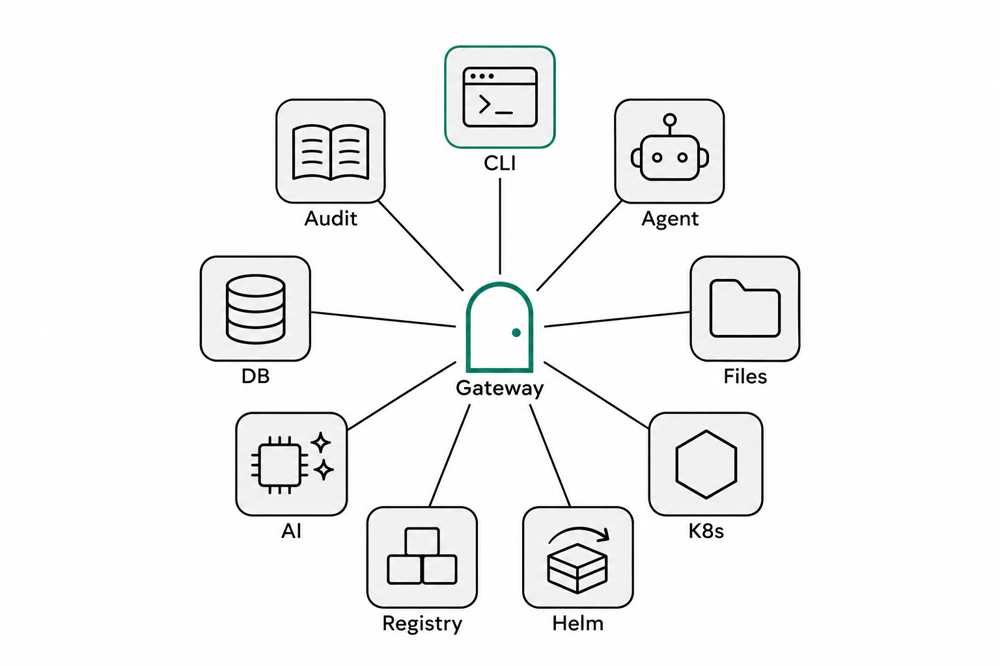
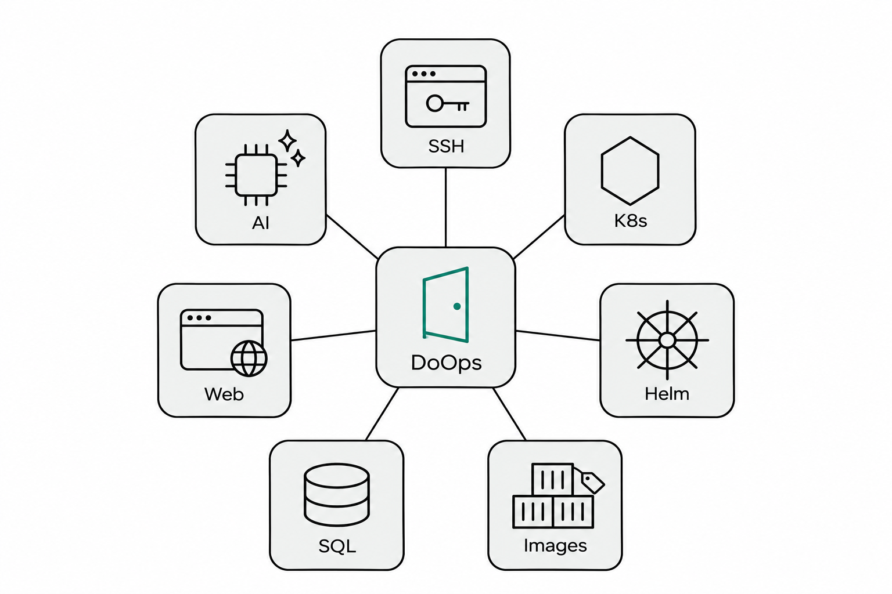
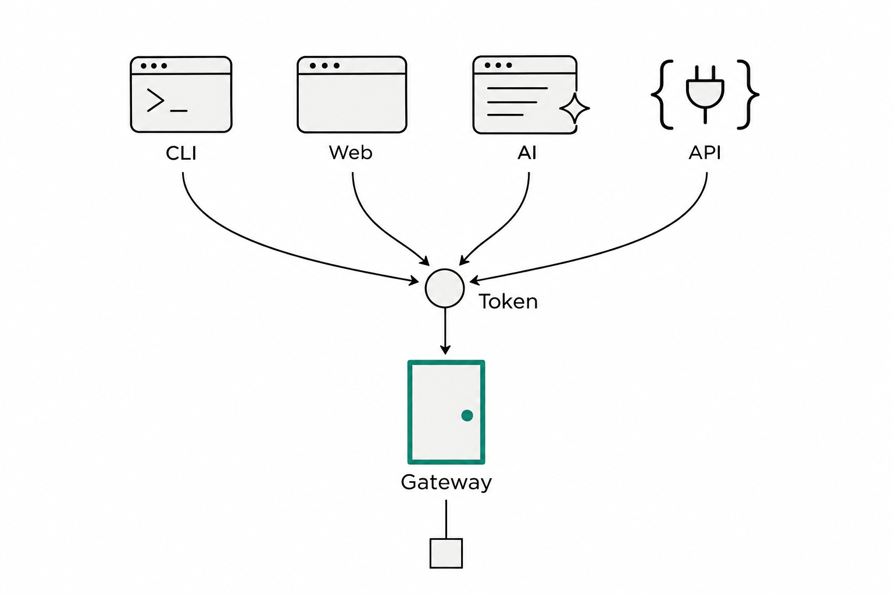
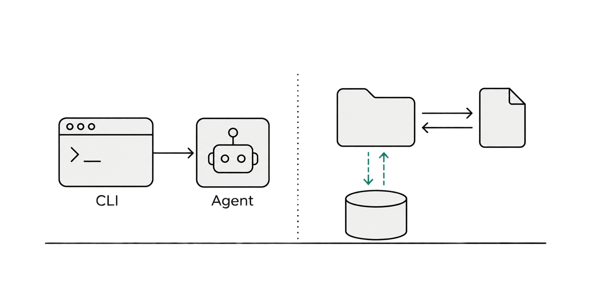
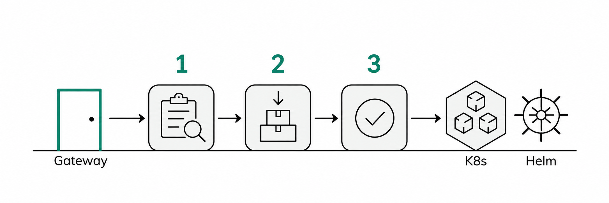
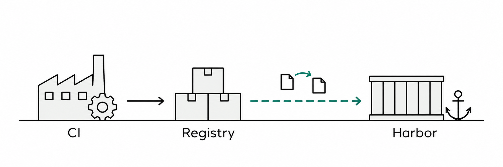
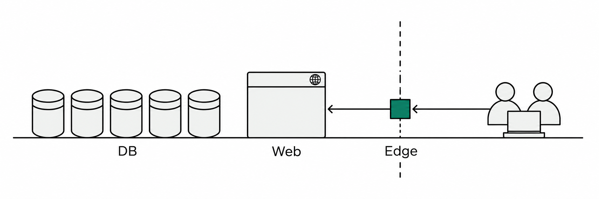
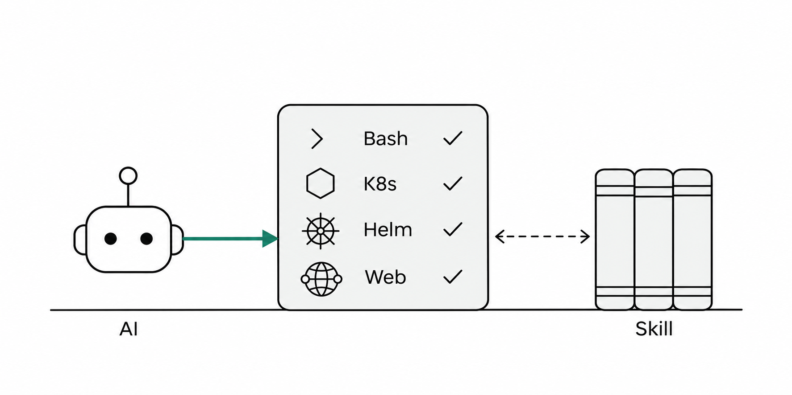
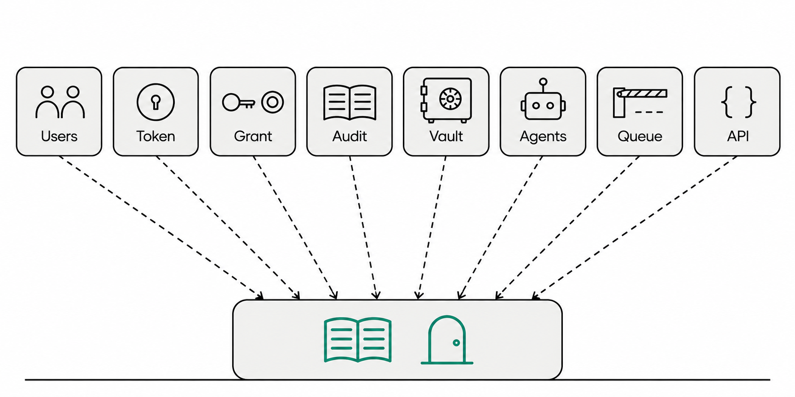
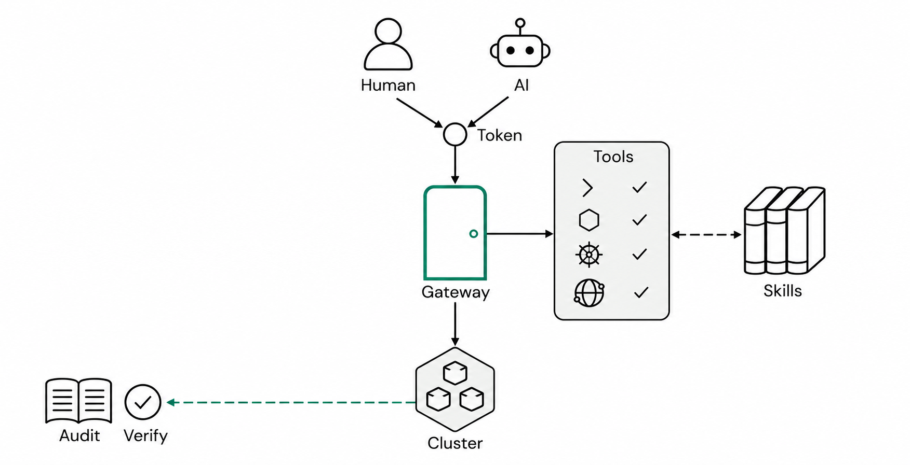

<a href="../zh/doops-core-features.md">中文</a> | <a href="../en/doops-core-features.md">English</a> | <b>Русский</b>

# Что умеет DoOps: бизнес-возможности, плоскость управления и AI-нативность

В прошлой статье речь шла об архитектуре и безопасности. Здесь — взгляд пользователя и два разных вопроса:

- **Вопрос от бизнес-коллег**: что конкретно это поможет мне довести до конца?
- **Вопрос от платформы и управления**: как удержать эти возможности, когда команд и кластеров несколько?

Поэтому обзор делится на три части: **7 бизнес-областей возможностей** (что можно сделать), **5 групп поддерживающих управленческих возможностей** (как всё удержать) и сквозная линия через них обе — **AI-нативность** (почему эти возможности устроены именно так). Все три опираются на одни и те же идентичность, авторизацию и аудит — в этом и есть принципиальное отличие DoOps от «кучи скриптов плюс кучи прав».

*Рис. 1 · Общая карта возможностей: в верхней части — бизнес-возможности, в нижней — управленческий фундамент, на котором они держатся*

---

## Часть первая · Бизнес-возможности: что с их помощью можно сделать

*Рис. 2 · Семь бизнес-областей: каналы и доступ, удалённая эксплуатация и файлы, Kubernetes и доставка приложений, образы и артефакты, базы данных, сайты и внешние сервисы, эксплуатация с ИИ*

| Бизнес-область | Конкретные возможности | Типичные задачи | Для кого |
|---|---|---|---|
| Каналы и доступ | Единый Gateway, обратное подключение Agent, четыре входа | Диагностика во внутренней сети, удалённая работа, вызовы из CI | Все |
| Удалённая эксплуатация и файлы | Команды, фоновые задачи, структурированный SSH, синхронизация файлов и кода, доступ к хост-машине | Смотреть логи, перезапускать сервисы, передавать артефакты, работать на физических серверах | Эксплуатация / разработка |
| K8s и доставка | Наблюдение, контролируемые изменения, выпуск и откат через Helm, выпуск на естественном языке, обновление Agent | Смотреть Pod, выпускать версии, откатывать, обновлять Agent | Эксплуатация / релиз-инженеры |
| Образы и артефакты | Сборка, репликация, синхронизация реестров, приведение Harbor к целевому состоянию | Собирать образы, отправлять в реестр, распространять по кластерам | Релиз-инженеры / CI |
| Базы данных | DoSql: пять движков, запросы/планы/изменения/репликация | Смотреть данные, менять таблицы, переносить данные между базами | DBA / бэкенд |
| Сайты и внешние сервисы | Публикация сайтов через DoWeb, обратный прокси Edge | Публиковать сайты, выставлять внутренние сервисы наружу | Эксплуатация |
| Эксплуатация с ИИ | Диагностика в ask, изменения в apply, система Skill | Разбирать инциденты, вносить изменения, закреплять SOP | Разработка / эксплуатация |

### 1. Каналы и доступ: сначала решаем задачу «дотянуться»

*Рис. 3 · Терминал, браузер, ИИ в редакторе, API — четыре входа через одни ворота Gateway*

DoOps сначала решает задачу «дотянуться»:

- **Обратное подключение Agent**: Agent на целевой машине сам подключается к Gateway; машине не нужен публичный IP и не нужно открывать входящие порты, её можно взять под управление даже из-за NAT и файрвола;
- **Единый вход**: CLI в терминале, веб-консоль, ИИ в редакторе (Skill), HTTP/WebSocket API — четыре способа с одним общим входом;
- **Маршрутизация на цели**: target определяется по cluster/instance, а несколько кластеров висят за одними воротами;
- **Выставление наружу**: когда нужно открыть наружу внутренний HTTP-сервис (включая долгоживущие соединения вроде WebIDE и noVNC), используется обратный прокси Edge (регистрационный Token на конкретный target + TLS passthrough), а не дыра в файрволе.

### 2. Удалённая эксплуатация и файлы: перенимаем работу у SSH

*Рис. 4 · Команды уходят в Agent на выполнение; рабочая область и код/артефакты синхронизируются в обе стороны; большие файлы идут через хранилище*

- **Выполнение команд**: команда на переднем плане идёт прямо на цель; длинную можно запустить в фоне и в любой момент проверить статус, забрать логи или отменить;
- **Структурированный SSH**: когда нужно прыгнуть с машины A на машину B, используется параметризованный SSH-прокси, и многослойные кавычки не переразбираются удалённым shell;
- **Информация об узле**: CPU, память, диск и инструментарий (сборка, работа с образами, runtime) видны сразу;
- **Файлы и код**: небольшие текстовые файлы читаются и пишутся напрямую (с явными лимитами размера); код и артефакты синхронизируются через push/pull, хранилище — Gateway или туннель Git, с учётом .gitignore;
- **Хост-машины и физические серверы**: K8s Agent может зайти на свой узел и проверить хост-машину; физический сервер можно подключить отдельно или прыгнуть через уже существующую VM; для первого подключения по-прежнему используется DaemonSet, Docker или одноразовый SSH.

Одна деталь: тайм-аут, обрыв соединения или завершение сигналом помечаются как **«результат неизвестен»**, а не как «успех», — это напоминание: сначала проверьте фактическое состояние, а потом решайте, повторять ли операцию.

### 3. Kubernetes и доставка приложений: смотреть, действовать, проверять

*Рис. 5 · Доставка в три этапа: наблюдение → preflight → apply → verify*

**Смотрим**: Pod, Deployment, Service, события, логи, top, состояние rollout, Helm list/history/status/values (возвращаются только пути ключей), имена ключей ConfigMap.

**Действуем**: перезапуск, масштабирование, cordon/uncordon, удаление Pod — все эти операции записи требуют явного подтверждения и проходят через аренду изменений на уровне target; **Secret и ServiceAccount не открыты даже на чтение**.

**Доставка**: выпуск через Helm разбит на три этапа: preflight (dry-run — сначала рендеринг и проверка) → apply (фактическое выполнение) → verify (revision и живые объекты читаются обратно и сверяются по пунктам, а вместе с expected_image это ловит «команда прошла, а образ не изменился»). Можно выпускать и на естественном языке: в задаче указываются цель, область, источник образа, причина и проверяемые машиной критерии приёмки, а по завершении выдаются доказательства проверки.

Кроме того, есть два дополнительных механизма: `check` сверяет образ в production с результатом сборки на согласованность; самообновление Agent выполняется отдельным Job (резервная копия → обновление → проверка → откат при сбое) — Agent не заменяет сам себя во время работы.

### 4. Образы и артефакты: от CI до целевого кластера

*Рис. 6 · Авторитетный источник образов — CI; на целевой стороне выполняется только репликация и синхронизация, Harbor приводится к целевому состоянию по pull-модели*

- **Сборка**: на целевом Agent с помощью BuildKit собираются OCI-образы; поддерживается несколько платформ, вывод в локальное хранилище или прямая отправка в реестр;
- **Репликация**: образы копируются между реестрами по digest — чтобы не было «выглядят одинаково, а на деле разные»;
- **Синхронизация реестров**: пакетная синхронизация с проверкой digest и на источнике, и на цели;
- **Приведение Harbor к целевому состоянию**: pull-модель «CI → Harbor этого кластера», с заданиями по расписанию и проверочными скриптами; копирование между кластерами не выполняется.

Граница: образы — продукт CI. Сборка и репликация на целевой машине относятся только к плоскости выполнения и не заменяют CI — иначе становится непонятно, «какой commit работает в production».

### 5. Базы данных и сайты: два специализированных входа в эксплуатацию

*Рис. 7 · DoSql управляет данными, DoWeb — сайтами, Edge безопасно выставляет внутренние сервисы наружу*

**Базы данных (DoSql)**: поддерживает PostgreSQL, MySQL, Oracle, SQL Server и MongoDB, а внешние драйверы расширяют набор движков; четыре режима — запрос, план изменений, выполнение и обнаружение активов; поддерживаются dry-run и проверка результата; репликация между базами выполняется Agent напрямую, чтением и записью, минуя модель; каждый шаг оставляет журнал версий с хеш-цепочкой, так что задним числом можно доказать, «какие именно запросы были выполнены».

**Сайты (DoWeb)**: сайт описывается через SiteSpec; генерация конфигурации Nginx, проверка, reload, проверка работоспособности, откат и доказательства — одна цепочка; операции только на чтение отделены от изменений; если не хватает фактов, процесс блокируется, а не угадывает.

**Внешние сервисы (Edge)**: внутренние веб-сервисы (включая долгоживущие соединения вроде WebIDE/noVNC) выставляются наружу через обратный прокси в Agent и динамическое отображение доменов в Gateway; регистрационный Token привязан к конкретному target, поддерживается TLS passthrough.

### 6. Эксплуатация с ИИ: агент внутри allowlist инструментов

*Рис. 8 · ИИ получает не одну оболочку shell, а allowlist инструментов; Skill определяет, что он может делать на этом target*

- **Режим диагностики (ask)**: может читать файлы, проверять состояние и выполнять команды, помогая разобраться в проблеме;
- **Режим изменений (apply)**: выдаются только структурированные инструменты изменений (Helm или публикация сайта — одно из двух), требуется авторизация изменений, на выходе — доказательства проверки;
- **Комбинации, которых не бывает**: в диагностике нет инструментов изменений, в режиме изменений нет свободного Bash, а Skill базы данных или неизвестный Skill не наследуют возможности изменений;
- **Определение успеха**: успех устанавливается совместно авторизацией изменений, attestation и доказательством конечного состояния; словесное «готово» от модели не считается;
- **Skill**: в Agent встроены 6 Skill — shell, K8s, сборка образов, базы данных, сайты и дистилляция; команда может написать собственный SKILL.md и закрепить SOP.

---

## Часть вторая · Поддерживающее управление: как сделать эти возможности управляемыми

*Рис. 9 · Пять групп поддерживающих управленческих возможностей: идентичность и авторизация, аудит и учётные данные, узлы и Agent, задачи и надёжность, консоль и масштабирование*

| Управленческая область | Конкретные возможности | Какую задачу решает |
|---|---|---|
| Идентичность и авторизация | Пользователи, вход, Token, авторизации на target, администраторы | Кто может войти и куда ему можно |
| Аудит и учётные данные | Записи операций, запросы, жизненный цикл учётных данных и материализация | Что было сделано и как управляются секреты |
| Узлы и Agent | Взятие под управление, онлайн/архив, обновление, регистрационные Token, проверка возможностей | Как машины подключаются и как обновляются |
| Задачи и надёжность | Рабочие области session, параллелизм, очередь, admission, «результат неизвестен» | Как не устроить хаос при массовом параллелизме |
| Консоль и масштабирование | Страницы администрирования в Web, API, расширение Skill, варианты развёртывания | Как команде работать вместе и как расширять систему |

### 7. Идентичность и авторизация: кто может войти и куда

- **Идентичность**: создание, блокировка и смена пароля пользователя; вход выдаёт Token (по умолчанию на 24 часа, срок можно задать); Token показывается один раз, на сервере хранится только его хеш, а отозвать его можно по id; блокировка пользователя или отзыв Token действуют уже на следующем запросе;
- **На стороне входов**: CLI хранит учётные данные локально; веб-консоль использует HttpOnly Cookie и не кладёт Token в localStorage;
- **Авторизация**: один grant привязан к cluster/instance и покрывает этот target и связанные с ним учётные данные; администратор платформы — это флаг у пользователя;
- **О компромиссе — честно**: авторизация существует только на уровне target, без гранулярности до действий вроде «разрешено только смотреть логи». Поэтому в production это компенсируется разделением target (production и test — разные кластеры), коротким TTL и аудитом.

### 8. Аудит и учётные данные: что было сделано и как управляются секреты

- **Аудит**: сначала запись, потом выполнение; если запись не удалась, операция не выполняется; сбои, отказы и «результат неизвестен» тоже попадают в базу; конечное состояние не переписывается; администратор видит всё, обычный пользователь — своё; если аудит недоступен, обслуживание отклоняется;
- **Учётные данные**: полный жизненный цикл create → stage → grant → verify → promote; версионирование; привязка к target; материализация по требованию на тот target, у которого есть авторизация (с очисткой после использования); поддерживаются Bundle (группы учётных данных) и предварительная проверка metadata-only на этапе разработки; payload передаётся только через stdin или приватный канал, шифруется при хранении, а при отсутствии ключа запрос отклоняется.

### 9. Узлы и Agent: как машины подключаются и обновляются

- **Взятие под управление**: DaemonSet в K8s, Docker или одноразовый SSH для первичного подключения; представления «онлайн / офлайн / история / архив»; записи инстансов, отсутствующих более 24 часов, очищаются автоматически, а авторизации сохраняются;
- **Регистрационный Token**: для канала Edge выдаётся на конкретный target, в открытом виде возвращается только один раз;
- **Проверка возможностей**: `capabilities` проверяет протокольные возможности целевого Agent; старый Agent получает явный отказ, а не тихое понижение функциональности (принудительная проверка выполняется и в ssh, и в upgrade);
- **Обновление**: выполняется отдельным Job — предварительная проверка → изменение → проверка (Pod Ready, digest образа, номер версии, переподключение к Gateway) → автоматический откат при сбое;
- **Согласованность**: `check` сверяет образ в production с результатом сборки; `info` показывает, полностью ли укомплектован инструментарий узла.

### 10. Задачи, параллелизм и надёжность

- **Рабочая область session**: отдельный каталог /root/ws/<session> на каждую задачу, ничего не задевает соседей, его можно очистить;
- **Семантика параллелизма**: операции на одном target в одной session могут выполняться параллельно; самообновление Agent занимает target монопольно; запись в workspace, точные ресурсы и т.п. блокируются по ключу действия и ресурса;
- **Очередь и допуск**: по умолчанию на каждый target — 10 задач в очереди и ожидание до 10 минут; отказ до допуска возвращается стабильным кодом ошибки, не считается «результатом неизвестен», поэтому массовые выпуски не порождают двойного выполнения из-за повторов;
- **Дисциплина «результат неизвестен»**: при отсутствии достоверного конечного состояния сохраняется «неизвестно» (-32008) — без заявлений об успехе и без автоматического повтора; старое «неизвестно» не блокирует новые задачи, но реальные блокировки ресурсов продолжают действовать;
- **Наблюдаемость**: `targets --admission` без затрат на модель читает актуальные слоты, владельцев и очередь — это первый шаг при разборе «выпуск застрял».

### 11. Консоль, открытые интерфейсы и масштабирование развёртывания

- **Веб-консоль**: 11 вкладок — обзор, ИИ-помощник, базы данных, сайты, Kubernetes, образы, файлы, база знаний, учётные данные, аудит, терминал; плюс три представления: развёртывание, CI/CD, администрирование. Страницы администрирования покрывают пользователей, Token, grant, инстансы и аудит;
- **Что нового**: консоль читает CHANGELOG из репозитория и после обновления показывает изменения во всплывающем окне;
- **Открытые интерфейсы**: JSON-RPC over WebSocket, Git HTTP, REST-интерфейс управления; публичных инструментов JSON-RPC — 12, остальные относятся к внутренним инструментам плоскости управления;
- **Расширение**: разработка собственных Skill (свой SKILL.md в проекте); установочная цепочка проверяет release/commit/sha256 и доставляет CLI и Skill/docs;
- **Варианты развёртывания**: замкнутый контур внутренней сети, вход из интернета и отдельные ворота на каждый домен (подробнее — в прошлой статье); плоскость управления — единая точка, поэтому базу данных и главный ключ нужно резервировать, а вход настраивать под конкретную схему: TLS/ACL.

---

## Часть третья · AI-нативность: почему возможности устроены именно так

DoOps — не «инструмент эксплуатации, к которому прикрутили чат с ИИ». С первого дня ИИ — полноценный пользователь наравне с человеком: у него есть собственный вход, права, аудит, инструменты и цепочка доказательств. Именно это проектное допущение во многом определило, как выглядят описанные выше бизнес- и управленческие возможности.

*Рис. 10 · ИИ и человек используют одни и те же идентичность, авторизацию и аудит; что ИИ может делать, определяют allowlist инструментов и Skill; сделанное остаётся в записях, а изменения подтверждаются доказательствами*

### 12. ИИ — полноценный пользователь, а не надстройка

- **Свой вход**: ИИ подключается через Skill в редакторе или через интерфейс Agent, а не имитирует ввод с клавиатуры в терминале;
- **Общая идентичность**: операции ИИ так же проходят через Token, grant и аудит; отзыв прав или блокировка действуют для него так же мгновенно;
- **Не все инструменты общие**: у диагностики (ask) и изменений (apply) разные списки инструментов — диагностика может выполнять команды, а изменениям доступны только структурированные инструменты изменений, и для них нужна авторизация изменений.

### 13. Шесть деталей, спроектированных под ИИ

1. **Структурированные примитивы, а не имитация терминала**: операции — это вызовы инструментов, а вход и выход машиночитаемы (структурированные результаты, стабильные коды ошибок); нет ни интерактивного PTY, ни «снятия экрана». ИИ не нужно понимать нрав shell — человек и программа получают одни и те же факты.
2. **Интерфейсы рассчитаны на автоматизацию**: CLI, Web и ИИ — всего лишь клиенты одного и того же API; доступны инструменты JSON-RPC, Git HTTP и REST-интерфейс управления, так что CI может вызывать их напрямую; семантика повторов явная — при неизвестном результате автоматического повтора нет.
3. **Права из того же источника, что у людей**: превышение прав ИИ — это превышение прав человека, отзыв grant действует сразу; «специальной лазейки для ИИ» не существует.
4. **Возможности передаются через Skill**: 6 встроенных Skill (shell / K8s / образы / базы данных / сайты / дистилляция) плюс собственный SKILL.md проекта закрепляют SOP команды в виде процесса, который ИИ может выполнять шаг за шагом; модель поставляется по target, а учётные данные не попадают в промпт.
5. **Успех подтверждается доказательствами, а не словами**: изменения проходят preflight → apply → verify с чтением обратно живых объектов и digest; «готово» от модели не считается — считается доказательство конечного состояния; при неизвестном результате сохраняется «неизвестно», без имитации успеха.
6. **Прослеживаемость — обязательное условие**: аудит покрывает пять слоёв — команды, выполнение, изменения, данные и учётные данные; сначала запись, потом выполнение; если аудит недоступен, обслуживание отклоняется.

### 14. Цена и границы AI-нативности

AI-нативность — не маркетинговый термин, она означает определённые компромиссы:

- у ИИ есть реальная способность выполнять действия — **allowlist инструментов не песочница**, поэтому смотрите в аудит и выдавайте минимальные права;
- изменения по-прежнему требуют проверки человеком — мы даём ИИ возможность «предложить и проверить», но не передаём ему право решать, «стоит ли менять»;
- «интеллект» модели обеспечивает не DoOps — он лишь отвечает за то, чтобы инструменты, права, доказательства и записи были на месте, а сама модель настраивается по target.

Одной фразой: **AI-нативность DoOps — это не «поставить ИИ на первое место», а спроектировать ИИ как исполнителя, которого нужно авторизовать, аудировать и проверять.**

---

## Заключение: бизнес-возможности отвечают за «сделать», управленческие — за «удержать под контролем»

Вернёмся к двум вопросам из начала:

- **Что можно сделать в бизнесе?** Каналы, удалённая эксплуатация, K8s и доставка, образы, базы данных, сайты, ИИ — семь областей покрывают основной путь повседневной эксплуатации и выпусков;
- **Как этим управлять?** Идентичность, авторизация, аудит, учётные данные, узлы, задачи, консоль — пять групп гарантируют, что у этих операций есть ответственный, их можно проверить по записям и отозвать.

Семь бизнес-областей, пять групп управленческих возможностей и ещё одна сквозная линия — AI-нативность — **опираются на одни и те же идентичность, авторизацию и аудит**. Поэтому DoOps может быть и «инструментом эксплуатации», и инфраструктурой, которой управляет целая команда, и при этом ему можно спокойно доверить участие ИИ.

Если хочется сначала попробовать одну функцию, начните с двух вещей: один раз выполните `exec` для диагностики только на чтение и один раз — `ask`, чтобы посмотреть, какие инструменты вызывает ИИ; затем загляните на страницу администрирования и посмотрите, как эти две операции выглядят в аудите.
