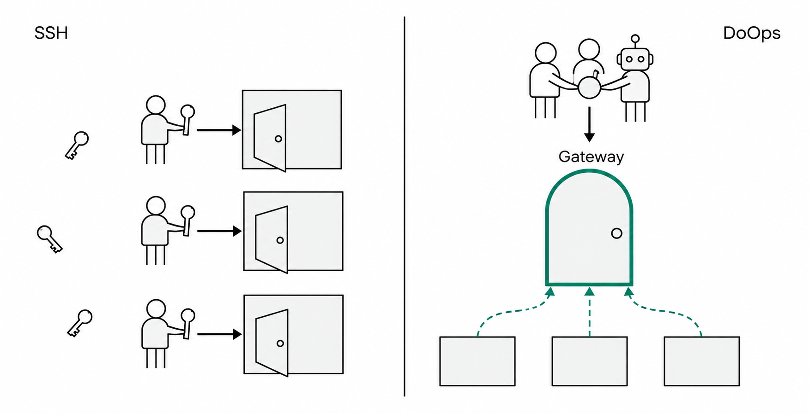
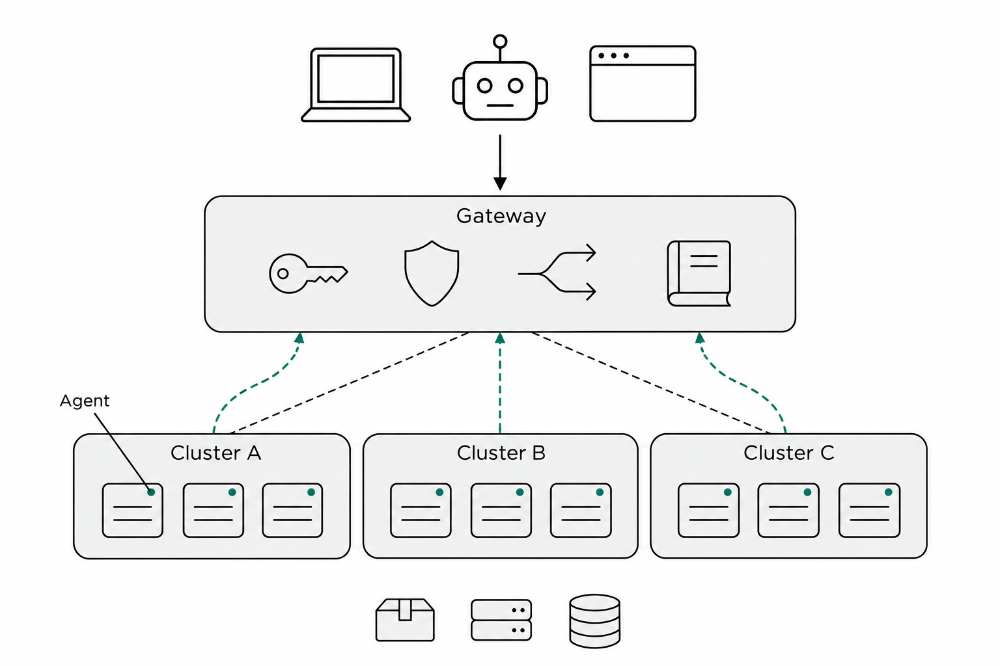
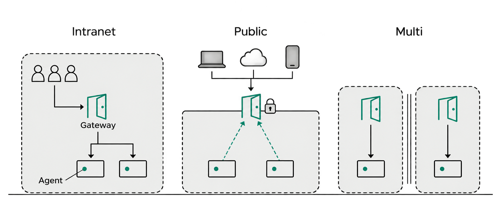
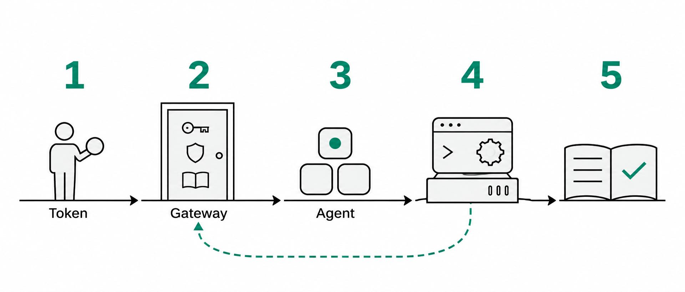
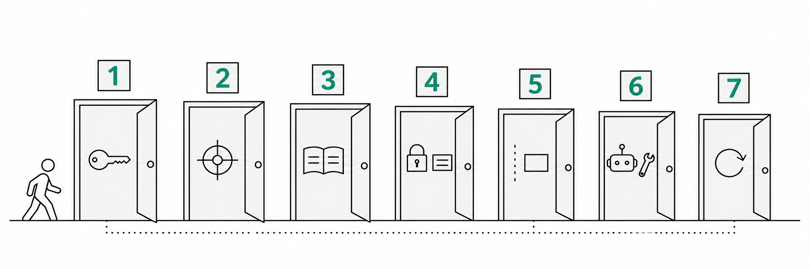
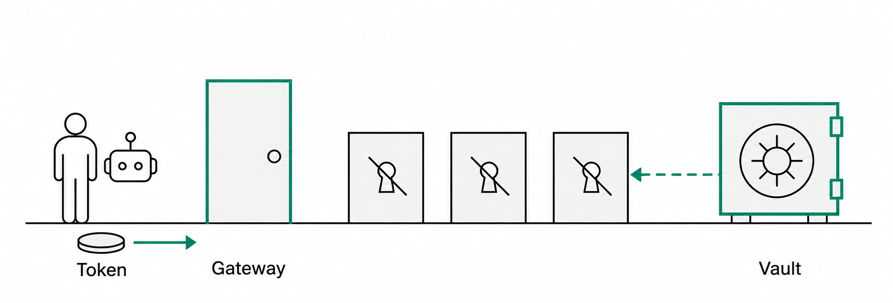
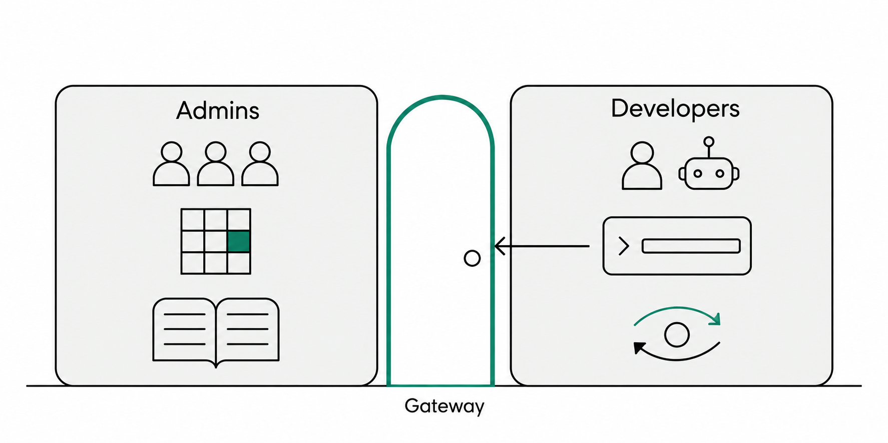
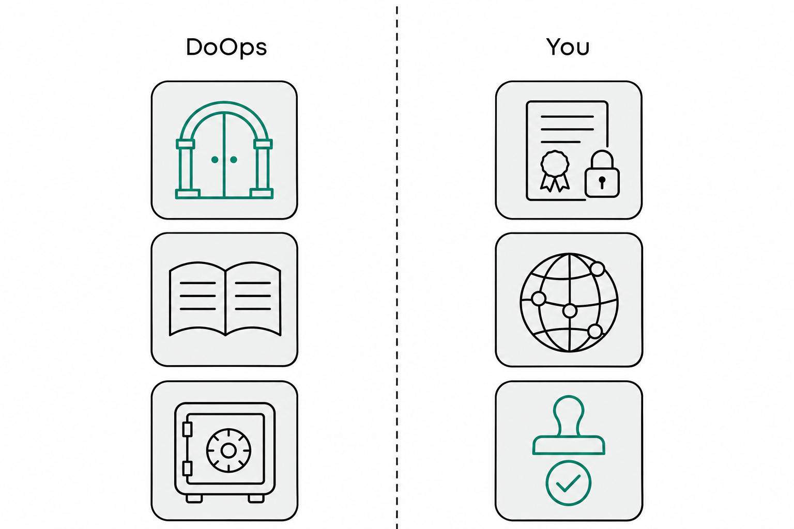

<b>中文</b> | <a href="../en/after-goodbye-ssh-what-is-doops-and-security.md">English</a> | <a href="../ru/after-goodbye-ssh-what-is-doops-and-security.md">Русский</a>

# 再见 SSH 之后：DoOps 是什么，安全靠什么保证

上一篇《再见，SSH。》发出去以后，评论区问得最多的两个问题是：

- “这不就是把 SSH 包了一层？”
- “搞定公网服务端，不就一锅端？”

这篇不急着讲安全。我们用八张图，从“最熟悉的 SSH”走到“DoOps 的架构”，再沿着一台机器的执行路径，一层一层看它凭什么敢把运维入口收拢起来。**每一步只讲一件事。**

---

## 一、先看两条路：为什么“再多一台机器”就变难了

SSH 的方式，是每台机器开一扇门，每个人手里拿一把钥匙：

*图 1 · 左边：每台机器一扇门，人人手里一把钥匙；右边：人 / 程序 / AI 共用一枚 Token 通过同一扇 Gateway 门，机器没有门，只用虚线向外连接*

问题不在 SSH 本身。SSH 是过去二十年最可靠的运维工具。问题在**规模**：

- 门太多：几十台机器就是几十扇门，每扇门的安全配置还不一样；
- 钥匙太散：密钥、密码散落在 Excel、聊天记录、家目录里，换人即失控；
- 没人记账：谁在什么时候做了什么，基本靠 shell 历史和回忆。

DoOps 换的不是“连接方式”，而是**门的数量和位置**：所有人走同一扇门，机器不再开门，而是主动连出来。

---

## 二、总览：一扇门，多个集群，机器主动连出来

*图 2 · 顶部是入口（笔记本 / 机器人 / 浏览器）；中间 Gateway 门里的四枚小图标分别是认证、授权、路由、审计；下方三个集群 Cluster A / B / C，每台机器上有一个 Agent 连接点；Agent 到 Gateway 是出站连接，机器不开放入站端口*

四个角色，各管一段：

| 角色 | 是什么 | 干什么 |
|---|---|---|
| 入口 | 命令行、网页控制台、编辑器里的 AI | 发起操作 |
| 控制面 | 统一网关（位置可变：可放内网，也可放公网） | 认证、授权、路由、排队、审计 |
| 执行端 | 装在被管机器上的 Agent | 在本机执行、回传结果 |
| 目标 | 集群 / 主机 / 容器 | 真正被操作的东西 |

这张图里有两个关键设计，后面的安全都建立在它们上面：

1. **连接方向是反的。** 传统方式是外面的人连进机器；DoOps 是机器上的 Agent 主动连出来。所以被管机器不需要公网 IP、不开放入站端口，NAT 和防火墙后面也能纳管。
2. **身份留在门里。** 人拿到的是一枚令牌，不是每台机器的账号和密钥。人离开、令牌撤销，所有目标上的权限同时消失。

对比一下两种架构：

| | SSH | DoOps |
|---|---|---|
| 门在哪 | 每台机器各有一扇 | 只有一扇统一的门 |
| 钥匙在谁手里 | 每个工程师手里各一把 | 每人一枚令牌，门里核验 |
| 机器开什么端口 | 要能被连进来的 SSH 端口 | 不开放入站端口，主动连出 |
| 谁在记日志 | 各机器自己，格式不一 | 统一入口统一记录 |
| 权限怎么收 | 改密码、删密钥，逐台处理 | 撤一次令牌或授权，立即生效 |

---

## 三、这扇门放在哪里：内网、公网，还是分域多网关

先纠正一个常见误解：**DoOps 不是“必须部署在公网”的产品。** 它没有固定的网络位置——**Gateway 放在哪里，取决于谁需要访问它、你愿意把安全边界画在哪里。** 架构本身不变：Agent 永远主动向外连，认证、授权、审计永远在 Gateway。

| 形态 | Gateway 放在哪 | 谁需要连到它 | 典型场景 |
|---|---|---|---|
| 内网闭环 | 企业内网 | 内网里的用户和 CI，以及内网里的 Agent | 单企业、合规要求高；机器和人本来就在内网 |
| 公网入口 | 公网边缘（TLS 终止） | 远程 / 多地用户、跨网络的 Agent | 分布式团队、边缘节点、外部协作 |
| 分域多网关 | 每个网络域各放一个 | 本域内的用户与 Agent | 多子公司、多集群隔离、生产 / 测试分域 |

关键不在“门放在公网还是内网”，而在**门的朝向决定了谁能到达它**：

- **放内网**：外部要先进你的网络才能找到门，安全边界是网络边界（VPN、零信任、办公网）；
- **放公网**：门直接面向互联网，安全边界就是 TLS、认证、授权、限流和监控；
- **多网关**：每个域自己守门，域与域之间不共享钥匙。

三种形态下，认证、授权、审计完全一致——变的只是“门要防谁”。所以我们的建议是：**先决定谁能访问，再决定 Gateway 放在哪，而不是反过来。** 另外提醒一句：Agent 要能连到 Gateway，所以跨网络时仍然需要网络可达（对等连接、VPN、专线），只是不需要给机器开入站端口。

*图 3 · 三种部署形态：内网闭环（门在墙内）、公网入口（门在墙边、只开加密入口）、分域多网关（每个域各守一扇门）*

---

## 四、一次操作，是怎么走完的

架构图讲的是“静态的谁连着谁”。再看“动态”：你在终端里说一句“在 prod-node 上执行 uptime”，它到底走了哪几步。

*图 4 · 一次请求的五个步骤：1 令牌 → 2 Gateway（认证 / 授权 / 记账）→ 3 路由到 Agent → 4 在本机执行 → 5 结果与审计回写（墨绿虚线）*

1. 请求带着**令牌**到达控制面；
2. 控制面先确认“你是谁”，再确认“你有没有这台目标的授权”，同时**把这次操作记下来**；
3. 任务被路由到那台目标上在线的 **Agent**——注意，是 Agent 主动连出来的常驻连接，不是控制面去连机器；
4. Agent 在本机执行；
5. 结果回到你手上，这条记录被更新为成功、失败或“结果未知”。

这里最容易被忽略的是顺序：**认证、授权、记账都在最前面，执行在最后。**没有记录就不执行；没有授权，连目标列表里都看不到这台机器。

三条链路都走同一扇门，没有旁路：

- 命令、文件、代码同步、发布，是**控制链路**；
- 文件与代码同步按会话分配独立工作区，是**数据链路**；
- AI 自己拆任务、多步执行，是 **AI 链路**。

---

## 五、安全性从哪来：一次操作要过七道门

架构看清了，再谈“为什么安全”就不抽象了。把一次操作拆开，它要依次过七道门——每一道门只回答一个问题。

*图 5 · 七道门，门上数字 1–7：从“你是谁”一路走到“换新版本时怎么保证不出事”，小人正走向第 1 扇门*

**第一道门：你是谁。**
令牌只在签发时显示一次，服务端只存哈希；可以设过期，也可以随时撤销——撤销或禁用，下一条请求就生效；网页端把它放在浏览器读不到的 Cookie 里。

**第二道门：你能去哪。**
每次操作都检查“你有没有这个目标的授权”。没有授权，连目标列表里都看不到这台机器。授权按目标给，一次授权覆盖这台目标的全部操作——这是“粗”的代价，后面讲怎么补。

**第三道门：做过什么。**
先记账，再干活；记不下来就不执行。操作结束无论成败，都更新在同一条记录上；已经结束的记录不会被改写。管理员看全部，普通用户看自己的。

**第四道门：用什么身份干活。**
凭据加密存放，密钥不在数据库里；只有被授权的那台目标、在那次操作里才会拿到，用完即清；凭据不进命令行、不进提示词、不进审计摘要。

**第五道门：在哪干、能到什么程度。**
Agent 不开放入站端口、只做被下发的操作；但它装在被管机器上，**本质上拥有那台机器的管理员权限**。所以必须说明白：**DoOps 不是沙箱**，安全边界是容器、虚拟机或节点本身。

**第六道门：AI 能做什么。**
AI 可以诊断，但变更要额外授权、要留下验证证据；AI 不能自己给自己签变更票。同时提醒：诊断路上的 AI 有执行能力，可能跑出你没预料到的命令。

**第七道门：换新版本时。**
Agent 不能自己替换自己——替换中被打断，验证和回滚就没人做了。所以升级由独立任务完成：先预检、再变更、确认新版本真的起来了，失败自动回滚。

还有一道不在流程图里、但必须由部署方守住的门：**传输**。控制面负责业务逻辑，TLS 由它前面的反向代理负责。如果这扇门要对外或跨域访问，就只暴露加密入口、管理端口绝不直接暴露；如果门放在内网，这条责任换成内网入口收敛和网络边界。

---

## 六、身份与凭据：人走带不走，凭据不落地

七道门里，最容易让人误解的是第四道门。很多人第一反应是“那不就等于把密码都放在控制面了？”

*图 6 · 左边：人和 AI 共用一枚 Token 进同一扇 Gateway 门；中间三台机器上的钥匙孔都被划掉（机器上没有别人的钥匙）；右边：Vault 加密保管凭据，只向被授权的那个目标按需递出（虚线）*

分开看两件事：

**身份**：每个人、每个程序、每个 AI 都只持有一枚令牌。机器上没有张三、李四的钥匙；张三离开，撤一次令牌就结束了。这是“身份与机器解耦”。

**凭据**：数据库密码、镜像仓库账号、K8s 凭据，加密放在控制面；使用时才按需下发到被授权的那台目标，用完即清。它们不进命令行、不进提示词、不进审计摘要。

需要诚实说清楚：控制面持有解密能力，它不是“端到端零知识”的方案。所以控制面本身必须按最高等级的资产来保护——这一点，下一节会讲。

---

## 七、两种角色：企业怎么管，开发者怎么用

DoOps 有两种典型使用者：**管的人**（平台 / 运维负责人、团队 Leader、安全管理员）和**用的人**（开发者、运维工程师，以及替他们干活的 AI）。同一套架构，在两种人手里是两个界面。

*图 7 · 左边是管理面（用户与令牌、授权清单、审计、机群清单），右边是使用面（登录、执行、代码同步、AI 排障）；中间同一扇 Gateway 门*

### 7.1 对企业 / 团队：怎么“管”

管理的目标只有一句话：**把“谁能操作哪台机器”变成可配置、可审计、可撤销的条目，而不是散在人和机器之间的钥匙。**

落地是五件事：

| 管什么 | 怎么做 | 什么时候做 |
|---|---|---|
| 人和令牌 | 一人一令牌、设有效期、离职即撤；CI / 自动化单独发令牌 | 入职离职、每季度复核 |
| 目标与授权 | 按集群 / 实例建目标，生产与测试分开；只授具体目标，不给通配 | 新环境接入、每季度复核 |
| 凭据 | 主密钥单独保管并备份；凭据按目标绑定、按需授权、用完即撤 | 变更时、定期验证 |
| 审计 | 实时外送到日志系统 / SIEM；对失败、结果未知、异常注册建告警 | 常开 |
| 执行端纳管 | 只装到要纳管的节点；网络 ACL；定期核对在线清单；升级走审批与镜像准入 | 接入时、每月 |

再加三件平台侧的事：入口只暴露加密通道、控制面数据库与密钥做备份、监控控制面本身的健康。

多集群场景下，命名规范就是权限边界：生产、测试、边缘、客户环境分清楚，授权按环境边界发。**企业真正要的不是“更细的命令权限”，而是“谁在什么时候、对哪台机器、做了什么”这份账。**

### 7.2 对开发者：怎么“用”

使用的目标也只有一句话：**装一次，之后像用一条命令一样用它。**

1. **准备**：装好命令行工具和项目里的 Skill，登录换令牌，看一眼“我能去哪”——你能看到的列表，就是你的权限范围。
2. **日常四类操作**：执行命令、读写小文件、同步代码、让 AI 排障。四类都走同一套授权和记录。
3. **变更**：会改状态的发布、配置变更，走带验证的变更通道——写清目标、范围和验收条件；AI 给方案，执行后给验证证据。
4. **出事**：先看会话和记录，再决定重试、回滚还是找人。“结果不确定”的时候不要盲目重来。

一个真实的排障流程：凌晨告警 → 让 AI 先查 → 需要动手时执行一条命令 → 过程和结果都进记录 → 交接时把会话和记录一起交出去，而不是口头说一句“我改过了”。

给开发者的三条规矩：

- 只碰授权给你的目标，先在测试环境验证再上生产；
- 不要把密钥写进命令行——交给凭据托管，命令行和记录都会留痕；
- 变更走带验证的通道；拿不准就先问，再动手。

### 7.3 两种角色怎么配合

管理面负责“门、钥匙、账”，使用面负责“进门做事”。两者之间的契约只有一句：

> **每一次操作，都对应一个身份、一个目标、一条记录。**

这就是 DoOps 相对“给每个人发 SSH 密钥”最根本的变化：权限从“散落的钥匙”变成“可管理的条目”，行为从“各机器各自的日志”变成“统一入口的一本账”。

---

## 八、边界与分工：DoOps 负责什么，你必须补什么

没有哪个工具能替你完成安全。真实的分工是这样：

*图 8 · 中缝虚线分开两边：左边 DoOps 负责的部分（闸门、账本、金库、执行收口），右边部署方必须补的部分（证书与锁、网络与边界、审批）*

| 事项 | DoOps 负责 | 你必须补 |
|---|---|---|
| 入口加密 | 业务逻辑 | 按部署形态定：内网部署收敛内网入口；对外部署才需要公网 TLS 入口与来源控制；管理端口始终不裸露 |
| 身份 | 令牌签发、过期、撤销 | 一人一令牌、短时效、离职即撤、CI 单独发 |
| 授权 | 按目标校验 | 生产/测试分目标、不给通配、定期复核 |
| 审计 | 记录、查询权限、写不进就不执行 | 实时外送到日志系统、对失败和异常建告警 |
| 凭据 | 加密存放、按需下发 | 主密钥备份与保管、按需授权、定期验证 |
| 执行端 | 出站连接、执行收口 | 只装在要纳管的节点、网络 ACL、异常注册监控 |
| 升级 | 预检、校验、回滚 | 镜像签名、仓库准入、发布审批 |
| AI | 工具范围、变更授权 | 模型密钥管理、生产先只开放诊断 |

**架构层面的三个已知边界：**

1. **控制面是单点。**它被拿下，等于所有被纳管目标被拿下——所以它必须部署在受控网络里，只暴露加密入口。
2. **执行端接入依赖网络边界。**执行端接入时只声明“我是哪台目标”，没有额外凭证；所以控制面的网络位置、ACL、异常注册监控，就是这条通道的安全边界。（对外提供 Web 服务的那条通道是另一条链路，有精确到目标的注册令牌。）
3. **审计还不是防篡改账本。**它存在控制面数据库里，有权限的人可以删除；正确用法是实时外送。

一句话：**DoOps 把“操作”收进一扇门，但这扇门的门锁、监控和钥匙管理，仍然需要你来配。**

---

## 九、评论区的问题，一次答完

**“搞定公网服务端，不就一锅端？”**
集中控制面确实是最高价值单点，这个担心成立。但要先看门放在哪：放在内网，风险边界是你内网的边界；放在公网，才需要额外扛住互联网的暴露面（TLS、限流、来源控制、监控）。无论哪种，控制面的数据库、密钥、审计都要按核心资产管理，并且审计要外送。它不是“不会被攻破”，而是“被攻破时能第一时间知道、能追溯”。

**“不就是堡垒机吗？”**
相同点是都做了“收口”。不同点是：堡垒机管人的会话，DoOps 管任务和调用——人和 AI 用同一套接口，命令、文件、代码同步、发布都是结构化操作，能跨多套集群编排，也能被脚本和流水线直接调用。

**“AI 帮你 SSH 而已。”**
AI 不持有 SSH 凭据，它调用受控操作；变更类操作有额外授权和验证。但这句话有一半是对的：AI 确实能执行命令。所以关键不是“有没有 AI”，而是“AI 做的每件事能不能查到、能不能拦住”。

**“第一次你怎么登进去部署这玩意？”**
Kubernetes、Docker，或者一次性 SSH。这是“最后一次用 SSH”，不是“从不用 SSH”。

**“除了小白，基本不会用。”**
两类用户：运维和平台工程师痛点是多集群、多应用的重复操作；用 AI 写代码的开发者痛点是“最后一公里部署”。不懂 SSH 的人本来也会共享密码、用管理员账号直连——至少在这里，他们有授权和记录。

**“agent 一旦暴露，一锅端。”**
要分清楚：Agent 被攻破，影响的是它所在的那台机器；真正“一锅端”的是控制面。而 Agent 接入依赖网络边界，所以控制面要放在你能控制访问来源的网络里（内网，或带 TLS/ACL 的公网入口），并监控异常注册。

**“frp + SSH 更好。”**
只要一条临时隧道，frp 确实更简单。DoOps 的价值在团队和规模化：身份、授权、审计、任务编排、流水线适配，这些是隧道工具没有的。

**“没有沙箱。”**
对。要沙箱，就用容器、虚拟机或独立节点；DoOps 管的是“谁能操作、操作了什么”。

---

## 十、结尾：安全不是有没有沙箱，而是三个问题

我们更愿意把安全定义为三个问题：

**边界在哪？谁能进来？做过的事查不查得到？**

DoOps 的架构把这三个问题变成结构性的回答：边界在目标，入口只有一扇门，做过的事都有记录。它不是没有风险，而是风险可见、可控、可撤销。

“再见 SSH”真正的意思是：**把运维入口从“人人手里一把钥匙”，变成“一扇有人看守、有记录可查的门”。**

如果你在评论区还有疑问，欢迎继续拍砖；涉及安全问题，请按项目仓库的安全说明私下联系维护者，不要在公开渠道贴真实地址和凭据。
