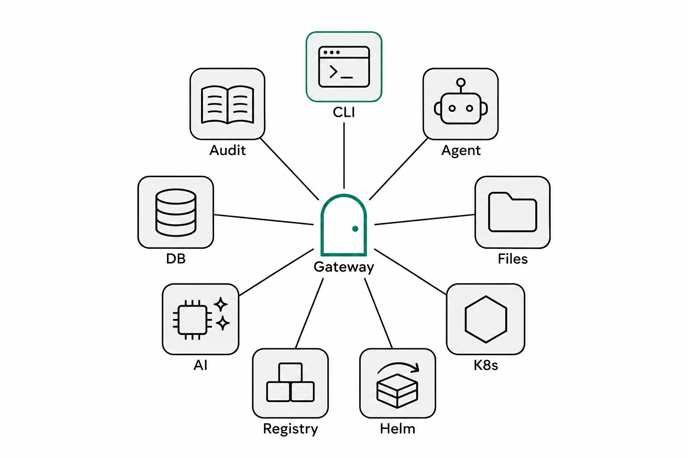
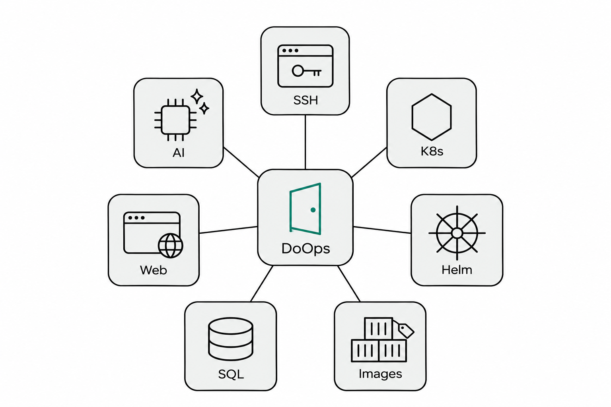
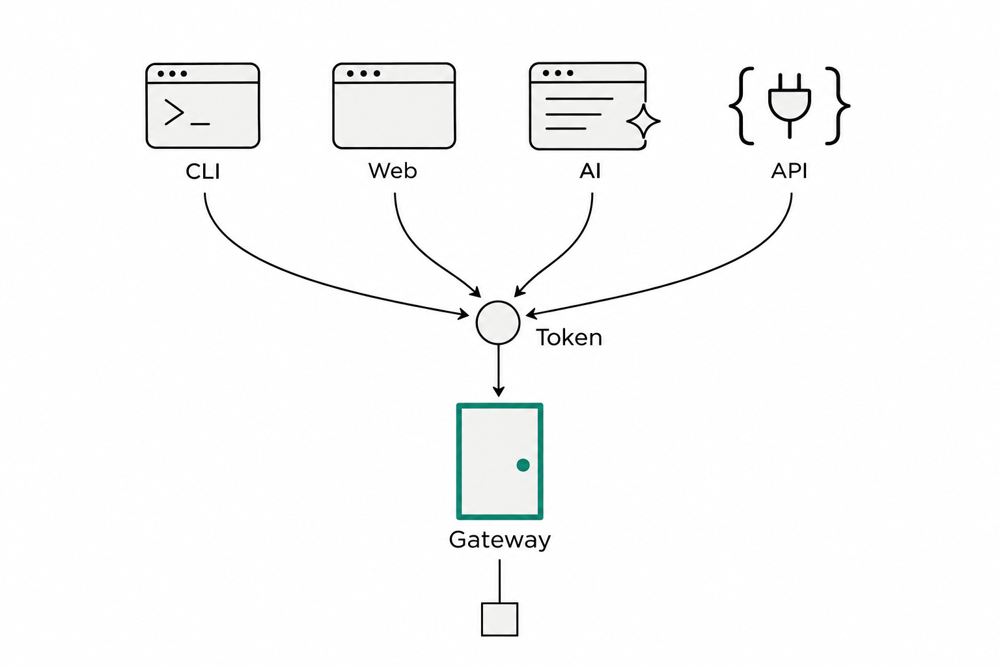
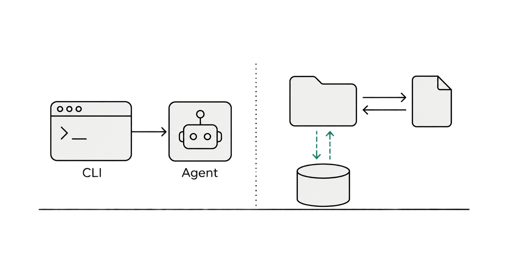
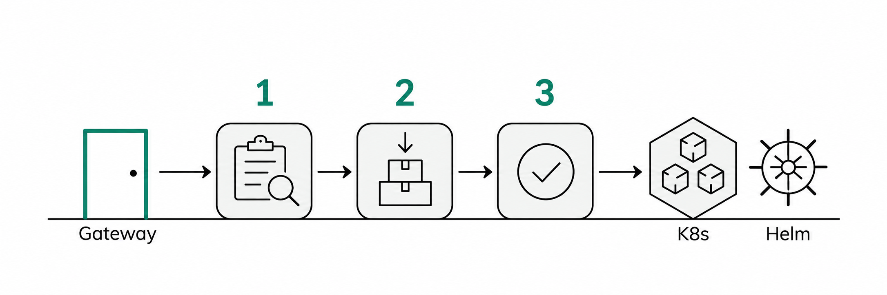
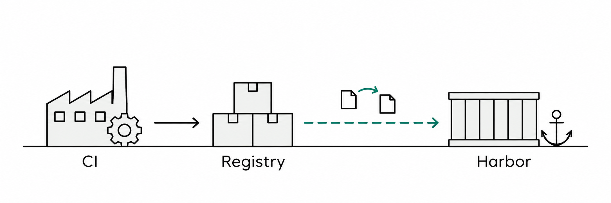
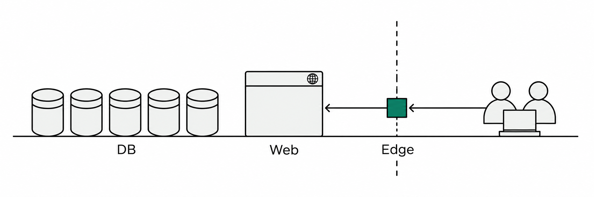
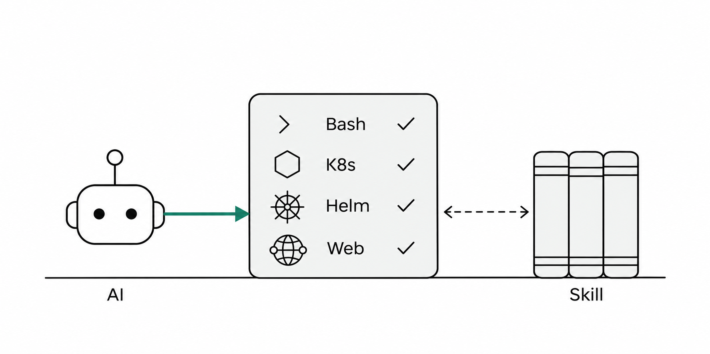
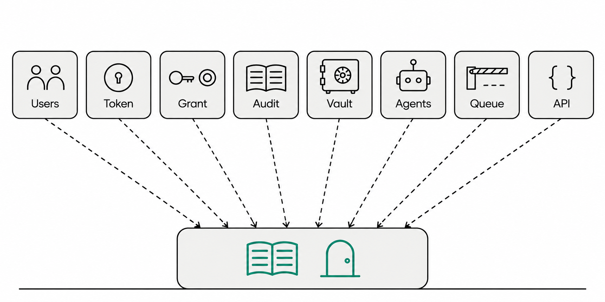

<b>中文</b> | <a href="../en/doops-core-features.md">English</a> | <a href="../ru/doops-core-features.md">Русский</a>

# DoOps 能做什么：业务功能与管理功能全景

上一篇讲的是架构与安全。这一篇换使用者视角，回答两个不同的问题：

- **业务同事问**：它到底能帮我做完哪些事？
- **平台/管理同事问**：这些能力在多团队、多集群下怎么管住？

所以下面分两部分盘点：**7 个业务能力域**（能做什么），以及 **5 组支撑管理能力**（怎么管住）。两者共用同一套身份、授权和审计——这也是 DoOps 和“一堆脚本 + 一堆权限”的本质区别。

*图 1 · 整体能力地图：上半部分是业务能力，下半部分是支撑这些业务能力的管理底座*

---

## 第一部分 · 业务功能：拿它能做完哪些事

*图 2 · 七个业务能力域：通道与接入、远程运维与文件、Kubernetes 与应用交付、镜像与制品、数据库、网站与对外服务、AI 运维*

| 业务域 | 具体能力 | 典型场景 | 主要面向 |
|---|---|---|---|
| 通道与接入 | 统一 Gateway、Agent 反向连接、四种入口 | 内网排障、远程协作、CI 调用 | 所有人 |
| 远程运维与文件 | 命令、后台任务、结构化 SSH、文件与代码同步、宿主机访问 | 看日志、重启服务、传产物、上物理机 | 运维 / 开发 |
| K8s 与交付 | 观察、受控变更、Helm 发布与回滚、自然语言发布、Agent 升级 | 查 Pod、发版本、回滚、升级 Agent | 运维 / 发布者 |
| 镜像与制品 | 构建、复制、仓库同步、Harbor 收敛 | 出镜像、推仓库、多集群分发 | 发布者 / CI |
| 数据库 | DoSql 五引擎、查询/计划/变更/复制 | 查数、改表、跨库搬数据 | DBA / 后端 |
| 网站与对外服务 | DoWeb 站点发布、Edge 反向代理 | 发站点、对外暴露内网服务 | 运维 |
| AI 运维 | ask 诊断、apply 变更、Skill 体系 | 排故障、做变更、固化 SOP | 开发 / 运维 |

### 一、通道与接入：先把“够得着”解决掉

*图 3 · 终端、浏览器、编辑器里的 AI、API 四种入口，走同一扇 Gateway 门*

DoOps 首先解决的是“够得着”：

- **Agent 反向连接**：目标机器上的 Agent 主动连到 Gateway，机器不需要公网 IP、不需要开放入站端口，NAT、防火墙后面也能纳管；
- **统一入口**：终端 CLI、Web 控制台、编辑器里的 AI（Skill）、HTTP/WebSocket API 四种方式，共用一次登录；
- **目标路由**：用 cluster/instance 定位目标，多套集群挂在同一扇门后；
- **对外暴露**：需要把内网的 HTTP 服务（含 WebIDE、noVNC 这类长连接）开放出去时，走 Edge 反向代理（精确到目标的注册令牌 + TLS passthrough），而不是在防火墙上打洞。

### 二、远程运维与文件：把 SSH 的活接过来

*图 4 · 命令下发到 Agent 执行；工作区与代码/产物双向同步；大文件走存储*

- **命令执行**：前台一条命令直达目标；长命令可以后台跑，随时查状态、拉日志、取消；
- **结构化 SSH**：需要从 A 机器跳 B 机器时，用参数化的 SSH 代理，多层引号不会被远端 shell 重解析；
- **节点信息**：CPU、内存、磁盘、工具链（构建/镜像/运行时）一眼可见；
- **文件与代码**：小文本直接读写（有明确大小上限）；代码和产物用 push/pull 同步，存储走 Gateway 或 Git 隧道，尊重 .gitignore；
- **宿主机与物理机**：K8s Agent 可以进入所在节点做宿主检查；物理机可以单独接入，或经已有 VM 跳过去；首次接入仍用 DaemonSet、Docker 或一次性 SSH 自举。

一个细节：超时、断连、被信号终止这类情况会被标记为**“结果未知”**，而不是“成功”——提醒你先确认现场再决定是否重试。

### 三、Kubernetes 与应用交付：先看，再动，最后验证

*图 5 · 观察 → preflight → apply → verify 三段式交付*

**看**：Pod、Deployment、Service、事件、日志、top、rollout 状态、Helm 的 list/history/status/values（只回 key 路径）、ConfigMap 键名。

**动**：重启、扩缩、cordon/uncordon、删 Pod 这些写操作必须显式确认，并走 target 级变更租约；**Secret 和 ServiceAccount 连读都不开放**。

**交付**：Helm 发布拆成 preflight（dry-run 先渲染校验）→ apply（真正执行）→ verify（读回 revision 与实时对象逐项比对，配合 expected_image 识别“命令成功但镜像没变”）。也可以直接用自然语言发布：任务里写清目标、范围、镜像来源、原因和可机器校验的验收条件，完成后给出验证证据。

此外还有两件配套：`check` 比对线上镜像与构建一致性；Agent 自升级走独立 Job（备份 → 升级 → 校验 → 失败回滚），不让 Agent 在运行中替换自己。

### 四、镜像与制品：从 CI 到目标集群

*图 6 · 镜像的权威来源是 CI；目标侧只做复制与同步，Harbor 按 pull 方式收敛*

- **构建**：在目标 Agent 上用 BuildKit 出 OCI 镜像，支持多平台、输出本地或直接推送；
- **复制**：仓库之间按 digest 复制，避免“看起来一样、实际不同”；
- **仓库同步**：批量同步，源与目标都做 digest 校验；
- **Harbor 收敛**：CI → 本集群 Harbor 的 pull 模式，有定时任务与校验脚本，不做集群间互拷。

边界：镜像是 CI 的产物，目标机上的构建/复制只是执行面，不能替代 CI——否则“线上跑的是哪个 commit”就说不清。

### 五、数据库与网站：两个专业运维入口

*图 7 · DoSql 管数据，DoWeb 管站点，Edge 负责把内网服务安全暴露出去*

**数据库（DoSql）**：支持 PostgreSQL、MySQL、Oracle、SQL Server、MongoDB，另有外置驱动扩展其他引擎；查询、变更计划、执行、资产发现四种模式；支持 dry-run 与结果校验；跨库复制由 Agent 直读直写、不经过模型；每一步有哈希链版本日志，事后可证明“到底执行了哪些语句”。

**网站（DoWeb）**：用 SiteSpec 描述站点，Nginx 配置生成、校验、reload、健康检查、回滚、证据一条链；只读操作与变更操作分离，事实缺失时只阻塞、不猜测。

**对外服务（Edge）**：把内网 Web 服务（含 WebIDE/noVNC 这类长连接）通过 Agent 反向代理 + Gateway 动态域名映射暴露出去；注册令牌精确到 target，支持 TLS passthrough。

### 六、AI 运维：工具白名单里的“智能体”

*图 8 · AI 拿到的不是一台 shell，而是一份工具白名单；Skill 决定它在这个目标能做什么*

- **诊断模式（ask）**：可以读文件、查状态、跑命令，帮你想清楚问题；
- **变更模式（apply）**：只给结构化变更工具（Helm 或网站发布二选一），需要变更授权，产出验证证据；
- **不会发生的组合**：诊断拿不到变更工具，变更拿不到自由 Bash，数据库/未知 Skill 不继承变更能力；
- **成功判定**：由变更授权、attestation 和终态证据共同判定，模型口头说“已完成”不算数；
- **Skill**：Agent 内置 shell、K8s、镜像构建、数据库、网站、蒸馏等 6 个 Skill，团队也可以写自己的 SKILL.md 固化 SOP。

---

## 第二部分 · 支撑管理：让这些能力可被管理

*图 9 · 五组支撑管理能力：身份与授权、审计与凭据、节点与 Agent、任务与可靠性、控制台与规模化*

| 管理域 | 具体能力 | 解决什么问题 |
|---|---|---|
| 身份与授权 | 用户、登录、token、target grant、管理员 | 谁能进、能去哪 |
| 审计与凭据 | 操作记录、查询、凭据生命周期与物化 | 做过什么、密钥怎么管 |
| 节点与 Agent | 纳管、在线/归档、升级、注册令牌、能力闸门 | 机器怎么进、怎么更新 |
| 任务与可靠性 | 会话工作区、并发、队列、admission、结果未知 | 大规模并发下不出乱子 |
| 控制台与规模化 | Web 管理页、API、Skill 扩展、多形态部署 | 团队怎么协作、系统怎么延展 |

### 七、身份与授权：谁能进、能去哪

- **身份**：用户创建/禁用/改密；登录换 token（默认 24 小时，可指定有效期）；token 只显示一次、只存哈希、可按 id 撤销；禁用用户或撤销 token 下一条请求就生效；
- **入口侧**：CLI 存本地凭据；Web 控制台用 HttpOnly Cookie，不落 localStorage；
- **授权**：一条 grant 精确到 cluster/instance，覆盖该目标和它绑定的凭据；平台管理员是用户上的一个标记；
- **取舍要说明**：授权只有 target 粒度，没有“只准看日志”的动作级细分——所以生产上要用 target 划分（生产/测试分集群）、短 TTL 和审计来补。

### 八、审计与凭据：做过什么、密钥怎么管

- **审计**：先记账再执行，写不进账就不执行；失败、拒绝、结果未知都落库；终态不可改写；管理员看全局，普通用户看自己的；审计不可用即拒绝服务；
- **凭据**：create → stage → grant → verify → promote 的完整生命周期；版本化；按 target 绑定；按需物化到被授权目标（用完即清）；支持 Bundle（凭据组）和开发阶段的 metadata-only 预检；payload 只走 stdin/私有通道，静态加密，缺密钥即拒绝。

### 九、节点与 Agent：机器怎么进、怎么更新

- **纳管**：K8s DaemonSet、Docker、一次性 SSH 自举；在线/离线/历史/归档视图；离线超过 24 小时的实例记录自动清理但保留授权；
- **注册令牌**：Edge 通道按精确 target 发放，明文只返回一次；
- **能力闸门**：`capabilities` 检查目标 Agent 的协议能力，旧 Agent 直接失败而不是静默降级（ssh 与 upgrade 都会强制检查）；
- **升级**：独立 Job 执行，预检 → 变更 → 校验（Pod Ready、镜像 digest、版本号、Gateway 重连）→ 失败自动回滚；
- **一致性**：`check` 比对线上镜像与构建产物；`info` 查看节点工具链是否齐全。

### 十、任务、并发与可靠性

- **会话工作区**：每次任务独立目录 /root/ws/<session>，互不踩踏，可清理；
- **并发语义**：同 target 同 session 可并发；Agent 自升级独占 target；workspace 写入、精确资源等按动作与资源键加锁；
- **队列与准入**：每个 target 默认排队 10 个、等 10 分钟；准入前的拒绝是稳定错误码，不算“结果未知”，大批量发布时不会因为重试造成双写；
- **结果未知纪律**：缺可信终态时保留“未知”（-32008），不宣称成功、不自动重放；历史未知不阻断新任务，但真实资源锁仍生效；
- **可观测**：`targets --admission` 零模型成本读取实时名额/持有者/队列，排查“发布卡住”的第一步。

### 十一、控制台、开放接口与规模化部署

- **Web 控制台**：概览、AI 助手、数据库、网站、Kubernetes、镜像、文件、知识库、凭据、审计、终端等 11 个标签页，另有部署、CI/CD、管理三个视图；管理页覆盖用户、token、grant、实例与审计；
- **更新内容**：控制台读取仓库 CHANGELOG，升级后弹窗提示变更；
- **开放接口**：JSON-RPC over WebSocket、Git HTTP、REST 管理接口；公开 JSON-RPC 工具 12 个，其余为内部控制面工具；
- **扩展**：Skill 二次开发（项目里写 SKILL.md）；安装链路校验 release/commit/sha256 并下发 CLI 与 Skill/docs；
- **部署形态**：内网闭环、公网入口、分域多网关三种（详见上一篇）；控制面是单点，数据库与主密钥要备份，入口按形态配置 TLS/ACL。

---

## 结语：业务能力决定“能不能干成”，管理能力决定“能不能管住”

回到开头两个问题：

- **业务上能做什么？** 通道、远程运维、K8s 与交付、镜像、数据库、网站、AI——七类能力覆盖了日常运维和发布的主链路；
- **管理上怎么管？** 身份、授权、审计、凭据、节点、任务、控制台——五组能力保证这些操作有人负责、有据可查、可回收。

七类业务能力和五组管理能力**共用同一套身份、授权、审计**。这就是为什么它既能当“运维工具”用，也能当一个团队的基础设施来管。

如果你只想先试一个功能，建议从两件事开始：用一次 `exec` 做只读排障，用一次 `ask` 看 AI 怎么调工具；然后去管理页看看刚才那两次操作在审计里长什么样。
