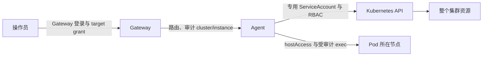

# 目标与边界

延续已授权的 `gw-zyj-test` 集群权限整改，把身份与 RBAC 纳入可回读、可回滚的 Helm 配置。
工作树为 `claude/agent-k8s-identity`；主工作区中的其他改动不属于本任务。
不变更 Gateway 用户、token、grant，不变更 `gw-zyj`、业务工作负载或其他集群的权限。
凭据保留在用户私有配置目录，证据和 Git 不含凭据 payload。

# 现场基线

- CLI 与 test Agent 均为 `f5cebcdabb37ca6459271cc8487c6c00ac7dcbbe`。
- target 为 `doops-zyj/zyj-test`；release 为 `agents-test/doops-agent-test` revision 8。
- Pod 为 `doops-agent-test-7cb959dcd-kmf7v`，Ready，重启次数 0。
- 身份为 `system:serviceaccount:agents-test:doops-agent-test`，`kubeconfig.source=serviceAccount`。
- 原先失败的四项 `auth can-i` 及 `* * --all-namespaces` 现均为 yes。
- `agents-test-doops-agent-test-cluster-admin` 已存在并指向该 SA，但仅贴了 Helm ownership
  和 `keep` 注解。revision 8 manifest 只有 Deployment；SA 也没有 Helm ownership。
  因此当前权限已生效，但尚未真正成为 release 管理的资源，升级/卸载无法完整管理其生命周期。

# 实施与验收计划

1. 保存当前 Helm revision、values、manifest、SA、绑定和运行状态；检查备份权限及摘要。
2. Chart 增加显式 `rbac.create`，默认关闭；启用时只允许 dedicated ServiceAccount 模式，
   创建 SA 与 cluster-admin 绑定。不用 `keep` 保留孤立权限。文档说明 Gateway target
   与 Kubernetes 身份、宿主机访问的不同职责；为 test 保留无密钥部署 values。
   检查：Helm 实际渲染、非法组合拒绝、现有 mounted/外管 SA 模式没有隐式提权。
3. 通过独立于 test Agent 身份的审计控制通道收编资源并进行 Helm 收敛，先 server dry-run，
   后 mutation；失败恢复 revision 和收编前资源，不能靠 test 自己已被撤销的权限恢复。
   检查：release manifest 真正包含三类资源、身份不变、四项权限和真实跨 namespace 读取、
   API server dry-run 创建、Pod Ready、Gateway 回连、镜像 digest 与 commit。
4. 自查与独立审查、相关本地检查、CNB CI、制品及远端提交可见性；记录证据与回滚入口。

# 推进约束

最多 12 次实现/验证迭代，90 分钟；连续 3 次同一阻塞且无新证据则停止 mutation 并交接。
任一权限对象指向意外主体、release owner 冲突、revision 漂移或 RPC 终态不明时停止，先回读。
禁止削弱测试、重放终态不明的 mutation、删除其他 agent 的权限或输出凭据。

# 标准关系

Gateway target 是用户的操作入口；SA 与 RBAC 决定 Agent 的 Kubernetes 能力，namespace
只是运行位置。节点入口独立配置。本实例按已授权目标使用 `cluster-admin`，包括全 namespace
Secret 管理能力。标准不把权限不足自动变成提权，也不在认证失败后切换另一套凭据。

# 已完成结果

- 发布代码：`2d720b7fd54b9ae77b9114cbcf2261bc0aca3f25`，PR #86 已合入 CNB `main`，
  合并提交 `16c6fb3fc675c19b9bdc7110285da562dd2ce8ad`。
- 制品：`v1.3.121`；固定镜像
  `docker.cnb.cool/l8ai/ai/doops.sh@sha256:e926271555dfad6eacc454ae31fab6c1bb4e9de52173bd68ceadc364480919dd`。
  registry revision/version 标签、CLI 内嵌 commit、Pod imageID 与 Gateway release_commit 均已核对。
- 本机通过正式 `install.sh` 安装同版 CLI/Skill/docs，默认和 lwy 的 config/auth/credentials
  哈希未变化；lwy 的 Gateway sync 为 `2 live, 0 new local routes`。
- Chart `0.3.0` 管理 SA/CRB，默认 `rbac.create=false`，本实例显式开启。
  Helm revision 9 首次纳管，10 为标准自升级验收，11 为回滚到 9 后生成的当前 revision。
- 当前 Pod `doops-agent-test-69f5cf99cc-687pr`，UID
  `8d07137e-a42b-4fa6-a94e-bf0b3c161ca0`，Ready，重启 0；SA UID
  `9514ddfe-8a8a-47ce-97b1-1d7387dc1ec6`，CRB UID
  `c3957a8d-d03b-437d-83de-4c85b57359a2`，均保留。
- revision 11 manifest 实际包含 Deployment、ServiceAccount、ClusterRoleBinding；SA/CRB
  owner 属于本 release，旧 `keep` 已移除。完整无密钥 values 已固定实际运行镜像。

# 证据

| 场景 | 结果 |
|---|---|
| 实际 `auth whoami` | `system:serviceaccount:agents-test:doops-agent-test` |
| 四项原拒绝权限及 `* * --all-namespaces` | 全部 yes |
| 跨 namespace 真实读取 Pod | 成功，覆盖多个 namespace |
| 创建 Namespace / default Deployment | API server dry-run 成功，未持久化业务资源 |
| Gateway 回连、structuredSSH、live/ready | 全部通过 |
| 新 CLI 安装 | 正式 Release Asset + checksum 校验通过，Skill commit 与 CLI 一致 |
| 旧 Chart 移除托管身份 | `rbac_controller_identity_changed`，mutation 前拒绝；revision 保持 9，Pod/SA UID 未变 |
| 标准 `doops upgrade` | 成功，revision 10；身份与绑定保留 |
| 标准 `doops upgrade --rollback` | 成功回到 9 的配置并生成 revision 11；身份与绑定保留 |
| 合成凭据完整生命周期 | create/put(stdin)/grant/verify/promote、未验证激活拒绝、target 隔离、跨 Pod 替换持久性均通过 |
| 合成凭据清理 | 已 revoke，物化 Secret 删除；输出无 payload |

本地 Agent/CLI/Gateway package tests、完整脚本回归、Helm 实际渲染/lint、diff 检查通过。
发布和 PR CI 均成功：发布构建 `cnb-b7r-1k6qtit3g`，PR 构建 `cnb-63q-1k6qtg2ta`。
发布 CI 包含 329 项 Python 契约、完整 Go 验证、Web build、镜像与 CLI 制品发布及回读；
PR CI 另含 Linux Git race 验收和 Web acceptance。独立代码/控制器审查的问题已修复。

# 备份与恢复

- 用户私有 `~/.agent/doops-lwy/backups/zyj-test-rbac-20261107/`，目录 0700、文件 0600。
  `before.json` SHA256 为 `c815c9aae313d0570af1c18afb16a7441ac783741e53cd927040222563abe311`。
  `after.json`、`release-state.json`、正反向升级日志、合成凭据回执、发布回执均在同目录；
  2026-11-06 原备份保留。以上均不包含凭据 payload。
- 集群快照 `agents-test/doops-rbac-backup-20261107`；独立控制器 Job
  `doops-rbac-reconcile-20261107` 已成功退出，Gateway 验收 gate 已通过。Job TTL 1 小时，
  备份 ConfigMap 保留用于审计及外部恢复。
- 首次纳管由实际 `kubernetes-admin` X509 身份执行，先 server dry-run，后 Helm 收敛；
  验证失败或 180 秒未收到 Gateway 验收时恢复 revision 8 的配置与原 SA/CRB 元数据。
  控制器硬上限 1800 秒，为失败恢复保留预算；RPC 未知不自动重放。
- 托管身份范围内的普通回滚已实测。跨到未托管身份的 revision（8 及以前），必须由
  `gw-zyj` 的独立管理身份恢复备份，不能让 test SA 删除自己的身份再继续恢复。
  详细步骤见 [BUILD_DEPLOY_SOP.md](../../backend/docs/BUILD_DEPLOY_SOP.md#agent-rbac-纳管与回滚)。
